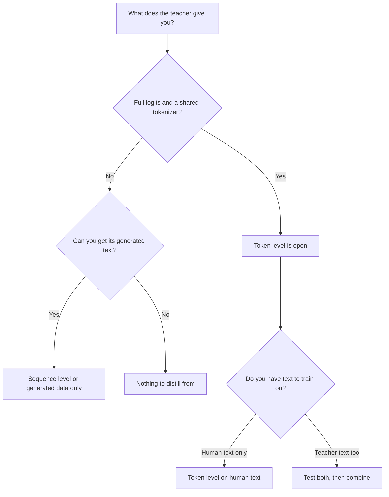

# Leçon 9. Token ou séquence

**Lien avec la mission :** La mission vous demande de dire ce que chaque niveau de distillation transmet que l'autre ne transmet pas, et d'en choisir un d'après ce que l'enseignant expose, ce qui est le choix auquel vous faites face la première fois qu'un enseignant se trouve derrière une API.
**Source primaire :** [Article : "Sequence-Level Knowledge Distillation", Kim et Rush, 2016](https://arxiv.org/abs/1606.07947)
**Prérequis :** [Leçon 8](0008-sequence-level-distillation.md), [Leçon 6](0006-the-tokenizer-constraint.md), [Distillation de logits](../GLOSSARY.md), [Distillation off-policy](../GLOSSARY.md), [Soft targets](../GLOSSARY.md)

## Échauffement

1. ▢ Dans la recette de Kim et Rush, quelle est la loss d'entraînement de l'élève, et qu'apporte l'enseignant ?

Vérifier

De l'entropie croisée ordinaire sur des phrases entières. L'enseignant n'apporte que le texte qu'il a décodé avec le beam search, jamais ses probabilités.

2. ▢ Nommez la raison pour laquelle les probabilités des mauvaises réponses d'un enseignant enseignent plus qu'un [hard label](../GLOSSARY.md).

Vérifier

Les probabilités sur les mauvaises réponses disent comment l'enseignant les classe : quelles mauvaises réponses sont des quasi-réussites et lesquelles sont très loin. Un hard label met toute la probabilité sur une réponse, si bien que ce classement est perdu (leçon 2).

3. ▢ Deux modèles utilisent des tokenizers différents. Quel niveau de distillation cela exclut-il, et lequel laisse-t-il ouvert ?

Vérifier

Cela exclut la [distillation de logits](../GLOSSARY.md) simple, qui compare les distributions index par index et exige un vocabulaire partagé. Cela laisse ouverte la distillation au niveau de la séquence, parce que le texte décodé peut être retokenisé par le propre tokenizer de l'élève.

## À savoir

### Ce que porte chaque niveau

Les deux niveaux entraînent un élève sur le comportement de l'enseignant. Ils diffèrent par la partie de ce comportement qui atteint l'élève.

| | Niveau du token | Niveau de la séquence |
|---|---|---|
| Ce que l'élève lit | La distribution complète de l'enseignant à chaque position | Une séquence décodée par entrée |
| Ce qu'il porte | Comment l'enseignant classe les alternatives à chaque étape | Le choix d'ensemble de l'enseignant, y compris sa manière d'enchaîner les étapes |
| Ce qu'il abandonne | Rien à cette position, mais seulement sur les préfixes qu'on lui fournit | Les probabilités de chaque alternative que l'enseignant n'a pas choisie |
| Ce que l'enseignant doit exposer | Des logits et un vocabulaire partagé | Du texte |
| Loss d'entraînement | Une divergence par position | Entropie croisée simple |

La première ligne du tableau est le cœur de l'affaire. La distillation au niveau du token donne une cible riche à chaque position et laisse ouverte la question de savoir sur quelles séquences l'évaluer. La distillation au niveau de la séquence remet la séquence elle-même, et l'élève apprend à la produire, une cible dure par position. Kim et Rush décrivent la séparation en ces termes : la distillation au niveau du mot transfère la connaissance au niveau local et la distillation au niveau de la séquence au niveau global, et ils disent que les deux sont complémentaires (section 5).

### Les combiner

On peut faire les deux à la fois. Décoder avec l'enseignant pour obtenir des séquences, puis entraîner l'élève sur ces séquences avec l'entropie croisée par rapport au texte plus un terme au niveau du token par rapport à la distribution de l'enseignant à chaque position de ce texte. L'article appelle cela Seq-KD + Word-KD (section 4, la note 9 décrit la loss de mélange).

Tous les nombres sont ceux de Kim et Rush, du tableau 1, en BLEU avec décodage glouton et faisceau de 5 (K=1 / K=5) :

| Élève | Référence | Seq-KD | Seq-KD + Word-KD |
|---|---|---|---|
| Anglais vers allemand, 2×500 | 14.7 / 17.6 | 18.9 / 19.0 | 18.7 / 18.9 |
| Anglais vers allemand, 2×300 | 14.1 / 16.9 | 18.1 / 18.1 | 17.9 / 18.8 |
| Thaï vers anglais, 2×100 | 10.6 / 12.7 | 12.8 / 13.4 | 13.7 / 14.2 |

La combinaison a aidé les élèves 2×300 et 2×100 et n'a pas aidé le 2×500 (section 5). Traitez donc le terme au niveau du token comme quelque chose à tester avec l'élève que vous avez, pas comme un ajout gratuit. Il coûte aussi plus que ne le suggère le tableau : outre le texte décodé, il vous faut la distribution de l'enseignant à chaque position, ce que la leçon 7 a chiffré.

### Choisir d'après ce que l'enseignant expose

La première question n'est pas « lequel est meilleur » mais « qu'ai-je ». Elle détermine quels niveaux vous sont ouverts.

Lecture du diagramme :

- **Des logits et un tokenizer partagé :** les deux niveaux sont ouverts, et le choix devient une expérience. Le niveau du token sur du texte humain n'exige aucun décodage de l'enseignant. Le texte décodé par l'enseignant ajoute de l'information au niveau de la séquence. Les combiner est ce que Kim et Rush ont testé.
- **Des logits mais un tokenizer différent :** la loss habituelle au niveau du token est fermée (leçon 6), donc le texte décodé est la voie directe. Des méthodes inter-tokenizers existent et abandonnent quelque chose.
- **Du texte seulement, comme quand l'enseignant se trouve derrière une API qui renvoie des complétions :** le niveau de la séquence est la voie, et tout ce que contiennent les leçons 10 à 13 aussi. Le signal de distillation est le texte que vous pouvez obtenir, donc le choix des entrées et le filtrage comptent davantage.
- **Un modèle dont vous ne pouvez pas obtenir les sorties en volume :** il n'y a rien à distiller.

Le rapport de DeepSeek sur R1 est un exemple de choix du texte même avec les poids en main. Pour les petits modèles, ils ont fait un fine-tuning sur environ 800,000 échantillons générés par R1 et n'ont appliqué que du fine-tuning supervisé, sans étape d'apprentissage par renforcement, et ont noté qu'en ajouter une pourrait aider davantage (rapport R1, section sur la distillation et annexe B.4.3). Savoir si le niveau du token aurait fait mieux n'est pas testé dans ce rapport, ce n'est donc pas un résultat.

### Ce que les deux partagent

L'entraînement sur un ensemble fixe de sorties de l'enseignant est de la [distillation off-policy](../GLOSSARY.md) : l'élève apprend sur des séquences qu'il n'a pas générées. Les deux niveaux, tels qu'enseignés jusqu'ici, partagent cette propriété. L'étape 5 revient sur ce que cela coûte.

## Pratique

1. ▢ Votre enseignant est un modèle hébergé qui renvoie des complétions et rien d'autre. Quels niveaux de distillation pouvez-vous exécuter ?

    - a) Le niveau du token seul, avec le texte qu'il renvoie
    - b) Les deux niveaux, une fois tout le texte collecté
    - c) Le niveau de la séquence seul, avec le texte qu'il renvoie
    - d) Aucun des deux, puisque les logits sont toujours strictement requis

Vérifier

**c)** Le texte est tout ce dont a besoin la distillation au niveau de la séquence. (a) et (b) supposent que vous pouvez lire la distribution de l'enseignant à chaque position, ce qu'un enseignant à texte seul ne vous donne pas. (d) confond la distillation avec la distillation de logits, qui n'en est qu'une famille.

2. ▢ Un enseignant ouvert et un élève ouvert partagent un tokenizer, et vous pouvez exécuter les deux. Vous avez décodé la sortie de l'enseignant pour vos prompts. D'après le seul tableau 1, qu'attendez-vous de l'ajout d'un terme au niveau du token, et avec quelle certitude ?

Indice

Comparez les trois lignes d'élèves, pas seulement la meilleure.

Vérifier

Mitigé. Il a aidé deux des trois élèves (2×300 et 2×100) et n'a pas aidé le troisième (2×500), donc l'attente honnête est « essayez-le, et ne le supposez pas ». On est seulement sûr que c'est un article sur la traduction avec des LSTM, il dit donc de tester, pas ce que fera un LLM.

3. ▢ Quelle affirmation sur ce que chaque niveau abandonne est correcte ?

    - a) Le niveau du token abandonne chaque position après la première
    - b) Le niveau de la séquence abandonne le choix final fait par l'enseignant
    - c) Le niveau du token abandonne la forme de la distribution de l'enseignant
    - d) Le niveau de la séquence abandonne les probabilités des alternatives de l'enseignant

Vérifier

**d)** Une séquence décodée ne porte que ce que l'enseignant a choisi, donc les alternatives et leurs probabilités ont disparu. (a) est faux : le niveau du token lit chaque position qu'on lui donne. (b) inverse la chose : le choix de l'enseignant est exactement ce que garde le niveau de la séquence. (c) l'inverse aussi, puisque la forme de la distribution est ce que lit le niveau du token.

4. ▢ Votre collègue dit que la distillation au niveau du token est strictement meilleure parce qu'elle utilise plus d'information par exemple. Donnez une raison pour laquelle cela ne suit pas.

Vérifier

Trois raisons, une seule suffit. Elle n'est pas disponible sans logits et sans vocabulaire partagé. L'information supplémentaire porte sur les positions que vous évaluez, elle ne dit donc rien des séquences que l'enseignant aurait produites de lui-même. Et dans le tableau 1, la combinaison n'a pas battu le niveau de la séquence seul sur l'élève 2×500. Plus d'information par exemple n'est pas la même chose qu'un meilleur élève.

5. ▢ Une équipe a un enseignant à poids ouverts avec son propre tokenizer et un élève avec un autre, et un budget pour décoder un million de prompts. Quelle voie recommandez-vous d'abord, et que leur dites-vous de mesurer avant de dépenser pour quoi que ce soit de plus élaboré ?

Vérifier

Le niveau de la séquence d'abord : décoder les prompts avec l'enseignant et entraîner l'élève sur le texte, parce que l'élève peut tokeniser ce texte lui-même et qu'aucun vocabulaire partagé n'est nécessaire. Mesurer l'élève par rapport à l'enseignant et à une référence sur des prompts held-out, pour que l'étape suivante (méthodes inter-tokenizers, ou collecte de plus de données) soit choisie sur des preuves. C'est une recommandation tirée des contraintes de la leçon 6 et de cette leçon, pas un résultat d'un article.

## Exercices en situation réelle

- [ ] Choisissez un modèle que vous utilisez derrière une API. Lisez sa documentation et listez exactement ce qu'un appel peut renvoyer. Marquez quels niveaux de distillation cette sortie permettrait.
- [ ] Choisissez deux modèles ouverts. Vérifiez s'ils partagent un tokenizer, et notez quel niveau vous pourriez exécuter entre eux.
- [ ] Demain : sans notes, redessinez de mémoire le diagramme de décision ci-dessus et ajoutez un vrai modèle à chaque feuille.

## Pour aller plus loin

- [Séquences et données synthétiques](../reference/sequence-and-synthetic-data.md)
- [Article : "Sequence-Level Knowledge Distillation", Kim et Rush, 2016](https://arxiv.org/abs/1606.07947)
- [Article : "DeepSeek-R1: Incentivizing Reasoning Capability in LLMs via Reinforcement Learning", DeepSeek-AI, 2025](https://arxiv.org/abs/2501.12948)
- [Ressources](../RESOURCES.md)

---

Ça ne passe pas ? Relisez la source primaire en haut de page, car cette leçon la condense et c'est dans la condensation que la compréhension s'échappe. Consultez le [glossaire](../GLOSSARY.md) pour tout terme qui vous a paru glissant.

Si c'est la leçon elle-même qui n'est pas claire plutôt que la matière, c'est un défaut : [ouvrez une issue](https://github.com/TokenCemetery/teach/issues).
