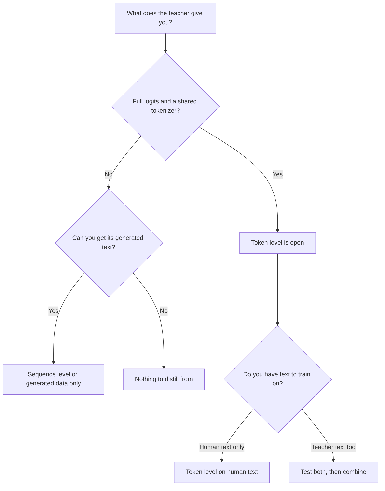

# पाठ 9. Token या Sequence

**मिशन से संबंध:** मिशन आपसे माँगता है कि आप बता सकें कि distillation का हर level ऐसा क्या transfer करता है जो दूसरा नहीं करता, और teacher जो कुछ उपलब्ध कराता है उससे एक चुनें, जो वह चुनाव है जिसका सामना आप तब करते हैं जब पहली बार teacher किसी API के पीछे हो।
**मुख्य स्रोत:** [पेपर: "Sequence-Level Knowledge Distillation", Kim and Rush, 2016](https://arxiv.org/abs/1606.07947)
**पूर्व-आवश्यकताएँ:** [पाठ 8](0008-sequence-level-distillation.md), [पाठ 6](0006-the-tokenizer-constraint.md), [Logit distillation](../GLOSSARY.md), [Off-policy distillation](../GLOSSARY.md), [Soft targets](../GLOSSARY.md)

## वार्म-अप

1. ▢ Kim और Rush की विधि में, student का training loss क्या है, और teacher क्या देता है?

जाँचें

पूरे वाक्यों पर साधारण cross-entropy। Teacher सिर्फ़ वह text देता है जो उसने beam search से decode किया, कभी अपनी probabilities नहीं।

2. ▢ वह कारण बताएँ कि teacher की ग़लत-उत्तर वाली probabilities [hard label](../GLOSSARY.md) से ज़्यादा क्यों सिखाती हैं।

जाँचें

ग़लत उत्तरों पर probabilities बताती हैं कि teacher उन्हें कैसे क्रम में रखता है: कौन-से ग़लत उत्तर क़रीब चूके हैं और कौन-से बहुत दूर। Hard label सारी probability एक उत्तर पर रख देता है, इसलिए वह क्रम खो जाता है (पाठ 2)।

3. ▢ दो models अलग tokenizers इस्तेमाल करते हैं। यह distillation का कौन-सा level नामुमकिन करता है, और कौन-सा खुला छोड़ता है?

जाँचें

यह सादा [logit distillation](../GLOSSARY.md) नामुमकिन करता है, जो distributions की index-दर-index तुलना करता है और साझा vocabulary माँगता है। यह sequence-level distillation को खुला छोड़ता है, क्योंकि decode किए text को student अपने tokenizer से दोबारा tokenize कर सकता है।

## यह जानें

### हर level क्या ढोता है

दोनों levels student को teacher के व्यवहार पर train करते हैं। फ़र्क़ इसमें है कि उस व्यवहार का कौन-सा हिस्सा student तक पहुँचता है।

| | Token level | Sequence level |
|---|---|---|
| Student क्या पढ़ता है | हर position पर teacher का पूरा distribution | हर input के लिए एक decode किया हुआ sequence |
| वह क्या ढोता है | Teacher हर चरण पर विकल्पों को कैसे क्रम में रखता है | Teacher का समग्र चुनाव, जिसमें वह चरणों को आपस में कैसे जोड़ता है भी शामिल है |
| वह क्या छोड़ता है | उस position पर कुछ नहीं, पर सिर्फ़ उन prefixes पर जो आप उसे खिलाएँ | हर उस विकल्प की probabilities जिसे teacher ने नहीं चुना |
| Teacher को क्या उपलब्ध कराना होगा | Logits और साझा vocabulary | Text |
| Training loss | हर position पर एक divergence | सादा cross-entropy |

तालिका की पहली पंक्ति इसका सार है। Token-level distillation हर position पर समृद्ध target देता है और यह सवाल खुला छोड़ देता है कि उसे किन sequences पर परखा जाए। Sequence-level distillation sequence ख़ुद सौंप देता है, और student उसे बनाना सीखता है, हर position पर एक hard target के साथ। Kim और Rush इस बँटवारे को इन शब्दों में बताते हैं: word-level distillation ज्ञान को स्थानीय स्तर पर transfer करता है और sequence-level distillation वैश्विक स्तर पर, और वे कहते हैं कि दोनों एक-दूसरे के पूरक हैं (section 5)।

### दोनों को जोड़ना

आप दोनों एक साथ कर सकते हैं। Teacher से decode करके sequences पाएँ, फिर student को उन sequences पर text के विरुद्ध cross-entropy के साथ-साथ उस text के हर position पर teacher के distribution के विरुद्ध एक token-level term के साथ train करें। पेपर इसे Seq-KD + Word-KD कहता है (section 4, footnote 9 मिश्रण loss बताता है)।

सारी संख्याएँ Kim और Rush की हैं, Table 1 से, greedy decoding और beam 5 के साथ BLEU में (K=1 / K=5):

| Student | Baseline | Seq-KD | Seq-KD + Word-KD |
|---|---|---|---|
| अंग्रेज़ी से जर्मन, 2×500 | 14.7 / 17.6 | 18.9 / 19.0 | 18.7 / 18.9 |
| अंग्रेज़ी से जर्मन, 2×300 | 14.1 / 16.9 | 18.1 / 18.1 | 17.9 / 18.8 |
| थाई से अंग्रेज़ी, 2×100 | 10.6 / 12.7 | 12.8 / 13.4 | 13.7 / 14.2 |

मेल ने 2×300 और 2×100 students की मदद की और 2×500 की नहीं की (section 5)। इसलिए token-level term को ऐसी चीज़ मानें जिसे आपके पास मौजूद student के साथ परखना है, कोई मुफ़्त जोड़ नहीं। यह तालिका के संकेत से ज़्यादा महँगा भी है: decode किए text के अलावा आपको हर position पर teacher का distribution चाहिए, जिसकी क़ीमत पाठ 7 ने आँकी।

### teacher जो उपलब्ध कराता है उससे चुनना

पहला सवाल "कौन-सा बेहतर है" नहीं, "मेरे पास क्या है" है। वही तय करता है कि कौन-से levels आपके लिए खुले हैं।

आरेख को पढ़ना:

- **Logits और साझा tokenizer:** दोनों levels खुले हैं, और चुनाव एक प्रयोग बन जाता है। मानव text पर token level को teacher decoding नहीं चाहिए। Teacher-decoded text sequence-level जानकारी जोड़ता है। दोनों को जोड़ना वही है जो Kim और Rush ने परखा।
- **Logits पर अलग tokenizer:** सामान्य token-level loss बंद है (पाठ 6), इसलिए decode किया text सीधा रास्ता है। Cross-tokenizer तरीक़े मौजूद हैं और कुछ छोड़ते हैं।
- **सिर्फ़ text, जैसे जब teacher किसी ऐसी API के पीछे हो जो completions लौटाती है:** sequence level रास्ता है, और पाठ 10 से 13 की हर चीज़ भी। Distillation signal वह text है जो आप पा सकते हैं, इसलिए inputs का चुनाव और filtering ज़्यादा मायने रखते हैं।
- **ऐसा model जिसके outputs आप बड़ी मात्रा में नहीं पा सकते:** distil करने के लिए कुछ नहीं है।

DeepSeek की R1 report weights हाथ में होते हुए भी text चुनने का उदाहरण है। छोटे models के लिए उन्होंने R1 द्वारा generate किए लगभग 800,000 samples पर fine-tune किया और सिर्फ़ supervised fine-tuning लगाई, कोई reinforcement-learning चरण नहीं, और ध्यान दिलाया कि एक जोड़ना और मदद कर सकता है (R1 report, distillation section और appendix B.4.3)। वहाँ token level बेहतर करता या नहीं, इसे उस report में परखा नहीं गया, इसलिए यह कोई नतीजा नहीं है।

### दोनों में क्या साझा है

Teacher outputs के तय सेट पर training [off-policy distillation](../GLOSSARY.md) है: student उन sequences पर सीखता है जो उसने generate नहीं किए। अब तक जैसे सिखाए गए, दोनों levels यह गुण साझा करते हैं। चरण 5 इस पर लौटता है कि उसकी क्या क़ीमत है।

## अभ्यास

1. ▢ आपका teacher एक hosted model है जो completions लौटाता है और कुछ नहीं। आप distillation के कौन-से levels चला सकते हैं?

    - a) सिर्फ़ token level, उसके लौटाए text से
    - b) दोनों levels, जब सारा text इकट्ठा हो जाए
    - c) सिर्फ़ sequence level, उसके लौटाए text से
    - d) कोई level नहीं, क्योंकि logits हमेशा सख़्ती से ज़रूरी हैं

जाँचें

**c)** Sequence-level distillation को बस text चाहिए। (a) और (b) मानते हैं कि आप हर position पर teacher का distribution पढ़ सकते हैं, जो text-only teacher नहीं देता। (d) distillation को logit distillation से गड़बड़ा देता है, जो एक परिवार है।

2. ▢ एक open teacher और एक open student tokenizer साझा करते हैं, और आप दोनों चला सकते हैं। आपने अपने prompts के लिए teacher का output decode कर लिया है। सिर्फ़ Table 1 से, token-level term जोड़ने से आप क्या उम्मीद करते हैं, और कितने आश्वस्त हैं?

संकेत

तीनों student पंक्तियों की तुलना करें, सिर्फ़ सबसे अच्छी की नहीं।

जाँचें

मिला-जुला। उसने तीन में से दो students (2×300 और 2×100) की मदद की और तीसरे (2×500) की नहीं, इसलिए ईमानदार उम्मीद है "आज़माएँ, मानकर न चलें"। बस इतने ही आश्वस्त हैं कि यह LSTMs के साथ translation पर एक पेपर है, इसलिए यह परखने को कहता है, यह नहीं कि LLM क्या करेगा।

3. ▢ हर level क्या छोड़ता है, इस बारे में कौन-सा कथन सही है?

    - a) Token level पहले position के बाद हर position छोड़ देता है
    - b) Sequence level वह अंतिम चुनाव छोड़ देता है जो teacher ने किया
    - c) Token level teacher के distribution का आकार छोड़ देता है
    - d) Sequence level teacher के विकल्पों की probabilities छोड़ देता है

जाँचें

**d)** Decode किया sequence सिर्फ़ वही ढोता है जो teacher ने चुना, इसलिए विकल्प और उनकी probabilities चली जाती हैं। (a) ग़लत है: token level हर उस position को पढ़ता है जो उसे दिया जाए। (b) उसे उलट देता है: teacher का चुनाव ठीक वही है जो sequence level रखता है। (c) भी उलट देता है, क्योंकि distribution का आकार वही है जो token level पढ़ता है।

4. ▢ आपका सहकर्मी कहता है कि token-level distillation सख़्ती से बेहतर है क्योंकि वह हर example पर ज़्यादा जानकारी इस्तेमाल करता है। एक कारण दें कि यह निष्कर्ष क्यों नहीं निकलता।

जाँचें

तीन कारण, कोई एक काफ़ी है। वह logits और साझा vocabulary के बिना उपलब्ध नहीं। अतिरिक्त जानकारी उन positions के बारे में है जिन्हें आप परखते हैं, इसलिए वह उन sequences के बारे में कुछ नहीं कहती जो teacher ख़ुद बनाता। और Table 1 में 2×500 student पर मेल ने अकेले sequence-level को नहीं हराया। हर example पर ज़्यादा जानकारी का मतलब बेहतर student नहीं होता।

5. ▢ एक टीम के पास अपने tokenizer वाला open-weights teacher और अलग tokenizer वाला student है, और दस लाख prompts decode करने का बजट है। आप पहले कौन-सा रास्ता सुझाते हैं, और किसी भी ज़्यादा जटिल चीज़ पर ख़र्च करने से पहले आप उन्हें क्या मापने को कहते हैं?

जाँचें

पहले sequence level: prompts को teacher से decode करें और student को text पर train करें, क्योंकि student उस text को ख़ुद tokenize कर सकता है और साझा vocabulary की ज़रूरत नहीं। Held-out prompts पर student को teacher और baseline के विरुद्ध मापें, ताकि अगला क़दम (cross-tokenizer तरीक़े, या ज़्यादा data जुटाना) सबूत के आधार पर चुना जाए। यह पाठ 6 और इस पाठ की बाध्यताओं से निकली सिफ़ारिश है, किसी पेपर का नतीजा नहीं।

## असली दुनिया का अभ्यास

- [ ] कोई model चुनें जो आप इस्तेमाल करते हैं और API के पीछे है। उसका दस्तावेज़ पढ़ें और ठीक-ठीक सूची बनाएँ कि एक call क्या लौटा सकती है। चिह्नित करें कि वह output distillation के कौन-से levels की अनुमति देगा।
- [ ] दो open models चुनें। जाँचें कि वे tokenizer साझा करते हैं या नहीं, और लिखें कि उनके बीच आप कौन-सा level चला सकते थे।
- [ ] कल: बिना नोट्स के ऊपर का निर्णय आरेख याद से बनाएँ और हर पत्ते (leaf) पर एक असली model जोड़ें।

## आगे बढ़ने के लिए

- [Sequence और Synthetic Data शीट](../reference/sequence-and-synthetic-data.md)
- [पेपर: "Sequence-Level Knowledge Distillation", Kim and Rush, 2016](https://arxiv.org/abs/1606.07947)
- [पेपर: "DeepSeek-R1: Incentivizing Reasoning Capability in LLMs via Reinforcement Learning", DeepSeek-AI, 2025](https://arxiv.org/abs/2501.12948)
- [संसाधन](../RESOURCES.md)

---

बात नहीं बन रही? ऊपर दिए मुख्य स्रोत को दोबारा पढ़ें, क्योंकि यह पाठ उसे संक्षिप्त करता है और समझ संक्षेप में ही रिसती है। जो शब्द फिसलन भरा लगे, उसके लिए [शब्दावली](../GLOSSARY.md) देखें।

अगर दिक़्क़त सामग्री की नहीं बल्कि पाठ की ही है, तो वह एक खोट है: [issue खोलें](https://github.com/TokenCemetery/teach/issues)।
