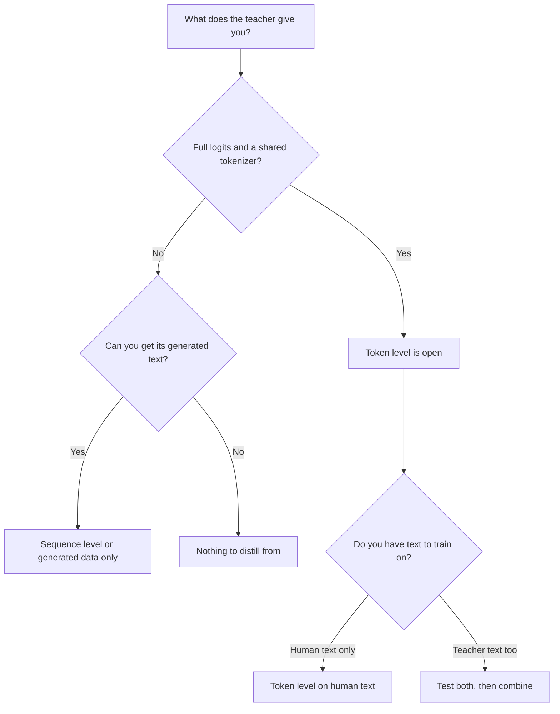

# Lesson 9. Token or Sequence

**Mission link:** The mission asks you to say what each level of distillation transfers that the other does not, and to pick one from what the teacher exposes, which is the choice you face the first time a teacher sits behind an API.
**Primary source:** [Paper: "Sequence-Level Knowledge Distillation", Kim and Rush, 2016](https://arxiv.org/abs/1606.07947)
**Prerequisites:** [Lesson 8](0008-sequence-level-distillation.md), [Lesson 6](0006-the-tokenizer-constraint.md), [Logit distillation](../GLOSSARY.md), [Off-policy distillation](../GLOSSARY.md), [Soft targets](../GLOSSARY.md)

## Warm-up

1. ▢ In Kim and Rush's recipe, what is the student's training loss, and what does the teacher contribute?

Check

Ordinary cross-entropy on whole sentences. The teacher contributes only the text it decoded with beam search, never its probabilities.

2. ▢ Name the reason a teacher's wrong-answer probabilities teach more than a [hard label](../GLOSSARY.md).

Check

The probabilities on wrong answers say how the teacher ranks them: which wrong answers are near misses and which are far off. A hard label puts all the probability on one answer, so that ranking is lost (lesson 2).

3. ▢ Two models use different tokenizers. Which level of distillation does that rule out, and which does it leave open?

Check

It rules out plain [logit distillation](../GLOSSARY.md), which compares distributions index by index and needs a shared vocabulary. It leaves sequence-level distillation open, because decoded text can be tokenized again by the student's own tokenizer.

## Know this

### What each level carries

Both levels train a student on the teacher's behaviour. They differ in which part of that behaviour reaches the student.

| | Token level | Sequence level |
|---|---|---|
| What the student reads | The teacher's whole distribution at each position | One decoded sequence per input |
| What it carries | How the teacher ranks the alternatives at every step | The teacher's overall choice, including how it chains steps together |
| What it drops | Nothing at that position, but only on the prefixes you feed it | The probabilities of every alternative the teacher did not pick |
| What the teacher must expose | Logits and a shared vocabulary | Text |
| Training loss | A divergence per position | Plain cross-entropy |

The first row of the table is the heart of it. Token-level distillation gives a rich target at each position and leaves the question of which sequences to evaluate it on. Sequence-level distillation hands over the sequence itself, and the student learns to produce it, one hard target per position. Kim and Rush describe the split in these terms: word-level distillation transfers knowledge at the local level and sequence-level distillation at the global level, and they say the two are complementary (section 5).

### Combining them

You can do both at once. Decode with the teacher to get sequences, then train the student on those sequences with the cross-entropy against the text plus a token-level term against the teacher's distribution at each position of that text. The paper calls this Seq-KD + Word-KD (section 4, footnote 9 describes the mixture loss).

All numbers are Kim and Rush's, from Table 1, in BLEU with greedy decoding and beam 5 (K=1 / K=5):

| Student | Baseline | Seq-KD | Seq-KD + Word-KD |
|---|---|---|---|
| English to German, 2×500 | 14.7 / 17.6 | 18.9 / 19.0 | 18.7 / 18.9 |
| English to German, 2×300 | 14.1 / 16.9 | 18.1 / 18.1 | 17.9 / 18.8 |
| Thai to English, 2×100 | 10.6 / 12.7 | 12.8 / 13.4 | 13.7 / 14.2 |

The combination helped the 2×300 and 2×100 students and did not help the 2×500 one (section 5). So treat the token-level term as something to test with the student you have, not a free addition. It also costs more than the table suggests: besides the decoded text, you need the teacher's distribution at every position, which lesson 7 priced.

### Choosing from what the teacher exposes

The first question is not "which is better" but "what do I have". It sets which levels are open to you.

Reading the diagram:

- **Logits and a shared tokenizer:** both levels are open, and the choice becomes an experiment. Token level on human text needs no teacher decoding. Teacher-decoded text adds sequence-level information. Combining them is what Kim and Rush tested.
- **Logits but a different tokenizer:** the usual token-level loss is closed (lesson 6), so decoded text is the straightforward route. Cross-tokenizer methods exist and give something up.
- **Text only, as when the teacher sits behind an API that returns completions:** sequence level is the route, and so is everything in lessons 10 to 13. The distillation signal is the text you can obtain, so the choice of inputs and the filtering matter more.
- **A model whose outputs you cannot obtain at volume:** there is nothing to distill from.

DeepSeek's R1 report is an example of choosing text even with weights in hand. For the small models they fine-tuned on about 800,000 samples generated by R1 and applied only supervised fine-tuning, with no reinforcement-learning stage, and noted that adding one could help further (R1 report, distillation section and appendix B.4.3). Whether token level would have done better there is not tested in that report, so it is not a result.

### What both share

Training on a fixed set of teacher outputs is [off-policy distillation](../GLOSSARY.md): the student learns on sequences it did not generate. Both levels, as taught so far, share that property. Stage 5 returns to what that costs.

## Practice

1. ▢ Your teacher is a hosted model that returns completions and nothing else. Which levels of distillation can you run?

    - a) Token level only, using the text it returns
    - b) Both levels, once all the text is collected
    - c) Sequence level only, using the text it returns
    - d) Neither level, since logits are always strictly required

Check

**c)** Text is all sequence-level distillation needs. (a) and (b) assume you can read the teacher's distribution at each position, which a text-only teacher does not give you. (d) confuses distillation with logit distillation, which is one family.

2. ▢ An open teacher and an open student share a tokenizer, and you can run both. You have decoded the teacher's output for your prompts. Using Table 1 only, what do you expect from adding a token-level term, and how sure are you?

Hint

Compare the three student rows, not just the best one.

Check

Mixed. It helped two of the three students (2×300 and 2×100) and did not help the third (2×500), so the honest expectation is "try it, and do not assume it". Sure only that this is one paper on translation with LSTMs, so it says to test, not what an LLM will do.

3. ▢ Which statement about what each level drops is correct?

    - a) Token level drops each position after the first one
    - b) Sequence level drops the final choice the teacher made
    - c) Token level drops the shape of the teacher's distribution
    - d) Sequence level drops the probabilities of the teacher's alternatives

Check

**d)** A decoded sequence carries only what the teacher chose, so the alternatives and their probabilities are gone. (a) is false: token level reads every position it is given. (b) reverses it: the teacher's choice is exactly what sequence level keeps. (c) reverses it as well, since the shape of the distribution is what token level reads.

4. ▢ Your colleague says token-level distillation is strictly better because it uses more information per example. Give one reason that does not follow.

Check

Three reasons, any one is enough. It is not available without logits and a shared vocabulary. The extra information is about the positions you evaluate, so it says nothing about sequences the teacher would have produced on its own. And in Table 1 the combination did not beat sequence-level alone on the 2×500 student. More information per example is not the same as a better student.

5. ▢ A team has an open-weights teacher with its own tokenizer and a student with a different one, and a budget to decode a million prompts. Which route do you recommend first, and what do you tell them to measure before spending on anything more elaborate?

Check

Sequence level first: decode the prompts with the teacher and train the student on the text, because the student can tokenize that text itself and no shared vocabulary is needed. Measure the student against the teacher and against a baseline on held-out prompts, so the next step (cross-tokenizer methods, or collecting more data) is chosen on evidence. This is a recommendation from the constraints in lesson 6 and this lesson, not a result from a paper.

## Real-world reps

- [ ] Pick a model you use that is behind an API. Read its documentation and list exactly what a call can return. Mark which levels of distillation that output would allow.
- [ ] Pick two open models. Check whether they share a tokenizer, and write down which level you could run between them.
- [ ] Tomorrow: without notes, draw the decision diagram above from memory and add one real model at each leaf.

## Going further

- [Sequence and Synthetic Data](../reference/sequence-and-synthetic-data.md)
- [Paper: "Sequence-Level Knowledge Distillation", Kim and Rush, 2016](https://arxiv.org/abs/1606.07947)
- [Paper: "DeepSeek-R1: Incentivizing Reasoning Capability in LLMs via Reinforcement Learning", DeepSeek-AI, 2025](https://arxiv.org/abs/2501.12948)
- [Resources](../RESOURCES.md)

---

Not landing? Reread the primary source at the top, since this lesson compresses it and compression is where understanding leaks. Check the [glossary](../GLOSSARY.md) for any term that felt slippery.

If the lesson itself is unclear rather than the material, that is a defect: [open an issue](https://github.com/TokenCemetery/teach/issues).
