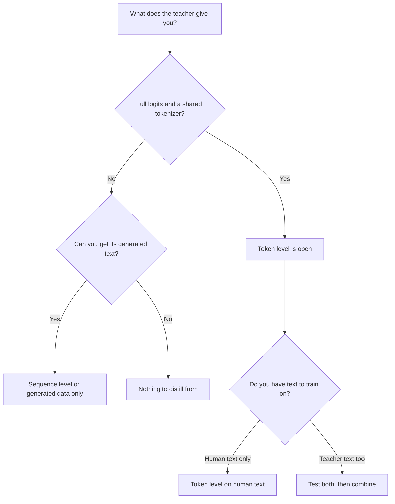

# Lição 9. Token ou sequência

**Ligação com a missão:** A missão pede que você diga o que cada nível de destilação transfere que o outro não transfere, e que escolha um a partir do que o professor expõe, que é a escolha que você enfrenta na primeira vez em que um professor fica atrás de uma API.
**Fonte principal:** [Artigo científico: "Sequence-Level Knowledge Distillation", Kim e Rush, 2016](https://arxiv.org/abs/1606.07947)
**Pré-requisitos:** [Lição 8](0008-sequence-level-distillation.md), [Lição 6](0006-the-tokenizer-constraint.md), [Destilação de logits](../GLOSSARY.md), [Destilação off-policy](../GLOSSARY.md), [Soft targets](../GLOSSARY.md)

## Aquecimento

1. ▢ Na receita de Kim e Rush, qual é a loss de treinamento do aluno, e o que o professor contribui?

Verificação

Cross-entropy comum em frases inteiras. O professor contribui apenas com o texto que decodificou com beam search, nunca com as suas probabilidades.

2. ▢ Diga a razão pela qual as probabilidades de respostas erradas de um professor ensinam mais do que um [hard label](../GLOSSARY.md).

Verificação

As probabilidades nas respostas erradas dizem como o professor as classifica: quais respostas erradas foram quase acertos e quais estão longe. Um hard label põe toda a probabilidade em uma resposta, então essa classificação se perde (lição 2).

3. ▢ Dois modelos usam tokenizers diferentes. Qual nível de destilação isso descarta, e qual deixa aberto?

Verificação

Descarta a [destilação de logits](../GLOSSARY.md) simples, que compara distribuições índice por índice e precisa de um vocabulário compartilhado. Deixa aberta a destilação em nível de sequência, porque o texto decodificado pode ser tokenizado de novo pelo tokenizer do próprio aluno.

## Saiba isto

### O que cada nível carrega

Os dois níveis treinam um aluno no comportamento do professor. Eles diferem em qual parte desse comportamento chega ao aluno.

| | Nível de token | Nível de sequência |
|---|---|---|
| O que o aluno lê | A distribuição inteira do professor em cada posição | Uma sequência decodificada por entrada |
| O que carrega | Como o professor classifica as alternativas a cada passo | A escolha geral do professor, incluindo como ele encadeia os passos |
| O que descarta | Nada naquela posição, mas apenas nos prefixos que você fornece | As probabilidades de toda alternativa que o professor não escolheu |
| O que o professor precisa expor | Logits e um vocabulário compartilhado | Texto |
| Loss de treinamento | Uma divergência por posição | Cross-entropy comum |

A primeira linha da tabela é o coração da questão. A destilação em nível de token dá um alvo rico em cada posição e deixa em aberto a pergunta de em quais sequências avaliá-lo. A destilação em nível de sequência entrega a própria sequência, e o aluno aprende a produzi-la, um hard target por posição. Kim e Rush descrevem a divisão nestes termos: a destilação em nível de palavra transfere conhecimento no nível local e a destilação em nível de sequência no nível global, e eles dizem que as duas são complementares (seção 5).

### Combinando os dois

Você pode fazer os dois ao mesmo tempo. Decodifique com o professor para obter sequências e depois treine o aluno nessas sequências com a cross-entropy contra o texto mais um termo em nível de token contra a distribuição do professor em cada posição desse texto. O artigo chama isso de Seq-KD + Word-KD (seção 4, a nota de rodapé 9 descreve a loss de mistura).

Todos os números são de Kim e Rush, da Tabela 1, em BLEU com decodificação greedy e beam 5 (K=1 / K=5):

| Aluno | Baseline | Seq-KD | Seq-KD + Word-KD |
|---|---|---|---|
| Inglês para alemão, 2×500 | 14,7 / 17,6 | 18,9 / 19,0 | 18,7 / 18,9 |
| Inglês para alemão, 2×300 | 14,1 / 16,9 | 18,1 / 18,1 | 17,9 / 18,8 |
| Tailandês para inglês, 2×100 | 10,6 / 12,7 | 12,8 / 13,4 | 13,7 / 14,2 |

A combinação ajudou os alunos 2×300 e 2×100 e não ajudou o 2×500 (seção 5). Então trate o termo em nível de token como algo a testar com o aluno que você tem, e não como um acréscimo gratuito. Ele também custa mais do que a tabela sugere: além do texto decodificado, você precisa da distribuição do professor em cada posição, que a lição 7 precificou.

### Escolhendo a partir do que o professor expõe

A primeira pergunta não é "qual é melhor", mas "o que eu tenho". Ela define quais níveis estão abertos para você.

Lendo o diagrama:

- **Logits e um tokenizer compartilhado:** os dois níveis estão abertos, e a escolha vira um experimento. O nível de token em texto humano não precisa de decodificação do professor. O texto decodificado pelo professor acrescenta informação em nível de sequência. Combiná-los é o que Kim e Rush testaram.
- **Logits, mas um tokenizer diferente:** a loss usual em nível de token está fechada (lição 6), então o texto decodificado é o caminho direto. Existem métodos entre tokenizers, e eles sacrificam algo.
- **Apenas texto, como quando o professor fica atrás de uma API que devolve completions:** o nível de sequência é o caminho, e também tudo o que está nas lições 10 a 13. O sinal de destilação é o texto que você consegue obter, então a escolha das entradas e a filtragem importam mais.
- **Um modelo cujas saídas você não consegue obter em volume:** não há de onde destilar.

O relatório do DeepSeek R1 é um exemplo de escolher texto mesmo com os pesos em mãos. Para os modelos pequenos, eles fizeram fine-tuning em cerca de 800.000 amostras geradas pelo R1 e aplicaram apenas supervised fine-tuning, sem etapa de reinforcement learning, e observaram que acrescentar uma poderia ajudar ainda mais (relatório do R1, seção de destilação e apêndice B.4.3). Se o nível de token teria se saído melhor ali não é testado nesse relatório, então não é um resultado.

### O que os dois compartilham

Treinar em um conjunto fixo de saídas do professor é [destilação off-policy](../GLOSSARY.md): o aluno aprende em sequências que não gerou. Os dois níveis, como ensinados até aqui, compartilham essa propriedade. A etapa 5 volta ao que isso custa.

## Prática

1. ▢ O seu professor é um modelo hospedado que devolve completions e mais nada. Quais níveis de destilação você pode rodar?

    - a) Apenas o nível de token, usando o texto que ele devolve
    - b) Os dois níveis, depois que todo o texto for coletado
    - c) Apenas o nível de sequência, usando o texto que ele devolve
    - d) Nenhum dos níveis, já que logits são sempre estritamente necessários

Verificação

**c)** Texto é tudo de que a destilação em nível de sequência precisa. (a) e (b) assumem que você consegue ler a distribuição do professor em cada posição, o que um professor só de texto não dá. (d) confunde a destilação com a destilação de logits, que é uma família.

2. ▢ Um professor aberto e um aluno aberto compartilham um tokenizer, e você consegue rodar os dois. Você decodificou a saída do professor para os seus prompts. Usando apenas a Tabela 1, o que você espera de acrescentar um termo em nível de token, e com quanta certeza?

Dica

Compare as três linhas de alunos, não apenas a melhor.

Verificação

Misto. Ele ajudou dois dos três alunos (2×300 e 2×100) e não ajudou o terceiro (2×500), então a expectativa honesta é "tente, e não presuma". Só se tem certeza de que este é um artigo sobre tradução com LSTMs, então ele diz para testar, não o que um LLM fará.

3. ▢ Qual afirmação sobre o que cada nível descarta está correta?

    - a) O nível de token descarta cada posição depois da primeira
    - b) O nível de sequência descarta a escolha final que o professor fez
    - c) O nível de token descarta o formato da distribuição do professor
    - d) O nível de sequência descarta as probabilidades das alternativas do professor

Verificação

**d)** Uma sequência decodificada carrega apenas o que o professor escolheu, então as alternativas e as suas probabilidades se perdem. (a) é falsa: o nível de token lê todas as posições que recebe. (b) inverte: a escolha do professor é exatamente o que o nível de sequência mantém. (c) também inverte, já que o formato da distribuição é o que o nível de token lê.

4. ▢ O seu colega diz que a destilação em nível de token é estritamente melhor porque usa mais informação por exemplo. Dê uma razão pela qual isso não decorre.

Verificação

Três razões, qualquer uma basta. Ela não está disponível sem logits e um vocabulário compartilhado. A informação extra é sobre as posições que você avalia, então não diz nada sobre as sequências que o professor teria produzido por conta própria. E na Tabela 1 a combinação não superou só o nível de sequência no aluno 2×500. Mais informação por exemplo não é o mesmo que um aluno melhor.

5. ▢ Uma equipe tem um professor de pesos abertos com o seu próprio tokenizer e um aluno com outro, e um orçamento para decodificar um milhão de prompts. Qual caminho você recomenda primeiro, e o que diz a eles para medir antes de gastar em algo mais elaborado?

Verificação

Nível de sequência primeiro: decodifique os prompts com o professor e treine o aluno no texto, porque o aluno pode tokenizar esse texto ele mesmo e nenhum vocabulário compartilhado é necessário. Meça o aluno contra o professor e contra um baseline em prompts held-out, para que o próximo passo (métodos entre tokenizers, ou coletar mais dados) seja escolhido com base em evidência. Essa é uma recomendação a partir das restrições da lição 6 e desta lição, não um resultado de um artigo.

## Prática no mundo real

- [ ] Escolha um modelo que você usa e que fica atrás de uma API. Leia a documentação dele e liste exatamente o que uma chamada pode devolver. Marque quais níveis de destilação essa saída permitiria.
- [ ] Escolha dois modelos abertos. Verifique se eles compartilham um tokenizer e anote qual nível você poderia rodar entre eles.
- [ ] Amanhã: sem consultar anotações, desenhe de memória o diagrama de decisão acima e acrescente um modelo real em cada folha.

## Para ir além

- [Sequência e Dados Sintéticos](../reference/sequence-and-synthetic-data.md)
- [Artigo científico: "Sequence-Level Knowledge Distillation", Kim e Rush, 2016](https://arxiv.org/abs/1606.07947)
- [Artigo científico: "DeepSeek-R1: Incentivizing Reasoning Capability in LLMs via Reinforcement Learning", DeepSeek-AI, 2025](https://arxiv.org/abs/2501.12948)
- [Recursos](../RESOURCES.md)

---

Não ficou claro? Releia a fonte principal no topo, já que esta lição a comprime e é na compressão que o entendimento escapa. Consulte o [glossário](../GLOSSARY.md) para qualquer termo que pareceu escorregadio.

Se o problema é a lição em si, e não o material, isso é um defeito: [abra uma issue](https://github.com/TokenCemetery/teach/issues).
