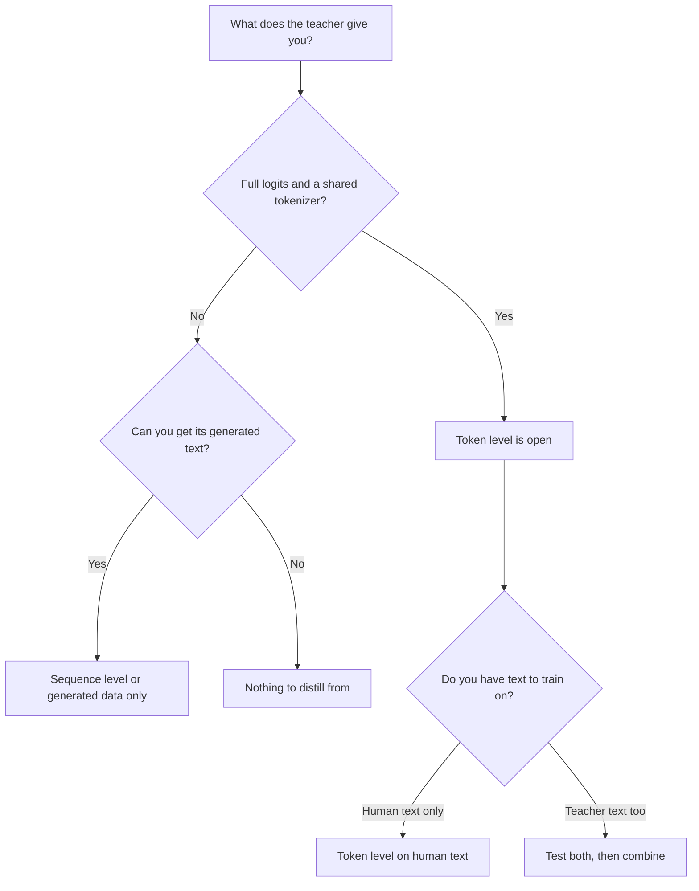

# Урок 9. Токены или последовательности

**Связь с целью курса:** Цель курса требует, чтобы вы могли сказать, что передаёт каждый уровень дистилляции такого, чего не передаёт другой, и выбрать один по тому, что открывает учитель. С этим выбором вы столкнётесь, когда впервые окажется, что учитель находится за API.
**Первоисточник:** [Научная статья: "Sequence-Level Knowledge Distillation", Kim and Rush, 2016](https://arxiv.org/abs/1606.07947)
**Предварительные требования:** [Урок 8](0008-sequence-level-distillation.md), [Урок 6](0006-the-tokenizer-constraint.md), [логитная дистилляция](../GLOSSARY.md), [off-policy-дистилляция](../GLOSSARY.md), [мягкие метки](../GLOSSARY.md)

## Разминка

1. ▢ Какова обучающая функция потерь ученика в рецепте Kim и Rush и что вносит учитель?

Проверка

Обычная кросс-энтропия на целых предложениях. Учитель вносит только текст, который декодировал лучевым поиском, и никогда свои вероятности.

2. ▢ Назовите причину, по которой вероятности учителя на неверных ответах учат больше, чем [жёсткая метка](../GLOSSARY.md).

Проверка

Вероятности на неверных ответах говорят, как учитель их ранжирует: какие неверные ответы почти попали, а какие далеки от цели. Жёсткая метка ставит всю вероятность на один ответ, так что это ранжирование теряется (урок 2).

3. ▢ Две модели используют разные токенизаторы. Какой уровень дистилляции это исключает и какой оставляет открытым?

Проверка

Это исключает обычную [логитную дистилляцию](../GLOSSARY.md), которая сравнивает распределения индекс за индексом и требует общего словаря. Дистилляцию на уровне последовательностей это оставляет открытой, потому что декодированный текст можно снова токенизировать собственным токенизатором ученика.

## Что нужно знать

### Что несёт каждый уровень

Оба уровня обучают ученика на поведении учителя. Они различаются тем, какая часть этого поведения доходит до ученика.

| | Уровень токенов | Уровень последовательностей |
|---|---|---|
| Что читает ученик | Всё распределение учителя в каждой позиции | Одну декодированную последовательность на вход |
| Что оно несёт | Как учитель ранжирует альтернативы на каждом шаге | Общий выбор учителя, включая то, как он связывает шаги в цепочку |
| Что отбрасывает | Ничего в этой позиции, но только на тех префиксах, которые вы подаёте | Вероятности всех альтернатив, которые учитель не выбрал |
| Что должен открывать учитель | Логиты и общий словарь | Текст |
| Обучающая функция потерь | Дивергенция на позицию | Обычная кросс-энтропия |

Первая строка таблицы это самая суть. Дистилляция на уровне токенов даёт богатую цель в каждой позиции и оставляет открытым вопрос, на каких последовательностях её вычислять. Дистилляция на уровне последовательностей передаёт саму последовательность, и ученик учится её порождать, с одной жёсткой целью на позицию. Kim и Rush описывают это разделение так: дистилляция на уровне слов передаёт знания на локальном уровне, а дистилляция на уровне последовательностей на глобальном, и, по их словам, они дополняют друг друга (раздел 5).

### Их сочетание

Можно делать оба сразу. Декодируйте учителем, чтобы получить последовательности, затем обучайте ученика на этих последовательностях с кросс-энтропией относительно текста плюс токенным слагаемым относительно распределения учителя в каждой позиции этого текста. Статья называет это Seq-KD + Word-KD (раздел 4, сноска 9 описывает смешанную функцию потерь).

Все числа принадлежат Kim и Rush, из таблицы 1, в BLEU при жадном декодировании и луче 5 (K=1 / K=5):

| Ученик | Базовый уровень | Seq-KD | Seq-KD + Word-KD |
|---|---|---|---|
| Английский в немецкий, 2×500 | 14.7 / 17.6 | 18.9 / 19.0 | 18.7 / 18.9 |
| Английский в немецкий, 2×300 | 14.1 / 16.9 | 18.1 / 18.1 | 17.9 / 18.8 |
| Тайский в английский, 2×100 | 10.6 / 12.7 | 12.8 / 13.4 | 13.7 / 14.2 |

Сочетание помогло ученикам 2×300 и 2×100 и не помогло ученику 2×500 (раздел 5). Так что считайте токенное слагаемое тем, что нужно проверять на вашем ученике, а не бесплатным дополнением. Оно к тому же стоит дороже, чем предполагает таблица: помимо декодированного текста, нужно распределение учителя в каждой позиции, цену которого посчитал урок 7.

### Выбор по тому, что открывает учитель

Первый вопрос не «что лучше», а «что у меня есть». Он определяет, какие уровни для вас открыты.

Как читать диаграмму:

- **Логиты и общий токенизатор:** открыты оба уровня, и выбор становится экспериментом. Уровень токенов на человеческом тексте не требует декодирования учителем. Текст, декодированный учителем, добавляет информацию уровня последовательностей. Сочетание их и проверяли Kim и Rush.
- **Логиты, но другой токенизатор:** обычная токенная функция потерь закрыта (урок 6), так что декодированный текст это прямой путь. Кросс-токенизаторные методы существуют, но от чего-то отказываются.
- **Только текст, как когда учитель находится за API, возвращающим завершения:** путь это уровень последовательностей, как и всё из уроков с 10 по 13. Сигналом дистилляции служит тот текст, который вы можете получить, так что выбор входов и фильтрация важнее.
- **Модель, выходы которой вы не можете получить в нужном объёме:** дистиллировать не из чего.

Отчёт о DeepSeek R1 это пример выбора текста, даже когда веса есть на руках. Для малых моделей они дообучили на примерно 800 000 сэмплов, сгенерированных R1, и применили только контролируемое дообучение, без этапа обучения с подкреплением, и отметили, что добавление такого этапа могло бы помочь ещё больше (отчёт R1, раздел о дистилляции и приложение B.4.3). Сработал бы уровень токенов там лучше, в этом отчёте не проверялось, так что это не результат.

### Что у них общего

Обучение на фиксированном наборе выходов учителя это [off-policy-дистилляция](../GLOSSARY.md): ученик учится на последовательностях, которые не генерировал. Оба уровня в том виде, как их преподавали до сих пор, разделяют это свойство. Этап 5 возвращается к тому, во что это обходится.

## Практика

1. ▢ Ваш учитель это размещённая модель, которая возвращает завершения и больше ничего. Какие уровни дистилляции вы можете запустить?

    - a) Только уровень токенов, используя возвращаемый текст
    - b) Оба уровня, когда весь текст собран
    - c) Только уровень последовательностей, используя возвращаемый текст
    - d) Ни одного, так как логиты всегда строго необходимы

Проверка

**c)** Текст это всё, что нужно дистилляции на уровне последовательностей. (a) и (b) предполагают, что вы можете читать распределение учителя в каждой позиции, чего текстовый учитель не даёт. (d) путает дистилляцию с логитной дистилляцией, которая лишь одно семейство.

2. ▢ У открытого учителя и открытого ученика общий токенизатор, и вы можете запустить обоих. Вы декодировали выход учителя для ваших промптов. Опираясь только на таблицу 1, чего вы ожидаете от добавления токенного слагаемого и насколько вы уверены?

Подсказка

Сравнивайте три строки учеников, а не только лучшую.

Проверка

Неоднозначно. Оно помогло двум из трёх учеников (2×300 и 2×100) и не помогло третьему (2×500), так что честное ожидание такое: «попробуйте, но не предполагайте заранее». Уверены лишь в том, что это одна статья про перевод с LSTM, так что она говорит о необходимости проверки, а не о том, что сделает LLM.

3. ▢ Какое утверждение о том, что отбрасывает каждый уровень, верно?

    - a) Уровень токенов отбрасывает каждую позицию после первой
    - b) Уровень последовательностей отбрасывает итоговый выбор учителя
    - c) Уровень токенов отбрасывает форму распределения учителя
    - d) Уровень последовательностей отбрасывает вероятности альтернатив учителя

Проверка

**d)** Декодированная последовательность несёт только то, что выбрал учитель, так что альтернативы и их вероятности пропадают. (a) неверно: уровень токенов читает каждую позицию, которую ему дают. (b) переворачивает смысл: выбор учителя это именно то, что уровень последовательностей сохраняет. (c) тоже переворачивает смысл, поскольку форма распределения это то, что читает уровень токенов.

4. ▢ Ваш коллега говорит, что дистилляция на уровне токенов строго лучше, потому что использует больше информации на пример. Приведите одну причину, по которой это не следует.

Проверка

Три причины, достаточно любой одной. Она недоступна без логитов и общего словаря. Дополнительная информация относится к позициям, которые вы оцениваете, так что ничего не говорит о последовательностях, которые учитель породил бы сам. А в таблице 1 сочетание не превзошло одну лишь дистилляцию на уровне последовательностей на ученике 2×500. Больше информации на пример это не то же самое, что лучший ученик.

5. ▢ У команды есть учитель с открытыми весами и собственным токенизатором и ученик с другим токенизатором, а также бюджет на декодирование миллиона промптов. Какой путь вы рекомендуете первым и что велите измерить, прежде чем тратиться на что-то более сложное?

Проверка

Сначала уровень последовательностей: декодировать промпты учителем и обучить ученика на тексте, потому что ученик может токенизировать этот текст сам и общий словарь не нужен. Измерьте ученика относительно учителя и относительно базового уровня на отложенных промптах, чтобы следующий шаг (кросс-токенизаторные методы или сбор дополнительных данных) выбирался по свидетельствам. Это рекомендация, выведенная из ограничений урока 6 и этого урока, а не результат из статьи.

## Практика в реальной работе

- [ ] Выберите модель, которой вы пользуетесь за API. Прочитайте её документацию и перечислите точно, что может вернуть вызов. Отметьте, какие уровни дистилляции этот выход позволил бы.
- [ ] Выберите две открытые модели. Проверьте, есть ли у них общий токенизатор, и запишите, какой уровень вы могли бы запустить между ними.
- [ ] Завтра: без заметок нарисуйте по памяти диаграмму решений выше и добавьте к каждому листу одну настоящую модель.

## Что почитать дальше

- [Последовательности и синтетические данные](../reference/sequence-and-synthetic-data.md)
- [Научная статья: "Sequence-Level Knowledge Distillation", Kim and Rush, 2016](https://arxiv.org/abs/1606.07947)
- [Научная статья: "DeepSeek-R1: Incentivizing Reasoning Capability in LLMs via Reinforcement Learning", DeepSeek-AI, 2025](https://arxiv.org/abs/2501.12948)
- [Ресурсы](../RESOURCES.md)

---

Не доходит? Перечитайте первоисточник в начале: этот урок его сжимает, а при сжатии понимание как раз и теряется. Загляните в [глоссарий](../GLOSSARY.md), если какой-то термин показался скользким.

Если неясен сам урок, а не материал, это дефект: [откройте issue](https://github.com/TokenCemetery/teach/issues).
