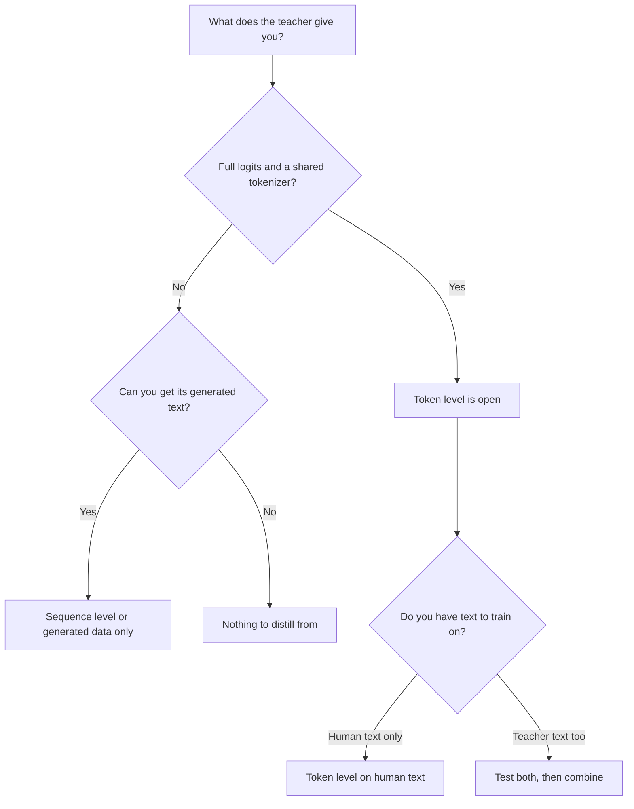

# 第 9 课：token 级还是序列级

**使命关联:** 本使命要求你说明蒸馏的每个层级能迁移哪些另一个层级迁移不了的东西，并根据教师暴露出来的内容选定其一，这正是教师第一次藏在 API 后面时你要面对的选择。
**主要来源:** [论文：“Sequence-Level Knowledge Distillation”，Kim 和 Rush，2016](https://arxiv.org/abs/1606.07947)
**前置知识:** [第 8 课](0008-sequence-level-distillation.md)、[第 6 课](0006-the-tokenizer-constraint.md)、[logit 蒸馏](../GLOSSARY.md)、[离策略蒸馏](../GLOSSARY.md)、[软目标](../GLOSSARY.md)

## 热身

1. ▢ 在 Kim 和 Rush 的配方里，学生的训练损失是什么，教师贡献了什么？

检查

针对整句的普通交叉熵。教师贡献的只是它用束搜索解码出的文本，从来不是它的概率。

2. ▢ 说出教师在错误答案上的概率，为什么比[硬标签](../GLOSSARY.md)教得更多。

检查

错误答案上的概率，说明了教师如何给它们排序：哪些错误答案是差一点就对，哪些则差得很远。硬标签把全部概率放在一个答案上，所以这个排序就丢失了（第 2 课）。

3. ▢ 两个模型使用不同的分词器。这排除了哪个层级的蒸馏，又留下了哪个？

检查

它排除了普通的 [logit 蒸馏](../GLOSSARY.md)，后者要逐个索引地比较分布，需要共享词表。它留下了序列级蒸馏，因为解码出的文本可以由学生自己的分词器重新分词。

## 要点

### 每个层级携带什么

两个层级都是在教师的行为上训练学生。它们的区别在于，这些行为的哪一部分传到了学生那里。

| | token 级 | 序列级 |
|---|---|---|
| 学生读取什么 | 教师在每个位置上的完整分布 | 每个输入对应一条解码出的序列 |
| 它携带什么 | 教师在每一步如何给各个备选项排序 | 教师整体的选择，包括它如何把各步串联起来 |
| 它丢掉什么 | 在那个位置上什么都不丢，但只限于你输入给它的那些前缀 | 教师没有选中的每个备选项的概率 |
| 教师必须暴露什么 | logit 和共享的词表 | 文本 |
| 训练损失 | 每个位置一个散度 | 普通的交叉熵 |

表的第一行是核心。token 级蒸馏在每个位置上给出丰富的目标，但把在哪些序列上评估它的问题留了下来。序列级蒸馏直接交出序列本身，学生学着去产出它，每个位置一个硬目标。Kim 和 Rush 用这样的措辞描述这种区分：词级蒸馏在局部层面迁移知识，序列级蒸馏在全局层面迁移知识，而且他们说两者是互补的（第 5 节）。

### 把二者结合

你可以同时做两者。用教师解码得到序列，然后在这些序列上训练学生：针对文本做交叉熵，再加上针对教师在该文本每个位置上的分布的 token 级一项。论文把这叫作 Seq-KD + Word-KD（第 4 节，脚注 9 描述了混合损失）。

所有数字都是 Kim 和 Rush 的，出自表 1，BLEU，贪心解码和束宽 5（K=1 / K=5）：

| 学生 | 基线 | Seq-KD | Seq-KD + Word-KD |
|---|---|---|---|
| 英语到德语，2×500 | 14.7 / 17.6 | 18.9 / 19.0 | 18.7 / 18.9 |
| 英语到德语，2×300 | 14.1 / 16.9 | 18.1 / 18.1 | 17.9 / 18.8 |
| 泰语到英语，2×100 | 10.6 / 12.7 | 12.8 / 13.4 | 13.7 / 14.2 |

这种结合帮助了 2×300 和 2×100 的学生，对 2×500 的那个则没有帮助（第 5 节）。所以请把 token 级这一项当作要在你手头的学生身上测试的东西，而不是白送的附加项。它的代价也比表上看起来的更高：除了解码出的文本，你还需要教师在每个位置上的分布，而第 7 课给它标过价。

### 根据教师暴露的内容来选择

第一个问题不是“哪个更好”，而是“我手里有什么”。它决定了你能用哪些层级。

解读这张图：

- **有 logit，且共享分词器**：两个层级都可用，选择变成一次实验。在人类文本上做 token 级，不需要教师解码。教师解码出的文本则增加了序列级的信息。把二者结合，就是 Kim 和 Rush 测试过的东西。
- **有 logit，但分词器不同**：通常的 token 级损失走不通（第 6 课），所以解码出的文本是最直接的路线。跨分词器的方法是存在的，但要放弃一些东西。
- **只有文本，比如教师藏在一个返回补全结果的 API 后面**：路线是序列级，第 10 到 13 课的全部内容也是如此。蒸馏信号就是你能拿到的文本，所以输入的选择和过滤更为重要。
- **一个无法大批量获取其输出的模型**：没有东西可以蒸馏。

DeepSeek 的 R1 报告就是一个即使手里有权重也选择文本的例子。对那些小模型，他们在 R1 生成的大约 80 万条样本上做了微调，只应用了监督微调，没有强化学习阶段，并指出再加上强化学习可能会有进一步的帮助（R1 报告，蒸馏一节和附录 B.4.3）。在那里 token 级是否会做得更好，那份报告没有测试，所以那不是一个结果。

### 二者的共同点

在一组固定的教师输出上训练，就是[离策略蒸馏](../GLOSSARY.md)：学生是在它自己并未生成的序列上学习。到目前为止所讲的两个层级，都具有这一性质。第 5 阶段会回到这样做的代价上。

## 练习

1. ▢ 你的教师是一个托管模型，只返回补全结果，别的什么都没有。你能运行蒸馏的哪些层级？

    - a) 只有 token 级，使用它返回的文本
    - b) 两个层级，一旦收集到所有文本
    - c) 只有序列级，使用它返回的文本
    - d) 两个层级都不行，因为总是严格需要 logit

检查

**c)** 文本就是序列级蒸馏所需要的一切。(a) 和 (b) 假定你能读到教师在每个位置上的分布，而只有文本的教师并不提供这些。(d) 把蒸馏与 logit 蒸馏混为一谈，而后者只是其中一个家族。

2. ▢ 一个开源教师和一个开源学生共享分词器，你能运行二者。你已经为自己的提示词解码出了教师的输出。只根据表 1，你预期加上 token 级一项会怎样？你有多大把握？

提示

比较三行学生，不要只看最好的那一行。

检查

好坏参半。它帮助了三个学生中的两个（2×300 和 2×100），对第三个（2×500）没有帮助，所以诚实的预期是“试一试，不要想当然”。唯一有把握的是，这只是一篇关于翻译、用 LSTM 的论文，所以它说的是要去测试，而不是 LLM 会怎样。

3. ▢ 关于每个层级丢掉了什么，下面哪一项陈述是正确的？

    - a) token 级丢掉第一个位置之后的每个位置
    - b) 序列级丢掉教师做出的最终选择
    - c) token 级丢掉教师分布的形状
    - d) 序列级丢掉教师备选项的概率

检查

**d)** 解码出的序列只携带教师选定的内容，所以备选项和它们的概率都没了。(a) 是错的：token 级会读取输入给它的每个位置。(b) 说反了：教师的选择恰恰是序列级所保留的。(c) 也说反了，因为分布的形状正是 token 级所读取的。

4. ▢ 你的同事说 token 级蒸馏严格来说更好，因为每个样本它用到的信息更多。给出一个不能由此推出的理由。

检查

三个理由，任何一个都够了。没有 logit 和共享词表，它就用不了。多出来的信息是关于你评估的那些位置的，所以对于教师自己会产生的序列，它什么也没说。而在表 1 里，对 2×500 的学生，二者结合并没有胜过单独的序列级。每个样本的信息更多，并不等于学生更好。

5. ▢ 一个团队有一个使用自己分词器的开放权重教师，和一个使用不同分词器的学生，还有解码一百万个提示词的预算。你首先推荐哪条路线？在花钱做更复杂的事情之前，你要他们度量什么？

检查

先用序列级：用教师解码这些提示词，并在文本上训练学生，因为学生可以自己对这些文本分词，不需要共享词表。在留出的提示词上，对照教师、也对照一个基线来度量学生，这样下一步（跨分词器的方法，或者收集更多数据）就是依据证据来选的。这是根据第 6 课和本课的约束得出的建议，不是某篇论文里的结果。

## 实战练习

- [ ] 选一个你在用、藏在 API 后面的模型。阅读它的文档，列出一次调用究竟能返回什么。标出这个输出允许哪些蒸馏层级。
- [ ] 选两个开源模型。检查它们是否共享分词器，并写下二者之间你能运行哪个层级。
- [ ] 明天：不看笔记，凭记忆画出上面的决策图，并在每个叶子节点上加上一个真实的模型。

## 延伸阅读

- [序列与合成数据](../reference/sequence-and-synthetic-data.md)
- [论文：“Sequence-Level Knowledge Distillation”，Kim 和 Rush，2016](https://arxiv.org/abs/1606.07947)
- [论文：“DeepSeek-R1: Incentivizing Reasoning Capability in LLMs via Reinforcement Learning”，DeepSeek-AI，2025](https://arxiv.org/abs/2501.12948)
- [资源](../RESOURCES.md)

---

没学明白？请重读顶部的主要来源，因为本课是对它的压缩，而理解正是在压缩中流失的。如果有哪个术语觉得含糊，可以查看[术语表](../GLOSSARY.md)。

如果问题出在课程本身，而不是学习材料，那就是一个缺陷：[提交 issue](https://github.com/TokenCemetery/teach/issues)。
