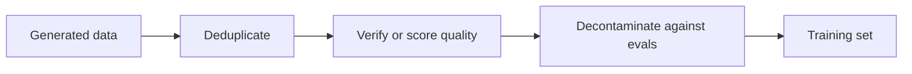

# Lección 12. Filtrar datos sintéticos

**Vínculo con la misión:** La misión te pide construir un conjunto de destilación sintético filtrado por calidad, lo que significa saber cuál de cuatro comprobaciones detecta qué tipo de mal ejemplo, y qué cuesta cada una.
**Fuente principal:** [Paper: "Textbooks Are All You Need", Gunasekar et al., 2023](https://arxiv.org/abs/2306.11644)
**Requisitos previos:** [Lección 11](0011-rationales-and-explanation-traces.md), [Datos sintéticos](../GLOSSARY.md), [Rejection sampling](../GLOSSARY.md), [Descontaminación](../GLOSSARY.md)

## Calentamiento

1. ▢ En Distilling Step-by-Step, el estudiante se entrena para producir una etiqueta y, por separado, un rationale. ¿De qué protege la separación?

Comprobación

Escribir el rationale y la etiqueta como una sola secuencia objetivo a veces puntuó por debajo del fine-tuning simple (ANLI 43.50 y CQA 61.37 frente a 43.58 y 62.19 en la Tabla 2). Tratado como una segunda tarea, el rationale ayudó en los cuatro benchmarks (lección 11).

2. ▢ Orca entrenó con 5M de respuestas de ChatGPT y luego con 1M de respuestas de GPT-4. Nombra las dos razones que dan los autores para usar ChatGPT como profesor intermedio.

Comprobación

La brecha de capacidad entre un estudiante de 13B y GPT-4, y el costo y el tiempo, ya que ChatGPT era más rápido y barato de consultar y recogieron 5 veces más de él (lección 11).

3. ▢ Self-Instruct descarta una instrucción cuya similitud ROUGE-L con cualquier miembro del conjunto es de 0.7 o más. ¿A qué tipo de mal ejemplo apunta esa regla?

Comprobación

Casi duplicados: la misma instrucción reformulada, que inflaría la proporción de una tarea en el conjunto de entrenamiento sin añadir nada nuevo (lección 10).

## Qué debes saber

### El volumen no arregla un mal ejemplo

Un profesor escribe lo que escribe, incluidas respuestas equivocadas, prompts repetitivos y texto copiado del benchmark con el que te van a juzgar. Un estudiante entrenado con todo ello lo aprende todo. Filtrar es el paso que decide qué se le permite aprender al estudiante, y es más barato hacerlo antes de entrenar que descubrirlo después.

El orden es una sugerencia: primero las pasadas baratas basadas en reglas, las comprobaciones costosas sobre lo que queda. A continuación vienen cuatro herramientas, cada una de un pipeline real.

### Filtros basados en reglas y deduplicación

Self-Instruct (lección 10) filtra con reglas baratas: ROUGE-L por debajo de 0.7 frente a cada miembro del conjunto, sin palabras clave como imagen o foto, sin instancias duplicadas, sin pares con la misma entrada y salida distinta, y heurísticas de longitud y de repetición (sección 2.2). ROUGE-L mide el solapamiento de la subsecuencia común más larga de palabras, así que detecta reformulaciones con las mismas palabras y se pierde una paráfrasis que comparte pocas.

Importan dos tipos de duplicado. Un duplicado exacto es el caso fácil. Un casi duplicado es el que sube en silencio el peso de un ejemplo en el entrenamiento. El umbral es una elección: Self-Instruct escogió 0.7 y el paper no lo presenta como universal. Los autores de phi-1 partieron de la versión deduplicada de The Stack (sección 2.1), así que la deduplicación es un primer paso en ambos pipelines.

### Un clasificador de calidad

phi-1 (Gunasekar et al., 2023) entrena un modelo de código de 1.3B con datos de "calidad de libro de texto". Su filtro es un clasificador. Anotaron unos 100k archivos con GPT-4, al que se le pidió juzgar el "valor educativo de un fragmento para un estudiante cuyo objetivo es aprender conceptos básicos de programación". Entrenaron un random forest sobre los embeddings de salida de un CodeGen preentrenado para predecir esa puntuación para cada archivo, y lo aplicaron a un corpus de Python de más de 35 millones de archivos y más de 35B de tokens. El conjunto filtrado fue de unos 6B de tokens (secciones 1 y 2.1).

El pipeline tiene tres partes: un conjunto pequeño etiquetado por un juez costoso, un modelo barato entrenado con él, y el modelo barato ejecutado sobre todo. Los autores señalan que usaron GPT-4 solo para anotar ese subconjunto, no para generar datos.

También generaron datos. Menos de 1B de tokens de libros de texto de Python vinieron de GPT-3.5, con la diversidad forzada restringiendo los temas y el público objetivo, y unos 180M de tokens de ejercicios con soluciones se usaron para el fine-tuning. Su modelo de 1.3B se preentrenó en menos de 4 días en 8 A100, unas 8 pasadas sobre un conjunto de preentrenamiento de menos de 7B de tokens (algo más de 50B de tokens vistos), seguido de un fine-tuning. Informan de un 50.6% de pass@1 en HumanEval y un 55.5% en MBPP (resumen). El modelo base antes del fine-tuning con ejercicios alcanzó un 29% en HumanEval (sección 1). Son resultados autoinformados de un paper en benchmarks de código, y el paper no aísla cuánto contribuyó cada filtro o dataset.

### Verificación y rejection sampling

Donde exista un verificador, úsalo. El [rejection sampling](../GLOSSARY.md) significa extraer varias respuestas candidatas por prompt y conservar solo las que pasan.

El informe de DeepSeek-R1 (apéndice B.3.3) describe los datos detrás de los modelos destilados:

- Generaron trayectorias de razonamiento por rejection sampling desde el checkpoint de la ejecución de aprendizaje por refuerzo de la primera etapa, muestreando para cada prompt varias respuestas y conservando solo las correctas.
- La corrección vino de reglas donde la respuesta era determinista. Para los datos que las reglas no podían juzgar, dieron la verdad de referencia y la respuesta del modelo a DeepSeek-V3 como juez.
- Como la salida del modelo era a veces difícil de leer, también filtraron las cadenas de pensamiento con idiomas mezclados, párrafos largos y bloques de código.
- Eso dio unas 600k muestras de razonamiento, más unas 200k muestras de no razonamiento, unas 800,000 en total (apéndice B.3.3 y Tabla 5, que suma 804,745). Los modelos destilados se afinaron con las 800k muestras, durante 2 a 3 épocas (apéndice B.4.3).

En esa lista aparecen dos tipos de filtro, y detectan cosas distintas: un filtro de corrección conserva las respuestas que son correctas, y un filtro de formato conserva las respuestas legibles. Una respuesta correcta puede seguir siendo ilegible, y una respuesta legible puede seguir siendo errónea.

Lo que un verificador no puede hacer es juzgar un estilo o una respuesta abierta. Ahí las opciones son un juez modelo, que es a su vez un modelo con errores, o una muestra humana.

### Descontaminación

Los datos que generas no deben contener el examen con el que te van a calificar. Los autores de phi-1 lo comprobaron con cuidado, y su registro muestra que es más difícil de lo que parece (sección 5). Primero midieron el solapamiento de n-gramas entre los prompts de HumanEval y sus ejercicios: cuatro preguntas tenían un solapamiento de 13-gramas con algún ejercicio, y las cuatro eran falsos positivos. Luego usaron una combinación de distancia de embeddings y coincidencia de árbol de sintaxis abstracta (AST) para encontrar código similar, y podaron el conjunto de ejercicios, eliminando entre 42.5K y 354K de sus 879.5K problemas según el umbral. Tras la poda, un phi-1 reentrenado seguía puntuando entre un 45.1% y un 50.6% en HumanEval, aún por encima del 41.5% que informan para StarCoder, y dicen que esto respalda que la mejora no es contaminación (Tabla 3). Sus resultados también muestran que la puntuación cayó hasta 5.5 puntos con la poda más estricta, así que el filtro cambió el número.

HumanEval tiene 164 problemas. Las diferencias de unos pocos puntos son un puñado de problemas, así que pesan menos de lo que parece. Consulta [Datos held-out y contaminación](../../evals/reference/held-out-data-and-contamination.md) en el track de evals para las dos vías de contaminación y cómo detectarlas.

### Lo que ningún filtro arregla

Un filtro actúa sobre lo que puedes ver en el texto. La lección 19 vuelve sobre el [aprendizaje subliminal](../GLOSSARY.md), donde un rasgo pasa del profesor al estudiante a través de datos que parecen ajenos a él. Filtra lo que puedas nombrar, y no esperes que un conjunto de aspecto limpio sea un conjunto limpio.

## Práctica

1. ▢ El clasificador de phi-1 parte de unos 100k archivos anotados por GPT-4 y se ejecuta sobre un corpus de más de 35 millones de archivos. ¿Por qué entrenar un random forest en lugar de preguntar a GPT-4 por cada archivo?

Comprobación

Costo y velocidad: un modelo pequeño sobre embeddings puede puntuar millones de archivos de forma barata, mientras que una llamada a un juez por archivo no escala. Las etiquetas del juez costoso se usan una vez, para enseñar al modelo barato. El costo de este diseño es que el clasificador hereda los errores del juez en el subconjunto que vio.

2. ▢ ¿Para qué datos es el rejection sampling con un verificador la herramienta adecuada?

    - a) Poemas escritos al estilo de un poeta famoso
    - b) Problemas de matemáticas con una respuesta final verificable
    - c) Consejos abiertos sobre cómo elegir una carrera profesional
    - d) Resúmenes de documentos muy largos y ambiguos

Comprobación

**b)** Una respuesta final se puede comprobar por regla, así que las muestras erróneas se descartan sin un juez. (a), (c) y (d) no tienen una verdad de referencia contra la que comprobar, así que el filtro tendría que ser un juez modelo o una muestra humana, que es una garantía más débil.

3. ▢ DeepSeek-R1 informa de unas 600k muestras de razonamiento y unas 200k de no razonamiento. ¿Qué fracción de las unas 800k son datos de razonamiento, y qué te dice eso de la mezcla de entrenamiento de los modelos destilados?

Comprobación

Unas tres cuartas partes. La mezcla es sobre todo datos de razonamiento, filtrados por las comprobaciones de arriba. La Tabla 5 da el desglose: matemáticas 395,285 y código 211,129 son los dos dominios mayores.

4. ▢ Tu conjunto sintético muestra un 12% de solapamiento en la coincidencia de 13-gramas frente a una eval, y los elementos que se solapan parecen problemas distintos. ¿Debes concluir que está limpio?

Pista

Piensa en lo que encontró la comprobación de n-gramas de phi-1, y en lo que hizo después.

Comprobación

No. Los autores de phi-1 encontraron que su comprobación de 13-gramas solo sacó cuatro preguntas, todas falsos positivos, y la juzgaron demasiado tosca para encontrar código similar, así que añadieron la comparación por embeddings y AST. Una coincidencia baja de n-gramas no descarta una paráfrasis cercana ni una solución reescrita. Usa más de una medida de similitud, e informa del efecto de la poda en la puntuación.

5. ▢ Con la poda más estricta (τ de 0.8), phi-1 reentrenado con los ejercicios podados puntuó un 45.1% frente al 50.6% original. Un colega dice que eso prueba que el número original estaba inflado por contaminación. ¿Qué falla en la afirmación?

Comprobación

La poda elimina cerca del 40% de los ejercicios con ese umbral, incluidos archivos solo vagamente parecidos a HumanEval, así que la caída podría venir de perder datos de entrenamiento útiles además de eliminar fugas. Los autores la presentan como una prueba de estrés: incluso tras la poda, el modelo sigue superando a StarCoder. El paper no separa las dos causas, así que la afirmación no está respaldada.

## Prácticas en el mundo real

- [ ] Toma 30 ejemplos sintéticos de cualquier dataset sintético público. Para cada uno, anota cuál de las cuatro comprobaciones (duplicado, calidad, verificado, contaminado) lo habría eliminado, si alguna. Cuenta cuántos sobreviven a las cuatro.
- [ ] Calcula ROUGE-L entre unos pocos pares de instrucciones que escribas tú, una paráfrasis y una casi copia, y anota cuál detecta un umbral de 0.7.
- [ ] Mañana: sin apuntes, enumera las cuatro herramientas de filtrado de esta lección y un pipeline que usó cada una.

## Para profundizar

- [Secuencia y datos sintéticos](../reference/sequence-and-synthetic-data.md)
- [Datos held-out y contaminación](../../evals/reference/held-out-data-and-contamination.md)
- [Paper: "Textbooks Are All You Need", Gunasekar et al., 2023](https://arxiv.org/abs/2306.11644)
- [Paper: "DeepSeek-R1: Incentivizing Reasoning Capability in LLMs via Reinforcement Learning", DeepSeek-AI, 2025](https://arxiv.org/abs/2501.12948)
- [Recursos](../RESOURCES.md)

---

¿No termina de quedar claro? Vuelve a leer la fuente primaria de arriba, ya que esta lección la comprime y en la compresión es donde se escapa la comprensión. Consulta el [glosario](../GLOSSARY.md) por si algún término te resultó resbaladizo.

Si lo poco claro es la propia lección y no el material, eso es un defecto: [abre un issue](https://github.com/TokenCemetery/teach/issues).
