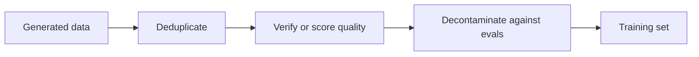

# Leçon 12. Filtrer les données synthétiques

**Lien avec la mission :** La mission vous demande de construire un jeu de distillation synthétique filtré pour la qualité, ce qui veut dire savoir lequel de quatre contrôles attrape quel type de mauvais exemple, et ce que coûte chacun.
**Source primaire :** [Article : "Textbooks Are All You Need", Gunasekar et al., 2023](https://arxiv.org/abs/2306.11644)
**Prérequis :** [Leçon 11](0011-rationales-and-explanation-traces.md), [Données synthétiques](../GLOSSARY.md), [Échantillonnage par rejet](../GLOSSARY.md), [Décontamination](../GLOSSARY.md)

## Échauffement

1. ▢ Dans Distilling Step-by-Step, l'élève est entraîné à produire un label et, séparément, une rationale. Contre quoi la séparation protège-t-elle ?

Vérifier

Écrire la rationale et le label comme une seule séquence cible a parfois donné un score inférieur au fine-tuning simple (ANLI 43.50 et CQA 61.37 contre 43.58 et 62.19 dans le tableau 2). Traitée comme une seconde tâche, la rationale a aidé sur les quatre benchmarks (leçon 11).

2. ▢ Orca s'est entraîné sur 5M de réponses de ChatGPT puis sur 1M de réponses de GPT-4. Nommez les deux raisons que donnent les auteurs d'utiliser ChatGPT comme enseignant intermédiaire.

Vérifier

L'écart de capacité entre un élève de 13B et GPT-4, et le coût et le temps, puisque ChatGPT était plus rapide et moins cher à interroger et qu'ils en ont collecté 5 fois plus (leçon 11).

3. ▢ Self-Instruct écarte une instruction dont la similarité ROUGE-L avec un membre du pool est de 0.7 ou plus. Quel type de mauvais exemple cette règle vise-t-elle ?

Vérifier

Les quasi-doublons : la même instruction reformulée, qui gonflerait la part d'une tâche dans le jeu d'entraînement sans rien apporter de nouveau (leçon 10).

## À savoir

### Le volume ne répare pas un mauvais exemple

Un enseignant écrit ce qu'il écrit, y compris des réponses fausses, des prompts répétitifs, et du texte copié du benchmark sur lequel vous serez jugé. Un élève entraîné sur tout cela apprend tout cela. Le filtrage est l'étape qui décide de ce que l'élève a le droit d'apprendre, et il est moins coûteux de le faire avant l'entraînement que de le découvrir après.

L'ordre est une suggestion : d'abord les passes peu coûteuses fondées sur des règles, puis les contrôles coûteux sur ce qui reste. Quatre outils suivent, chacun issu d'un vrai pipeline.

### Filtres à règles et déduplication

Self-Instruct (leçon 10) filtre avec des règles peu coûteuses : ROUGE-L inférieur à 0.7 par rapport à chaque membre du pool, aucun mot-clé comme image ou picture, aucune instance en double, aucune paire à même entrée et sortie différente, et des heuristiques de longueur et de répétition (section 2.2). ROUGE-L mesure le recouvrement de la plus longue sous-séquence commune de mots, il attrape donc les reformulations avec les mêmes mots et rate une paraphrase qui en partage peu.

Deux types de doublons comptent. Un doublon exact est le cas facile. Un quasi-doublon est celui qui augmente discrètement le poids d'un exemple dans l'entraînement. Le seuil est un choix : Self-Instruct a pris 0.7 et l'article ne le présente pas comme universel. Les auteurs de phi-1 sont partis de la version dédupliquée de The Stack (section 2.1), donc la déduplication est une première étape dans les deux pipelines.

### Un classifieur de qualité

phi-1 (Gunasekar et al., 2023) entraîne un modèle de code de 1.3B sur des données de « qualité manuel scolaire ». Son filtre est un classifieur. Ils ont annoté environ 100k fichiers avec GPT-4, sollicité pour juger la « valeur éducative d'un extrait pour un étudiant dont le but est d'apprendre les concepts de base du code ». Ils ont entraîné une random forest sur les embeddings de sortie d'un modèle CodeGen pré-entraîné pour prédire ce score pour chaque fichier, et l'ont appliquée à un corpus Python de plus de 35 millions de fichiers et de plus de 35B tokens. L'ensemble filtré faisait environ 6B tokens (sections 1 et 2.1).

Le pipeline comporte trois parties : un petit jeu labellisé issu d'un juge coûteux, un modèle peu coûteux entraîné dessus, et le modèle peu coûteux exécuté sur tout. Les auteurs notent qu'ils n'ont utilisé GPT-4 que pour annoter ce sous-ensemble, pas pour générer des données.

Ils ont aussi généré des données. Moins de 1B tokens de manuels Python sont venus de GPT-3.5, avec une diversité forcée en contraignant les sujets et le public cible, et environ 180M tokens d'exercices avec solutions ont servi au fine-tuning. Leur modèle de 1.3B a été pré-entraîné en moins de 4 jours sur 8 A100, soit environ 8 passes sur un jeu de pré-entraînement de moins de 7B tokens (un peu plus de 50B tokens vus), suivi d'un fine-tuning. Ils rapportent 50.6 % de pass@1 sur HumanEval et 55.5 % sur MBPP (résumé). Le modèle de base avant le fine-tuning sur les exercices a atteint 29 % sur HumanEval (section 1). Ce sont les résultats auto-déclarés d'un seul article sur des benchmarks de code, et l'article n'isole pas la contribution de chaque filtre ou jeu de données.

### Vérification et échantillonnage par rejet

Là où un vérificateur existe, utilisez-le. L'[échantillonnage par rejet](../GLOSSARY.md) consiste à tirer plusieurs réponses candidates par prompt et à ne garder que celles qui passent.

Le rapport de DeepSeek-R1 (annexe B.3.3) décrit les données derrière les modèles distillés :

- Ils ont généré des trajectoires de raisonnement par échantillonnage par rejet à partir du checkpoint du run d'apprentissage par renforcement de première étape, en échantillonnant pour chaque prompt plusieurs réponses et en ne gardant que les correctes.
- La justesse venait de règles là où la réponse était déterministe. Pour les données que les règles ne pouvaient pas juger, ils ont fourni la vérité terrain et la réponse du modèle à DeepSeek-V3 comme juge.
- Comme la sortie du modèle était parfois difficile à lire, ils ont aussi écarté les chaînes de raisonnement mêlant plusieurs langues, avec de longs paragraphes et des blocs de code.
- Cela a donné environ 600k échantillons de raisonnement, plus environ 200k échantillons hors raisonnement, soit environ 800,000 au total (annexe B.3.3 et tableau 5, qui somme à 804,745). Les modèles distillés ont été affinés sur les 800k échantillons, pendant 2 à 3 époques (annexe B.4.3).

Deux types de filtre apparaissent dans cette liste, et ils attrapent des choses différentes : un filtre de justesse garde les réponses qui sont justes, et un filtre de format garde les réponses qui sont lisibles. Une réponse juste peut rester illisible, et une réponse lisible peut rester fausse.

Ce qu'un vérificateur ne sait pas faire, c'est juger un style ou une réponse ouverte. Là, les options sont un juge modèle, qui est lui-même un modèle sujet aux erreurs, ou un échantillon humain.

### Décontamination

Les données que vous générez ne doivent pas contenir le test sur lequel vous serez noté. Les auteurs de phi-1 l'ont vérifié avec soin, et leur compte rendu montre que c'est plus difficile qu'il n'y paraît (section 5). Ils ont d'abord mesuré le recouvrement de n-grammes entre les prompts de HumanEval et leurs exercices : quatre questions avaient un recouvrement de 13-grammes avec un exercice, et les quatre étaient des faux positifs. Ils ont ensuite utilisé une combinaison de distance d'embedding et de correspondance d'arbre syntaxique abstrait (AST) pour trouver du code similaire, et ont élagué l'ensemble d'exercices, en retirant entre 42.5K et 354K de ses 879.5K problèmes selon le seuil. Après élagage, un phi-1 ré-entraîné obtenait encore entre 45.1 % et 50.6 % sur HumanEval, encore au-dessus des 41.5 % qu'ils rapportent pour StarCoder, et ils disent que cela soutient que le gain n'est pas de la contamination (tableau 3). Leurs résultats montrent aussi que le score a baissé jusqu'à 5.5 points sous l'élagage le plus strict, donc le filtre a changé le nombre.

HumanEval compte 164 problèmes. Des différences de quelques points sont une poignée de problèmes, elles pèsent donc moins qu'il n'y paraît. Voyez la fiche [Données held-out et contamination](../../evals/reference/held-out-data-and-contamination.md) du parcours evals pour les deux voies de contamination et la façon de les détecter.

### Ce qu'aucun filtre ne corrige

Un filtre agit sur ce que vous pouvez voir dans le texte. La leçon 19 revient sur l'[apprentissage subliminal](../GLOSSARY.md), où un trait passe de l'enseignant à l'élève à travers des données qui semblent sans rapport avec lui. Filtrez ce que vous pouvez nommer, et ne vous attendez pas à ce qu'un jeu d'apparence propre le soit.

## Pratique

1. ▢ Le classifieur de phi-1 part d'environ 100k fichiers annotés par GPT-4 et tourne sur un corpus de plus de 35 millions de fichiers. Pourquoi entraîner une random forest plutôt que de demander à GPT-4 pour chaque fichier ?

Vérifier

Le coût et la vitesse : un petit modèle sur des embeddings peut noter des millions de fichiers à peu de frais, alors qu'un appel au juge par fichier ne passe pas à l'échelle. Les labels du juge coûteux ne servent qu'une fois, pour enseigner le modèle peu coûteux. Le prix de ce schéma est que le classifieur hérite des erreurs du juge sur le sous-ensemble qu'il a vu.

2. ▢ Pour quelles données l'échantillonnage par rejet avec un vérificateur est-il le bon outil ?

    - a) Des poèmes écrits dans le style d'un poète célèbre
    - b) Des problèmes de maths avec une réponse finale vérifiable
    - c) Des conseils ouverts sur le choix d'un parcours de carrière
    - d) Des résumés de documents très longs et ambigus

Vérifier

**b)** Une réponse finale peut être vérifiée par une règle, donc les mauvais échantillons sont écartés sans juge. (a), (c) et (d) n'ont pas de vérité terrain à laquelle se référer, donc le filtre devrait être un juge modèle ou un échantillon humain, ce qui est une garantie plus faible.

3. ▢ DeepSeek-R1 rapporte environ 600k échantillons de raisonnement et environ 200k hors raisonnement. Quelle fraction des quelque 800k représente les données de raisonnement, et que dit cela du mélange d'entraînement des modèles distillés ?

Vérifier

Environ trois quarts. Le mélange est surtout des données de raisonnement, filtrées par les contrôles ci-dessus. Le tableau 5 donne la répartition : les maths avec 395,285 et le code avec 211,129 sont les deux plus grands domaines.

4. ▢ Votre jeu synthétique montre 12 % de recouvrement par correspondance de 13-grammes avec une eval, et les éléments qui se recouvrent ressemblent à des problèmes différents. Devez-vous conclure qu'il est propre ?

Indice

Pensez à ce qu'a trouvé le contrôle par n-grammes de phi-1, et à ce qu'il a fait ensuite.

Vérifier

Non. Les auteurs de phi-1 ont constaté que leur contrôle par 13-grammes ne faisait ressortir que quatre questions, toutes des faux positifs, et l'ont jugé trop grossier pour trouver du code similaire, ils ont donc ajouté des comparaisons par embedding et par AST. Une faible correspondance de n-grammes n'exclut pas une paraphrase proche ou une solution réécrite. Utilisez plus d'une mesure de similarité, et rapportez l'effet de l'élagage sur le score.

5. ▢ À l'élagage le plus strict (τ de 0.8), phi-1 ré-entraîné sur les exercices élagués a obtenu 45.1 % contre 50.6 % à l'origine. Un collègue dit que cela prouve que le nombre d'origine était gonflé par la contamination. Qu'est-ce qui ne va pas dans cette affirmation ?

Vérifier

L'élagage retire environ 40 % des exercices à ce seuil, y compris des fichiers seulement vaguement similaires à HumanEval, donc la baisse pourrait venir de la perte de données d'entraînement utiles autant que du retrait de la fuite. Les auteurs le présentent comme un test de résistance : même après élagage, le modèle bat encore StarCoder. L'article ne sépare pas les deux causes, donc l'affirmation n'est pas étayée.

## Exercices en situation réelle

- [ ] Prenez 30 exemples synthétiques d'un jeu de données synthétiques public. Pour chacun, notez lequel des quatre contrôles (doublon, qualité, vérifié, contaminé) l'aurait retiré, le cas échéant. Comptez combien survivent aux quatre.
- [ ] Calculez le ROUGE-L entre quelques paires d'instructions que vous écrivez vous-même, une paraphrase et une quasi-copie, et notez laquelle un seuil de 0.7 attrape.
- [ ] Demain : sans notes, listez les quatre outils de filtrage de cette leçon et un pipeline qui a utilisé chacun.

## Pour aller plus loin

- [Séquences et données synthétiques](../reference/sequence-and-synthetic-data.md)
- [Evals : Données held-out et contamination](../../evals/reference/held-out-data-and-contamination.md)
- [Article : "Textbooks Are All You Need", Gunasekar et al., 2023](https://arxiv.org/abs/2306.11644)
- [Article : "DeepSeek-R1: Incentivizing Reasoning Capability in LLMs via Reinforcement Learning", DeepSeek-AI, 2025](https://arxiv.org/abs/2501.12948)
- [Ressources](../RESOURCES.md)

---

Ça ne passe pas ? Relisez la source primaire en haut de page, car cette leçon la condense et c'est dans la condensation que la compréhension s'échappe. Consultez le [glossaire](../GLOSSARY.md) pour tout terme qui vous a paru glissant.

Si c'est la leçon elle-même qui n'est pas claire plutôt que la matière, c'est un défaut : [ouvrez une issue](https://github.com/TokenCemetery/teach/issues).
