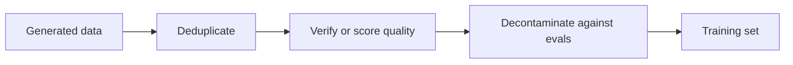

# पाठ 12. Synthetic Data को Filter करना

**मिशन से संबंध:** मिशन आपसे माँगता है कि आप गुणवत्ता के लिए filter किया हुआ synthetic distillation set बनाएँ, यानी जानें कि चार जाँचों में से कौन-सी किस तरह के ख़राब example को पकड़ती है, और हर एक की क्या लागत है।
**मुख्य स्रोत:** [पेपर: "Textbooks Are All You Need", Gunasekar et al., 2023](https://arxiv.org/abs/2306.11644)
**पूर्व-आवश्यकताएँ:** [पाठ 11](0011-rationales-and-explanation-traces.md), [Synthetic data](../GLOSSARY.md), [Rejection sampling](../GLOSSARY.md), [Decontamination](../GLOSSARY.md)

## वार्म-अप

1. ▢ Distilling Step-by-Step में student को label और, अलग से, rationale बनाने के लिए train किया जाता है। यह अलगाव किस चीज़ से बचाता है?

जाँचें

Rationale और label को एक target sequence के रूप में लिखने पर कभी-कभी सादे fine-tuning से कम score मिला (Table 2 में ANLI 43.50 और CQA 61.37, जबकि 43.58 और 62.19)। दूसरे task के रूप में लेने पर rationale ने सभी चारों benchmarks पर मदद की (पाठ 11)।

2. ▢ Orca ने 5M ChatGPT responses पर और फिर 1M GPT-4 responses पर train किया। ChatGPT को बीच के teacher के रूप में इस्तेमाल करने के लिए लेखक जो दो कारण देते हैं, उनके नाम बताएँ।

जाँचें

13B student और GPT-4 के बीच का capacity gap, और लागत तथा समय, क्योंकि ChatGPT से query करना तेज़ और सस्ता था और उन्होंने उससे 5 गुना ज़्यादा इकट्ठा किया (पाठ 11)।

3. ▢ Self-Instruct उस instruction को हटा देता है जिसकी pool के किसी भी सदस्य से ROUGE-L समानता 0.7 या ज़्यादा हो। वह नियम किस तरह के ख़राब example को निशाना बनाता है?

जाँचें

Near-duplicates: वही instruction दूसरे शब्दों में, जो कुछ नया जोड़े बिना training set में एक task का हिस्सा फुला देगा (पाठ 10)।

## यह जानें

### मात्रा ख़राब example को ठीक नहीं करती

Teacher जो भी लिखता है वह लिखता है, जिसमें ग़लत उत्तर, दोहराव वाले prompts, और उस benchmark से नक़ल किया हुआ text भी शामिल है जिस पर आपको परखा जाएगा। उस सबसे train हुआ student वह सब सीख लेता है। Filtering वह चरण है जो तय करता है कि student को क्या सीखने की अनुमति है, और training के बाद जानने के बजाय पहले करना सस्ता है।

क्रम एक सुझाव है: पहले सस्ते नियम-आधारित पास, फिर जो बचे उस पर महँगी जाँचें। आगे चार औज़ार हैं, हर एक किसी असली pipeline से।

### नियम-आधारित filters और deduplication

Self-Instruct (पाठ 10) सस्ते नियमों से filter करता है: pool के हर सदस्य के विरुद्ध ROUGE-L 0.7 से नीचे, image या picture जैसे keywords नहीं, दोहराए गए instances नहीं, एक ही input पर अलग output वाले जोड़े नहीं, और लंबाई तथा दोहराव के heuristics (section 2.2)। ROUGE-L शब्दों की सबसे लंबी साझा subsequence का overlap मापता है, इसलिए वह उन्हीं शब्दों के दोबारा कहे रूप पकड़ता है और उस paraphrase को चूक जाता है जो उनमें से कम शब्द साझा करता हो।

दो तरह के duplicate मायने रखते हैं। Exact duplicate आसान मामला है। Near-duplicate वह है जो चुपचाप training में एक example का weight बढ़ा देता है। Threshold एक चुनाव है: Self-Instruct ने 0.7 चुना और पेपर उसे सार्वभौमिक बताकर पेश नहीं करता। phi-1 के लेखकों ने The Stack के deduplicated संस्करण से शुरुआत की (section 2.1), इसलिए deduplication दोनों pipelines में पहला चरण है।

### गुणवत्ता classifier

phi-1 (Gunasekar et al., 2023) 1.3B code model को "textbook quality" data पर train करता है। उसका filter एक classifier है। उन्होंने लगभग 100k files को GPT-4 से annotate किया, जिसे snippet का "उस छात्र के लिए शैक्षिक मूल्य जिसका लक्ष्य बुनियादी coding अवधारणाएँ सीखना है" आँकने के लिए prompt किया गया था। उन्होंने pretrained CodeGen model के output embeddings पर random forest train किया ताकि वह हर file के लिए वह score predict करे, और उसे 35 million से ज़्यादा files और 35B से ज़्यादा tokens वाले Python corpus पर लगाया। Filter किया हुआ सेट लगभग 6B tokens का था (sections 1 और 2.1)।

Pipeline के तीन हिस्से हैं: महँगे judge से एक छोटा labelled सेट, उस पर train हुआ सस्ता model, और सबके ऊपर चलता सस्ता model। लेखक ध्यान दिलाते हैं कि उन्होंने GPT-4 सिर्फ़ उस उपसमुच्चय को annotate करने के लिए इस्तेमाल किया, data generate करने के लिए नहीं।

उन्होंने data generate भी किया। 1B tokens से कम के Python textbooks GPT-3.5 से आए, विषयों और लक्षित दर्शकों को बाँधकर विविधता मजबूर की गई, और हल सहित लगभग 180M tokens के exercises fine-tuning के लिए इस्तेमाल हुए। उनका 1.3B model 8 A100s पर 4 दिन से कम में pretrain हुआ, 7B tokens से कम के pretraining set पर लगभग 8 पास (50B से कुछ ज़्यादा tokens देखे गए), और उसके बाद fine-tune। वे HumanEval पर 50.6% pass@1 और MBPP पर 55.5% बताते हैं (abstract)। Exercises वाले fine-tune से पहले का base model HumanEval पर 29% तक पहुँचा (section 1)। ये code benchmarks पर एक पेपर के स्वयं-बताए नतीजे हैं, और पेपर यह अलग नहीं करता कि हर filter या dataset ने कितना योगदान दिया।

### Verification और rejection sampling

जहाँ checker मौजूद हो, उसे इस्तेमाल करें। [Rejection sampling](../GLOSSARY.md) का मतलब है हर prompt के लिए कई candidate उत्तर निकालना और सिर्फ़ वे रखना जो पास हों।

DeepSeek-R1 की report (appendix B.3.3) distilled models के पीछे के data को बताती है:

- उन्होंने पहले-चरण के reinforcement-learning run के checkpoint से rejection sampling के ज़रिए reasoning trajectories generate कीं, हर prompt के लिए कई responses sample करके और सिर्फ़ सही वाले रखकर।
- जहाँ उत्तर निश्चित था वहाँ सही होने का फ़ैसला नियमों से आया। उस data के लिए जिसे नियम नहीं आँक सकते थे, उन्होंने ground truth और model का उत्तर DeepSeek-V3 को judge के रूप में खिलाए।
- क्योंकि model का output कभी-कभी पढ़ने में कठिन था, उन्होंने मिली-जुली भाषाओं, लंबे paragraphs और code blocks वाली chains of thought भी छाँट दीं।
- इससे लगभग 600k reasoning samples मिले, और लगभग 200k non-reasoning samples, कुल मिलाकर लगभग 800,000 (appendix B.3.3 और Table 5, जिसका योग 804,745 है)। Distilled models को 800k samples पर 2 से 3 epochs fine-tune किया गया (appendix B.4.3)।

उस सूची में दो तरह के filter दिखते हैं, और वे अलग चीज़ें पकड़ते हैं: correctness filter वे उत्तर रखता है जो सही हैं, और format filter वे जो पढ़ने लायक़ हैं। सही उत्तर फिर भी पढ़ने लायक़ न हो सकता है, और पढ़ने लायक़ उत्तर फिर भी ग़लत हो सकता है।

Checker जो नहीं कर सकता वह style या खुले-अंत वाले उत्तर का फ़ैसला है। वहाँ विकल्प हैं model judge, जो ख़ुद ग़लतियों वाला model है, या मानव का नमूना।

### Decontamination

आपका generate किया data उस test को नहीं रखना चाहिए जिस पर आपको परखा जाएगा। phi-1 के लेखकों ने इसे सावधानी से जाँचा, और उनका रिकॉर्ड दिखाता है कि यह सुनने से कठिन है (section 5)। उन्होंने पहले HumanEval prompts और अपने exercises के बीच n-gram overlap मापा: चार सवालों का किसी exercise के साथ 13-gram overlap था, और चारों false positives थे। फिर उन्होंने समान code ढूँढने के लिए embedding दूरी और abstract-syntax-tree (AST) मेल के संयोजन का इस्तेमाल किया, और exercise set को prune किया, threshold के अनुसार उसकी 879.5K समस्याओं में से 42.5K से 354K तक हटाईं। Pruning के बाद, दोबारा train किए phi-1 ने HumanEval पर फिर भी 45.1% और 50.6% के बीच score किया, जो अब भी StarCoder के लिए बताए 41.5% से ऊपर है, और वे कहते हैं कि यह समर्थन करता है कि फ़ायदा contamination का नहीं है (Table 3)। उनके नतीजे यह भी दिखाते हैं कि सबसे सख़्त pruning में score 5.5 अंक तक गिरा, इसलिए filter ने संख्या बदली।

HumanEval में 164 समस्याएँ हैं। कुछ अंकों के अंतर मुट्ठी भर समस्याएँ हैं, इसलिए उनका वज़न दिखने से कम है। Contamination के दो रास्तों और उन्हें पहचानने के तरीक़ों के लिए evals track की [Held-Out Data और Contamination शीट](../../evals/reference/held-out-data-and-contamination.md) देखें।

### जो कोई filter ठीक नहीं करता

Filter उस पर काम करता है जो आप text में देख सकते हैं। पाठ 19 [subliminal learning](../GLOSSARY.md) पर लौटता है, जहाँ कोई विशेषता teacher से student तक ऐसे data के ज़रिए पहुँचती है जो उससे असंबद्ध दिखता है। उसके लिए filter करें जिसका आप नाम ले सकते हैं, और यह उम्मीद न रखें कि साफ़ दिखता सेट साफ़ ही है।

## अभ्यास

1. ▢ phi-1 का classifier लगभग 100k GPT-4-annotated files से शुरू होता है और 35 million से ज़्यादा files के corpus पर चलता है। हर file के बारे में GPT-4 से पूछने की जगह random forest क्यों train करें?

जाँचें

लागत और गति: embeddings पर एक छोटा model लाखों files को सस्ते में score कर सकता है, जबकि हर file पर एक judge call पैमाने पर नहीं चलती। महँगे judge के labels एक बार इस्तेमाल होते हैं, सस्ते model को सिखाने के लिए। इस डिज़ाइन की क़ीमत यह है कि classifier उस उपसमुच्चय पर judge की ग़लतियाँ विरासत में पाता है जो उसने देखा।

2. ▢ किस data के लिए checker के साथ rejection sampling सही औज़ार है?

    - a) किसी प्रसिद्ध कवि के style में कविताएँ
    - b) सत्यापन-योग्य अंतिम उत्तर वाली math समस्याएँ
    - c) करियर का रास्ता चुनने पर खुले-अंत वाली सलाह
    - d) बहुत लंबे और अस्पष्ट documents के सारांश

जाँचें

**b)** अंतिम उत्तर नियम से जाँचा जा सकता है, इसलिए ग़लत samples बिना judge के हट जाते हैं। (a), (c) और (d) में जाँचने के लिए कोई ground truth नहीं है, इसलिए filter को model judge या मानव का नमूना बनना पड़ेगा, जो कमज़ोर गारंटी है।

3. ▢ DeepSeek-R1 लगभग 600k reasoning और लगभग 200k non-reasoning samples बताता है। लगभग 800k में से कितना हिस्सा reasoning data है, और यह distilled models के training मिश्रण के बारे में क्या बताता है?

जाँचें

लगभग तीन-चौथाई। मिश्रण ज़्यादातर reasoning data है, जिसे ऊपर की जाँचों से filter किया गया। Table 5 विभाजन देती है: math 395,285 और code 211,129 दो सबसे बड़े domains हैं।

4. ▢ आपका synthetic set किसी eval के विरुद्ध 13-gram matching पर 12% overlap दिखाता है, और overlap वाले items अलग समस्याओं जैसे दिखते हैं। क्या आपको निष्कर्ष निकालना चाहिए कि वह साफ़ है?

संकेत

सोचें कि phi-1 की n-gram जाँच ने क्या पाया, और फिर उसने आगे क्या किया।

जाँचें

नहीं। phi-1 के लेखकों ने पाया कि उनकी 13-gram जाँच ने सिर्फ़ चार सवाल निकाले, सब false positives, और उसे समान code ढूँढने के लिए बहुत मोटा माना, इसलिए उन्होंने embedding और AST तुलना जोड़ी। कम n-gram मेल किसी नज़दीकी paraphrase या दोबारा लिखे हल को नकारता नहीं। एक से ज़्यादा समानता माप इस्तेमाल करें, और score पर pruning का असर बताएँ।

5. ▢ सबसे सख़्त pruning (τ = 0.8) पर, pruned exercises पर दोबारा train हुए phi-1 ने मूल 50.6% के मुक़ाबले 45.1% score किया। एक सहकर्मी कहता है कि यह साबित करता है कि मूल संख्या contamination से फूली हुई थी। दावे में क्या ग़लत है?

जाँचें

उस threshold पर pruning लगभग 40% exercises हटा देती है, उनमें वे files भी जो HumanEval से बस हल्की-सी मिलती हैं, इसलिए गिरावट leakage हटाने के साथ उपयोगी training data खोने से भी आ सकती है। लेखक इसे stress test के रूप में पेश करते हैं: pruning के बाद भी model StarCoder को हराता है। पेपर दोनों कारणों को अलग नहीं करता, इसलिए दावा समर्थित नहीं है।

## असली दुनिया का अभ्यास

- [ ] किसी भी public synthetic dataset से 30 synthetic examples लें। हर एक के लिए लिखें कि चार जाँचों (duplicate, quality, verified, contaminated) में से कौन-सी उसे हटाती, अगर कोई हटाती। गिनें कितने चारों से बच निकले।
- [ ] अपने लिखे कुछ instruction जोड़ों के बीच ROUGE-L निकालें, एक paraphrase और एक लगभग-नक़ल, और नोट करें कि 0.7 की सीमा किसे पकड़ती है।
- [ ] कल: बिना नोट्स के इस पाठ के चार filtering औज़ार सूचीबद्ध करें और हर एक का इस्तेमाल करने वाली एक pipeline।

## आगे बढ़ने के लिए

- [Sequence और Synthetic Data शीट](../reference/sequence-and-synthetic-data.md)
- [Held-Out Data और Contamination शीट](../../evals/reference/held-out-data-and-contamination.md)
- [पेपर: "Textbooks Are All You Need", Gunasekar et al., 2023](https://arxiv.org/abs/2306.11644)
- [पेपर: "DeepSeek-R1: Incentivizing Reasoning Capability in LLMs via Reinforcement Learning", DeepSeek-AI, 2025](https://arxiv.org/abs/2501.12948)
- [संसाधन](../RESOURCES.md)

---

बात नहीं बन रही? ऊपर दिए मुख्य स्रोत को दोबारा पढ़ें, क्योंकि यह पाठ उसे संक्षिप्त करता है और समझ संक्षेप में ही रिसती है। जो शब्द फिसलन भरा लगे, उसके लिए [शब्दावली](../GLOSSARY.md) देखें।

अगर दिक़्क़त सामग्री की नहीं बल्कि पाठ की ही है, तो वह एक खोट है: [issue खोलें](https://github.com/TokenCemetery/teach/issues)।
