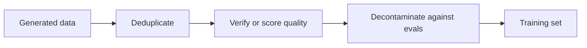

# Lesson 12. Filtering Synthetic Data

**Mission link:** The mission asks you to build a synthetic distillation set filtered for quality, which means knowing which of four checks catches which kind of bad example, and what each costs.
**Primary source:** [Paper: "Textbooks Are All You Need", Gunasekar et al., 2023](https://arxiv.org/abs/2306.11644)
**Prerequisites:** [Lesson 11](0011-rationales-and-explanation-traces.md), [Synthetic data](../GLOSSARY.md), [Rejection sampling](../GLOSSARY.md), [Decontamination](../GLOSSARY.md)

## Warm-up

1. ▢ In Distilling Step-by-Step, the student is trained to produce a label and, separately, a rationale. What does the separation protect against?

Check

Writing the rationale and label as one target sequence sometimes scored below plain fine-tuning (ANLI 43.50 and CQA 61.37 against 43.58 and 62.19 in Table 2). Treated as a second task, the rationale helped on all four benchmarks (lesson 11).

2. ▢ Orca trained on 5M ChatGPT responses and then on 1M GPT-4 responses. Name the two reasons the authors give for using ChatGPT as an intermediate teacher.

Check

The capacity gap between a 13B student and GPT-4, and cost and time, since ChatGPT was faster and cheaper to query and they collected 5 times as much from it (lesson 11).

3. ▢ Self-Instruct drops an instruction whose ROUGE-L similarity to any pool member is 0.7 or more. What kind of bad example is that rule aimed at?

Check

Near-duplicates: the same instruction rephrased, which would inflate the share of one task in the training set without adding anything new (lesson 10).

## Know this

### Volume does not fix a bad example

A teacher writes whatever it writes, including wrong answers, repetitive prompts, and text copied from the benchmark you will be judged on. A student trained on all of it learns all of it. Filtering is the step that decides what the student is allowed to learn, and it is cheaper to do before training than to discover after.

The order is a suggestion: cheap rule-based passes first, expensive checks on what remains. Four tools follow, each from a real pipeline.

### Rule-based filters and deduplication

Self-Instruct (lesson 10) filters with cheap rules: ROUGE-L below 0.7 against every pool member, no keywords such as image or picture, no duplicate instances, no same-input-different-output pairs, and length and repetition heuristics (section 2.2). ROUGE-L measures overlap of the longest common subsequence of words, so it catches rephrasings of the same words and misses a paraphrase that shares few of them.

Two kinds of duplicate matter. An exact duplicate is the easy case. A near-duplicate is the one that quietly raises the weight of one example in training. The threshold is a choice: Self-Instruct picked 0.7 and the paper does not present it as universal. phi-1's authors started from the deduplicated version of The Stack (section 2.1), so deduplication is a first step in both pipelines.

### A quality classifier

phi-1 (Gunasekar et al., 2023) trains a 1.3B code model on "textbook quality" data. Its filter is a classifier. They annotated about 100k files with GPT-4, prompted to judge a snippet's "educational value for a student whose goal is to learn basic coding concepts". They trained a random forest on the output embeddings of a pretrained CodeGen model to predict that score for every file, and applied it to a Python corpus of over 35 million files and over 35B tokens. The filtered set was about 6B tokens (sections 1 and 2.1).

The pipeline has three parts: a small labelled set from an expensive judge, a cheap model trained on it, and the cheap model run over everything. The authors note they used GPT-4 only for annotating that subset, not for generating data.

They also generated data. Under 1B tokens of Python textbooks came from GPT-3.5, with diversity forced by constraining topics and target audience, and about 180M tokens of exercises with solutions were used for fine-tuning. Their 1.3B model was pretrained in under 4 days on 8 A100s, about 8 passes over a pretraining set of under 7B tokens (a little over 50B tokens seen), followed by a fine-tune. They report 50.6% pass@1 on HumanEval and 55.5% on MBPP (abstract). The base model before the exercises fine-tune reached 29% on HumanEval (section 1). These are one paper's self-reported results on code benchmarks, and the paper does not isolate how much each filter or dataset contributed.

### Verification and rejection sampling

Where a checker exists, use it. [Rejection sampling](../GLOSSARY.md) means drawing several candidate answers per prompt and keeping only the ones that pass.

DeepSeek-R1's report (appendix B.3.3) describes the data behind the distilled models:

- They generated reasoning trajectories by rejection sampling from the checkpoint of the first-stage reinforcement-learning run, for each prompt sampling multiple responses and keeping only the correct ones.
- Correctness came from rules where the answer was deterministic. For data that rules could not judge, they fed the ground truth and the model's answer to DeepSeek-V3 as a judge.
- Because the model's output was sometimes hard to read, they also filtered out chains of thought with mixed languages, long paragraphs and code blocks.
- That gave about 600k reasoning samples, plus about 200k non-reasoning samples, for about 800,000 in total (appendix B.3.3 and Table 5, which sums to 804,745). The distilled models were fine-tuned on the 800k samples, for 2 to 3 epochs (appendix B.4.3).

Two kinds of filter appear in that list, and they catch different things: a correctness filter keeps answers that are right, and a format filter keeps answers that are readable. A right answer can still be unreadable, and a readable answer can still be wrong.

What a checker cannot do is judge a style or an open-ended answer. There the options are a model judge, which is itself a model with errors, or a human sample.

### Decontamination

The data you generate must not contain the test you will be graded on. phi-1's authors checked for this carefully, and their record shows it is harder than it sounds (section 5). They first measured n-gram overlap between HumanEval prompts and their exercises: four questions had a 13-gram overlap with some exercise, and all four were false positives. They then used a combination of embedding distance and abstract-syntax-tree (AST) match to find similar code, and pruned the exercise set, removing between 42.5K and 354K of its 879.5K problems depending on the threshold. After pruning, a retrained phi-1 still scored between 45.1% and 50.6% on HumanEval, still above the 41.5% they report for StarCoder, and they say this supports that the gain is not contamination (Table 3). Their results also show the score fell by up to 5.5 points under the strictest pruning, so the filter changed the number.

HumanEval has 164 problems. Differences of a few points are a handful of problems, so they carry less weight than they appear to. See the [held-out data and contamination sheet](../../evals/reference/held-out-data-and-contamination.md) in the evals track for the two contamination pathways and how to detect them.

### What no filter fixes

A filter acts on what you can see in the text. Lesson 19 returns to [subliminal learning](../GLOSSARY.md), where a trait passes from teacher to student through data that looks unrelated to it. Filter for what you can name, and do not expect a clean-looking set to be a clean one.

## Practice

1. ▢ phi-1's classifier starts from about 100k GPT-4-annotated files and runs on a corpus of over 35 million files. Why train a random forest instead of asking GPT-4 about every file?

Check

Cost and speed: a small model on embeddings can score millions of files cheaply, while a judge call per file does not scale. The expensive judge's labels are used once, to teach the cheap model. The cost of this design is that the classifier inherits the judge's mistakes on the subset it saw.

2. ▢ For which data is rejection sampling with a checker the right tool?

    - a) Poems written in a famous poet's style
    - b) Math problems with a verifiable final answer
    - c) Open-ended advice on choosing a career path
    - d) Summaries of very long and ambiguous documents

Check

**b)** A final answer can be checked by rule, so wrong samples are dropped without a judge. (a), (c) and (d) have no ground truth to check against, so the filter would have to be a model judge or a human sample, which is a weaker guarantee.

3. ▢ DeepSeek-R1 reports about 600k reasoning and about 200k non-reasoning samples. What fraction of the roughly 800k is reasoning data, and what does that tell you about the distilled models' training mix?

Check

About three quarters. The mix is mostly reasoning data, filtered by the checks above. Table 5 gives the breakdown: math 395,285 and code 211,129 are the two largest domains.

4. ▢ Your synthetic set shows 12% overlap on 13-gram matching against an eval, and the overlapping items look like different problems. Should you conclude it is clean?

Hint

Think about what phi-1's n-gram check found, and what it then did next.

Check

No. phi-1's authors found their 13-gram check turned up only four questions, all false positives, and judged it too coarse to find similar code, so they added embedding and AST comparison. A low n-gram match does not rule out a close paraphrase or a rewritten solution. Use more than one similarity measure, and report the effect of pruning on the score.

5. ▢ At the strictest pruning (τ of 0.8) phi-1 retrained on the pruned exercises scored 45.1% against the original 50.6%. A colleague says that proves the original number was inflated by contamination. What is wrong with the claim?

Check

Pruning removes about 40% of the exercises at that threshold, including files only vaguely similar to HumanEval, so the drop could come from losing useful training data as well as from removing leakage. The authors present it as a stress test: even after pruning, the model still beats StarCoder. The paper does not separate the two causes, so the claim is not supported.

## Real-world reps

- [ ] Take 30 synthetic examples from any public synthetic dataset. For each, write down which of the four checks (duplicate, quality, verified, contaminated) would have removed it, if any. Count how many survive all four.
- [ ] Compute ROUGE-L between a few instruction pairs you write yourself, one paraphrase and one near copy, and note which one a 0.7 threshold catches.
- [ ] Tomorrow: without notes, list the four filtering tools in this lesson and one pipeline that used each.

## Going further

- [Sequence and Synthetic Data](../reference/sequence-and-synthetic-data.md)
- [Evals: Held-Out Data and Contamination](../../evals/reference/held-out-data-and-contamination.md)
- [Paper: "Textbooks Are All You Need", Gunasekar et al., 2023](https://arxiv.org/abs/2306.11644)
- [Paper: "DeepSeek-R1: Incentivizing Reasoning Capability in LLMs via Reinforcement Learning", DeepSeek-AI, 2025](https://arxiv.org/abs/2501.12948)
- [Resources](../RESOURCES.md)

---

Not landing? Reread the primary source at the top, since this lesson compresses it and compression is where understanding leaks. Check the [glossary](../GLOSSARY.md) for any term that felt slippery.

If the lesson itself is unclear rather than the material, that is a defect: [open an issue](https://github.com/TokenCemetery/teach/issues).
