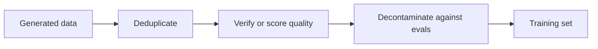

# Lição 12. Filtrando dados sintéticos

**Ligação com a missão:** A missão pede que você construa um conjunto sintético de destilação filtrado por qualidade, o que significa saber qual das quatro verificações pega qual tipo de exemplo ruim, e quanto cada uma custa.
**Fonte principal:** [Artigo científico: "Textbooks Are All You Need", Gunasekar et al., 2023](https://arxiv.org/abs/2306.11644)
**Pré-requisitos:** [Lição 11](0011-rationales-and-explanation-traces.md), [Dados sintéticos](../GLOSSARY.md), [Rejection sampling](../GLOSSARY.md), [Descontaminação](../GLOSSARY.md)

## Aquecimento

1. ▢ No Distilling Step-by-Step, o aluno é treinado para produzir um rótulo e, separadamente, um rationale. Contra o que a separação protege?

Verificação

Escrever o rationale e o rótulo como uma única sequência-alvo às vezes pontuou abaixo do fine-tuning simples (ANLI 43,50 e CQA 61,37 contra 43,58 e 62,19 na Tabela 2). Tratado como uma segunda tarefa, o rationale ajudou nos quatro benchmarks (lição 11).

2. ▢ O Orca treinou em 5M de respostas do ChatGPT e depois em 1M de respostas do GPT-4. Cite as duas razões que os autores dão para usar o ChatGPT como professor intermediário.

Verificação

A lacuna de capacidade entre um aluno de 13B e o GPT-4, e custo e tempo, já que o ChatGPT era mais rápido e barato de consultar e eles coletaram 5 vezes mais dele (lição 11).

3. ▢ O Self-Instruct descarta uma instrução cuja similaridade ROUGE-L com qualquer membro do pool é 0,7 ou mais. Contra que tipo de exemplo ruim essa regra é voltada?

Verificação

Quase duplicatas: a mesma instrução reformulada, que inflaria a participação de uma tarefa no conjunto de treinamento sem acrescentar nada de novo (lição 10).

## Saiba isto

### Volume não corrige um exemplo ruim

Um professor escreve o que escreve, incluindo respostas erradas, prompts repetitivos e texto copiado do benchmark pelo qual você será julgado. Um aluno treinado em tudo isso aprende tudo isso. A filtragem é o passo que decide o que o aluno tem permissão de aprender, e é mais barato fazê-la antes do treinamento do que descobrir depois.

A ordem é uma sugestão: primeiro as passagens baratas baseadas em regras, as verificações caras sobre o que sobrar. Seguem quatro ferramentas, cada uma de um pipeline real.

### Filtros baseados em regras e deduplicação

O Self-Instruct (lição 10) filtra com regras baratas: ROUGE-L abaixo de 0,7 contra todo membro do pool, sem palavras-chave como image ou picture, sem instâncias duplicadas, sem pares de mesma entrada e saída diferente, e heurísticas de comprimento e de repetição (seção 2.2). O ROUGE-L mede a sobreposição da maior subsequência comum de palavras, então ele pega reformulações com as mesmas palavras e deixa passar uma paráfrase que compartilha poucas delas.

Dois tipos de duplicata importam. Uma duplicata exata é o caso fácil. Uma quase duplicata é a que aumenta silenciosamente o peso de um exemplo no treinamento. O limiar é uma escolha: o Self-Instruct escolheu 0,7 e o artigo não o apresenta como universal. Os autores do phi-1 partiram da versão deduplicada do The Stack (seção 2.1), então a deduplicação é um primeiro passo nos dois pipelines.

### Um classificador de qualidade

O phi-1 (Gunasekar et al., 2023) treina um modelo de código de 1,3B em dados de "qualidade de livro-texto". O seu filtro é um classificador. Eles anotaram cerca de 100k arquivos com o GPT-4, instruído a julgar o "valor educacional de um trecho para um estudante cujo objetivo é aprender conceitos básicos de programação". Treinaram um random forest nos embeddings de saída de um modelo CodeGen pré-treinado para prever essa pontuação para cada arquivo e o aplicaram a um corpus de Python com mais de 35 milhões de arquivos e mais de 35B tokens. O conjunto filtrado ficou com cerca de 6B tokens (seções 1 e 2.1).

O pipeline tem três partes: um pequeno conjunto rotulado por um juiz caro, um modelo barato treinado nele e o modelo barato rodando sobre tudo. Os autores observam que usaram o GPT-4 apenas para anotar esse subconjunto, não para gerar dados.

Eles também geraram dados. Menos de 1B tokens de livros-texto de Python vieram do GPT-3.5, com a diversidade forçada restringindo tópicos e público-alvo, e cerca de 180M tokens de exercícios com soluções foram usados no fine-tuning. O modelo de 1,3B deles foi pré-treinado em menos de 4 dias em 8 A100, cerca de 8 passagens sobre um conjunto de pré-treinamento de menos de 7B tokens (um pouco mais de 50B tokens vistos), seguido de um fine-tuning. Eles relatam 50,6% de pass@1 no HumanEval e 55,5% no MBPP (resumo). O modelo base antes do fine-tuning com os exercícios chegou a 29% no HumanEval (seção 1). Esses são resultados autorrelatados de um único artigo em benchmarks de código, e o artigo não isola quanto cada filtro ou dataset contribuiu.

### Verificação e rejection sampling

Onde existir um verificador, use-o. [Rejection sampling](../GLOSSARY.md) significa tirar várias respostas candidatas por prompt e manter apenas as que passam.

O relatório do DeepSeek-R1 (apêndice B.3.3) descreve os dados por trás dos modelos destilados:

- Eles geraram trajetórias de raciocínio por rejection sampling a partir do checkpoint da execução de reinforcement learning da primeira etapa, amostrando várias respostas para cada prompt e mantendo apenas as corretas.
- A correção vinha de regras onde a resposta era determinística. Para os dados que as regras não conseguiam julgar, eles forneceram a verdade de referência e a resposta do modelo ao DeepSeek-V3 como juiz.
- Como a saída do modelo às vezes era difícil de ler, eles também filtraram chains of thought com idiomas misturados, parágrafos longos e blocos de código.
- Isso deu cerca de 600k amostras de raciocínio, mais cerca de 200k amostras sem raciocínio, para cerca de 800.000 no total (apêndice B.3.3 e Tabela 5, que soma 804.745). Os modelos destilados passaram por fine-tuning nas 800k amostras, por 2 a 3 épocas (apêndice B.4.3).

Dois tipos de filtro aparecem nessa lista, e eles pegam coisas diferentes: um filtro de correção mantém as respostas que estão certas, e um filtro de formato mantém as respostas que são legíveis. Uma resposta certa ainda pode ser ilegível, e uma resposta legível ainda pode estar errada.

O que um verificador não consegue fazer é julgar um estilo ou uma resposta aberta. Ali as opções são um juiz-modelo, que é ele mesmo um modelo com erros, ou uma amostra humana.

### Descontaminação

Os dados que você gera não podem conter o teste pelo qual você será avaliado. Os autores do phi-1 verificaram isso com cuidado, e o registro deles mostra que é mais difícil do que parece (seção 5). Eles primeiro mediram a sobreposição de n-gramas entre os prompts do HumanEval e os seus exercícios: quatro perguntas tiveram uma sobreposição de 13-gramas com algum exercício, e as quatro eram falsos positivos. Depois usaram uma combinação de distância de embedding e correspondência de árvore sintática abstrata (AST) para encontrar código parecido e podaram o conjunto de exercícios, removendo entre 42,5K e 354K dos seus 879,5K problemas conforme o limiar. Depois da poda, um phi-1 retreinado ainda pontuou entre 45,1% e 50,6% no HumanEval, ainda acima dos 41,5% que eles relatam para o StarCoder, e eles dizem que isso apoia que o ganho não é contaminação (Tabela 3). Os resultados deles também mostram que a pontuação caiu até 5,5 pontos sob a poda mais estrita, então o filtro mudou o número.

O HumanEval tem 164 problemas. Diferenças de alguns pontos são um punhado de problemas, então pesam menos do que parecem. Veja a folha [Dados Held-Out e Contaminação](../../evals/reference/held-out-data-and-contamination.md) na trilha de evals para os dois caminhos da contaminação e como detectá-los.

### O que nenhum filtro corrige

Um filtro age sobre o que você consegue ver no texto. A lição 19 volta ao [aprendizado subliminar](../GLOSSARY.md), em que um traço passa do professor para o aluno por meio de dados que parecem não relacionados a ele. Filtre pelo que você consegue nomear, e não espere que um conjunto de aparência limpa seja um conjunto limpo.

## Prática

1. ▢ O classificador do phi-1 parte de cerca de 100k arquivos anotados pelo GPT-4 e roda em um corpus de mais de 35 milhões de arquivos. Por que treinar um random forest em vez de perguntar ao GPT-4 sobre cada arquivo?

Verificação

Custo e velocidade: um modelo pequeno sobre embeddings consegue pontuar milhões de arquivos de forma barata, enquanto uma chamada de juiz por arquivo não escala. Os rótulos do juiz caro são usados uma vez, para ensinar o modelo barato. O custo desse design é que o classificador herda os erros do juiz no subconjunto que viu.

2. ▢ Para quais dados o rejection sampling com um verificador é a ferramenta certa?

    - a) Poemas escritos no estilo de um poeta famoso
    - b) Problemas de matemática com uma resposta final verificável
    - c) Conselhos abertos sobre como escolher uma carreira
    - d) Resumos de documentos muito longos e ambíguos

Verificação

**b)** Uma resposta final pode ser verificada por regra, então as amostras erradas são descartadas sem um juiz. (a), (c) e (d) não têm verdade de referência contra a qual verificar, então o filtro teria que ser um juiz-modelo ou uma amostra humana, que é uma garantia mais fraca.

3. ▢ O DeepSeek-R1 relata cerca de 600k amostras de raciocínio e cerca de 200k sem raciocínio. Que fração das cerca de 800k são dados de raciocínio, e o que isso diz sobre a mistura de treinamento dos modelos destilados?

Verificação

Cerca de três quartos. A mistura é majoritariamente de dados de raciocínio, filtrados pelas verificações acima. A Tabela 5 dá o detalhamento: matemática 395.285 e código 211.129 são os dois maiores domínios.

4. ▢ O seu conjunto sintético mostra 12% de sobreposição em correspondência de 13-gramas contra um eval, e os itens sobrepostos parecem problemas diferentes. Você deve concluir que ele está limpo?

Dica

Pense no que a verificação de n-gramas do phi-1 encontrou e no que ele fez em seguida.

Verificação

Não. Os autores do phi-1 constataram que a verificação de 13-gramas encontrou apenas quatro perguntas, todas falsos positivos, e a julgaram grosseira demais para encontrar código parecido, então acrescentaram a comparação por embedding e por AST. Uma correspondência baixa de n-gramas não exclui uma paráfrase próxima ou uma solução reescrita. Use mais de uma medida de similaridade e relate o efeito da poda na pontuação.

5. ▢ Com a poda mais estrita (τ de 0,8), o phi-1 retreinado nos exercícios podados pontuou 45,1% contra os 50,6% originais. Um colega diz que isso prova que o número original estava inflado por contaminação. O que há de errado com a alegação?

Verificação

A poda remove cerca de 40% dos exercícios nesse limiar, incluindo arquivos apenas vagamente parecidos com o HumanEval, então a queda poderia vir de perder dados de treinamento úteis tanto quanto de remover vazamento. Os autores a apresentam como um teste de estresse: mesmo depois da poda, o modelo ainda supera o StarCoder. O artigo não separa as duas causas, então a alegação não é sustentada.

## Prática no mundo real

- [ ] Pegue 30 exemplos sintéticos de qualquer dataset sintético público. Para cada um, anote qual das quatro verificações (duplicata, qualidade, verificado, contaminado) o teria removido, se alguma. Conte quantos sobrevivem às quatro.
- [ ] Calcule o ROUGE-L entre alguns pares de instruções que você mesmo escrever, uma paráfrase e uma quase cópia, e observe qual delas um limiar de 0,7 pega.
- [ ] Amanhã: sem consultar anotações, liste as quatro ferramentas de filtragem desta lição e um pipeline que usou cada uma.

## Para ir além

- [Sequência e Dados Sintéticos](../reference/sequence-and-synthetic-data.md)
- [Dados Held-Out e Contaminação](../../evals/reference/held-out-data-and-contamination.md)
- [Artigo científico: "Textbooks Are All You Need", Gunasekar et al., 2023](https://arxiv.org/abs/2306.11644)
- [Artigo científico: "DeepSeek-R1: Incentivizing Reasoning Capability in LLMs via Reinforcement Learning", DeepSeek-AI, 2025](https://arxiv.org/abs/2501.12948)
- [Recursos](../RESOURCES.md)

---

Não ficou claro? Releia a fonte principal no topo, já que esta lição a comprime e é na compressão que o entendimento escapa. Consulte o [glossário](../GLOSSARY.md) para qualquer termo que pareceu escorregadio.

Se o problema é a lição em si, e não o material, isso é um defeito: [abra uma issue](https://github.com/TokenCemetery/teach/issues).
