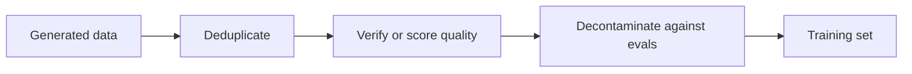

# Урок 12. Фильтрация синтетических данных

**Связь с целью курса:** Цель курса требует, чтобы вы могли построить синтетический набор для дистилляции, отфильтрованный по качеству, а это значит знать, какая из четырёх проверок ловит какой вид плохих примеров и чего каждая стоит.
**Первоисточник:** [Научная статья: "Textbooks Are All You Need", Gunasekar et al., 2023](https://arxiv.org/abs/2306.11644)
**Предварительные требования:** [Урок 11](0011-rationales-and-explanation-traces.md), [синтетические данные](../GLOSSARY.md), [отбраковочная выборка](../GLOSSARY.md), [деконтаминация](../GLOSSARY.md)

## Разминка

1. ▢ В Distilling Step-by-Step ученика обучают выдавать метку и, отдельно, обоснование. От чего защищает это разделение?

Проверка

Запись обоснования и метки как одной целевой последовательности иногда давала результат ниже обычного дообучения (ANLI 43.50 и CQA 61.37 против 43.58 и 62.19 в таблице 2). Рассматриваемое как вторая задача, обоснование помогло на всех четырёх бенчмарках (урок 11).

2. ▢ Orca обучалась на 5M ответов ChatGPT, а затем на 1M ответов GPT-4. Назовите две причины, которые приводят авторы для использования ChatGPT как промежуточного учителя.

Проверка

Разрыв в ёмкости между учеником на 13B и GPT-4, а также стоимость и время, так как ChatGPT был быстрее и дешевле в запросах и от него они собрали в 5 раз больше (урок 11).

3. ▢ Self-Instruct отбрасывает инструкцию, у которой сходство по ROUGE-L с любым членом пула составляет 0.7 или более. На какой вид плохих примеров нацелено это правило?

Проверка

Почти-дубликаты: та же инструкция в другой формулировке, которая раздувала бы долю одной задачи в обучающем наборе, не добавляя ничего нового (урок 10).

## Что нужно знать

### Объём не исправляет плохой пример

Учитель пишет что пишет, включая неверные ответы, повторяющиеся промпты и текст, скопированный из бенчмарка, по которому вас будут оценивать. Ученик, обученный на всём этом, выучивает всё это. Фильтрация это шаг, который решает, чему ученику позволено учиться, и дешевле сделать её до обучения, чем обнаружить последствия после.

Порядок это предложение: сначала дешёвые проходы по правилам, дорогие проверки на том, что осталось. Далее четыре инструмента, каждый из настоящего конвейера.

### Фильтры по правилам и дедупликация

Self-Instruct (урок 10) фильтрует дешёвыми правилами: ROUGE-L ниже 0.7 относительно каждого члена пула, никаких ключевых слов вроде image или picture, никаких дубликатов экземпляров, никаких пар «тот же вход, другой выход» и эвристик по длине и повторам (раздел 2.2). ROUGE-L измеряет перекрытие наибольшей общей подпоследовательности слов, так что он ловит перефразировки теми же словами и пропускает парафраз, у которого с оригиналом мало общих слов.

Важны два вида дубликатов. Точный дубликат это простой случай. Почти-дубликат это тот, который тихо повышает вес одного примера при обучении. Порог это выбор: Self-Instruct выбрал 0.7, и статья не представляет его как универсальный. Авторы phi-1 начали с дедуплицированной версии The Stack (раздел 2.1), так что дедупликация это первый шаг в обоих конвейерах.

### Классификатор качества

phi-1 (Gunasekar et al., 2023) обучает модель для кода на 1.3B на данных «качества учебника». Её фильтр это классификатор. Они разметили около 100 тысяч файлов с помощью GPT-4, которому предложили оценить «образовательную ценность фрагмента для студента, цель которого выучить базовые понятия программирования». Они обучили случайный лес на выходных эмбеддингах предобученной модели CodeGen предсказывать эту оценку для каждого файла и применили его к корпусу Python из более чем 35 миллионов файлов и более 35B токенов. Отфильтрованный набор составил около 6B токенов (разделы 1 и 2.1).

В конвейере три части: небольшой размеченный набор от дорогого судьи, дешёвая модель, обученная на нём, и дешёвая модель, прогнанная по всему. Авторы отмечают, что использовали GPT-4 только для разметки этого подмножества, а не для генерации данных.

Они также генерировали данные. Менее 1B токенов учебников по Python пришли от GPT-3.5, с разнообразием, обеспеченным ограничением тем и целевой аудитории, а около 180M токенов упражнений с решениями использовали для дообучения. Их модель на 1.3B предобучали менее 4 суток на 8 A100, примерно 8 проходов по набору для предобучения менее чем в 7B токенов (чуть более 50B увиденных токенов), с последующим дообучением. Они сообщают о 50.6% pass@1 на HumanEval и 55.5% на MBPP (аннотация). Базовая модель до дообучения на упражнениях достигала 29% на HumanEval (раздел 1). Это самостоятельно заявленные результаты одной статьи на бенчмарках для кода, и статья не выделяет, сколько дал каждый фильтр или набор данных.

### Верификация и отбраковочная выборка

Где есть проверяющий, используйте его. [Отбраковочная выборка](../GLOSSARY.md) означает получение нескольких кандидатов-ответов на промпт и сохранение только тех, что проходят проверку.

Отчёт DeepSeek-R1 (приложение B.3.3) описывает данные, стоящие за дистиллированными моделями:

- Они генерировали траектории рассуждений отбраковочной выборкой из чекпоинта запуска обучения с подкреплением первого этапа, для каждого промпта сэмплируя несколько ответов и оставляя только верные.
- Верность определялась правилами там, где ответ детерминирован. Для данных, которые правила оценить не могли, они подавали истину и ответ модели в DeepSeek-V3 как судье.
- Поскольку выход модели иногда было трудно читать, они также отфильтровывали цепочки рассуждений со смешанными языками, длинными абзацами и блоками кода.
- Это дало около 600 тысяч сэмплов рассуждений плюс около 200 тысяч сэмплов без рассуждений, всего около 800 000 (приложение B.3.3 и таблица 5, дающая в сумме 804 745). Дистиллированные модели дообучали на 800 тысячах сэмплов, 2 или 3 эпохи (приложение B.4.3).

В этом списке встречаются два вида фильтра, и они ловят разное: фильтр верности сохраняет правильные ответы, а фильтр формата сохраняет читаемые ответы. Правильный ответ всё равно может быть нечитаемым, а читаемый ответ всё равно может быть неверным.

Проверяющий не может оценить стиль или открытый ответ. Там остаются варианты: судья-модель, которая сама модель с ошибками, или человеческая выборка.

### Деконтаминация

Генерируемые вами данные не должны содержать тест, по которому вас будут оценивать. Авторы phi-1 проверяли это тщательно, и их запись показывает, что это труднее, чем кажется (раздел 5). Сначала они измерили перекрытие n-грамм между промптами HumanEval и своими упражнениями: у четырёх вопросов нашлось перекрытие 13-грамм с каким-то упражнением, и все четыре оказались ложными срабатываниями. Затем они использовали сочетание расстояния между эмбеддингами и совпадения по абстрактному синтаксическому дереву (AST), чтобы найти похожий код, и сократили набор упражнений, удалив от 42.5K до 354K из его 879.5K задач в зависимости от порога. После сокращения переобученная phi-1 по-прежнему набирала от 45.1% до 50.6% на HumanEval, всё ещё выше 41.5%, о которых они сообщают для StarCoder, и они говорят, что это подтверждает, что прирост не вызван загрязнением (таблица 3). Их результаты также показывают, что оценка упала до 5.5 пунктов при самом строгом сокращении, так что фильтр изменил число.

В HumanEval 164 задачи. Различия в несколько пунктов это несколько задач, так что они весят меньше, чем кажется. См. [Отложенные данные и загрязнение](../../evals/reference/held-out-data-and-contamination.md) в курсе по эвалам: там два пути загрязнения и способы их обнаружения.

### Что не исправляет никакой фильтр

Фильтр действует на то, что видно в тексте. Урок 19 возвращается к [подсознательному обучению](../GLOSSARY.md), когда черта переходит от учителя к ученику через данные, которые выглядят несвязанными с ней. Фильтруйте то, что можете назвать, и не ожидайте, что чистый на вид набор действительно чист.

## Практика

1. ▢ Классификатор phi-1 начинает с около 100 тысяч размеченных GPT-4 файлов и работает на корпусе из более чем 35 миллионов файлов. Зачем обучать случайный лес, а не спрашивать GPT-4 про каждый файл?

Проверка

Стоимость и скорость: небольшая модель на эмбеддингах может дёшево оценить миллионы файлов, а вызов судьи на каждый файл не масштабируется. Метки дорогого судьи используются один раз, чтобы обучить дешёвую модель. Цена такого дизайна в том, что классификатор наследует ошибки судьи на том подмножестве, которое тот видел.

2. ▢ Для каких данных отбраковочная выборка с проверяющим это правильный инструмент?

    - a) Стихи, написанные в стиле известного поэта
    - b) Математические задачи с проверяемым итоговым ответом
    - c) Открытые советы по выбору карьерного пути
    - d) Резюме очень длинных и неоднозначных документов

Проверка

**b)** Итоговый ответ можно проверить по правилу, так что неверные сэмплы отбрасываются без судьи. У (a), (c) и (d) нет эталона, с которым можно сверяться, так что фильтром пришлось бы быть судье-модели или человеческой выборке, а это более слабая гарантия.

3. ▢ DeepSeek-R1 сообщает о около 600 тысячах сэмплов рассуждений и около 200 тысячах сэмплов без рассуждений. Какая доля примерно 800 тысяч приходится на данные рассуждений и что это говорит о смеси для обучения дистиллированных моделей?

Проверка

Около трёх четвертей. Смесь в основном состоит из данных рассуждений, отфильтрованных описанными выше проверками. Таблица 5 даёт разбивку: математика 395 285 и код 211 129 это две крупнейшие области.

4. ▢ В вашем синтетическом наборе видно 12% перекрытия при сопоставлении 13-грамм с эвалом, и перекрывающиеся элементы выглядят как разные задачи. Следует ли заключить, что набор чист?

Подсказка

Подумайте, что нашла проверка n-грамм в phi-1 и что они сделали после этого.

Проверка

Нет. Авторы phi-1 обнаружили, что их проверка 13-грамм выявила лишь четыре вопроса, все ложные срабатывания, и сочли её слишком грубой для поиска похожего кода, поэтому добавили сравнение эмбеддингов и AST. Низкое совпадение n-грамм не исключает близкого парафраза или переписанного решения. Используйте больше одной меры сходства и сообщайте, как сокращение влияет на оценку.

5. ▢ При самом строгом сокращении (τ равно 0.8) phi-1, переобученная на сокращённых упражнениях, набрала 45.1% против исходных 50.6%. Коллега говорит, что это доказывает, что исходное число было раздуто загрязнением. Что не так с этим утверждением?

Проверка

Сокращение при этом пороге убирает около 40% упражнений, включая файлы, лишь смутно похожие на HumanEval, так что падение могло возникнуть и из-за потери полезных обучающих данных, а не только из-за удаления утечки. Авторы представляют это как стресс-тест: даже после сокращения модель всё ещё превосходит StarCoder. Статья эти две причины не разделяет, так что утверждение не подтверждено.

## Практика в реальной работе

- [ ] Возьмите 30 синтетических примеров из любого публичного синтетического датасета. Для каждого запишите, какая из четырёх проверок (дубликат, качество, верификация, загрязнение) его удалила бы, если вообще удалила. Посчитайте, сколько пройдут все четыре.
- [ ] Вычислите ROUGE-L между несколькими парами инструкций, которые напишете сами, одним парафразом и одной почти-копией, и отметьте, какую из них поймает порог 0.7.
- [ ] Завтра: без заметок перечислите четыре инструмента фильтрации из этого урока и по одному конвейеру, который использовал каждый.

## Что почитать дальше

- [Последовательности и синтетические данные](../reference/sequence-and-synthetic-data.md)
- [Отложенные данные и загрязнение](../../evals/reference/held-out-data-and-contamination.md)
- [Научная статья: "Textbooks Are All You Need", Gunasekar et al., 2023](https://arxiv.org/abs/2306.11644)
- [Научная статья: "DeepSeek-R1: Incentivizing Reasoning Capability in LLMs via Reinforcement Learning", DeepSeek-AI, 2025](https://arxiv.org/abs/2501.12948)
- [Ресурсы](../RESOURCES.md)

---

Не доходит? Перечитайте первоисточник в начале: этот урок его сжимает, а при сжатии понимание как раз и теряется. Загляните в [глоссарий](../GLOSSARY.md), если какой-то термин показался скользким.

Если неясен сам урок, а не материал, это дефект: [откройте issue](https://github.com/TokenCemetery/teach/issues).
