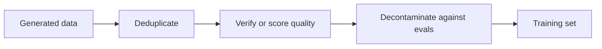

# 第 12 课：过滤合成数据

**使命关联:** 本使命要求你构建一份经过质量过滤的合成蒸馏数据集，这意味着要知道四种检查各自能抓住哪一类糟糕的样本，以及各自要付出什么代价。
**主要来源:** [论文：“Textbooks Are All You Need”，Gunasekar 等，2023](https://arxiv.org/abs/2306.11644)
**前置知识:** [第 11 课](0011-rationales-and-explanation-traces.md)、[合成数据](../GLOSSARY.md)、[拒绝采样](../GLOSSARY.md)、[去污染](../GLOSSARY.md)

## 热身

1. ▢ 在 Distilling Step-by-Step 里，学生被训练去产出一个标签，并单独产出一条推理依据。这种分开保护的是什么？

检查

把推理依据和标签写成一条目标序列，有时得分低于普通微调（表 2 中，ANLI 是 43.50、CQA 是 61.37，而普通微调是 43.58 和 62.19）。把推理依据当作第二项任务，它在四个基准上都有帮助（第 11 课）。

2. ▢ Orca 先在 500 万条 ChatGPT 回复上训练，再在 100 万条 GPT-4 回复上训练。说出作者把 ChatGPT 用作中间教师的两个理由。

检查

13B 学生与 GPT-4 之间的容量差距，以及成本和时间，因为 ChatGPT 查询起来更快更便宜，他们从它那里收集的量是 5 倍（第 11 课）。

3. ▢ Self-Instruct 会丢弃与池中任何成员的 ROUGE-L 相似度达到 0.7 或更高的指令。这条规则针对的是哪一类糟糕的样本？

检查

近似重复：同一条指令换个说法，这会在不增加任何新东西的情况下，抬高某一项任务在训练集中的占比（第 10 课）。

## 要点

### 数量弥补不了糟糕的样本

教师想写什么就写什么，包括错误的答案、重复的提示词，以及从你将来要被评判的基准里抄来的文本。在这些东西上全部训练过的学生，会把它们全学进去。过滤就是决定学生被允许学什么的那一步，在训练之前做，比训练之后才发现要便宜。

这个顺序只是一个建议：先做便宜的、基于规则的过滤，再对剩下的做昂贵的检查。下面是四种工具，各自来自一条真实的流水线。

### 基于规则的过滤与去重

Self-Instruct（第 10 课）用便宜的规则过滤：与池中每个成员的 ROUGE-L 低于 0.7，不含 image 或 picture 之类的关键词，没有重复的实例，没有输入相同而输出不同的配对，以及长度和重复的启发式规则（第 2.2 节）。ROUGE-L 度量的是词的最长公共子序列的重叠，所以它能抓住用同样的词换个说法的情况，却抓不住共享的词很少的释义。

有两种重复很重要。完全重复是容易的情形。近似重复则会悄悄抬高训练中某个样本的权重。阈值是一个选择：Self-Instruct 选了 0.7，论文并没有把它当作通用值。phi-1 的作者从去重后的 The Stack 版本出发（第 2.1 节），所以去重是两条流水线共同的第一步。

### 质量分类器

phi-1（Gunasekar 等，2023）在“教科书质量”的数据上训练一个 1.3B 的代码模型。它的过滤器是一个分类器。他们用 GPT-4 标注了大约 10 万个文件，提示它判断一个代码片段对“目标是学习基础编程概念的学生的教育价值”。他们在一个预训练 CodeGen 模型的输出嵌入上训练了一个随机森林，让它为每个文件预测这个分数，并把它应用到一个有超过 3500 万个文件、超过 350 亿 token 的 Python 语料上。过滤后的数据集约 60 亿 token（第 1 和第 2.1 节）。

这条流水线有三个部分：由昂贵的评判者给出的一小份标注集，在其上训练出来的一个便宜的模型，以及把这个便宜的模型跑在所有数据上。作者指出，他们只用 GPT-4 来标注那个子集，而没有用它来生成数据。

他们也生成了数据。不到 10 亿 token 的 Python 教科书来自 GPT-3.5，通过限定主题和目标读者来强制保证多样性，另有约 1.8 亿 token 带解答的习题用于微调。他们的 1.3B 模型在 8 块 A100 上预训练了不到 4 天，对不到 70 亿 token 的预训练集大约过了 8 遍（共见过略多于 500 亿 token），之后再做一次微调。他们报告在 HumanEval 上 pass@1 为 50.6%，在 MBPP 上为 55.5%（摘要）。在做习题微调之前的基础模型，在 HumanEval 上达到 29%（第 1 节）。这些是一篇论文在代码基准上自己报告的结果，论文并没有把每个过滤器或数据集各自的贡献区分开。

### 验证与拒绝采样

有检查器的地方，就用它。[拒绝采样](../GLOSSARY.md)的意思是，对每个提示词抽取若干候选答案，只保留通过检查的那些。

DeepSeek-R1 的报告（附录 B.3.3）描述了蒸馏模型背后的数据：

- 他们对第一阶段强化学习运行的检查点做拒绝采样，生成推理轨迹，对每个提示词采样多个回复，只保留正确的。
- 在答案是确定性的地方，正确性由规则判定。对规则无法判断的数据，他们把标准答案和模型的答案交给 DeepSeek-V3 当评判者。
- 由于模型的输出有时难以阅读，他们还过滤掉了混杂多种语言、含有长段落和代码块的思维链。
- 这得到了大约 60 万条推理样本，外加约 20 万条非推理样本，总共约 800,000 条（附录 B.3.3 和表 5，加起来是 804,745）。蒸馏模型在这 80 万条样本上微调，训练 2 到 3 个轮次（附录 B.4.3）。

那份清单里出现了两种过滤器，它们抓住的东西不同：正确性过滤器保留正确的答案，格式过滤器保留可读的答案。正确的答案仍然可能不可读，可读的答案仍然可能是错的。

检查器做不到的，是评判风格或开放式的答案。那里的选择是模型评判者（它本身也是会出错的模型），或者人工抽样。

### 去污染

你生成的数据，不能包含你将来要被打分的那场测试。phi-1 的作者仔细检查了这一点，而他们的记录显示，这比听起来要难（第 5 节）。他们先度量了 HumanEval 的提示词与他们的习题之间的 n-gram 重叠：有四道题与某些习题有 13-gram 的重叠，而这四个全是误报。随后他们结合嵌入距离和抽象语法树（AST）匹配去找相似的代码，并对习题集做了剪枝，按阈值的不同，在 879.5K 道题里去掉了 42.5K 到 354K 道。剪枝之后，重新训练的 phi-1 在 HumanEval 上仍然得到 45.1% 到 50.6%，仍然高于他们报告的 StarCoder 的 41.5%，他们说这支持提升并非来自污染这一点（表 3）。他们的结果同样显示，在最严格的剪枝下，分数下降了多达 5.5 分，所以这个过滤器改变了这个数字。

HumanEval 有 164 道题。几分的差异只是少数几道题，所以它们的分量比看上去要轻。关于两条污染途径以及如何检测它们，请参阅评测系列中的[留出数据与数据污染](../../evals/reference/held-out-data-and-contamination.md)参考表。

### 没有任何过滤器能修复的

过滤器作用于你在文本里看得见的东西。第 19 课会回到[潜意识学习](../GLOSSARY.md)，其中一种特质，通过看起来与它无关的数据，从教师传到了学生。要过滤你能叫出名字的东西，不要指望看起来干净的数据集就真的是干净的。

## 练习

1. ▢ phi-1 的分类器从大约 10 万个由 GPT-4 标注的文件出发，运行在一个有超过 3500 万个文件的语料上。为什么要训练一个随机森林，而不是对每个文件都去问 GPT-4？

检查

成本和速度：一个作用在嵌入上的小模型，可以便宜地给数百万个文件打分，而每个文件调用一次评判者则无法扩展。昂贵的评判者的标签只用一次，用来教那个便宜的模型。这种设计的代价是，分类器会继承评判者在它看过的那个子集上的错误。

2. ▢ 对哪类数据，带检查器的拒绝采样是合适的工具？

    - a) 模仿某位著名诗人风格写的诗
    - b) 有可验证最终答案的数学题
    - c) 关于如何选择职业道路的开放式建议
    - d) 非常长而含糊的文档的摘要

检查

**b)** 最终答案可以由规则检查，所以错误的样本不需要评判者就能被丢掉。(a)、(c) 和 (d) 没有可供核对的标准答案，所以过滤器只能是模型评判者或人工抽样，这是较弱的保证。

3. ▢ DeepSeek-R1 报告了约 60 万条推理样本和约 20 万条非推理样本。在大约 80 万条里，推理数据占多少比例？这说明了蒸馏模型的训练混合是怎样的？

检查

大约四分之三。这份混合数据主要是推理数据，并经过上面那些检查的过滤。表 5 给出了分类：数学 395,285 条和代码 211,129 条，是最大的两个领域。

4. ▢ 你的合成数据集，在针对某个评测集做 13-gram 匹配时显示 12% 的重叠，而重叠的条目看起来是不同的题目。你该下结论说它是干净的吗？

提示

想想 phi-1 的 n-gram 检查发现了什么，以及它接下来又做了什么。

检查

不该。phi-1 的作者发现，他们的 13-gram 检查只找出四道题，全是误报，并认为它对找出相似的代码来说太粗糙，所以他们加入了嵌入和 AST 的比较。低的 n-gram 匹配，并不能排除相近的释义或改写过的解答。要使用不止一种相似度度量，并报告剪枝对分数的影响。

5. ▢ 在最严格的剪枝下（τ 为 0.8），在剪枝后的习题上重新训练的 phi-1 得分 45.1%，而原来是 50.6%。一位同事说这证明原来的数字被污染抬高了。这个说法错在哪里？

检查

在那个阈值下，剪枝去掉了大约 40% 的习题，其中包括只是与 HumanEval 略有相似的文件，所以下降可能既来自丢掉了有用的训练数据，也来自去掉了泄漏。作者把它当作一次压力测试：即使剪枝之后，这个模型仍然胜过 StarCoder。论文没有把这两个原因区分开，所以这个说法没有得到支持。

## 实战练习

- [ ] 从任何一个公开的合成数据集里取 30 个合成样本。对每一个，写下四种检查（重复、质量、已验证、污染）中，哪一种会把它去掉（如果有的话）。数一数有多少个能通过全部四种检查。
- [ ] 对你自己写的几对指令计算 ROUGE-L，一对是释义，一对是近似的副本，并记下 0.7 的阈值能抓住哪一对。
- [ ] 明天：不看笔记，列出本课的四种过滤工具，以及使用过每一种的一条流水线。

## 延伸阅读

- [序列与合成数据](../reference/sequence-and-synthetic-data.md)
- [评测：留出数据与数据污染](../../evals/reference/held-out-data-and-contamination.md)
- [论文：“Textbooks Are All You Need”，Gunasekar 等，2023](https://arxiv.org/abs/2306.11644)
- [论文：“DeepSeek-R1: Incentivizing Reasoning Capability in LLMs via Reinforcement Learning”，DeepSeek-AI，2025](https://arxiv.org/abs/2501.12948)
- [资源](../RESOURCES.md)

---

没学明白？请重读顶部的主要来源，因为本课是对它的压缩，而理解正是在压缩中流失的。如果有哪个术语觉得含糊，可以查看[术语表](../GLOSSARY.md)。

如果问题出在课程本身，而不是学习材料，那就是一个缺陷：[提交 issue](https://github.com/TokenCemetery/teach/issues)。
