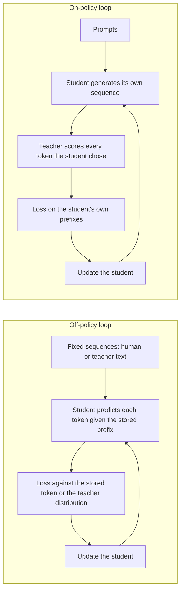

# Lección 14. Exposure bias

**Vínculo con la misión:** La misión te pide decir cuándo la destilación on-policy vale su costo frente a entrenar con salidas fijas del profesor, y eso empieza por saber exactamente qué no enseñan las salidas fijas.
**Fuente principal:** [Paper: "On-Policy Distillation of Language Models: Learning from Self-Generated Mistakes", Agarwal et al., 2023](https://arxiv.org/abs/2306.13649), secciones 1 y 3.1
**Requisitos previos:** [Lección 8](0008-sequence-level-distillation.md), [Lección 9](0009-token-or-sequence.md), [Exposure bias](../GLOSSARY.md), [Destilación off-policy](../GLOSSARY.md), [Destilación a nivel de token](../GLOSSARY.md)

## Calentamiento

1. ▢ En la destilación a nivel de secuencia, ¿con qué entrena el estudiante, y de quién son las palabras del prefijo en cada posición?

Comprobación

Entrena con entropía cruzada ordinaria sobre secuencias completas que decodificó el profesor, así que cada prefijo en el que se condiciona el estudiante lo escribió el profesor. Nunca se le pide al estudiante que continúe un texto que escribió él mismo.

2. ▢ La destilación a nivel de token minimiza una divergencia en cada posición. ¿Bajo la distribución de quién sobre las posiciones se toma ese promedio, en la versión de KL directa?

Comprobación

La del profesor, por eso la [KL directa](../GLOSSARY.md) castiga al estudiante por dejar fuera cualquier cosa que el profesor considere probable. Sobre qué secuencias corre el promedio es una elección aparte, y es el tema de esta lección.

3. ▢ La lección 9 comparó el nivel de token y el de secuencia según lo que expone el profesor. ¿Qué nivel funciona cuando solo tienes el texto del profesor?

Comprobación

El nivel de secuencia, porque solo necesita texto decodificado. El nivel de token necesita la distribución por posición del profesor, así que necesita logits.

## Qué debes saber

### El entrenamiento ve un tipo de prefijo, la inferencia otro

Un estudiante autorregresivo predice cada token dado todo lo que hay antes. En el supervised fine-tuning, y en todos los métodos de destilación vistos hasta ahora, el "todo lo que hay antes" viene de un dataset fijo: texto humano, o texto que generó el profesor.

En inferencia el prefijo es la propia salida del estudiante. Agarwal et al. enuncian la consecuencia: las secuencias parciales con que se topa el estudiante al generar "pueden ser bastante distintas" de las vistas en el entrenamiento, y como cada predicción depende de las anteriores, un error en un paso temprano puede afectar a las predicciones posteriores y degradar todo el texto (sección 3.1). Lo llaman desajuste de distribución entre entrenamiento e inferencia y señalan que es un problema conocido en el aprendizaje por imitación.

El término del glosario para ello es [exposure bias](../GLOSSARY.md): el modelo nunca estuvo expuesto a sus propios errores durante el entrenamiento, así que no tiene práctica recuperándose de ellos.

### El teacher forcing es cómo surge el desajuste

Entrenar con un prefijo almacenado y puntuar el siguiente token suele llamarse teacher forcing. Esta lección usa ese nombre como contexto, no como un término con fuente: nada en el glosario lo fija. Lo que importa es el efecto. Cada posición se puntúa como si todas las posiciones anteriores hubieran sido correctas.

Una ilustración sencilla, con un número supuesto y no una medición: si cada token tuviera una probabilidad independiente del 1% de salir del territorio con el que se entrenó el estudiante, una respuesta de 100 tokens se mantendría dentro con probabilidad 0.99 elevado a 100, alrededor del 37%. El supuesto de independencia es erróneo en la dirección que empeora las cosas. Tras el primer desliz el estudiante está en un estado desconocido, donde un segundo desliz es más probable, que es la cascada que describe el paper.

### La destilación a nivel de secuencia no lo arregla

Es tentador pensar que entrenar con las propias generaciones del profesor resuelve el desajuste, ya que son salidas completas de ejecución libre. Son las salidas de ejecución libre del profesor. Agarwal et al. agrupan la KD a nivel de secuencia con la KD supervisada como métodos que usan un conjunto fijo de secuencias de salida, ya sea la verdad de referencia o generadas por el profesor, y dicen que estos enfoques dan lugar a un desajuste entre entrenamiento e inferencia para el estudiante (sección 3.1).

El estudiante sigue sin ver nunca un prefijo que escribió él. Solo cambió la identidad de quien lo escribe.

### La solución: entrenar con las propias secuencias del estudiante

El movimiento del paper es tratar la destilación como aprendizaje por imitación con un experto interactivo. La imitación on-policy recoge secuencias con la propia política del estudiante, pide al experto etiquetas sobre esas secuencias y reentrena. Para la destilación la etiqueta del experto es la distribución de tokens del profesor en cada posición de la secuencia del estudiante.

El estudiante entonces "recibe retroalimentación específica por token de los logits del profesor sobre los tokens erróneos de sus secuencias de salida autogeneradas". El profesor no escribe la continuación. Puntúa lo que escribió el estudiante, token por token.

Los dos bucles lado a lado:

En el bucle on-policy los datos de entrenamiento cambian a medida que cambia el estudiante. El paper señala que a medida que el estudiante mejora, las secuencias que genera también mejoran.

### Dos condiciones que enuncia el paper

GKD supone que el estudiante ya puede producir secuencias de calidad adecuada para que el profesor dé retroalimentación útil sobre ellas. En los experimentos todos los estudiantes partieron de un checkpoint con supervised fine-tuning (sección 3.1, Remark). Un estudiante inicializado al azar se puntuaría sobre galimatías.

El paper tampoco hace backpropagation a través del muestreo del estudiante. El gradiente fluye a través de la divergencia en cada token, no a través de la elección de qué token se muestreó. Dicen que esto mantiene el entrenamiento estable y barato, un punto que la lección 15 retoma al contrastar GKD con MiniLLM.

### La afirmación es discutida

No enseñes el exposure bias como un hecho zanjado. El mismo paper señala que He et al. (2019) sostienen que el desajuste puede no ser crítico, mientras que varios otros papers muestran que lleva a una mala generación de texto (sección 5). Trata la destilación on-policy como un método con mejoras medidas en tareas concretas, que informa la lección 15, y no como prueba de que el desajuste sea la causa.

MiniLLM lo midió directamente con una métrica de error en exceso, ExAccErr, con un estudiante GPT-2 de 125M y un profesor GPT-2 de 1.5B. El error en exceso de los baselines siguió creciendo a medida que la generación se alargaba. El de MiniLLM fue mucho menor y dejó de acumularse más allá de unos 150 tokens (sección 3.3, Figura 6). Es una configuración y una métrica.

## Práctica

1. ▢ Etiqueta cada conjunto de entrenamiento como on-policy u off-policy para el estudiante: (a) un conjunto de instrucciones escrito por humanos, (b) salidas al estilo Alpaca decodificadas por el profesor, (c) las muestras del estudiante puntuadas token a token por el profesor, (d) un corpus fijo donde el profesor aporta una distribución en cada posición.

Comprobación

Solo (c) es on-policy. (a), (b) y (d) están fijados antes del entrenamiento y ninguno contiene un prefijo que escribió el estudiante. (d) es el error habitual: usa los logits del profesor, así que parece interactivo, pero las secuencias siguen siendo un dataset almacenado. Lo que hace on-policy a un método es quién escribió el prefijo, no si el profesor aporta logits.

2. ▢ Un colega dice: "Decodificamos nuestro conjunto de entrenamiento con el profesor, así que el estudiante ya está entrenado con texto del tipo que generará". ¿Cuál es el fallo?

    - a) Las salidas del profesor son sistemáticamente mucho más cortas
    - b) Las salidas del profesor nunca contienen errores del estudiante
    - c) Las salidas del profesor pasan por un filtrado mucho más estricto
    - d) Las salidas del profesor usan vocabularios mucho mayores

Comprobación

**b)** Los errores del estudiante lo ponen en prefijos que el profesor no habría escrito, y el texto fijo del profesor no contiene ninguno de ellos. (a), (c) y (d) no son lo que identifica el paper: el desajuste trata de en los prefijos de quién se condiciona el estudiante, no de la longitud, el filtrado ni el vocabulario.

3. ▢ Usando la ilustración de la lección de una probabilidad del 1% por token de salir del territorio entrenado, calcula la probabilidad de que una respuesta de 300 tokens se mantenga dentro. Luego di si el número real probablemente es mayor o menor, y por qué.

Pista

Eleva 0.99 a la potencia 300. Luego pregunta qué le pasa a la probabilidad de un segundo desliz tras el primero.

Comprobación

0.99 elevado a 300 es aproximadamente 0.049, así que alrededor del 5%. El supuesto de deslices independientes favorece al estudiante: una vez fuera de la distribución, el siguiente token también tiene más probabilidad de ser incorrecto, así que la probabilidad real de mantenerse dentro es probablemente menor. El 1% en sí es un número supuesto para la ilustración, no una medición de ningún paper.

4. ▢ Un estudiante destilado tiene una pérdida baja sobre secuencias fijas held-out, pero sus respuestas de ejecución libre empeoran cuanto más se alargan. ¿Qué sugiere esto, y qué medición probaría la sugerencia sin fiarse de ella?

Pista

La pérdida held-out se calcula con prefijos almacenados. ¿Qué medición usa los propios del estudiante?

Comprobación

Sugiere exposure bias, ya que la pérdida con prefijo almacenado no puede ver errores que solo se acumulan cuando el estudiante continúa su propio texto. Pruébalo puntuando las generaciones de ejecución libre en función de la longitud, como hizo MiniLLM con ExAccErr, o comparando la calidad en salidas cortas frente a largas. No te detengas ahí: He et al. sostienen que el desajuste puede no ser crítico, así que el síntoma podría tener otra causa, como que a los datos de entrenamiento les falten ejemplos largos.

5. ▢ En el bucle on-policy, ¿qué componente genera los tokens y cuál solo los puntúa?

Comprobación

El estudiante genera la secuencia y el profesor puntúa cada token que el estudiante eligió, dando su distribución en esa posición. El profesor nunca escribe la continuación, por eso el costo es la decodificación del estudiante más un forward pass del profesor sobre el resultado, un costo al que la lección 16 pone números.

## Prácticas en el mundo real

- [ ] Abre el paper de GKD y lee la introducción y la sección 3.1. Escribe dos frases con tus propias palabras: qué desajuste existe, y por qué entrenar con secuencias generadas por el profesor no lo elimina.
- [ ] Carga cualquier modelo instruct pequeño, muestrea 20 respuestas con temperatura 1 y marca el primer token en que cada una se aparta de un texto sensato. Anota si la posición de la desviación es temprana o tardía, y si el texto posterior se recupera.
- [ ] Mañana: sin apuntes, dibuja los bucles off-policy y on-policy, y escribe debajo de cada uno quién escribió el prefijo en el que se condiciona el estudiante.

## Para profundizar

- [Destilación on-policy](../reference/on-policy-distillation.md)
- [Paper: "On-Policy Distillation of Language Models: Learning from Self-Generated Mistakes", Agarwal et al., 2023](https://arxiv.org/abs/2306.13649)
- [Paper: "MiniLLM: On-Policy Distillation of Large Language Models", Gu et al., 2023](https://arxiv.org/abs/2306.08543)
- [Recursos](../RESOURCES.md)

---

¿No termina de quedar claro? Vuelve a leer la fuente primaria de arriba, ya que esta lección la comprime y en la compresión es donde se escapa la comprensión. Consulta el [glosario](../GLOSSARY.md) por si algún término te resultó resbaladizo.

Si lo poco claro es la propia lección y no el material, eso es un defecto: [abre un issue](https://github.com/TokenCemetery/teach/issues).
