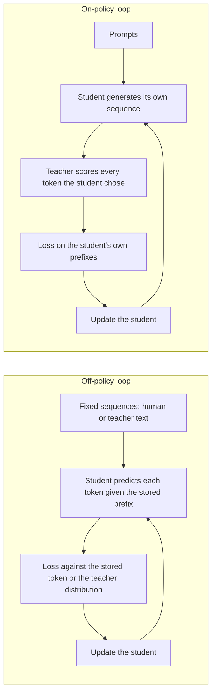

# Leçon 14. Biais d'exposition

**Lien avec la mission :** La mission vous demande de dire quand la distillation on-policy vaut son coût face à un entraînement sur des sorties fixes de l'enseignant, et cela commence par savoir exactement ce que les sorties fixes n'enseignent pas.
**Source primaire :** [Article : "On-Policy Distillation of Language Models: Learning from Self-Generated Mistakes", Agarwal et al., 2023](https://arxiv.org/abs/2306.13649), sections 1 et 3.1
**Prérequis :** [Leçon 8](0008-sequence-level-distillation.md), [Leçon 9](0009-token-or-sequence.md), [Biais d'exposition](../GLOSSARY.md), [Distillation off-policy](../GLOSSARY.md), [Distillation au niveau du token](../GLOSSARY.md)

## Échauffement

1. ▢ Dans la distillation au niveau de la séquence, sur quoi l'élève s'entraîne-t-il, et les mots de qui se trouvent dans le préfixe à chaque position ?

Vérifier

Il s'entraîne avec de l'entropie croisée ordinaire sur des séquences entières décodées par l'enseignant, donc chaque préfixe sur lequel l'élève se conditionne a été écrit par l'enseignant. On ne demande jamais à l'élève de poursuivre un texte qu'il a écrit lui-même.

2. ▢ La distillation au niveau du token minimise une divergence à chaque position. Sous la distribution de qui sur les positions cette moyenne est-elle prise, dans la version KL directe ?

Vérifier

Celle de l'enseignant, c'est pourquoi la [KL directe](../GLOSSARY.md) punit l'élève s'il laisse de côté tout ce que l'enseignant juge probable. Les séquences sur lesquelles porte la moyenne sont un choix distinct, et c'est le sujet de cette leçon.

3. ▢ La leçon 9 a comparé le niveau du token et celui de la séquence selon ce que l'enseignant expose. Quel niveau fonctionne quand vous n'avez que le texte de l'enseignant ?

Vérifier

Le niveau de la séquence, parce qu'il n'a besoin que de texte décodé. Le niveau du token a besoin de la distribution par position de l'enseignant, donc de logits.

## À savoir

### L'entraînement voit un type de préfixe, l'inférence un autre

Un élève autorégressif prédit chaque token étant donné tout ce qui précède. Sous le fine-tuning supervisé, et sous toutes les méthodes de distillation vues jusqu'ici, ce « tout ce qui précède » vient d'un jeu de données fixe : du texte humain, ou du texte généré par l'enseignant.

À l'inférence, le préfixe est la propre sortie de l'élève. Agarwal et al. énoncent la conséquence : les séquences partielles que l'élève rencontre en générant « can be quite different » de celles vues à l'entraînement, et comme chaque prédiction dépend des précédentes, une erreur à une étape précoce peut affecter les prédictions suivantes et dégrader tout le texte (section 3.1). Ils appellent cela un décalage de distribution entre entraînement et inférence et notent que c'est un problème connu de l'apprentissage par imitation.

Le terme du glossaire pour cela est [biais d'exposition](../GLOSSARY.md) : le modèle n'a jamais été exposé à ses propres erreurs pendant l'entraînement, il n'a donc aucune pratique pour s'en remettre.

### Le teacher forcing est la façon dont le décalage apparaît

Entraîner sur un préfixe stocké et évaluer le token suivant s'appelle généralement teacher forcing. Cette leçon emploie ce nom comme arrière-plan, pas comme un terme sourcé : rien dans le glossaire ne le fixe. Ce qui compte, c'est l'effet. Chaque position est évaluée comme si toutes les positions précédentes avaient été justes.

Une illustration simple, avec un nombre supposé et non une mesure : si chaque token avait 1 % de chances indépendantes de quitter le territoire sur lequel l'élève s'est entraîné, une réponse de 100 tokens y resterait avec une probabilité de 0.99 puissance 100, soit environ 37 %. L'hypothèse d'indépendance est fausse dans le sens qui aggrave les choses. Après le premier faux pas, l'élève est dans un état inconnu, où un second faux pas est plus probable, ce qui est la cascade que décrit l'article.

### La distillation au niveau de la séquence ne le corrige pas

Il est tentant de penser qu'entraîner sur les propres générations de l'enseignant résout le décalage, puisque ce sont des sorties complètes en roue libre. Ce sont les sorties en roue libre de l'enseignant. Agarwal et al. rangent le KD au niveau de la séquence avec le KD supervisé parmi les méthodes qui utilisent un ensemble fixe de séquences de sortie, vérité terrain ou générées par l'enseignant, et disent que ces approches entraînent un décalage entre entraînement et inférence pour l'élève (section 3.1).

L'élève ne voit toujours jamais un préfixe qu'il a écrit. Seule l'identité de l'auteur a changé.

### Le correctif : entraîner sur les propres séquences de l'élève

Le geste de l'article est de traiter la distillation comme de l'apprentissage par imitation avec un expert interactif. L'imitation on-policy collecte des séquences avec la propre politique de l'élève, demande à l'expert des labels sur ces séquences, et ré-entraîne. Pour la distillation, le label de l'expert est la distribution de tokens de l'enseignant à chaque position de la séquence de l'élève.

L'élève « receives token-specific feedback from the teacher's logits on the erroneous tokens in its self-generated output sequences ». L'enseignant n'écrit pas la suite. Il évalue ce que l'élève a écrit, token par token.

Les deux boucles côte à côte :

Dans la boucle on-policy, les données d'entraînement changent à mesure que l'élève change. L'article note qu'à mesure que l'élève s'améliore, les séquences qu'il génère s'améliorent aussi.

### Deux conditions qu'énonce l'article

GKD suppose que l'élève peut déjà produire des séquences de qualité suffisante pour que l'enseignant puisse donner un retour utile. Dans les expériences, chaque élève partait d'un checkpoint affiné de façon supervisée (section 3.1, Remark). Un élève initialisé aléatoirement serait évalué sur du charabia.

L'article ne rétropropage pas non plus à travers l'échantillonnage de l'élève. Le gradient passe par la divergence à chaque token, pas par le choix du token échantillonné. Ils disent que cela garde l'entraînement stable et peu coûteux, un point que la leçon 15 reprend quand elle oppose GKD à MiniLLM.

### L'affirmation est contestée

N'enseignez pas le biais d'exposition comme un fait établi. Le même article note que He et al. (2019) soutiennent que le décalage pourrait ne pas être critique, alors que plusieurs autres articles montrent qu'il conduit à une mauvaise génération de texte (section 5). Traitez la distillation on-policy comme une méthode aux gains mesurés sur des tâches précises, ce que rapporte la leçon 15, et non comme la preuve que le décalage en est la cause.

MiniLLM l'a mesuré directement avec une métrique d'erreur excédentaire, ExAccErr, sur un élève GPT-2 125M avec un enseignant GPT-2 1.5B. L'erreur excédentaire des références continuait de croître à mesure que la génération s'allongeait. Celle de MiniLLM était bien plus faible et cessait de s'accumuler au-delà d'environ 150 tokens (section 3.3, figure 6). C'est une configuration et une métrique.

## Pratique

1. ▢ Étiquetez chaque jeu d'entraînement comme on-policy ou off-policy pour l'élève : (a) un jeu d'instructions écrit par des humains, (b) des sorties de style Alpaca décodées par l'enseignant, (c) les échantillons de l'élève évalués token par token par l'enseignant, (d) un corpus fixe où l'enseignant fournit une distribution à chaque position.

Vérifier

Seul (c) est on-policy. (a), (b) et (d) sont fixés avant l'entraînement et aucun ne contient un préfixe que l'élève a écrit. (d) est l'erreur courante : il utilise les logits de l'enseignant, donc il paraît interactif, mais les séquences sont toujours un jeu de données stocké. Ce qui rend une méthode on-policy, c'est qui a écrit le préfixe, pas le fait que l'enseignant fournisse des logits.

2. ▢ Un collègue dit : « Nous décodons notre jeu d'entraînement à partir de l'enseignant, donc l'élève est déjà entraîné sur du texte du genre de celui qu'il générera. » Quelle est la faille ?

    - a) Les sorties de l'enseignant sont systématiquement bien plus courtes
    - b) Les sorties de l'enseignant ne contiennent jamais d'erreurs d'élève
    - c) Les sorties de l'enseignant subissent un filtrage bien plus strict
    - d) Les sorties de l'enseignant utilisent des vocabulaires bien plus grands

Vérifier

**b)** Les erreurs de l'élève le placent dans des préfixes que l'enseignant n'aurait pas écrits, et le texte fixe de l'enseignant n'en contient aucun. (a), (c) et (d) ne sont pas ce que l'article identifie : le décalage concerne les préfixes sur lesquels l'élève se conditionne, pas la longueur, le filtrage ou le vocabulaire.

3. ▢ En utilisant l'illustration de la leçon avec 1 % de chances par token de quitter le territoire entraîné, calculez la probabilité qu'une réponse de 300 tokens y reste. Puis dites si le nombre réel est probablement plus haut ou plus bas, et pourquoi.

Indice

Élevez 0.99 à la puissance 300. Puis demandez-vous ce qu'il advient de la probabilité d'un second faux pas après le premier.

Vérifier

0.99 puissance 300 vaut environ 0.049, soit environ 5 %. L'hypothèse de faux pas indépendants flatte l'élève : une fois hors distribution, le token suivant a plus de chances d'être faux lui aussi, donc la vraie probabilité de rester dedans est probablement plus basse. Le 1 % lui-même est un nombre supposé pour l'illustration, pas une mesure d'un article.

4. ▢ Un élève distillé a une loss faible sur des séquences fixes held-out, mais ses réponses en roue libre empirent à mesure qu'elles s'allongent. Que suggère cela, et quelle mesure unique le testerait sans se fier à la suggestion ?

Indice

La loss held-out est calculée avec des préfixes stockés. Quelle mesure utilise ceux de l'élève ?

Vérifier

Cela suggère un biais d'exposition, puisque la loss à préfixes stockés ne peut pas voir des erreurs qui ne s'accumulent que quand l'élève poursuit son propre texte. Testez-le en évaluant des générations en roue libre en fonction de la longueur, comme l'a fait MiniLLM avec ExAccErr, ou en comparant la qualité sur des sorties courtes et longues. Ne vous arrêtez pas là : He et al. soutiennent que le décalage pourrait ne pas être critique, donc le symptôme pourrait avoir une autre cause, comme des données d'entraînement sans longs exemples.

5. ▢ Dans la boucle on-policy, quel composant génère les tokens et quel composant ne fait que les évaluer ?

Vérifier

L'élève génère la séquence et l'enseignant évalue chaque token que l'élève a choisi, en donnant sa distribution à cette position. L'enseignant n'écrit jamais la suite, c'est pourquoi le coût est le décodage de l'élève plus une passe avant de l'enseignant sur le résultat, un coût que la leçon 16 chiffre.

## Exercices en situation réelle

- [ ] Ouvrez l'article GKD et lisez l'introduction et la section 3.1. Écrivez deux phrases avec vos propres mots : quel décalage existe, et pourquoi l'entraînement sur des séquences générées par l'enseignant ne le supprime pas.
- [ ] Chargez un petit modèle instruct, échantillonnez 20 réponses à la température 1, et marquez le premier token où chacune s'écarte d'un texte sensé. Notez si la position de l'écart est précoce ou tardive, et si le texte qui suit se rétablit.
- [ ] Demain : sans notes, dessinez les boucles off-policy et on-policy, et écrivez sous chacune qui a écrit le préfixe sur lequel l'élève se conditionne.

## Pour aller plus loin

- [Distillation on-policy](../reference/on-policy-distillation.md)
- [Article : "On-Policy Distillation of Language Models: Learning from Self-Generated Mistakes", Agarwal et al., 2023](https://arxiv.org/abs/2306.13649)
- [Article : "MiniLLM: On-Policy Distillation of Large Language Models", Gu et al., 2023](https://arxiv.org/abs/2306.08543)
- [Ressources](../RESOURCES.md)

---

Ça ne passe pas ? Relisez la source primaire en haut de page, car cette leçon la condense et c'est dans la condensation que la compréhension s'échappe. Consultez le [glossaire](../GLOSSARY.md) pour tout terme qui vous a paru glissant.

Si c'est la leçon elle-même qui n'est pas claire plutôt que la matière, c'est un défaut : [ouvrez une issue](https://github.com/TokenCemetery/teach/issues).
