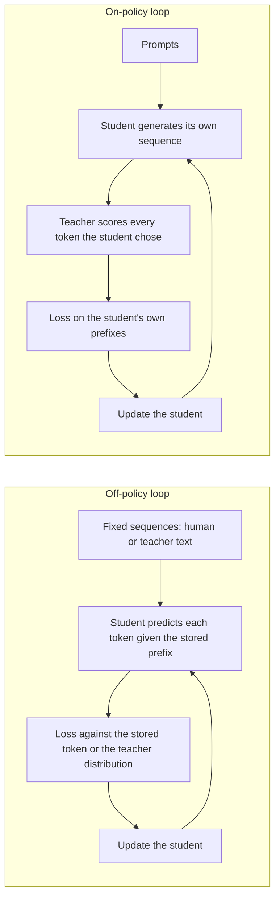

# पाठ 14. Exposure Bias

**मिशन से संबंध:** मिशन आपसे माँगता है कि आप बता सकें कि fixed teacher outputs पर training के मुक़ाबले on-policy distillation अपनी लागत के लायक़ कब है, और उसकी शुरुआत यह ठीक-ठीक जानने से होती है कि fixed outputs क्या नहीं सिखा पाते।
**मुख्य स्रोत:** [पेपर: "On-Policy Distillation of Language Models: Learning from Self-Generated Mistakes", Agarwal et al., 2023](https://arxiv.org/abs/2306.13649), sections 1 और 3.1
**पूर्व-आवश्यकताएँ:** [पाठ 8](0008-sequence-level-distillation.md), [पाठ 9](0009-token-or-sequence.md), [Exposure bias](../GLOSSARY.md), [Off-policy distillation](../GLOSSARY.md), [Token-level distillation](../GLOSSARY.md)

## वार्म-अप

1. ▢ Sequence-level distillation में student किस पर train करता है, और हर position पर prefix में किसके शब्द होते हैं?

जाँचें

वह teacher के decode किए पूरे sequences पर साधारण cross-entropy से train करता है, इसलिए हर prefix जिस पर student condition होता है, teacher ने लिखा था। Student से कभी नहीं कहा जाता कि वह अपना लिखा text आगे बढ़ाए।

2. ▢ Token-level distillation हर position पर एक divergence कम करता है। Forward KL संस्करण में, positions पर वह औसत किसके distribution के तहत लिया जाता है?

जाँचें

Teacher के, इसीलिए [forward KL](../GLOSSARY.md) student को हर उस चीज़ को छोड़ देने पर दंडित करता है जिसे teacher संभावित मानता है। औसत किन sequences पर चलता है, यह अलग चुनाव है, और वही इस पाठ का विषय है।

3. ▢ पाठ 9 ने token और sequence level की तुलना इस आधार पर की कि teacher क्या उपलब्ध कराता है। जब आपके पास सिर्फ़ teacher का text हो, तो कौन-सा level काम करता है?

जाँचें

Sequence level, क्योंकि उसे सिर्फ़ decode किया text चाहिए। Token level को teacher का प्रति-position distribution चाहिए, इसलिए logits चाहिए।

## यह जानें

### Training एक तरह का prefix देखती है, inference दूसरा

Autoregressive student हर token को उससे पहले की हर चीज़ देखकर predict करता है। Supervised fine-tuning के तहत, और अब तक की हर distillation विधि के तहत, "उससे पहले की हर चीज़" तय dataset से आती है: मानव का text, या वह text जो teacher ने generate किया।

Inference में prefix student का अपना output होता है। Agarwal et al. इसका नतीजा बताते हैं: generate करते समय student जिन आंशिक sequences से मिलता है वे training में देखे गए sequences से "काफ़ी अलग हो सकते हैं", और क्योंकि हर prediction पहले की predictions पर निर्भर है, शुरुआती चरण की एक ग़लती बाद की predictions को प्रभावित कर सकती है और पूरे text को बिगाड़ सकती है (section 3.1)। वे इसे train-inference distribution mismatch कहते हैं और ध्यान दिलाते हैं कि imitation learning में यह एक जानी-पहचानी समस्या है।

इसका शब्दावली वाला शब्द [exposure bias](../GLOSSARY.md) है: model training के दौरान अपनी ग़लतियों के सामने कभी आया ही नहीं, इसलिए उसे उनसे उबरने का अभ्यास नहीं है।

### Teacher forcing वह तरीक़ा है जिससे mismatch पैदा होता है

संग्रहीत prefix पर training करना और अगला token score करना आम तौर पर teacher forcing कहलाता है। यह पाठ वह नाम पृष्ठभूमि के रूप में इस्तेमाल करता है, किसी स्रोत वाले शब्द के रूप में नहीं: शब्दावली में कुछ उसे बाँधता नहीं। मायने यह रखता है कि असर क्या है। हर position ऐसे score होता है मानो पहले के सारे positions सही थे।

एक सरल उदाहरण, मान ली गई संख्या के साथ, मापे गए नहीं: अगर हर token के पास उस दायरे से बाहर जाने का स्वतंत्र 1% मौक़ा हो जिस पर student ने train किया, तो 100-token का उत्तर उसके अंदर रहने की probability 0.99 की घात 100 होगी, लगभग 37%। स्वतंत्रता की मान्यता ग़लत है, और उस दिशा में जो चीज़ें बदतर बनाती है। पहली चूक के बाद student अपरिचित स्थिति में है, जहाँ दूसरी चूक की संभावना ज़्यादा है, जो वही cascade है जिसका पेपर वर्णन करता है।

### Sequence-level distillation इसे ठीक नहीं करता

यह सोचना लुभावना है कि teacher की अपनी generations पर training mismatch हल कर देती है, क्योंकि वे पूरे free-running outputs हैं। वे teacher के free-running outputs हैं। Agarwal et al. sequence-level KD को supervised KD के साथ उन विधियों में रखते हैं जो output sequences का एक तय सेट इस्तेमाल करती हैं, चाहे ground truth या teacher-generated, और कहते हैं कि ये तरीक़े student के लिए train-inference mismatch पैदा करते हैं (section 3.1)।

Student अब भी कभी अपना लिखा prefix नहीं देखता। बस लिखने वाले की पहचान बदली।

### उपाय: student के अपने sequences पर train करना

पेपर की चाल distillation को interactive expert वाले imitation learning की तरह देखना है। On-policy imitation student की अपनी policy से sequences इकट्ठा करता है, उन sequences पर expert से labels माँगता है, और दोबारा train करता है। Distillation के लिए expert label student के sequence के हर position पर teacher का token distribution है।

तब student अपने self-generated output sequences की ग़लत tokens पर "teacher के logits से token-विशिष्ट प्रतिक्रिया पाता है"। Teacher आगे का हिस्सा नहीं लिखता। वह जो student ने लिखा उसे token-दर-token score करता है।

दोनों loops आमने-सामने:

On-policy loop में training data student के बदलने के साथ बदलता है। पेपर ध्यान दिलाता है कि जैसे-जैसे student सुधरता है, उसके generate किए sequences भी सुधरते हैं।

### पेपर की बताई दो शर्तें

GKD मानता है कि student पहले से इतनी गुणवत्ता के sequences बना सकता है कि teacher उन पर उपयोगी प्रतिक्रिया दे सके। Experiments में हर student supervised fine-tuned checkpoint से शुरू हुआ (section 3.1, Remark)। Randomly initialise किया student बकवास पर score होता।

पेपर student की sampling के आर-पार backpropagate भी नहीं करता। Gradient हर token पर divergence से बहता है, इस चुनाव से नहीं कि कौन-सा token sample हुआ। वे कहते हैं कि इससे training स्थिर और सस्ती रहती है, जिस बात को पाठ 15 तब उठाता है जब वह GKD की तुलना MiniLLM से करता है।

### दावा विवादित है

Exposure bias को तय तथ्य की तरह न सिखाएँ। वही पेपर ध्यान दिलाता है कि He et al. (2019) तर्क देते हैं कि mismatch शायद निर्णायक न हो, जबकि कई दूसरे पेपर दिखाते हैं कि वह ख़राब text generation की ओर ले जाता है (section 5)। On-policy distillation को ख़ास tasks पर मापे गए फ़ायदों वाली विधि मानें, जो पाठ 15 बताता है, इस सबूत के रूप में नहीं कि mismatch ही कारण है।

MiniLLM ने इसे excess-error metric, ExAccErr, से सीधे मापा, GPT-2 125M student और GPT-2 1.5B teacher पर। Baselines की excess error generation लंबी होने के साथ बढ़ती रही। MiniLLM की बहुत कम थी और लगभग 150 tokens के बाद जमा होना रुक गई (section 3.3, Figure 6)। यह एक setup और एक metric है।

## अभ्यास

1. ▢ हर training set को student के लिए on-policy या off-policy चिह्नित करें: (a) मानव-लिखित instruction set, (b) Alpaca-शैली के outputs जो teacher ने decode किए, (c) student के samples जिन्हें teacher ने token-दर-token score किया, (d) तय corpus जहाँ teacher हर position पर distribution देता है।

जाँचें

सिर्फ़ (c) on-policy है। (a), (b) और (d) training से पहले तय हैं और किसी में ऐसा prefix नहीं है जो student ने लिखा हो। (d) आम ग़लती है: वह teacher के logits इस्तेमाल करता है, इसलिए interactive लगता है, पर sequences अब भी संग्रहीत dataset हैं। किसी विधि को on-policy बनाता है यह कि prefix किसने लिखा, यह नहीं कि teacher logits देता है या नहीं।

2. ▢ एक सहकर्मी कहता है: "हम अपना training set teacher से decode करते हैं, इसलिए student पहले से उसी तरह के text पर train है जो वह generate करेगा।" दोष क्या है?

    - a) Teacher के outputs व्यवस्थित रूप से बहुत छोटे होते हैं
    - b) Teacher के outputs में student की ग़लतियाँ कभी नहीं होतीं
    - c) Teacher के outputs की filtering बहुत सख़्त होती है
    - d) Teacher के outputs बहुत बड़ी vocabularies इस्तेमाल करते हैं

जाँचें

**b)** Student की ग़लतियाँ उसे ऐसे prefixes में पहुँचा देती हैं जो teacher नहीं लिखता, और तय teacher text में उनमें से कोई नहीं होता। (a), (c) और (d) वे नहीं हैं जो पेपर पहचानता है: mismatch इस बारे में है कि student किसके prefixes पर condition होता है, लंबाई, filtering या vocabulary के बारे में नहीं।

3. ▢ पाठ के प्रति-token 1% वाले उदाहरण का इस्तेमाल करके, 300-token का उत्तर उसके अंदर रहने की संभावना निकालें। फिर बताएँ कि असली संख्या ज़्यादा होगी या कम, और क्यों।

संकेत

0.99 को 300 की घात तक उठाएँ। फिर पूछें कि पहली चूक के बाद दूसरी चूक की संभावना का क्या होता है।

जाँचें

0.99 की घात 300 लगभग 0.049 है, यानी लगभग 5%। स्वतंत्र-चूक की मान्यता student के प्रति उदार है: एक बार distribution से बाहर जाने पर अगला token भी ग़लत होने की संभावना ज़्यादा है, इसलिए अंदर रहने की सही संभावना शायद कम है। 1% ख़ुद उदाहरण के लिए मान ली गई संख्या है, किसी पेपर से मापी हुई नहीं।

4. ▢ Distilled student का held-out fixed sequences पर loss कम है, पर उसके free-running उत्तर जितने लंबे चलते हैं उतने बिगड़ते हैं। यह क्या सुझाता है, और सुझाव पर भरोसा किए बिना उसे कौन-सा एक माप परखेगा?

संकेत

Held-out loss संग्रहीत prefixes से निकलता है। कौन-सा माप student के अपने prefixes इस्तेमाल करता है?

जाँचें

यह exposure bias सुझाता है, क्योंकि संग्रहीत-prefix loss वे ग़लतियाँ नहीं देख सकता जो तभी जमा होती हैं जब student अपना text आगे बढ़ाता है। इसे परखने के लिए free-running generations को लंबाई के फ़ंक्शन के रूप में score करें, जैसा MiniLLM ने ExAccErr से किया, या छोटे बनाम लंबे outputs की गुणवत्ता की तुलना करें। वहीं न रुकें: He et al. तर्क देते हैं कि mismatch शायद निर्णायक न हो, इसलिए लक्षण का कोई और कारण हो सकता है, जैसे training data में लंबे examples की कमी।

5. ▢ On-policy loop में कौन-सा घटक tokens generate करता है और कौन-सा सिर्फ़ उन्हें score करता है?

जाँचें

Student sequence generate करता है और teacher student के चुने हर token को score करता है, उस position पर अपना distribution देकर। Teacher आगे का हिस्सा कभी नहीं लिखता, इसीलिए लागत student की decoding और नतीजे पर teacher का एक forward pass है, जिस लागत पर पाठ 16 संख्याएँ रखता है।

## असली दुनिया का अभ्यास

- [ ] GKD पेपर खोलें और Introduction तथा section 3.1 पढ़ें। अपने शब्दों में दो वाक्य लिखें: कौन-सा mismatch मौजूद है, और teacher-generated sequences पर training उसे क्यों नहीं हटाती।
- [ ] कोई भी छोटा instruct model load करें, temperature 1 पर 20 उत्तर sample करें, और हर एक में पहला token चिह्नित करें जहाँ वह समझदार text से भटकता है। नोट करें कि भटकाव की जगह शुरुआती है या देर की, और उसके बाद का text सँभलता है या नहीं।
- [ ] कल: बिना नोट्स के off-policy और on-policy loops बनाएँ, और हर एक के नीचे लिखें कि जिस prefix पर student condition होता है उसे किसने लिखा।

## आगे बढ़ने के लिए

- [On-Policy Distillation शीट](../reference/on-policy-distillation.md)
- [पेपर: "On-Policy Distillation of Language Models: Learning from Self-Generated Mistakes", Agarwal et al., 2023](https://arxiv.org/abs/2306.13649)
- [पेपर: "MiniLLM: On-Policy Distillation of Large Language Models", Gu et al., 2023](https://arxiv.org/abs/2306.08543)
- [संसाधन](../RESOURCES.md)

---

बात नहीं बन रही? ऊपर दिए मुख्य स्रोत को दोबारा पढ़ें, क्योंकि यह पाठ उसे संक्षिप्त करता है और समझ संक्षेप में ही रिसती है। जो शब्द फिसलन भरा लगे, उसके लिए [शब्दावली](../GLOSSARY.md) देखें।

अगर दिक़्क़त सामग्री की नहीं बल्कि पाठ की ही है, तो वह एक खोट है: [issue खोलें](https://github.com/TokenCemetery/teach/issues)।
