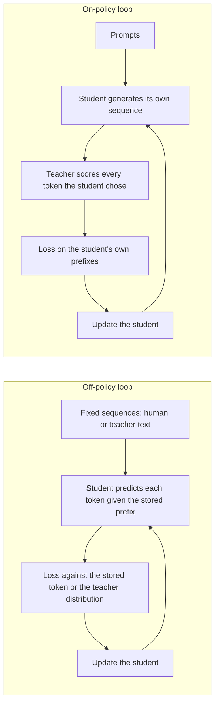

# Lesson 14. Exposure Bias

**Mission link:** The mission asks you to say when on-policy distillation is worth its cost over training on fixed teacher outputs, and that starts with knowing exactly what fixed outputs fail to teach.
**Primary source:** [Paper: "On-Policy Distillation of Language Models: Learning from Self-Generated Mistakes", Agarwal et al., 2023](https://arxiv.org/abs/2306.13649), sections 1 and 3.1
**Prerequisites:** [Lesson 8](0008-sequence-level-distillation.md), [Lesson 9](0009-token-or-sequence.md), [Exposure bias](../GLOSSARY.md), [Off-policy distillation](../GLOSSARY.md), [Token-level distillation](../GLOSSARY.md)

## Warm-up

1. ▢ In sequence-level distillation, what does the student train on, and whose words are in the prefix at every position?

Check

It trains with ordinary cross-entropy on whole sequences the teacher decoded, so every prefix the student conditions on was written by the teacher. The student is never asked to continue text it wrote itself.

2. ▢ Token-level distillation minimises a divergence at every position. Under whose distribution over positions is that average taken, in the forward KL version?

Check

The teacher's, which is why [forward KL](../GLOSSARY.md) punishes the student for leaving out anything the teacher considers likely. Which sequences the average runs over is a separate choice, and it is the subject of this lesson.

3. ▢ Lesson 9 compared token and sequence level by what the teacher exposes. Which level works when you only have the teacher's text?

Check

Sequence level, because it needs only decoded text. Token level needs the teacher's per-position distribution, so it needs logits.

## Know this

### Training sees one kind of prefix, inference another

An autoregressive student predicts each token given everything before it. Under supervised fine-tuning, and under every distillation method so far, the "everything before it" comes from a fixed dataset: human text, or text the teacher generated.

At inference the prefix is the student's own output. Agarwal et al. state the consequence: the partial sequences the student meets while generating "can be quite different" from the ones seen in training, and because each prediction depends on earlier ones, an error at an early step can affect later predictions and degrade the whole text (section 3.1). They call it train-inference distribution mismatch and note it is a known problem in imitation learning.

The glossary term for it is [exposure bias](../GLOSSARY.md): the model was never exposed to its own mistakes during training, so it has no practice recovering from them.

### Teacher forcing is how the mismatch arises

Training on a stored prefix and scoring the next token is usually called teacher forcing. This lesson uses that name as background, not as a sourced term: nothing in the glossary pins it. What matters is the effect. Each position is scored as if all earlier positions had been right.

A simple illustration, with an assumed number and not a measurement: if each token had an independent 1% chance of leaving the territory the student trained on, a 100-token answer would stay inside it with probability 0.99 to the power 100, about 37%. The independence assumption is wrong in the direction that makes things worse. After the first slip the student is in an unfamiliar state, where a second slip is more likely, which is the cascade the paper describes.

### Sequence-level distillation does not fix it

It is tempting to think that training on the teacher's own generations solves the mismatch, since those are full free-running outputs. They are the teacher's free-running outputs. Agarwal et al. group sequence-level KD with supervised KD as methods that use a fixed set of output sequences, either ground truth or teacher-generated, and say these approaches result in train-inference mismatch for the student (section 3.1).

The student still never sees a prefix it wrote. Only the identity of the writer changed.

### The fix: train on the student's own sequences

The paper's move is to treat distillation as imitation learning with an interactive expert. On-policy imitation collects sequences with the student's own policy, asks the expert for labels on those sequences, and retrains. For distillation the expert label is the teacher's token distribution at each position of the student's sequence.

The student then "receives token-specific feedback from the teacher's logits on the erroneous tokens in its self-generated output sequences". The teacher does not write the continuation. It scores what the student wrote, token by token.

The two loops side by side:

In the on-policy loop the training data changes as the student changes. The paper notes that as the student improves, the sequences it generates improve too.

### Two conditions the paper states

GKD assumes the student can already produce sequences of adequate quality for the teacher to give useful feedback on. In the experiments every student started from a supervised fine-tuned checkpoint (section 3.1, Remark). A randomly initialised student would be scored on gibberish.

The paper also does not backpropagate through the student's sampling. The gradient flows through the divergence at each token, not through the choice of which token was sampled. They say this keeps training stable and cheap, a point lesson 15 picks up when it contrasts GKD with MiniLLM.

### The claim is contested

Do not teach exposure bias as settled fact. The same paper notes that He et al. (2019) argue the mismatch may not be critical, while several other papers show it leads to poor text generation (section 5). Treat on-policy distillation as a method with measured gains on specific tasks, which lesson 15 reports, and not as proof that the mismatch is the cause.

MiniLLM measured it directly with an excess-error metric, ExAccErr, on a GPT-2 125M student with a GPT-2 1.5B teacher. The baselines' excess error kept growing as generation got longer. MiniLLM's was much lower and stopped accumulating beyond about 150 tokens (section 3.3, Figure 6). That is one setup and one metric.

## Practice

1. ▢ Label each training set as on-policy or off-policy for the student: (a) a human-written instruction set, (b) Alpaca-style outputs decoded by the teacher, (c) the student's samples scored token by token by the teacher, (d) a fixed corpus where the teacher supplies a distribution at every position.

Check

Only (c) is on-policy. (a), (b) and (d) are fixed before training and none contains a prefix the student wrote. (d) is the common mistake: it uses the teacher's logits, so it feels interactive, but the sequences are still a stored dataset. What makes a method on-policy is who wrote the prefix, not whether the teacher supplies logits.

2. ▢ A colleague says: "We decode our training set from the teacher, so the student is already trained on text of the kind it will generate." What is the flaw?

    - a) Teacher outputs are systematically much shorter
    - b) Teacher outputs never contain student mistakes
    - c) Teacher outputs undergo much stricter filtering
    - d) Teacher outputs use much larger vocabularies

Check

**b)** The student's mistakes put it in prefixes the teacher would not have written, and fixed teacher text contains none of them. (a), (c) and (d) are not what the paper identifies: the mismatch is about whose prefixes the student conditions on, not length, filtering or vocabulary.

3. ▢ Using the lesson's illustration of a 1% per-token chance of leaving trained territory, compute the chance a 300-token answer stays inside it. Then say whether the real number is likely higher or lower, and why.

Hint

Raise 0.99 to the power 300. Then ask what happens to the chance of a second slip after the first.

Check

0.99 to the 300 is about 0.049, so about 5%. The independent-slip assumption flatters the student: once off-distribution, the next token is more likely to be wrong too, so the true chance of staying inside is likely lower. The 1% itself is an assumed number for the illustration, not a measurement from any paper.

4. ▢ A distilled student has low loss on held-out fixed sequences, but its free-running answers get worse the longer they run. What does this suggest, and what one measurement would test it without trusting the suggestion?

Hint

The held-out loss is computed with stored prefixes. Which measurement uses the student's own?

Check

It suggests exposure bias, since stored-prefix loss cannot see errors that compound only when the student continues its own text. Test it by scoring free-running generations as a function of length, as MiniLLM did with ExAccErr, or by comparing quality on short against long outputs. Do not stop there: He et al. argue the mismatch may not be critical, so the symptom could have another cause, such as the training data lacking long examples.

5. ▢ In the on-policy loop, which component generates the tokens and which component only scores them?

Check

The student generates the sequence and the teacher scores each token the student chose, giving its distribution at that position. The teacher never writes the continuation, which is why the cost is student decoding plus a teacher forward pass over the result, a cost lesson 16 puts numbers on.

## Real-world reps

- [ ] Open the GKD paper and read the Introduction and section 3.1. Write two sentences in your own words: what mismatch exists, and why training on teacher-generated sequences does not remove it.
- [ ] Load any small instruct model, sample 20 answers at temperature 1, and mark the first token where each one departs from sensible text. Note whether the departure position is early or late, and whether the text after it recovers.
- [ ] Tomorrow: without notes, draw the off-policy and on-policy loops, and write under each one who wrote the prefix the student conditions on.

## Going further

- [On-Policy Distillation](../reference/on-policy-distillation.md)
- [Paper: "On-Policy Distillation of Language Models: Learning from Self-Generated Mistakes", Agarwal et al., 2023](https://arxiv.org/abs/2306.13649)
- [Paper: "MiniLLM: On-Policy Distillation of Large Language Models", Gu et al., 2023](https://arxiv.org/abs/2306.08543)
- [Resources](../RESOURCES.md)

---

Not landing? Reread the primary source at the top, since this lesson compresses it and compression is where understanding leaks. Check the [glossary](../GLOSSARY.md) for any term that felt slippery.

If the lesson itself is unclear rather than the material, that is a defect: [open an issue](https://github.com/TokenCemetery/teach/issues).
