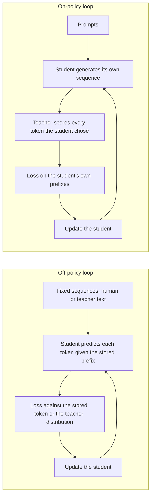

# Lição 14. Exposure bias

**Ligação com a missão:** A missão pede que você diga quando a destilação on-policy compensa o seu custo em relação a treinar com saídas fixas do professor, e isso começa por saber exatamente o que as saídas fixas deixam de ensinar.
**Fonte principal:** [Artigo científico: "On-Policy Distillation of Language Models: Learning from Self-Generated Mistakes", Agarwal et al., 2023](https://arxiv.org/abs/2306.13649), seções 1 e 3.1
**Pré-requisitos:** [Lição 8](0008-sequence-level-distillation.md), [Lição 9](0009-token-or-sequence.md), [Exposure bias](../GLOSSARY.md), [Destilação off-policy](../GLOSSARY.md), [Destilação em nível de token](../GLOSSARY.md)

## Aquecimento

1. ▢ Na destilação em nível de sequência, em que o aluno treina, e as palavras de quem estão no prefixo em cada posição?

Verificação

Ele treina com cross-entropy comum em sequências inteiras que o professor decodificou, então todo prefixo em que o aluno condiciona foi escrito pelo professor. O aluno nunca é solicitado a continuar um texto que ele mesmo escreveu.

2. ▢ A destilação em nível de token minimiza uma divergência em cada posição. Sob a distribuição de quem sobre as posições essa média é tomada, na versão com forward KL?

Verificação

A do professor, e é por isso que o [forward KL](../GLOSSARY.md) pune o aluno por deixar de fora qualquer coisa que o professor considere provável. Sobre quais sequências a média é calculada é uma escolha separada, e é o assunto desta lição.

3. ▢ A lição 9 comparou os níveis de token e de sequência pelo que o professor expõe. Qual nível funciona quando você só tem o texto do professor?

Verificação

O nível de sequência, porque ele precisa apenas de texto decodificado. O nível de token precisa da distribuição por posição do professor, então precisa de logits.

## Saiba isto

### O treinamento vê um tipo de prefixo, a inferência outro

Um aluno autorregressivo prevê cada token dado tudo o que vem antes dele. No supervised fine-tuning, e em todo método de destilação até aqui, o "tudo o que vem antes" vem de um dataset fixo: texto humano, ou texto que o professor gerou.

Na inferência, o prefixo é a própria saída do aluno. Agarwal et al. enunciam a consequência: as sequências parciais que o aluno encontra ao gerar "podem ser bem diferentes" das vistas no treinamento, e como cada previsão depende das anteriores, um erro em um passo inicial pode afetar as previsões posteriores e degradar o texto inteiro (seção 3.1). Eles chamam isso de incompatibilidade de distribuição entre treinamento e inferência e observam que é um problema conhecido no aprendizado por imitação.

O termo do glossário para isso é [exposure bias](../GLOSSARY.md): o modelo nunca foi exposto aos próprios erros durante o treinamento, então não tem prática em se recuperar deles.

### O teacher forcing é como a incompatibilidade surge

Treinar em um prefixo armazenado e pontuar o próximo token costuma ser chamado de teacher forcing. Esta lição usa esse nome como pano de fundo, não como um termo com fonte: nada no glossário o fixa. O que importa é o efeito. Cada posição é pontuada como se todas as posições anteriores tivessem acertado.

Uma ilustração simples, com um número assumido e não uma medição: se cada token tivesse uma chance independente de 1% de sair do território em que o aluno treinou, uma resposta de 100 tokens ficaria dentro dele com probabilidade 0,99 elevado a 100, cerca de 37%. A suposição de independência erra na direção que piora as coisas. Depois do primeiro deslize, o aluno está em um estado desconhecido, onde um segundo deslize é mais provável, que é a cascata que o artigo descreve.

### A destilação em nível de sequência não resolve

É tentador pensar que treinar nas próprias gerações do professor resolve a incompatibilidade, já que são saídas completas em execução livre. São as saídas em execução livre do professor. Agarwal et al. agrupam o KD em nível de sequência com o KD supervisionado como métodos que usam um conjunto fixo de sequências de saída, sejam de verdade de referência ou geradas pelo professor, e dizem que essas abordagens resultam em incompatibilidade entre treinamento e inferência para o aluno (seção 3.1).

O aluno ainda nunca vê um prefixo que ele escreveu. Só mudou a identidade de quem escreve.

### A correção: treinar nas sequências do próprio aluno

O movimento do artigo é tratar a destilação como aprendizado por imitação com um especialista interativo. A imitação on-policy coleta sequências com a própria política do aluno, pede ao especialista rótulos para essas sequências e retreina. Na destilação, o rótulo do especialista é a distribuição de tokens do professor em cada posição da sequência do aluno.

O aluno então "recebe feedback específico por token dos logits do professor sobre os tokens errôneos nas suas sequências de saída autogeradas". O professor não escreve a continuação. Ele pontua o que o aluno escreveu, token por token.

Os dois loops lado a lado:

No loop on-policy, os dados de treinamento mudam conforme o aluno muda. O artigo observa que, conforme o aluno melhora, as sequências que ele gera também melhoram.

### Duas condições que o artigo enuncia

O GKD assume que o aluno já consegue produzir sequências de qualidade adequada para que o professor dê feedback útil sobre elas. Nos experimentos, todo aluno partiu de um checkpoint com supervised fine-tuning (seção 3.1, Remark). Um aluno inicializado aleatoriamente seria pontuado sobre bobagens sem sentido.

O artigo também não faz backpropagation através da amostragem do aluno. O gradiente flui pela divergência em cada token, não pela escolha de qual token foi amostrado. Eles dizem que isso mantém o treinamento estável e barato, um ponto que a lição 15 retoma quando contrasta o GKD com o MiniLLM.

### A alegação é contestada

Não ensine o exposure bias como fato estabelecido. O mesmo artigo observa que He et al. (2019) argumentam que a incompatibilidade pode não ser crítica, enquanto vários outros artigos mostram que ela leva a uma geração de texto ruim (seção 5). Trate a destilação on-policy como um método com ganhos medidos em tarefas específicas, que a lição 15 relata, e não como prova de que a incompatibilidade é a causa.

O MiniLLM mediu isso diretamente com uma métrica de erro em excesso, ExAccErr, em um aluno GPT-2 de 125M com um professor GPT-2 de 1,5B. O erro em excesso dos baselines continuou crescendo conforme a geração ficava mais longa. O do MiniLLM foi muito menor e parou de se acumular depois de cerca de 150 tokens (seção 3.3, Figura 6). Esse é um cenário e uma métrica.

## Prática

1. ▢ Classifique cada conjunto de treinamento como on-policy ou off-policy para o aluno: (a) um conjunto de instruções escrito por humanos, (b) saídas ao estilo Alpaca decodificadas pelo professor, (c) as amostras do aluno pontuadas token a token pelo professor, (d) um corpus fixo em que o professor fornece uma distribuição em cada posição.

Verificação

Apenas (c) é on-policy. (a), (b) e (d) são fixados antes do treinamento e nenhum contém um prefixo que o aluno escreveu. (d) é o erro comum: ele usa os logits do professor, então parece interativo, mas as sequências ainda são um dataset armazenado. O que torna um método on-policy é quem escreveu o prefixo, não se o professor fornece logits.

2. ▢ Um colega diz: "Nós decodificamos o nosso conjunto de treinamento a partir do professor, então o aluno já é treinado em texto do tipo que vai gerar." Qual é a falha?

    - a) As saídas do professor são sistematicamente muito mais curtas
    - b) As saídas do professor nunca contêm erros do aluno
    - c) As saídas do professor passam por uma filtragem muito mais estrita
    - d) As saídas do professor usam vocabulários muito maiores

Verificação

**b)** Os erros do aluno o colocam em prefixos que o professor não teria escrito, e o texto fixo do professor não contém nenhum deles. (a), (c) e (d) não são o que o artigo identifica: a incompatibilidade é sobre os prefixos em que o aluno condiciona, não sobre comprimento, filtragem ou vocabulário.

3. ▢ Usando a ilustração da lição de uma chance de 1% por token de sair do território treinado, calcule a chance de uma resposta de 300 tokens ficar dentro dele. Depois diga se o número real provavelmente é maior ou menor, e por quê.

Dica

Eleve 0,99 à potência 300. Depois pergunte o que acontece com a chance de um segundo deslize depois do primeiro.

Verificação

0,99 elevado a 300 é cerca de 0,049, então cerca de 5%. A suposição de deslizes independentes favorece o aluno: uma vez fora da distribuição, o próximo token também tem mais chance de estar errado, então a chance real de ficar dentro provavelmente é menor. O 1% em si é um número assumido para a ilustração, não uma medição de nenhum artigo.

4. ▢ Um aluno destilado tem loss baixa em sequências fixas held-out, mas as suas respostas em execução livre pioram quanto mais longas ficam. O que isso sugere, e que uma medição testaria isso sem confiar na sugestão?

Dica

A loss held-out é calculada com prefixos armazenados. Qual medição usa os do próprio aluno?

Verificação

Sugere exposure bias, já que a loss com prefixo armazenado não consegue ver erros que se compõem apenas quando o aluno continua o próprio texto. Teste-o pontuando gerações em execução livre em função do comprimento, como o MiniLLM fez com o ExAccErr, ou comparando a qualidade em saídas curtas contra longas. Não pare aí: He et al. argumentam que a incompatibilidade pode não ser crítica, então o sintoma poderia ter outra causa, como os dados de treinamento não terem exemplos longos.

5. ▢ No loop on-policy, qual componente gera os tokens e qual apenas os pontua?

Verificação

O aluno gera a sequência e o professor pontua cada token que o aluno escolheu, dando a sua distribuição naquela posição. O professor nunca escreve a continuação, e é por isso que o custo é a decodificação do aluno mais um forward pass do professor sobre o resultado, um custo a que a lição 16 dá números.

## Prática no mundo real

- [ ] Abra o artigo do GKD e leia a Introdução e a seção 3.1. Escreva duas frases com as suas próprias palavras: que incompatibilidade existe, e por que treinar em sequências geradas pelo professor não a remove.
- [ ] Carregue qualquer modelo instruct pequeno, amostre 20 respostas com temperatura 1 e marque o primeiro token em que cada uma se afasta de um texto sensato. Anote se a posição do afastamento é cedo ou tarde, e se o texto depois dela se recupera.
- [ ] Amanhã: sem consultar anotações, desenhe os loops off-policy e on-policy e escreva embaixo de cada um quem escreveu o prefixo em que o aluno condiciona.

## Para ir além

- [Destilação On-Policy](../reference/on-policy-distillation.md)
- [Artigo científico: "On-Policy Distillation of Language Models: Learning from Self-Generated Mistakes", Agarwal et al., 2023](https://arxiv.org/abs/2306.13649)
- [Artigo científico: "MiniLLM: On-Policy Distillation of Large Language Models", Gu et al., 2023](https://arxiv.org/abs/2306.08543)
- [Recursos](../RESOURCES.md)

---

Não ficou claro? Releia a fonte principal no topo, já que esta lição a comprime e é na compressão que o entendimento escapa. Consulte o [glossário](../GLOSSARY.md) para qualquer termo que pareceu escorregadio.

Se o problema é a lição em si, e não o material, isso é um defeito: [abra uma issue](https://github.com/TokenCemetery/teach/issues).
