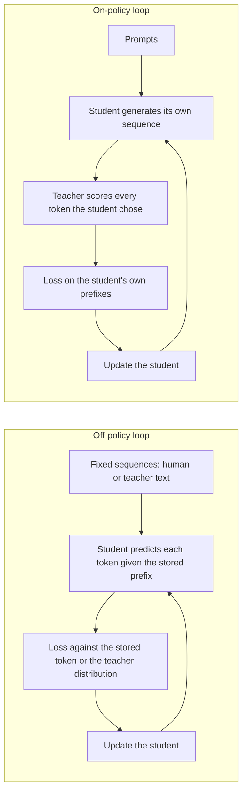

# Урок 14. Смещение экспозиции

**Связь с целью курса:** Цель курса требует, чтобы вы могли сказать, когда on-policy-дистилляция стоит своих затрат по сравнению с обучением на фиксированных выходах учителя, а это начинается с понимания того, чему именно фиксированные выходы не учат.
**Первоисточник:** [Научная статья: "On-Policy Distillation of Language Models: Learning from Self-Generated Mistakes", Agarwal et al., 2023](https://arxiv.org/abs/2306.13649), разделы 1 и 3.1
**Предварительные требования:** [Урок 8](0008-sequence-level-distillation.md), [Урок 9](0009-token-or-sequence.md), [смещение экспозиции](../GLOSSARY.md), [off-policy-дистилляция](../GLOSSARY.md), [дистилляция на уровне токенов](../GLOSSARY.md)

## Разминка

1. ▢ На чём обучается ученик в дистилляции на уровне последовательностей и чьи слова стоят в префиксе в каждой позиции?

Проверка

Он обучается обычной кросс-энтропией на целых последовательностях, декодированных учителем, так что каждый префикс, на который опирается ученик, написан учителем. Ученика никогда не просят продолжить текст, написанный им самим.

2. ▢ Токенная дистилляция минимизирует дивергенцию в каждой позиции. По чьему распределению по позициям берётся это среднее в версии с прямой KL?

Проверка

По распределению учителя, поэтому [прямая KL](../GLOSSARY.md) штрафует ученика за пропуск всего, что учитель считает вероятным. По каким последовательностям идёт усреднение, это отдельный выбор, и это предмет данного урока.

3. ▢ Урок 9 сравнивал уровни токенов и последовательностей по тому, что открывает учитель. Какой уровень работает, когда у вас есть только текст учителя?

Проверка

Уровень последовательностей, потому что ему нужен только декодированный текст. Уровню токенов нужно распределение учителя в каждой позиции, то есть логиты.

## Что нужно знать

### Обучение видит один вид префикса, инференс другой

Авторегрессионный ученик предсказывает каждый токен по всему, что стоит перед ним. При контролируемом дообучении и при каждом методе дистилляции до сих пор это «всё, что стоит перед ним» берётся из фиксированного датасета: человеческого текста или текста, сгенерированного учителем.

При инференсе префикс это собственный выход ученика. Agarwal и соавторы формулируют следствие: частичные последовательности, с которыми ученик сталкивается при генерации, «могут сильно отличаться» от тех, что встречались при обучении, а поскольку каждое предсказание зависит от предыдущих, ошибка на раннем шаге может повлиять на последующие предсказания и испортить весь текст (раздел 3.1). Они называют это несоответствием распределений при обучении и инференсе и отмечают, что это известная проблема в имитационном обучении.

Термин глоссария для этого [смещение экспозиции](../GLOSSARY.md): модель никогда не сталкивалась с собственными ошибками во время обучения, так что у неё нет практики в восстановлении после них.

### Teacher forcing это то, как возникает несоответствие

Обучение на сохранённом префиксе с оценкой следующего токена обычно называют teacher forcing. Этот урок использует это название как фон, а не как термин с источником: в глоссарии ничего это не закрепляет. Важен эффект. Каждая позиция оценивается так, как если бы все предыдущие были верны.

Простая иллюстрация, с предположенным числом, а не измерением: если бы у каждого токена был независимый шанс в 1% покинуть территорию, на которой обучался ученик, то ответ из 100 токенов остался бы в ней с вероятностью 0.99 в степени 100, около 37%. Допущение о независимости неверно в сторону ухудшения. После первого промаха ученик оказывается в незнакомом состоянии, где второй промах вероятнее, и это тот каскад, который описывает статья.

### Дистилляция на уровне последовательностей это не исправляет

Соблазнительно думать, что обучение на собственных генерациях учителя решает несоответствие, поскольку это полные выходы свободного прогона. Это выходы свободного прогона учителя. Agarwal и соавторы группируют KD на уровне последовательностей с контролируемой KD как методы, использующие фиксированный набор выходных последовательностей, либо эталонных, либо сгенерированных учителем, и говорят, что эти подходы приводят к несоответствию при обучении и инференсе для ученика (раздел 3.1).

Ученик по-прежнему никогда не видит префикса, который написал сам. Изменилась лишь личность автора.

### Решение: обучать на собственных последовательностях ученика

Ход статьи состоит в том, чтобы рассматривать дистилляцию как имитационное обучение с интерактивным экспертом. On-policy-имитация собирает последовательности с помощью собственной политики ученика, запрашивает у эксперта метки для этих последовательностей и переобучает. Для дистилляции метка эксперта это распределение токенов учителя в каждой позиции последовательности ученика.

Тогда ученик «получает от логитов учителя обратную связь по конкретным токенам, на ошибочных токенах в своих самосгенерированных выходных последовательностях». Учитель не пишет продолжение. Он оценивает то, что написал ученик, токен за токеном.

Два цикла рядом:

В on-policy-цикле обучающие данные меняются по мере изменения ученика. Статья отмечает, что по мере улучшения ученика улучшаются и последовательности, которые он порождает.

### Два условия, которые называет статья

GKD предполагает, что ученик уже может порождать последовательности достаточного качества, чтобы учитель мог дать на них полезную обратную связь. В экспериментах каждый ученик начинал с контрольной точки после контролируемого дообучения (раздел 3.1, замечание). Случайно инициализированного ученика оценивали бы на тарабарщине.

Статья также не пропускает обратное распространение через сэмплирование ученика. Градиент течёт через дивергенцию в каждом токене, а не через выбор того, какой токен был насэмплирован. Они говорят, что это сохраняет обучение устойчивым и дешёвым, и к этому пункту возвращается урок 15, противопоставляя GKD и MiniLLM.

### Утверждение оспаривается

Не преподавайте смещение экспозиции как установленный факт. Та же статья отмечает, что He и соавторы (2019) утверждают, что несоответствие может быть не критичным, тогда как несколько других статей показывают, что оно приводит к плохой генерации текста (раздел 5). Рассматривайте on-policy-дистилляцию как метод с измеренным приростом на конкретных задачах, о которых сообщает урок 15, а не как доказательство того, что причина в несоответствии.

MiniLLM измерила его напрямую метрикой избыточной ошибки, ExAccErr, на ученике GPT-2 125M с учителем GPT-2 1.5B. Избыточная ошибка базовых методов продолжала расти по мере удлинения генерации. У MiniLLM она была намного ниже и перестала накапливаться после примерно 150 токенов (раздел 3.3, рисунок 6). Это одна постановка и одна метрика.

## Практика

1. ▢ Отметьте каждый обучающий набор как on-policy или off-policy для ученика: (a) написанный людьми инструктивный набор, (b) выходы в стиле Alpaca, декодированные учителем, (c) сэмплы ученика, оцениваемые учителем токен за токеном, (d) фиксированный корпус, где учитель даёт распределение в каждой позиции.

Проверка

On-policy только (c). (a), (b) и (d) фиксируются до обучения, и ни один не содержит префикса, написанного учеником. (d) это распространённая ошибка: он использует логиты учителя, так что кажется интерактивным, но последовательности по-прежнему сохранённый датасет. On-policy метод делает то, кто написал префикс, а не то, даёт ли учитель логиты.

2. ▢ Коллега говорит: «Мы декодируем наш обучающий набор из учителя, так что ученик уже обучен на тексте того вида, который будет генерировать». В чём изъян?

    - a) Выходы учителя систематически намного короче
    - b) Выходы учителя никогда не содержат ошибок ученика
    - c) Выходы учителя проходят намного более строгую фильтрацию
    - d) Выходы учителя используют намного более крупные словари

Проверка

**b)** Ошибки ученика уводят его в префиксы, которые учитель не написал бы, а фиксированный текст учителя не содержит ни одного из них. (a), (c) и (d) не то, что выделяет статья: несоответствие касается того, чьи префиксы использует ученик, а не длины, фильтрации или словаря.

3. ▢ Используя иллюстрацию урока с шансом 1% на токен покинуть обученную территорию, вычислите шанс, что ответ из 300 токенов останется в ней. Затем скажите, реальное число, вероятно, выше или ниже, и почему.

Подсказка

Возведите 0.99 в степень 300. Затем спросите, что происходит с шансом второго промаха после первого.

Проверка

0.99 в степени 300 это около 0.049, то есть около 5%. Допущение о независимых промахах льстит ученику: оказавшись вне распределения, следующий токен тоже вероятнее окажется неверным, так что истинный шанс остаться внутри, вероятно, ниже. Сами 1% это предположенное число для иллюстрации, а не измерение из какой-либо статьи.

4. ▢ У дистиллированного ученика низкая потеря на отложенных фиксированных последовательностях, но его ответы свободного прогона становятся тем хуже, чем дольше длятся. О чём это говорит и какое одно измерение проверило бы это, не доверяя догадке?

Подсказка

Потеря на отложенных данных вычисляется на сохранённых префиксах. Какое измерение использует собственные префиксы ученика?

Проверка

Это наводит на смещение экспозиции, поскольку потеря на сохранённых префиксах не видит ошибок, которые накапливаются только когда ученик продолжает собственный текст. Проверьте это, оценивая генерации свободного прогона как функцию длины, как это делала MiniLLM с ExAccErr, или сравнивая качество на коротких и на длинных выходах. На этом не останавливайтесь: He и соавторы утверждают, что несоответствие может быть не критичным, так что у симптома может быть другая причина, например отсутствие длинных примеров в обучающих данных.

5. ▢ В on-policy-цикле какой компонент генерирует токены, а какой только оценивает их?

Проверка

Последовательность генерирует ученик, а учитель оценивает каждый выбранный учеником токен, давая своё распределение в этой позиции. Учитель никогда не пишет продолжение, поэтому цена это декодирование учеником плюс прямой проход учителя по результату, цену чего в числах даёт урок 16.

## Практика в реальной работе

- [ ] Откройте статью про GKD и прочитайте введение и раздел 3.1. Напишите два предложения своими словами: какое несоответствие существует и почему обучение на сгенерированных учителем последовательностях его не устраняет.
- [ ] Загрузите любую малую инструктивную модель, насэмплируйте 20 ответов при температуре 1 и отметьте первый токен, где каждый отклоняется от разумного текста. Отметьте, ранняя это позиция или поздняя и восстанавливается ли текст после неё.
- [ ] Завтра: без заметок нарисуйте off-policy- и on-policy-циклы и напишите под каждым, кто написал префикс, на который опирается ученик.

## Что почитать дальше

- [On-policy-дистилляция](../reference/on-policy-distillation.md)
- [Научная статья: "On-Policy Distillation of Language Models: Learning from Self-Generated Mistakes", Agarwal et al., 2023](https://arxiv.org/abs/2306.13649)
- [Научная статья: "MiniLLM: On-Policy Distillation of Large Language Models", Gu et al., 2023](https://arxiv.org/abs/2306.08543)
- [Ресурсы](../RESOURCES.md)

---

Не доходит? Перечитайте первоисточник в начале: этот урок его сжимает, а при сжатии понимание как раз и теряется. Загляните в [глоссарий](../GLOSSARY.md), если какой-то термин показался скользким.

Если неясен сам урок, а не материал, это дефект: [откройте issue](https://github.com/TokenCemetery/teach/issues).
