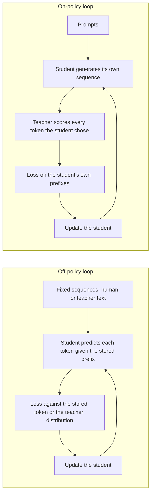

# 第 14 课：暴露偏差

**使命关联:** 本使命要求你说明在策略蒸馏相比在固定的教师输出上训练，什么时候值得付出它的成本，而这要从弄清楚固定输出到底教不会什么讲起。
**主要来源:** [论文：“On-Policy Distillation of Language Models: Learning from Self-Generated Mistakes”，Agarwal 等，2023](https://arxiv.org/abs/2306.13649)，第 1 节和第 3.1 节
**前置知识:** [第 8 课](0008-sequence-level-distillation.md)、[第 9 课](0009-token-or-sequence.md)、[暴露偏差](../GLOSSARY.md)、[离策略蒸馏](../GLOSSARY.md)、[token 级蒸馏](../GLOSSARY.md)

## 热身

1. ▢ 在序列级蒸馏里，学生在什么上训练？每个位置的前缀里是谁的词？

检查

它用普通的交叉熵，在教师解码出的整条序列上训练，所以学生所依赖的每个前缀，都是教师写的。学生从未被要求去续写它自己写的文本。

2. ▢ token 级蒸馏在每个位置上最小化一个散度。在前向 KL 的版本里，这个对位置的平均是在谁的分布下取的？

检查

教师的，这就是为什么[前向 KL](../GLOSSARY.md) 会惩罚学生漏掉教师认为可能的任何东西。这个平均遍历的是哪些序列，是另一个选择，也是本课的主题。

3. ▢ 第 9 课按教师暴露的内容比较了 token 级与序列级。只有教师的文本时，哪个层级可行？

检查

序列级，因为它只需要解码出的文本。token 级需要教师在每个位置上的分布，所以需要 logit。

## 要点

### 训练看到一种前缀，推理面对另一种

自回归的学生，在给定前面所有内容的条件下预测每个 token。在监督微调下，以及到目前为止的每一种蒸馏方法下，“前面所有内容”都来自一份固定的数据集：人类文本，或教师生成的文本。

推理时，前缀是学生自己的输出。Agarwal 等人陈述了其后果：学生在生成时遇到的部分序列，可能与训练中见过的“相当不同”，而且因为每个预测都依赖于前面的预测，早期某一步的错误，会影响后面的预测，并使整段文本变差（第 3.1 节）。他们把它叫作训练与推理的分布不匹配，并指出这是模仿学习中一个已知的问题。

术语表里对它的叫法是[暴露偏差](../GLOSSARY.md)：模型在训练中从未暴露在它自己的错误面前，所以没有从错误中恢复的练习。

### 教师强制是这种不匹配产生的原因

在存储下来的前缀上训练，并给下一个 token 打分，通常叫作教师强制。本课把这个名字当作背景使用，而不是作为有出处的术语：术语表里并没有固定它。要紧的是它的效果。每个位置的打分，都好像前面所有位置都是对的。

一个简单的例子，数字是假设的，不是度量出来的：如果每个 token 都有独立的 1% 的概率离开学生训练过的领域，一个 100 个 token 的回答留在其中的概率就是 0.99 的 100 次方，约 37%。独立性这个假设，在使事情更糟的方向上是错的。第一次失误之后，学生就处于不熟悉的状态，在那里第二次失误更有可能，这就是论文描述的级联。

### 序列级蒸馏并不能修复它

人们很容易以为，在教师自己的生成结果上训练，就解决了这个不匹配，因为那些是完整的自由运行输出。它们是教师的自由运行输出。Agarwal 等人把序列级 KD 与监督 KD 归为一类，认为它们都使用一组固定的输出序列，要么是标准答案，要么是教师生成的，并说这些做法会给学生造成训练与推理的不匹配（第 3.1 节）。

学生仍然从未见过自己写的前缀。变的只是写的人是谁。

### 修复办法：在学生自己的序列上训练

论文的做法，是把蒸馏当作带有交互式专家的模仿学习。在策略的模仿，用学生自己的策略收集序列，请专家为这些序列给出标签，然后重新训练。对蒸馏来说，专家的标签就是教师在学生序列每个位置上的 token 分布。

于是，学生“对它自己生成的输出序列中错误的 token，从教师的 logit 那里得到针对具体 token 的反馈”。教师并不写续写的内容。它给学生写下的东西逐 token 打分。

两个循环并排放在一起：

在在策略的循环里，训练数据随着学生的变化而变化。论文指出，随着学生的进步，它生成的序列也在改进。

### 论文陈述的两个条件

GKD 假定学生已经能产出质量足够好的序列，使教师能对其给出有用的反馈。在实验中，每个学生都是从一个经过监督微调的检查点开始的（第 3.1 节，备注）。随机初始化的学生，会被拿去对一堆乱码打分。

论文同样不对学生的采样做反向传播。梯度流过的是每个 token 上的散度，而不是流过采样了哪个 token 的这个选择。他们说这让训练稳定且便宜，第 15 课在对比 GKD 与 MiniLLM 时会再讲到这一点。

### 这个论断是有争议的

不要把暴露偏差当作定论来教。同一篇论文指出，He 等人（2019）认为这种不匹配可能并不关键，而另有几篇论文表明它会导致较差的文本生成（第 5 节）。请把在策略蒸馏当作在具体任务上有实测收益的方法，第 15 课会报告这些收益，而不要把它当作这种不匹配就是原因的证明。

MiniLLM 用一个超额错误指标 ExAccErr 直接度量了它，学生是 GPT-2 125M，教师是 GPT-2 1.5B。基线的超额错误随着生成变长而不断增长。MiniLLM 的则低得多，在大约 150 个 token 之后不再累积（第 3.3 节，图 6）。这是一套设置、一个指标。

## 练习

1. ▢ 把每一份训练集标为对学生而言是在策略还是离策略：(a) 人工编写的指令集，(b) 由教师解码出的 Alpaca 式输出，(c) 由教师逐 token 打分的学生样本，(d) 教师在每个位置上提供分布的固定语料。

检查

只有 (c) 是在策略的。(a)、(b) 和 (d) 在训练之前就已固定，其中没有一个含有学生写的前缀。(d) 是常见的错误：它用了教师的 logit，所以感觉是交互式的，但序列仍然是存储下来的数据集。让一种方法成为在策略的，是前缀由谁来写，而不是教师是否提供 logit。

2. ▢ 一位同事说：“我们的训练集是从教师那里解码出来的，所以学生已经在它将要生成的那类文本上训练过了。”缺陷在哪里？

    - a) 教师的输出系统性地短得多
    - b) 教师的输出从不包含学生的错误
    - c) 教师的输出经过严格得多的过滤
    - d) 教师的输出使用大得多的词表

检查

**b)** 学生的错误会把它带进教师不会写出的前缀里，而固定的教师文本里一个这样的前缀都没有。(a)、(c) 和 (d) 不是论文所指出的：这种不匹配关乎学生所依赖的是谁的前缀，而不是长度、过滤或词表。

3. ▢ 用本课对每个 token 有 1% 概率离开训练领域的例子，计算一个 300 个 token 的回答留在其中的概率。然后说明真实的数字可能更高还是更低，以及原因。

提示

把 0.99 取 300 次方。然后想想第一次失误之后，第二次失误的概率会怎样。

检查

0.99 的 300 次方约为 0.049，即约 5%。独立失误的假设对学生是美化了：一旦偏离了分布，下一个 token 也更可能出错，所以真实的留在其中的概率可能更低。1% 本身是为了举例假设的数字，不是任何论文里度量出来的。

4. ▢ 一个蒸馏出来的学生，在留出的固定序列上损失很低，但它自由运行的回答越长越差。这说明了什么？要不轻信这个说法，可以用什么度量来检验？

提示

留出损失是用存储的前缀计算的。哪种度量用的是学生自己的前缀？

检查

它暗示的是暴露偏差，因为用存储前缀算出的损失，看不到只有当学生续写自己的文本时才会累积的错误。检验的办法，是像 MiniLLM 用 ExAccErr 做的那样，按长度给自由运行的生成结果打分，或者比较短输出与长输出的质量。不要止步于此：He 等人认为这种不匹配可能并不关键，所以这个症状可能另有原因，比如训练数据里缺少长的样本。

5. ▢ 在在策略的循环里，哪个组件生成 token，哪个组件只负责打分？

检查

学生生成序列，教师对学生选出的每个 token 打分，给出它在那个位置上的分布。教师从不写续写的内容，所以成本是学生的解码，加上教师对结果的一次前向传播，第 16 课会给这个成本标上数字。

## 实战练习

- [ ] 打开 GKD 论文，阅读引言和第 3.1 节。用你自己的话写两句：存在什么不匹配，以及为什么在教师生成的序列上训练不能消除它。
- [ ] 加载任何一个小型指令模型，在温度 1 下采样 20 个回答，标出每个回答第一次偏离合理文本的 token。记下偏离的位置是早还是晚，以及之后的文本是否恢复了。
- [ ] 明天：不看笔记，画出离策略和在策略这两个循环，并在每个下面写下，学生所依赖的前缀是谁写的。

## 延伸阅读

- [在策略蒸馏](../reference/on-policy-distillation.md)
- [论文：“On-Policy Distillation of Language Models: Learning from Self-Generated Mistakes”，Agarwal 等，2023](https://arxiv.org/abs/2306.13649)
- [论文：“MiniLLM: On-Policy Distillation of Large Language Models”，Gu 等，2023](https://arxiv.org/abs/2306.08543)
- [资源](../RESOURCES.md)

---

没学明白？请重读顶部的主要来源，因为本课是对它的压缩，而理解正是在压缩中流失的。如果有哪个术语觉得含糊，可以查看[术语表](../GLOSSARY.md)。

如果问题出在课程本身，而不是学习材料，那就是一个缺陷：[提交 issue](https://github.com/TokenCemetery/teach/issues)。
