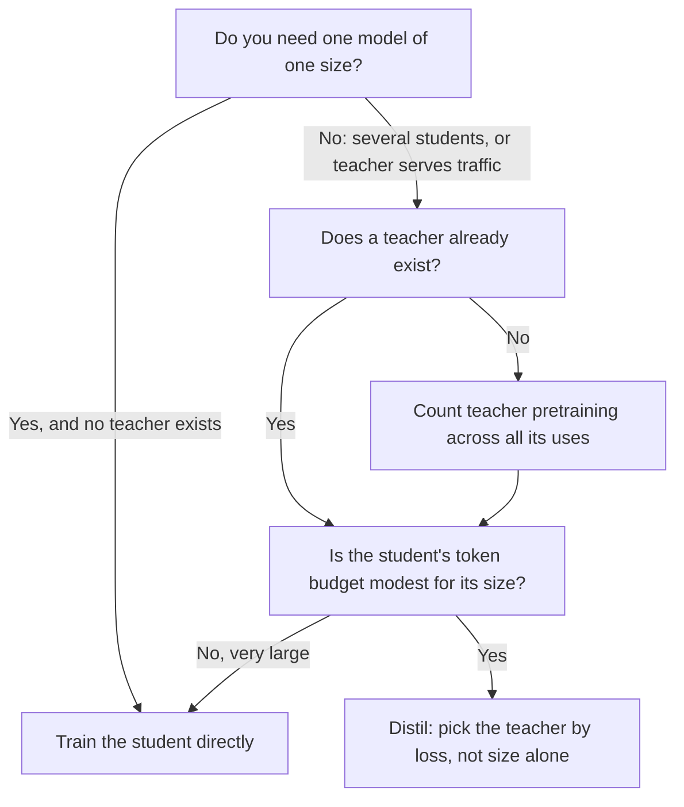

# Lección 20. Elegir el tamaño del estudiante

**Vínculo con la misión:** La misión te pide elegir un tamaño de estudiante y un volumen de datos contando el propio costo del profesor en el presupuesto, y la primera mitad de esa elección es saber cuándo vale la pena siquiera destilar frente a entrenar directamente al estudiante.
**Fuente principal:** [Paper: "Distillation Scaling Laws", Busbridge et al., 2025](https://arxiv.org/abs/2502.08606), secciones 1, 4 y 5
**Requisitos previos:** [Lección 19](0019-capacity-gap-and-hidden-traits.md), [Brecha de capacidad](../GLOSSARY.md), [Profesor](../GLOSSARY.md), [Estudiante](../GLOSSARY.md), [Destilación de logits](../GLOSSARY.md)

## Calentamiento

1. ▢ La lección 19 describió la brecha de capacidad. Enúnciala en una frase, incluyendo lo que le hace a la elección del profesor.

Comprobación

Un profesor mucho mayor puede producir un estudiante peor que el que produciría uno menor, así que un profesor más fuerte no es automáticamente uno mejor. La consecuencia práctica es que el tamaño del profesor es una elección con un óptimo, no un dial que se sube.

2. ▢ La lección 7 cubrió cómo Gemma 2 y Minitron usaron la distribución de un profesor durante el preentrenamiento. ¿Qué tiene que hacer con el profesor una ejecución de [destilación de logits](../GLOSSARY.md) en cada token de entrenamiento que el entrenamiento simple de siguiente token no hace?

Comprobación

Tiene que ejecutar al profesor sobre el prefijo de ese token y leer su distribución de salida, ya sea en vivo o desde logits almacenados. El entrenamiento simple de siguiente token solo necesita el propio forward y backward pass del estudiante. Ese trabajo extra del profesor es lo que esta lección y la siguiente ponen precio.

3. ▢ La lección 17 separó la fidelidad de la generalización. Si un estudiante iguala de cerca las predicciones de su profesor, ¿resuelve eso si el estudiante es bueno en la tarea?

Comprobación

No. La fidelidad es el acuerdo con el profesor sobre las mismas entradas, y el profesor puede equivocarse. Un estudiante puede ser una copia fiel de un profesor mediocre o un modelo infiel pero mejor. La lección 22 vuelve sobre esto con una medición.

## Qué debes saber

### La pregunta que responde el paper

La destilación suele justificarse por la existencia de un buen profesor. Busbridge et al. hacen una pregunta más estrecha: con los mismos recursos, ¿alcanza un estudiante entrenado con las salidas de un profesor una pérdida menor que el mismo estudiante entrenado directamente? Su estudio usa estudiantes y profesores transformer de 143M a 12.6B de parámetros, entrenados con unos pocos miles de millones a 512B de tokens (sección 1). Es un estudio controlado de la destilación usada como señal de preentrenamiento, así que es la destilación de logits de la lección 4, aplicada a lo largo de un dataset sin datos repetidos.

Dos límites de alcance importan para todo lo que sigue. La cantidad medida es la entropía cruzada sobre datos held-out, no la precisión en tareas posteriores. Y el paper no prueba la destilación a nivel de secuencia ni la destilación a partir de datos de instrucciones generados. Donde esta lección aplica el resultado a esos casos, es una extensión, y lo dice.

### La ley

El paper ajusta una [ley de escalado de la destilación](../GLOSSARY.md) (su Ecuación 8) que predice la entropía cruzada del estudiante a partir de tres cosas: los parámetros del estudiante, el número de tokens de destilación y la entropía cruzada del profesor. El profesor entra solo a través de ese último número. El hallazgo 2 del paper es que el tamaño del profesor y los tokens de entrenamiento del profesor fijan la pérdida del estudiante solo a través de la entropía cruzada resultante del profesor, así que un profesor menor entrenado más tiempo y uno mayor entrenado menos son intercambiables cuando sus pérdidas coinciden (sección 1, hallazgo 2, y Figura 3b).

El ajuste es bueno dentro del rango estudiado: un error relativo de predicción de en torno al 1% o menos, incluso al extrapolar de modelos más débiles a más fuertes (sección 4.4). Fuera de ese rango es una predicción, no una medición.

### Cuándo gana destilar

La conclusión del paper es condicional, y las condiciones son el contenido de esta lección. La destilación no puede alcanzar una entropía cruzada menor que el aprendizaje supervisado cuando a ambos se les da suficientes datos o cómputo. Es más eficiente que el aprendizaje supervisado cuando se cumplen ambas cosas (sección 1):

1. El cómputo o los tokens totales usados para el estudiante no superan un umbral que depende del tamaño del estudiante, dado por la ley de escalado (sección 5.1).
2. Ya existe un profesor, o el profesor que se va a entrenar tiene usos más allá de una única destilación (sección 5.3).

La segunda condición trata del dinero que ya has gastado. La sección 5.3 enuncia directamente el otro lado: cuando el entrenamiento del profesor se cuenta en el presupuesto, la mejor pérdida del estudiante es siempre peor que el resultado supervisado, así que si quieres un modelo de un tamaño y no tienes profesor, entrena el modelo directamente. Si pretendes destilar una familia de modelos, o el profesor además atiende tráfico, la destilación puede ser más barata.

La primera condición dice que la destilación es una ventaja inicial, no un mejor final. Con un presupuesto modesto de tokens es favorable. Con uno grande, el aprendizaje supervisado la alcanza y la supera (sección 5.1, Figura 6). La misma sección informa de que el cómputo a partir del cual el aprendizaje supervisado resulta preferible crece con el tamaño del estudiante, así que un estudiante mayor conserva la ventaja en un rango más amplio de presupuestos.

### Lo que cuesta contar al profesor

El paper aproxima el cómputo de una ejecución de destilación como el entrenamiento del estudiante más los forward passes del profesor (Ecuación 9). Si se cargan o no los forward passes del profesor y el propio preentrenamiento del profesor es una elección, y el paper estudia cuatro configuraciones (su Tabla 2):

| Configuración | Inferencia del profesor cargada | Preentrenamiento del profesor cargado | Cuándo te describe |
|---|---|---|---|
| Mejor caso, totalmente amortizado | No | No | El profesor existe y además se usa para otra cosa |
| Inferencia del profesor | Sí | No | El profesor existe, y pagas por ejecutarlo sobre tus datos |
| Preentrenamiento del profesor | No | Sí | Entrenas al profesor, luego almacenas sus logits para muchos estudiantes |
| Preentrenamiento más inferencia | Sí | Sí | Entrenas a un profesor para destilar un estudiante, el peor caso |

La lección 21 convierte las dos primeras columnas en aritmética. Aquí el punto es en qué fila estás. La mayoría de los profesionales que destilan a partir de un modelo abierto están en la segunda fila. Quien entrena un profesor a medida para un único estudiante está en la cuarta, y el resultado del paper para esa fila es que gana el entrenamiento directo.

### La brecha de capacidad, a su escala

En los experimentos de razón fija del paper (Figura 4), estudiantes de dos tamaños se destilan de diez profesores de tamaño creciente, cada uno entrenado con unos 20 tokens por parámetro. La entropía cruzada del estudiante baja al crecer el profesor, alcanza un óptimo y luego sube. Un profesor más fuerte acaba reduciendo el rendimiento del estudiante, que es la brecha de capacidad de la lección 19 medida en condiciones controladas.

La lectura del paper es que la brecha trata de la capacidad de aprendizaje, una diferencia en lo que profesor y estudiante pueden representar y optimizar, y no solo de los recuentos relativos de parámetros. En su ley la brecha aparece como una transición entre dos regiones de ley de potencias en la pérdida del profesor, situada donde la pérdida del profesor y la pérdida que alcanzaría un estudiante supervisado guardan una razón ajustada (sección 4.3). Un hallazgo que se sigue: cuando el presupuesto está fijado en tokens, la entropía cruzada del mejor profesor debería bajar al crecer el estudiante (sección 5.2).

Son resultados de un paper sobre sus propios modelos y datos. Trata la forma (un óptimo, luego un descenso) como el hallazgo, y no te lleves de ahí una razón concreta de tamaño profesor a estudiante.

### La decisión, dibujada

El segundo rombo es donde vive el umbral. El paper no da un número único para él: es una curva en el tamaño del estudiante que lees de la ley de escalado.

## Práctica

1. ▢ Un colega cita el paper para decir "la destilación siempre supera a entrenar directamente al estudiante". ¿Qué frase lo corrige con más exactitud?

    - a) La destilación gana por debajo de un nivel de tokens que depende del tamaño, y solo cuando existe un profesor o tiene otros usos.
    - b) La destilación gana para estudiantes de menos de 3B de parámetros, y solo cuando el profesor supera los 10B de parámetros.
    - c) La destilación gana siempre que el profesor sea mayor que el estudiante, mientras los datos estén filtrados.
    - d) La destilación gana en tareas posteriores, y pierde en entropía cruzada una vez que el estudiante está totalmente entrenado.

Comprobación

a). Las dos condiciones del paper son un umbral de tokens o de cómputo que depende del tamaño del estudiante, y un profesor que ya existe o tiene usos más allá de una destilación. b) inventa un corte de parámetros y un tamaño de profesor que no aparecen en ninguna parte de las condiciones del paper. c) es la intuición que el paper prueba y matiza: un profesor mayor puede incluso producir un estudiante peor. d) invierte la cantidad medida del paper: estudió la entropía cruzada, y no probó la precisión en tareas posteriores.

2. ▢ Un equipo entrenará un estudiante de 1B. No existe ningún profesor. Planean preentrenar un profesor de 7B y luego destilar de él un estudiante de 1B. ¿Qué dice el resultado del paper, y qué único cambio al plan alteraría la respuesta?

Comprobación

Con el entrenamiento del profesor contado en el presupuesto y un solo estudiante, el paper encuentra que la mejor pérdida del estudiante es siempre mayor que el entrenamiento supervisado directo con el mismo cómputo, así que entrena directamente el modelo de 1B. El cambio que lo altera es darle otros usos al profesor: destilar de él una familia de estudiantes, o servirlo como modelo de producción. Entonces su costo de preentrenamiento se comparte y se cumple la segunda condición.

3. ▢ Predice: mantienes al estudiante en 1B de parámetros y el presupuesto de tokens fijo, y cambias el profesor por uno tres veces mayor y mejor. ¿Baja necesariamente la pérdida del estudiante?

Pista

La Figura 4 del paper barre el tamaño del profesor para un estudiante fijo. Piensa en qué forma tiene la curva, no en si más grande es mejor.

Comprobación

No necesariamente. En la Figura 4 la entropía cruzada del estudiante disminuye hasta un óptimo y luego aumenta al crecer el profesor, así que un profesor más allá del óptimo empeora al estudiante. La ley del paper dice que el estudiante se ve afectado a través de la pérdida del profesor y de la relación de capacidad entre profesor y estudiante, no a través del tamaño del profesor solo. Si tu cambio cruza el óptimo depende de los dos modelos, y solo una ejecución o la ley ajustada te lo dice.

4. ▢ ¿Cuál de estas cosas puedes concluir solo del paper, y cuál sería una extensión suya? (i) Para estudiantes hasta su mayor tamaño, una mejor pérdida del profesor da una mejor pérdida del estudiante hasta la brecha de capacidad. (ii) La destilación a nivel de secuencia con 50K instrucciones generadas sigue la misma ley de escalado.

Comprobación

(i) es un hallazgo, dentro de los tamaños y datos con que entrenó el paper (143M a 12.6B de parámetros, hasta 512B de tokens). (ii) es una extensión: el paper estudia la destilación con logits del profesor sobre un dataset de estilo preentrenamiento y mide la entropía cruzada, así que no dice nada directamente sobre datos de instrucciones ni sobre entrenar con texto decodificado. Puedes usar la ley como un prior para (ii) pero tienes que etiquetarlo como tal.

5. ▢ La lección 18 enseñó la brecha de imitación. Si un estudiante se destila con un presupuesto modesto e iguala a su profesor en estilo pero no en capacidad, ¿lo habría predicho un mejor ajuste de la ley de escalado?

Comprobación

No por sí solo. La ley de escalado predice la entropía cruzada, un resumen de cuán bien modela el estudiante los datos, y no dice nada sobre qué comportamientos se copiaron primero. La brecha de imitación trata de la diferencia entre un estilo que ve un evaluador y una capacidad que prueba un benchmark específico. Un número de pérdida de buen aspecto puede coexistir con esa brecha, por eso las lecciones 22 y 23 miden por capacidad.

## Prácticas en el mundo real

- [ ] Abre el paper y encuentra la Figura 6 y su pie. Anota, con tus palabras, qué significan el azul y el rojo ahí y hacia dónde se mueve la frontera al crecer el tamaño del estudiante.
- [ ] Toma una destilación que hayas ejecutado o planees ejecutar. Rellena la tabla de cuatro filas de arriba: ¿en qué fila estás, y qué dice el paper para esa fila?
- [ ] Mañana: sin apuntes, escribe las dos condiciones bajo las que el paper dice que la destilación es más eficiente que el aprendizaje supervisado, y una cosa que el paper no probó.

## Para profundizar

- [Dimensionar y medir](../reference/sizing-and-measuring.md)
- [Paper: "Distillation Scaling Laws", Busbridge et al., 2025](https://arxiv.org/abs/2502.08606), Figuras 4, 6 y 9
- [Preentrenamiento](../../pretraining/): el track que enseña de qué se compone un presupuesto de cómputo y cómo se ajustan las leyes de escalado
- [Recursos](../RESOURCES.md)

---

¿No termina de quedar claro? Vuelve a leer la fuente primaria de arriba, ya que esta lección la comprime y en la compresión es donde se escapa la comprensión. Consulta el [glosario](../GLOSSARY.md) por si algún término te resultó resbaladizo.

Si lo poco claro es la propia lección y no el material, eso es un defecto: [abre un issue](https://github.com/TokenCemetery/teach/issues).
