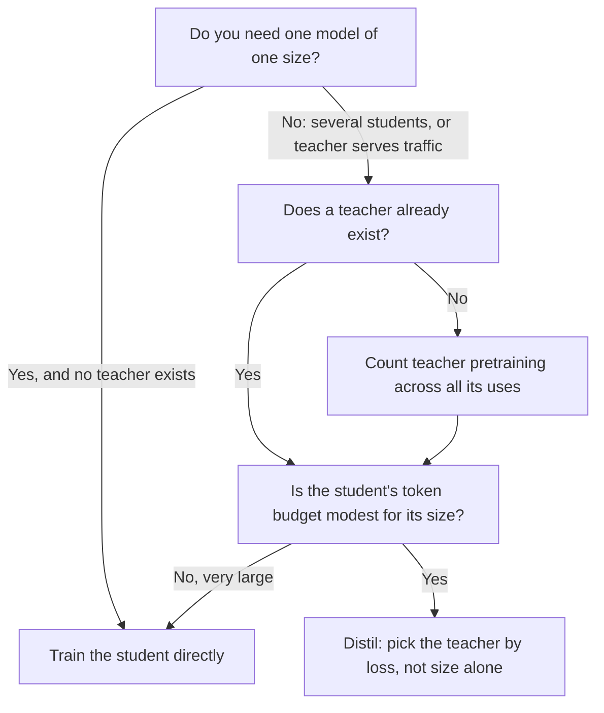

# Leçon 20. Choisir la taille de l'élève

**Lien avec la mission :** La mission vous demande de choisir une taille d'élève et un volume de données en comptant le coût propre de l'enseignant dans le budget, et la première moitié de ce choix est de savoir quand distiller vaut la peine tout court face à l'entraînement direct de l'élève.
**Source primaire :** [Article : "Distillation Scaling Laws", Busbridge et al., 2025](https://arxiv.org/abs/2502.08606), sections 1, 4 et 5
**Prérequis :** [Leçon 19](0019-capacity-gap-and-hidden-traits.md), [Écart de capacité](../GLOSSARY.md), [Enseignant](../GLOSSARY.md), [Élève](../GLOSSARY.md), [Distillation de logits](../GLOSSARY.md)

## Échauffement

1. ▢ La leçon 19 a décrit l'écart de capacité. Énoncez-le en une phrase, en incluant ce qu'il fait au choix de l'enseignant.

Vérifier

Un enseignant bien plus grand peut produire un élève moins bon qu'un enseignant plus petit, donc un enseignant plus fort n'est pas automatiquement un meilleur enseignant. La conséquence pratique est que la taille de l'enseignant est un choix qui a un optimum, pas un cadran à pousser vers le haut.

2. ▢ La leçon 7 a couvert la manière dont Gemma 2 et Minitron ont utilisé la distribution d'un enseignant pendant le pré-entraînement. Qu'un run de [distillation de logits](../GLOSSARY.md) doit-il faire avec l'enseignant à chaque token d'entraînement que l'entraînement simple au token suivant ne fait pas ?

Vérifier

Il doit exécuter l'enseignant sur le préfixe de ce token et lire sa distribution de sortie, soit en direct, soit à partir de logits stockés. L'entraînement simple au token suivant n'a besoin que de la propre passe avant et arrière de l'élève. Ce travail supplémentaire de l'enseignant est ce que cette leçon et la suivante chiffrent.

3. ▢ La leçon 17 a séparé la fidélité de la généralisation. Si un élève reproduit étroitement les prédictions de son enseignant, cela tranche-t-il la question de savoir s'il est bon sur la tâche ?

Vérifier

Non. La fidélité est l'accord avec l'enseignant sur les mêmes entrées, et l'enseignant peut avoir tort. Un élève peut être une copie fidèle d'un enseignant médiocre ou un modèle infidèle mais meilleur. La leçon 22 y revient avec une mesure.

## À savoir

### La question à laquelle répond l'article

La distillation est souvent justifiée par l'existence d'un bon enseignant. Busbridge et al. posent une question plus étroite : à ressources égales, un élève entraîné sur les sorties d'un enseignant atteint-il une loss plus basse que le même élève entraîné directement ? Leur étude utilise des élèves et des enseignants transformers de 143M à 12.6B de paramètres, entraînés sur quelques milliards à 512B tokens (section 1). C'est une étude contrôlée de la distillation utilisée comme signal de pré-entraînement, c'est donc la distillation de logits de la leçon 4, appliquée sur un jeu de données sans données répétées.

Deux limites de portée comptent pour tout ce qui suit. La grandeur mesurée est l'entropie croisée sur des données held-out, pas la précision sur des tâches en aval. Et l'article ne teste ni la distillation au niveau de la séquence ni la distillation à partir de données d'instruction générées. Là où cette leçon applique le résultat à celles-ci, c'est une extension, et elle le dit.

### La loi

L'article ajuste une [loi d'échelle de la distillation](../GLOSSARY.md) (son équation 8) qui prédit l'entropie croisée de l'élève à partir de trois choses : les paramètres de l'élève, le nombre de tokens de distillation et l'entropie croisée de l'enseignant. L'enseignant n'y entre que par ce dernier nombre. Le constat 2 de l'article est que la taille de l'enseignant et ses tokens d'entraînement ne fixent la loss de l'élève qu'à travers l'entropie croisée résultante de l'enseignant, si bien qu'un enseignant plus petit entraîné plus longtemps et un plus grand entraîné moins sont interchangeables quand leurs loss coïncident (section 1, constat 2, et figure 3b).

L'ajustement est bon dans la plage étudiée : erreur de prédiction relative d'environ 1 % ou moins, y compris en extrapolant de modèles plus faibles à des modèles plus forts (section 4.4). En dehors de cette plage, c'est une prédiction, pas une mesure.

### Quand distiller gagne

La conclusion de l'article est conditionnelle, et les conditions sont le contenu de cette leçon. La distillation ne peut pas atteindre une entropie croisée plus basse que l'apprentissage supervisé quand les deux disposent d'assez de données ou de calcul. Elle est plus efficace que l'apprentissage supervisé quand ces deux conditions tiennent (section 1) :

1. Le calcul total ou les tokens utilisés pour l'élève ne dépassent pas un seuil qui dépend de la taille de l'élève, donné par la loi d'échelle (section 5.1).
2. Un enseignant existe déjà, ou l'enseignant à entraîner a des usages au-delà d'une seule distillation (section 5.3).

La seconde condition concerne de l'argent déjà dépensé. La section 5.3 énonce directement l'autre côté : quand l'entraînement de l'enseignant est compté dans le budget, la meilleure loss d'élève est toujours pire que le résultat supervisé, donc si vous voulez un seul modèle d'une seule taille et n'avez pas d'enseignant, entraînez le modèle directement. Si vous comptez distiller une famille de modèles, ou si l'enseignant sert aussi du trafic, la distillation peut être moins chère.

La première condition dit que la distillation est une avance au départ, pas une meilleure fin. Avec un budget de tokens modeste, elle est favorable. Avec un budget important, l'apprentissage supervisé la rattrape et la dépasse (section 5.1, figure 6). La même section rapporte que le calcul à partir duquel l'apprentissage supervisé devient préférable croît avec la taille de l'élève, si bien qu'un élève plus grand garde l'avantage sur une plus large plage de budgets.

### Ce que coûte le fait de compter l'enseignant

L'article approche le calcul d'un run de distillation comme l'entraînement de l'élève plus les passes avant de l'enseignant (équation 9). Que les passes avant de l'enseignant et le propre pré-entraînement de l'enseignant soient facturés est un choix, et l'article étudie quatre cadres (son tableau 2) :

| Cadre | Inférence de l'enseignant facturée | Pré-entraînement de l'enseignant facturé | Quand il vous décrit |
|---|---|---|---|
| Meilleur cas, entièrement amorti | Non | Non | L'enseignant existe et sert aussi à autre chose |
| Inférence de l'enseignant | Oui | Non | L'enseignant existe, et vous payez pour l'exécuter sur vos données |
| Pré-entraînement de l'enseignant | Non | Oui | Vous entraînez l'enseignant, puis stockez ses logits pour de nombreux élèves |
| Pré-entraînement plus inférence | Oui | Oui | Vous entraînez un enseignant pour distiller un seul élève, le pire cas |

La leçon 21 transforme les deux premières colonnes en arithmétique. Ici, le point est la ligne dans laquelle vous vous trouvez. La plupart des praticiens qui distillent à partir d'un modèle ouvert sont dans la deuxième ligne. Quelqu'un qui entraîne un enseignant sur mesure pour un seul élève est dans la quatrième, et le résultat de l'article pour cette ligne est que l'entraînement direct gagne.

### L'écart de capacité, à leur échelle

Dans les expériences à rapport fixe de l'article (figure 4), des élèves de deux tailles sont distillés à partir de dix enseignants de taille croissante, chacun entraîné sur environ 20 tokens par paramètre. L'entropie croisée de l'élève baisse à mesure que l'enseignant grandit, atteint un optimum, puis remonte. Un enseignant plus fort finit par réduire la performance de l'élève, ce qui est l'écart de capacité de la leçon 19 mesuré dans des conditions contrôlées.

La lecture de l'article est que l'écart concerne la capacité d'apprentissage, une différence dans ce que l'enseignant et l'élève peuvent représenter et optimiser, et pas seulement les nombres relatifs de paramètres. Dans sa loi, l'écart apparaît comme une transition entre deux régions de loi de puissance dans la loss de l'enseignant, située là où la loss de l'enseignant et la loss qu'atteindrait un élève supervisé sont dans un rapport ajusté (section 4.3). Un constat qui en découle : quand le budget est fixé en tokens, l'entropie croisée du meilleur enseignant devrait baisser à mesure que l'élève grandit (section 5.2).

Ce sont les résultats d'un seul article sur ses propres modèles et données. Traitez la forme (un optimum, puis un déclin) comme le constat, et n'en tirez pas un rapport de taille enseignant-élève précis.

### La décision, dessinée

Le second losange est l'endroit où se trouve le seuil. L'article ne donne aucun nombre unique pour lui : c'est une courbe en la taille de l'élève que vous lisez dans la loi d'échelle.

## Pratique

1. ▢ Un collègue cite l'article pour dire « la distillation bat toujours l'entraînement direct de l'élève ». Quelle phrase corrige cela le plus précisément ?

    - a) La distillation gagne sous un niveau de tokens dépendant de la taille, et seulement quand un enseignant existe ou a d'autres usages.
    - b) La distillation gagne pour les élèves de moins de 3B de paramètres, et seulement quand l'enseignant dépasse 10B de paramètres.
    - c) La distillation gagne chaque fois que l'enseignant est plus grand que l'élève, tant que les données sont filtrées.
    - d) La distillation gagne sur les tâches en aval, et perd sur l'entropie croisée une fois l'élève entièrement entraîné.

Vérifier

a). Les deux conditions de l'article sont un seuil sur les tokens ou le calcul qui dépend de la taille de l'élève, et un enseignant qui existe déjà ou a des usages au-delà d'une seule distillation. b) invente un seuil de paramètres et une taille d'enseignant qui n'apparaissent nulle part dans les conditions de l'article. c) est l'intuition que l'article teste et nuance : un enseignant plus grand peut même produire un élève moins bon. d) inverse la grandeur mesurée par l'article : il a étudié l'entropie croisée, et n'a pas testé la précision en aval.

2. ▢ Une équipe va entraîner un élève de 1B. Aucun enseignant n'existe. Elle prévoit de pré-entraîner un enseignant de 7B, puis d'en distiller un seul élève de 1B. Que dit le résultat de l'article, et quel changement unique du plan modifierait la réponse ?

Vérifier

Avec l'entraînement de l'enseignant compté dans le budget et un seul élève, l'article trouve que la meilleure loss d'élève est toujours plus haute que l'entraînement supervisé direct à calcul égal, donc entraînez directement le modèle de 1B. Le changement qui la modifie est de donner d'autres usages à l'enseignant : en distiller une famille d'élèves, ou le servir comme modèle de production. Son coût de pré-entraînement est alors partagé et la seconde condition tient.

3. ▢ Prédisez : vous gardez l'élève à 1B de paramètres et le budget de tokens fixe, et vous remplacez l'enseignant par un enseignant trois fois plus grand et meilleur. La loss de l'élève baisse-t-elle nécessairement ?

Indice

La figure 4 de l'article balaie la taille de l'enseignant pour un élève fixe. Pensez à la forme de la courbe, pas à la question de savoir si plus grand est meilleur.

Vérifier

Pas nécessairement. Dans la figure 4, l'entropie croisée de l'élève diminue jusqu'à un optimum puis augmente quand l'enseignant grandit, donc un enseignant au-delà de l'optimum rend l'élève pire. La loi de l'article dit que l'élève est affecté à travers la loss de l'enseignant et la relation de capacité enseignant-élève, pas à travers la seule taille de l'enseignant. Que votre remplacement franchisse l'optimum dépend des deux modèles, et seul un run ou la loi ajustée vous le dit.

4. ▢ Lesquelles de ces affirmations pouvez-vous conclure de l'article seul, et lesquelles seraient une extension ? (i) Pour des élèves jusqu'à sa plus grande taille, une meilleure loss d'enseignant donne une meilleure loss d'élève jusqu'à l'écart de capacité. (ii) La distillation au niveau de la séquence sur 50K instructions générées suit la même loi d'échelle.

Vérifier

(i) est un constat, dans les tailles et les données que l'article a entraînées (143M à 12.6B de paramètres, jusqu'à 512B tokens). (ii) est une extension : l'article étudie la distillation sur logits d'enseignant sur un jeu de données de style pré-entraînement et mesure l'entropie croisée, il ne dit donc rien directement des données d'instruction ni de l'entraînement sur du texte décodé. Vous pouvez utiliser la loi comme a priori pour (ii) mais vous devez l'étiqueter comme tel.

5. ▢ La leçon 18 a enseigné l'écart d'imitation. Si un élève est distillé avec un budget modeste et reproduit son enseignant dans le style mais pas dans la capacité, un meilleur ajustement de la loi d'échelle l'aurait-il prédit ?

Vérifier

Pas à lui seul. La loi d'échelle prédit l'entropie croisée, un résumé de la qualité avec laquelle l'élève modélise les données, et ne dit rien des comportements copiés en premier. L'écart d'imitation concerne la différence entre un style que voit un évaluateur et une capacité que teste un benchmark ciblé. Un nombre de loss d'apparence bonne peut coexister avec cet écart, c'est pourquoi les leçons 22 et 23 mesurent par capacité.

## Exercices en situation réelle

- [ ] Ouvrez l'article et trouvez la figure 6 et sa légende. Notez, avec vos propres mots, ce que signifient le bleu et le rouge et dans quel sens la frontière se déplace quand la taille de l'élève grandit.
- [ ] Prenez une distillation que vous avez menée ou prévoyez de mener. Remplissez le tableau à quatre lignes ci-dessus : dans quelle ligne êtes-vous, et que dit l'article pour cette ligne ?
- [ ] Demain : sans notes, écrivez les deux conditions dans lesquelles l'article dit que la distillation est plus efficace que l'apprentissage supervisé, et une chose que l'article n'a pas testée.

## Pour aller plus loin

- [Dimensionner et mesurer](../reference/sizing-and-measuring.md)
- [Article : "Distillation Scaling Laws", Busbridge et al., 2025](https://arxiv.org/abs/2502.08606), figures 4, 6 et 9
- [Pré-entraînement](../../pretraining/) : le parcours qui enseigne de quoi se compose un budget de calcul et comment les lois d'échelle sont ajustées
- [Ressources](../RESOURCES.md)

---

Ça ne passe pas ? Relisez la source primaire en haut de page, car cette leçon la condense et c'est dans la condensation que la compréhension s'échappe. Consultez le [glossaire](../GLOSSARY.md) pour tout terme qui vous a paru glissant.

Si c'est la leçon elle-même qui n'est pas claire plutôt que la matière, c'est un défaut : [ouvrez une issue](https://github.com/TokenCemetery/teach/issues).
