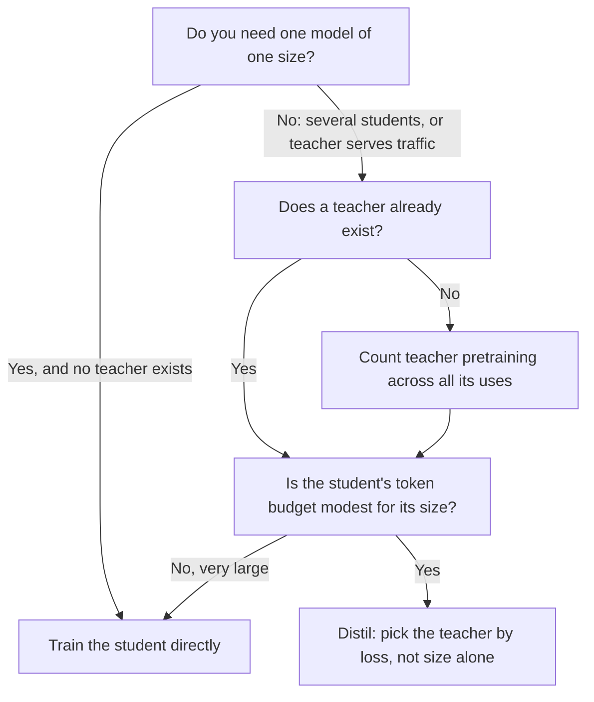

# पाठ 20. Student का आकार चुनना

**मिशन से संबंध:** मिशन आपसे माँगता है कि आप teacher की अपनी लागत को बजट में गिनकर student का आकार और data की मात्रा चुनें, और उस चुनाव का पहला आधा हिस्सा यह जानना है कि student को सीधे train करने की तुलना में distilling करना कब सार्थक है।
**मुख्य स्रोत:** [पेपर: "Distillation Scaling Laws", Busbridge et al., 2025](https://arxiv.org/abs/2502.08606), sections 1, 4 और 5
**पूर्व-आवश्यकताएँ:** [पाठ 19](0019-capacity-gap-and-hidden-traits.md), [Capacity gap](../GLOSSARY.md), [Teacher](../GLOSSARY.md), [Student](../GLOSSARY.md), [Logit distillation](../GLOSSARY.md)

## वार्म-अप

1. ▢ पाठ 19 ने capacity gap बताया। उसे एक वाक्य में कहें, जिसमें यह भी हो कि वह teacher के चुनाव के साथ क्या करता है।

जाँचें

कहीं बड़ा teacher, छोटे teacher से ख़राब student बना सकता है, इसलिए मज़बूत teacher अपने आप बेहतर teacher नहीं है। व्यावहारिक नतीजा यह है कि teacher का आकार ऐसा चुनाव है जिसका एक इष्टतम बिंदु है, ऐसा dial नहीं जिसे बढ़ाते जाएँ।

2. ▢ पाठ 7 ने कवर किया कि Gemma 2 और Minitron ने pretraining के दौरान teacher के distribution को कैसे इस्तेमाल किया। [Logit distillation](../GLOSSARY.md) run को हर training token पर teacher के साथ ऐसा क्या करना पड़ता है जो सादी next-token training नहीं करती?

जाँचें

उसे उस token के prefix पर teacher को चलाना और उसका output distribution पढ़ना पड़ता है, live या संग्रहीत logits से। सादी next-token training को सिर्फ़ student का अपना forward और backward pass चाहिए। teacher का वह अतिरिक्त काम वही है जिसकी क़ीमत यह पाठ और अगला आँकते हैं।

3. ▢ पाठ 17 ने fidelity को generalization से अलग किया। अगर student अपने teacher की predictions से क़रीब से मेल खाता है, तो क्या इससे तय होता है कि student task में अच्छा है?

जाँचें

नहीं। Fidelity उन्हीं inputs पर teacher से agreement है, और teacher ग़लत हो सकता है। Student किसी औसत दर्जे के teacher की वफ़ादार नक़ल हो सकता है या कोई बेवफ़ा पर बेहतर model। पाठ 22 एक माप के साथ इस पर लौटता है।

## यह जानें

### वह सवाल जिसका पेपर जवाब देता है

Distillation को अक्सर किसी अच्छे teacher के होने से उचित ठहराया जाता है। Busbridge et al. एक संकरा सवाल पूछते हैं: समान संसाधन दिए जाने पर, क्या teacher के outputs पर train हुआ student उसी student से कम loss तक पहुँचता है जो सीधे train हुआ? उनका अध्ययन 143M से 12.6B parameters के transformer students और teachers इस्तेमाल करता है, जो कुछ अरब से 512B tokens पर train हुए (section 1)। यह pretraining signal के रूप में इस्तेमाल हुए distillation का नियंत्रित अध्ययन है, इसलिए यह पाठ 4 का logit distillation है, बिना दोहराए data वाले dataset पर लगाया हुआ।

नीचे की हर चीज़ के लिए दो दायरा-सीमाएँ मायने रखती हैं। मापी गई राशि held-out data पर cross-entropy है, downstream task accuracy नहीं। और पेपर sequence-level distillation या generated instruction data से distillation को नहीं परखता। जहाँ यह पाठ नतीजे को उन पर लागू करता है, वह विस्तार है, और यह पाठ ऐसा कहता है।

### नियम

पेपर एक [distillation scaling law](../GLOSSARY.md) fit करता है (उसका Equation 8) जो student की cross-entropy का अनुमान तीन चीज़ों से लगाता है: student के parameters, distillation tokens की संख्या, और teacher की cross-entropy। Teacher सिर्फ़ उस आख़िरी संख्या के ज़रिए आता है। पेपर की finding 2 यह है कि teacher का आकार और teacher के training tokens, student के loss को सिर्फ़ teacher की नतीजे वाली cross-entropy के ज़रिए तय करते हैं, इसलिए जब उनके losses मेल खाएँ तो ज़्यादा देर train हुआ छोटा teacher और कम देर train हुआ बड़ा teacher आपस में बदले जा सकते हैं (section 1, finding 2, और Figure 3b)।

Fit अध्ययन किए गए दायरे के भीतर अच्छा है: लगभग 1% या कम सापेक्ष prediction error, जिसमें कमज़ोर से मज़बूत models तक extrapolate करना भी शामिल है (section 4.4)। उस दायरे के बाहर वह अनुमान है, माप नहीं।

### Distilling कब जीतता है

पेपर का निष्कर्ष सशर्त है, और शर्तें ही इस पाठ की सामग्री हैं। जब दोनों को पर्याप्त data या compute दिया जाए तो distillation, supervised learning से कम cross-entropy तक नहीं पहुँच सकता। वह supervised learning से ज़्यादा कुशल तब है जब ये दोनों सच हों (section 1):

1. Student के लिए इस्तेमाल हुआ कुल compute या tokens उस threshold से बड़ा न हो जो student के आकार पर निर्भर है और scaling law से मिलती है (section 5.1)।
2. कोई teacher पहले से मौजूद है, या जिस teacher को train करना है उसके एक अकेले distillation से परे उपयोग हैं (section 5.3)।

दूसरी शर्त उस पैसे के बारे में है जो आप पहले ही ख़र्च कर चुके हैं। Section 5.3 दूसरा पक्ष सीधे कहता है: जब teacher की training बजट में गिनी जाए, तो student का सबसे अच्छा loss हमेशा supervised नतीजे से बदतर होता है, इसलिए अगर आपको एक आकार का एक model चाहिए और आपके पास teacher नहीं है, तो model को सीधे train करें। अगर आप models का परिवार distil करना चाहते हैं, या teacher traffic भी सँभालता है, तो distillation सस्ता हो सकता है।

पहली शर्त कहती है कि distillation एक बेहतर शुरुआत है, बेहतर अंत नहीं। मामूली token बजट के साथ वह अनुकूल है। बड़े बजट के साथ, supervised learning उसे पकड़ लेती है और आगे निकल जाती है (section 5.1, Figure 6)। वही section बताता है कि जिस compute पर supervised learning बेहतर हो जाती है वह student के आकार के साथ बढ़ता है, इसलिए बड़ा student बजटों के ज़्यादा चौड़े दायरे में फ़ायदा बनाए रखता है।

### teacher को गिनने में क्या लागत है

पेपर distillation run के compute को student की training जमा teacher के forward passes के रूप में अनुमानित करता है (Equation 9)। Teacher के forward passes और teacher की अपनी pretraining पर शुल्क लगता है या नहीं, यह एक चुनाव है, और पेपर चार settings का अध्ययन करता है (उसकी Table 2):

| Setting | Teacher inference पर शुल्क | Teacher pretraining पर शुल्क | यह आपका वर्णन कब करती है |
|---|---|---|---|
| सबसे अच्छा मामला, पूरी तरह amortized | नहीं | नहीं | Teacher मौजूद है और किसी और काम में भी आता है |
| Teacher inference | हाँ | नहीं | Teacher मौजूद है, और आप उसे अपने data पर चलाने का पैसा देते हैं |
| Teacher pretraining | नहीं | हाँ | आप teacher train करते हैं, फिर कई students के लिए उसके logits सहेजते हैं |
| Pretraining और inference | हाँ | हाँ | आप एक student को distil करने के लिए teacher train करते हैं, सबसे बुरा मामला |

पाठ 21 पहले दो columns को गणित में बदलता है। यहाँ मुद्दा यह है कि आप किस पंक्ति में हैं। Open model से distil करने वाले ज़्यादातर practitioners दूसरी पंक्ति में हैं। एक अकेले student के लिए ख़ास teacher train करने वाला चौथी में है, और उस पंक्ति के लिए पेपर का नतीजा है कि सीधी training जीतती है।

### Capacity gap, उनके पैमाने पर

पेपर के fixed-ratio experiments (Figure 4) में, दो आकारों के students को बढ़ते आकार वाले दस teachers से distil किया जाता है, हर एक लगभग 20 tokens प्रति parameter पर train हुआ। जैसे teacher बढ़ता है student की cross-entropy गिरती है, एक इष्टतम पर पहुँचती है, फिर बढ़ती है। मज़बूत teacher आख़िरकार student का प्रदर्शन घटा देता है, जो पाठ 19 का capacity gap है, नियंत्रित स्थितियों में मापा हुआ।

पेपर की पढ़त है कि gap सीखने की क्षमता के बारे में है, यानी teacher और student क्या represent और optimise कर सकते हैं, इसमें अंतर, और सिर्फ़ सापेक्ष parameter counts के बारे में नहीं। उसके नियम में gap, teacher के loss में दो power-law क्षेत्रों के बीच बदलाव के रूप में दिखता है, वहाँ जहाँ teacher का loss और वह loss जो supervised student पाएगा, एक fit किए अनुपात में हों (section 4.3)। इससे निकली एक खोज: जब बजट tokens में तय हो, तो student के बढ़ने के साथ सबसे अच्छे teacher की cross-entropy गिरनी चाहिए (section 5.2)।

ये एक पेपर के अपने models और data पर नतीजे हैं। आकार (एक इष्टतम, फिर गिरावट) को खोज मानें, और उससे teacher-से-student आकार का कोई ख़ास अनुपात बाहर न ले जाएँ।

### निर्णय, चित्र में

दूसरा हीरा (diamond) वह जगह है जहाँ threshold रहता है। पेपर उसके लिए कोई एक संख्या नहीं देता: वह student के आकार में एक वक्र है जिसे आप scaling law से पढ़ते हैं।

## अभ्यास

1. ▢ एक सहकर्मी पेपर का हवाला देकर कहता है "distillation हमेशा student को सीधे train करने से बेहतर है"। कौन-सा वाक्य इसे सबसे सटीक रूप से सुधारता है?

    - a) Distillation एक आकार-निर्भर token स्तर से नीचे जीतता है, और सिर्फ़ तब जब teacher मौजूद हो या उसके दूसरे उपयोग हों।
    - b) Distillation 3B parameters से छोटे students के लिए जीतता है, और सिर्फ़ तब जब teacher 10B parameters से बड़ा हो।
    - c) Distillation हर बार जीतता है जब teacher student से बड़ा हो, बशर्ते data filter किया गया हो।
    - d) Distillation downstream tasks पर जीतता है, और student के पूरी तरह train होने पर cross-entropy पर हारता है।

जाँचें

a). पेपर की दो शर्तें हैं: tokens या compute पर student-आकार-निर्भर threshold, और ऐसा teacher जो पहले से मौजूद हो या जिसके एक distillation से परे उपयोग हों। b) एक parameter cutoff और teacher का आकार गढ़ता है जो पेपर की शर्तों में कहीं नहीं हैं। c) वह सहज बोध है जिसे पेपर परखता और सीमित करता है: बड़ा teacher ख़राब student भी बना सकता है। d) पेपर की मापी राशि को उलट देता है: उसने cross-entropy का अध्ययन किया, और downstream accuracy नहीं परखी।

2. ▢ एक टीम 1B student train करेगी। कोई teacher मौजूद नहीं है। वे 7B teacher को pretrain करने, फिर उससे एक 1B student distil करने की योजना बनाते हैं। पेपर का नतीजा क्या कहता है, और योजना में कौन-सा एक बदलाव जवाब बदल देगा?

जाँचें

जब teacher की training बजट में गिनी जाए और सिर्फ़ एक student हो, तो पेपर पाता है कि समान compute पर student का सबसे अच्छा loss सीधी supervised training से हमेशा ऊँचा है, इसलिए 1B model को सीधे train करें। जो बदलाव इसे बदलता है वह teacher को दूसरे उपयोग देना है: उससे students का परिवार distil करना, या उसे production model के रूप में serve करना। तब उसकी pretraining लागत साझा हो जाती है और दूसरी शर्त पूरी होती है।

3. ▢ अनुमान लगाएँ: आप student को 1B parameters पर और token बजट को तय रखते हैं, और teacher को तीन गुना बड़े और बेहतर से बदल देते हैं। क्या student का loss ज़रूर गिरता है?

संकेत

पेपर की Figure 4 तय student के लिए teacher का आकार बदलती है। सोचें कि वक्र का आकार क्या है, यह नहीं कि बड़ा बेहतर है या नहीं।

जाँचें

ज़रूरी नहीं। Figure 4 में student की cross-entropy teacher के बढ़ने पर एक इष्टतम तक घटती है और फिर बढ़ती है, इसलिए इष्टतम से आगे का teacher student को बदतर बनाता है। पेपर का नियम कहता है कि student पर असर teacher के loss और teacher-student capacity संबंध के ज़रिए पड़ता है, अकेले teacher के आकार से नहीं। आपकी अदला-बदली इष्टतम पार करती है या नहीं यह दोनों models पर निर्भर है, और सिर्फ़ एक run या fit किया नियम ही बताता है।

4. ▢ इनमें से आप अकेले पेपर से क्या निष्कर्ष निकाल सकते हैं, और क्या उसका विस्तार होगा? (i) उसके सबसे बड़े आकार तक के students के लिए, बेहतर teacher loss, capacity gap तक बेहतर student loss देता है। (ii) 50K generated instructions पर sequence-level distillation उसी scaling law को मानता है।

जाँचें

(i) एक खोज है, उन आकारों और data के भीतर जिन पर पेपर ने train किया (143M से 12.6B parameters, 512B tokens तक)। (ii) विस्तार है: पेपर pretraining-शैली के dataset पर teacher-logit distillation का अध्ययन करता है और cross-entropy मापता है, इसलिए वह instruction data या decode किए text पर training के बारे में सीधे कुछ नहीं कहता। आप नियम को (ii) के लिए एक prior की तरह इस्तेमाल कर सकते हैं, पर आपको उसे वैसा ही चिह्नित करना होगा।

5. ▢ पाठ 18 ने imitation gap सिखाया। अगर student को मामूली बजट के साथ distil किया जाए और वह style में teacher से मेल खाए पर क्षमता में नहीं, तो क्या scaling-law का बेहतर fit इसका अनुमान लगा लेता?

जाँचें

अपने आप नहीं। Scaling law cross-entropy का अनुमान लगाता है, जो इसका सार है कि student data को कितना अच्छा model करता है, और यह कुछ नहीं कहता कि कौन-से व्यवहार पहले नक़ल हुए। Imitation gap उस style के बीच के अंतर के बारे में है जिसे rater देखता है और उस क्षमता के बीच जिसे लक्षित benchmark परखता है। अच्छा दिखता loss उस gap के साथ रह सकता है, इसीलिए पाठ 22 और 23 हर क्षमता के लिए अलग मापते हैं।

## असली दुनिया का अभ्यास

- [ ] पेपर खोलें और Figure 6 और उसका caption ढूँढें। अपने शब्दों में लिखें कि वहाँ नीले और लाल का क्या मतलब है और student का आकार बढ़ने पर सीमा किस ओर खिसकती है।
- [ ] कोई distillation लें जो आपने चलाया हो या चलाने की योजना हो। ऊपर की चार-पंक्ति वाली तालिका भरें: आप किस पंक्ति में हैं, और उस पंक्ति के लिए पेपर क्या कहता है?
- [ ] कल: बिना नोट्स के वे दो शर्तें लिखें जिनके तहत पेपर कहता है कि distillation, supervised learning से ज़्यादा कुशल है, और एक चीज़ जो पेपर ने नहीं परखी।

## आगे बढ़ने के लिए

- [आकार तय करना और मापना शीट](../reference/sizing-and-measuring.md)
- [पेपर: "Distillation Scaling Laws", Busbridge et al., 2025](https://arxiv.org/abs/2502.08606), Figures 4, 6 और 9
- [Pretraining ट्रैक](../../pretraining/): वह track जो सिखाता है कि compute बजट किससे बनता है और scaling laws कैसे fit किए जाते हैं
- [संसाधन](../RESOURCES.md)

---

बात नहीं बन रही? ऊपर दिए मुख्य स्रोत को दोबारा पढ़ें, क्योंकि यह पाठ उसे संक्षिप्त करता है और समझ संक्षेप में ही रिसती है। जो शब्द फिसलन भरा लगे, उसके लिए [शब्दावली](../GLOSSARY.md) देखें।

अगर दिक़्क़त सामग्री की नहीं बल्कि पाठ की ही है, तो वह एक खोट है: [issue खोलें](https://github.com/TokenCemetery/teach/issues)।
