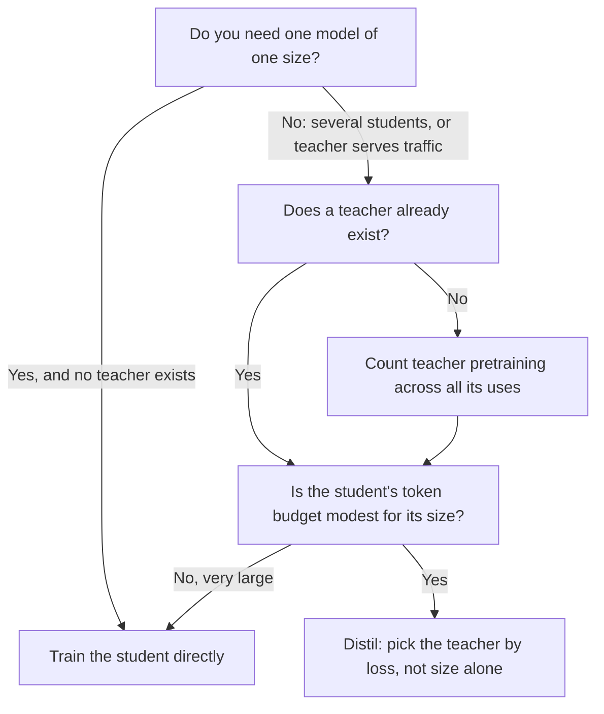

# Lesson 20. Choosing Student Size

**Mission link:** The mission asks you to choose a student size and a data volume with the teacher's own cost counted in the budget, and the first half of that choice is knowing when distilling is worth doing at all against training the student directly.
**Primary source:** [Paper: "Distillation Scaling Laws", Busbridge et al., 2025](https://arxiv.org/abs/2502.08606), sections 1, 4 and 5
**Prerequisites:** [Lesson 19](0019-capacity-gap-and-hidden-traits.md), [Capacity gap](../GLOSSARY.md), [Teacher](../GLOSSARY.md), [Student](../GLOSSARY.md), [Logit distillation](../GLOSSARY.md)

## Warm-up

1. ▢ Lesson 19 described the capacity gap. State it in one sentence, including what it does to the choice of teacher.

Check

A much larger teacher can produce a worse student than a smaller one would, so a stronger teacher is not automatically a better one. The practical consequence is that teacher size is a choice with an optimum, not a dial to turn up.

2. ▢ Lesson 7 covered how Gemma 2 and Minitron used a teacher's distribution during pretraining. What does a [logit distillation](../GLOSSARY.md) run have to do with the teacher at every training token that plain next-token training does not?

Check

It has to run the teacher on that token's prefix and read its output distribution, either live or from stored logits. Plain next-token training needs only the student's own forward and backward pass. That extra teacher work is what this lesson and the next put a price on.

3. ▢ Lesson 17 separated fidelity from generalization. If a student matches its teacher's predictions closely, does that settle whether the student is good at the task?

Check

No. Fidelity is agreement with the teacher on the same inputs, and the teacher can be wrong. A student can be a faithful copy of a mediocre teacher or an unfaithful but better model. Lesson 22 returns to this with a measurement.

## Know this

### The question the paper answers

Distillation is often justified by the existence of a good teacher. Busbridge et al. ask a narrower question: given the same resources, does a student trained on a teacher's outputs reach a lower loss than the same student trained directly? Their study uses transformer students and teachers from 143M to 12.6B parameters, trained on a few billion to 512B tokens (section 1). It is a controlled study of distillation used as a pretraining signal, so it is the logit distillation of lesson 4, applied across a dataset with no repeated data.

Two scope limits matter for everything below. The measured quantity is cross-entropy on held-out data, not downstream task accuracy. And the paper does not test sequence-level distillation or distillation from generated instruction data. Where this lesson applies the result to those, it is an extension, and it says so.

### The law

The paper fits a [distillation scaling law](../GLOSSARY.md) (its Equation 8) that predicts the student's cross-entropy from three things: the student's parameters, the number of distillation tokens, and the teacher's cross-entropy. The teacher enters only through that last number. The paper's finding 2 is that teacher size and teacher training tokens set the student's loss only through the teacher's resulting cross-entropy, so a smaller teacher trained longer and a larger one trained less are interchangeable when their losses match (section 1, finding 2, and Figure 3b).

The fit is good inside the range studied: relative prediction error of about 1% or less, including when extrapolating from weaker to stronger models (section 4.4). Outside that range it is a prediction, not a measurement.

### When distilling wins

The paper's conclusion is conditional, and the conditions are the content of this lesson. Distillation cannot reach a lower cross-entropy than supervised learning when both are given enough data or compute. It is more efficient than supervised learning when both of these hold (section 1):

1. The total compute or tokens used for the student is not larger than a threshold that depends on student size, given by the scaling law (section 5.1).
2. A teacher already exists, or the teacher to be trained has uses beyond a single distillation (section 5.3).

The second condition is about money you have already spent. Section 5.3 states the other side directly: when teacher training is counted in the budget, the best student loss is always worse than the supervised result, so if you want one model of one size and have no teacher, train the model directly. If you intend to distil a family of models, or the teacher also serves traffic, distillation may be cheaper.

The first condition says distillation is a head start, not a better ending. With a modest token budget it is favourable. With a large one, supervised learning catches up and overtakes it (section 5.1, Figure 6). The same section reports that the compute at which supervised learning becomes preferable grows with student size, so a larger student keeps the advantage over a wider range of budgets.

### What it costs to count the teacher

The paper approximates the compute of a distillation run as the student's training plus the teacher's forward passes (Equation 9). Whether the teacher's forward passes and the teacher's own pretraining are charged is a choice, and the paper studies four settings (its Table 2):

| Setting | Teacher inference charged | Teacher pretraining charged | When it describes you |
|---|---|---|---|
| Best case, fully amortized | No | No | The teacher exists and is also used for something else |
| Teacher inference | Yes | No | The teacher exists, and you pay to run it on your data |
| Teacher pretraining | No | Yes | You train the teacher, then store its logits for many students |
| Pretraining plus inference | Yes | Yes | You train a teacher to distil one student, the worst case |

Lesson 21 turns the first two columns into arithmetic. Here the point is the row you are in. Most practitioners distilling from an open model are in the second row. Someone training a bespoke teacher for a single student is in the fourth, and the paper's result for that row is that direct training wins.

### The capacity gap, at their scale

In the paper's fixed-ratio experiments (Figure 4), students of two sizes are distilled from ten teachers of increasing size, each trained on about 20 tokens per parameter. Student cross-entropy falls as the teacher grows, reaches an optimum, then rises. A stronger teacher eventually reduces student performance, which is the capacity gap of lesson 19 measured under controlled conditions.

The paper's reading is that the gap is about learning capacity, a difference in what teacher and student can represent and optimise, and not only about relative parameter counts. In its law the gap appears as a transition between two power-law regions in the teacher's loss, located where the teacher's loss and the loss a supervised student would reach stand in a fitted ratio (section 4.3). One finding that follows: when the budget is fixed in tokens, the best teacher's cross-entropy should fall as the student grows (section 5.2).

These are one paper's results on its own models and data. Treat the shape (an optimum, then decline) as the finding, and do not carry a specific teacher-to-student size ratio out of it.

### The decision, drawn

The second diamond is where the threshold lives. The paper gives no single number for it: it is a curve in student size that you read from the scaling law.

## Practice

1. ▢ A colleague cites the paper to say "distillation always beats training the student directly". Which sentence corrects this most accurately?

    - a) Distillation wins below a size-dependent token level, and only when a teacher exists or has other uses.
    - b) Distillation wins for students under 3B parameters, and only when the teacher exceeds 10B parameters.
    - c) Distillation wins whenever the teacher is larger than the student, as long as the data is filtered.
    - d) Distillation wins on downstream tasks, and loses on cross-entropy once the student is fully trained.

Check

a). The paper's two conditions are a student-size-dependent threshold on tokens or compute, and a teacher that already exists or has uses beyond one distillation. b) invents a parameter cutoff and a teacher size that appear nowhere in the paper's conditions. c) is the intuition the paper tests and qualifies: a larger teacher can even produce a worse student. d) reverses the paper's measured quantity: it studied cross-entropy, and it did not test downstream accuracy.

2. ▢ A team will train a 1B student. No teacher exists. They plan to pretrain a 7B teacher, then distil one 1B student from it. What does the paper's result say, and what single change to the plan would alter the answer?

Check

With teacher training counted in the budget and only one student, the paper finds the best student loss is always higher than direct supervised training at the same compute, so train the 1B model directly. The change that alters it is giving the teacher other uses: distilling a family of students from it, or serving it as the production model. Then its pretraining cost is shared and the second condition holds.

3. ▢ Predict: you hold the student at 1B parameters and the token budget fixed, and swap the teacher for one three times larger and better. Does the student's loss necessarily fall?

Hint

The paper's Figure 4 sweeps teacher size for a fixed student. Think about what shape the curve has, not about whether bigger is better.

Check

Not necessarily. In Figure 4 the student's cross-entropy decreases to an optimum and then increases as the teacher grows, so a teacher past the optimum makes the student worse. The paper's law says the student is affected through the teacher's loss and the teacher-student capacity relationship, not through the teacher's size alone. Whether your swap crosses the optimum depends on the two models, and only a run or the fitted law tells you.

4. ▢ Which of these can you conclude from the paper alone, and which would be an extension of it? (i) For students up to its largest size, a better teacher loss gives a better student loss until the capacity gap. (ii) Sequence-level distillation on 50K generated instructions follows the same scaling law.

Check

(i) is a finding, within the sizes and data the paper trained (143M to 12.6B parameters, up to 512B tokens). (ii) is an extension: the paper studies teacher-logit distillation on a pretraining-style dataset and measures cross-entropy, so it says nothing directly about instruction data or about training on decoded text. You may use the law as a prior for (ii) but you have to label it as one.

5. ▢ Lesson 18 taught the imitation gap. If a student is distilled with a modest budget and matches its teacher on style but not on capability, would a better scaling-law fit have predicted that?

Check

Not by itself. The scaling law predicts cross-entropy, a summary of how well the student models the data, and says nothing about which behaviours were copied first. The imitation gap is about the difference between a style a rater sees and a capability a targeted benchmark tests. A loss number that looks good can coexist with that gap, which is why lessons 22 and 23 measure per capability.

## Real-world reps

- [ ] Open the paper and find Figure 6 and its caption. Write down, in your own words, what blue and red mean there and which way the boundary moves as student size grows.
- [ ] Take a distillation you have run or plan to run. Fill in the four-row table above: which row are you in, and what does the paper say for that row?
- [ ] Tomorrow: without notes, write the two conditions under which the paper says distillation is more efficient than supervised learning, and one thing the paper did not test.

## Going further

- [Sizing and Measuring](../reference/sizing-and-measuring.md)
- [Paper: "Distillation Scaling Laws", Busbridge et al., 2025](https://arxiv.org/abs/2502.08606), Figures 4, 6 and 9
- [Pretraining](../../pretraining/): the track that teaches what a compute budget is made of and how scaling laws are fitted
- [Resources](../RESOURCES.md)

---

Not landing? Reread the primary source at the top, since this lesson compresses it and compression is where understanding leaks. Check the [glossary](../GLOSSARY.md) for any term that felt slippery.

If the lesson itself is unclear rather than the material, that is a defect: [open an issue](https://github.com/TokenCemetery/teach/issues).
