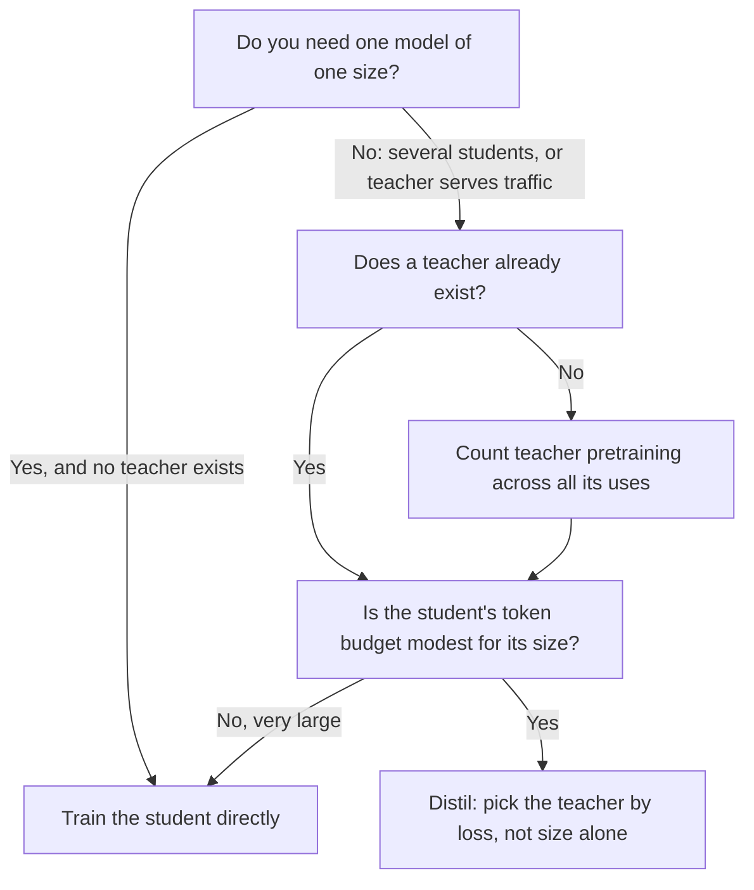

# Lição 20. Escolhendo o tamanho do aluno

**Ligação com a missão:** A missão pede que você escolha um tamanho de aluno e um volume de dados contando o próprio custo do professor no orçamento, e a primeira metade dessa escolha é saber quando vale a pena destilar de algum modo, em comparação com treinar o aluno diretamente.
**Fonte principal:** [Artigo científico: "Distillation Scaling Laws", Busbridge et al., 2025](https://arxiv.org/abs/2502.08606), seções 1, 4 e 5
**Pré-requisitos:** [Lição 19](0019-capacity-gap-and-hidden-traits.md), [Lacuna de capacidade](../GLOSSARY.md), [Professor](../GLOSSARY.md), [Aluno](../GLOSSARY.md), [Destilação de logits](../GLOSSARY.md)

## Aquecimento

1. ▢ A lição 19 descreveu a lacuna de capacidade. Enuncie-a em uma frase, incluindo o que ela faz com a escolha do professor.

Verificação

Um professor muito maior pode produzir um aluno pior do que um menor produziria, então um professor mais forte não é automaticamente um professor melhor. A consequência prática é que o tamanho do professor é uma escolha com um ótimo, não um botão para girar para cima.

2. ▢ A lição 7 cobriu como o Gemma 2 e o Minitron usaram a distribuição de um professor durante o pré-treinamento. O que uma execução de [destilação de logits](../GLOSSARY.md) precisa fazer com o professor em cada token de treinamento que o treinamento simples de próximo token não precisa?

Verificação

Ela precisa rodar o professor sobre o prefixo desse token e ler a sua distribuição de saída, ao vivo ou a partir de logits armazenados. O treinamento simples de próximo token precisa apenas do forward e do backward pass do próprio aluno. Esse trabalho extra do professor é o que esta lição e a próxima precificam.

3. ▢ A lição 17 separou a fidelidade da generalização. Se um aluno iguala de perto as previsões do seu professor, isso resolve se o aluno é bom na tarefa?

Verificação

Não. A fidelidade é a concordância com o professor nas mesmas entradas, e o professor pode estar errado. Um aluno pode ser uma cópia fiel de um professor medíocre ou um modelo infiel, porém melhor. A lição 22 volta a isso com uma medição.

## Saiba isto

### A pergunta que o artigo responde

A destilação costuma ser justificada pela existência de um bom professor. Busbridge et al. fazem uma pergunta mais estreita: com os mesmos recursos, um aluno treinado nas saídas de um professor chega a uma loss menor do que o mesmo aluno treinado diretamente? O estudo deles usa alunos e professores transformer de 143M a 12,6B de parâmetros, treinados em de alguns bilhões a 512B de tokens (seção 1). É um estudo controlado da destilação usada como sinal de pré-treinamento, então é a destilação de logits da lição 4, aplicada a um dataset sem dados repetidos.

Dois limites de escopo importam para tudo o que vem abaixo. A quantidade medida é a cross-entropy em dados held-out, não a acurácia em tarefas downstream. E o artigo não testa a destilação em nível de sequência nem a destilação a partir de dados de instrução gerados. Onde esta lição aplica o resultado a esses casos, é uma extensão, e ela diz isso.

### A lei

O artigo ajusta uma [lei de escala da destilação](../GLOSSARY.md) (a sua Equação 8) que prevê a cross-entropy do aluno a partir de três coisas: os parâmetros do aluno, o número de tokens de destilação e a cross-entropy do professor. O professor entra apenas por esse último número. O achado 2 do artigo é que o tamanho do professor e os tokens de treinamento do professor definem a loss do aluno apenas por meio da cross-entropy resultante do professor, então um professor menor treinado por mais tempo e um maior treinado menos são intercambiáveis quando as suas losses coincidem (seção 1, achado 2, e Figura 3b).

O ajuste é bom dentro da faixa estudada: erro relativo de previsão de cerca de 1% ou menos, inclusive ao extrapolar de modelos mais fracos para mais fortes (seção 4.4). Fora dessa faixa, é uma previsão, não uma medição.

### Quando destilar vence

A conclusão do artigo é condicional, e as condições são o conteúdo desta lição. A destilação não consegue chegar a uma cross-entropy menor do que o aprendizado supervisionado quando ambos recebem dados ou compute suficientes. Ela é mais eficiente do que o aprendizado supervisionado quando ambas as condições a seguir valem (seção 1):

1. O compute total ou os tokens usados para o aluno não são maiores do que um limiar que depende do tamanho do aluno, dado pela lei de escala (seção 5.1; a seção 5.3 mostra esse limiar crescendo com o tamanho do aluno).
2. Já existe um professor, ou o professor a ser treinado tem usos além de uma única destilação (seção 5.3).

A segunda condição é sobre dinheiro que você já gastou. A seção 5.3 enuncia o outro lado diretamente: quando o treinamento do professor é contado no orçamento, a melhor loss do aluno é sempre pior do que o resultado supervisionado, então, se você quer um modelo de um tamanho e não tem professor, treine o modelo diretamente. Se você pretende destilar uma família de modelos, ou o professor também atende tráfego, a destilação pode ser mais barata.

A primeira condição diz que a destilação é uma vantagem inicial, não um final melhor. Com um orçamento modesto de tokens, ela é favorável. Com um grande, o aprendizado supervisionado a alcança e a ultrapassa (seção 5.1, Figura 6). A mesma seção relata que o compute em que o aprendizado supervisionado passa a ser preferível cresce com o tamanho do aluno, então um aluno maior mantém a vantagem em uma faixa mais ampla de orçamentos.

### O que custa contar o professor

O artigo aproxima o compute de uma execução de destilação como o treinamento do aluno mais os forward passes do professor (Equação 9). Se os forward passes do professor e o próprio pré-treinamento do professor são cobrados é uma escolha, e o artigo estuda quatro cenários (a sua Tabela 2):

| Cenário | Inferência do professor cobrada | Pré-treinamento do professor cobrado | Quando descreve você |
|---|---|---|---|
| Melhor caso, totalmente amortizado | Não | Não | O professor existe e também é usado para outra coisa |
| Inferência do professor | Sim | Não | O professor existe, e você paga para rodá-lo nos seus dados |
| Pré-treinamento do professor | Não | Sim | Você treina o professor e depois armazena os seus logits para muitos alunos |
| Pré-treinamento mais inferência | Sim | Sim | Você treina um professor para destilar um aluno, o pior caso |

A lição 21 transforma as duas primeiras colunas em aritmética. Aqui o ponto é a linha em que você está. A maioria dos profissionais que destilam de um modelo aberto está na segunda linha. Quem treina um professor sob medida para um único aluno está na quarta, e o resultado do artigo para essa linha é que o treinamento direto vence.

### A lacuna de capacidade, na escala deles

Nos experimentos de razão fixa do artigo (Figura 4), alunos de dois tamanhos são destilados de dez professores de tamanho crescente, cada um treinado em cerca de 20 tokens por parâmetro. A cross-entropy do aluno cai conforme o professor cresce, chega a um ótimo e depois sobe. Um professor mais forte acaba reduzindo o desempenho do aluno, que é a lacuna de capacidade da lição 19 medida em condições controladas.

A leitura do artigo é que a lacuna é sobre capacidade de aprendizado, uma diferença no que professor e aluno conseguem representar e otimizar, e não apenas sobre contagens relativas de parâmetros. Na lei dele, a lacuna aparece como uma transição entre duas regiões de lei de potência na loss do professor, localizada onde a loss do professor e a loss que um aluno supervisionado alcançaria estão em uma razão ajustada (seção 4.3). Um achado que decorre disso: quando o orçamento é fixo em tokens, a cross-entropy do melhor professor deve cair conforme o aluno cresce (seção 5.2).

Esses são resultados de um artigo nos seus próprios modelos e dados. Trate o formato (um ótimo, depois declínio) como o achado, e não leve dali uma razão específica de tamanho entre professor e aluno.

### A decisão, desenhada

O segundo losango é onde mora o limiar. O artigo não dá um único número para ele: é uma curva no tamanho do aluno que você lê a partir da lei de escala.

## Prática

1. ▢ Um colega cita o artigo para dizer "a destilação sempre supera treinar o aluno diretamente". Qual frase corrige isso com mais precisão?

    - a) A destilação vence abaixo de um nível de tokens dependente do tamanho, e apenas quando existe um professor ou ele tem outros usos.
    - b) A destilação vence para alunos abaixo de 3B de parâmetros, e apenas quando o professor excede 10B de parâmetros.
    - c) A destilação vence sempre que o professor é maior do que o aluno, desde que os dados sejam filtrados.
    - d) A destilação vence em tarefas downstream, e perde em cross-entropy quando o aluno está totalmente treinado.

Verificação

a). As duas condições do artigo são um limiar de tokens ou compute dependente do tamanho do aluno e um professor que já existe ou tem usos além de uma destilação. b) inventa um corte de parâmetros e um tamanho de professor que não aparecem em lugar nenhum das condições do artigo. c) é a intuição que o artigo testa e qualifica: um professor maior pode até produzir um aluno pior. d) inverte a quantidade medida pelo artigo: ele estudou a cross-entropy e não testou a acurácia downstream.

2. ▢ Uma equipe vai treinar um aluno de 1B. Não existe professor. Ela planeja pré-treinar um professor de 7B e depois destilar dele um aluno de 1B. O que o resultado do artigo diz, e qual mudança única no plano alteraria a resposta?

Verificação

Com o treinamento do professor contado no orçamento e apenas um aluno, o artigo constata que a melhor loss do aluno é sempre maior do que a do treinamento supervisionado direto com o mesmo compute, então treine o modelo de 1B diretamente. A mudança que altera isso é dar outros usos ao professor: destilar dele uma família de alunos, ou servi-lo como o modelo de produção. Então o custo do seu pré-treinamento é compartilhado e a segunda condição vale.

3. ▢ Preveja: você mantém o aluno em 1B de parâmetros e o orçamento de tokens fixo, e troca o professor por um três vezes maior e melhor. A loss do aluno necessariamente cai?

Dica

A Figura 4 do artigo varre o tamanho do professor para um aluno fixo. Pense em qual formato a curva tem, e não em se maior é melhor.

Verificação

Não necessariamente. Na Figura 4, a cross-entropy do aluno diminui até um ótimo e depois aumenta conforme o professor cresce, então um professor além do ótimo piora o aluno. A lei do artigo diz que o aluno é afetado por meio da loss do professor e da relação de capacidade entre professor e aluno, e não apenas pelo tamanho do professor. Se a sua troca cruza o ótimo depende dos dois modelos, e só uma execução ou a lei ajustada diz.

4. ▢ Qual destas você pode concluir apenas do artigo, e qual seria uma extensão dele? (i) Para alunos até o seu maior tamanho, uma loss de professor melhor dá uma loss de aluno melhor até a lacuna de capacidade. (ii) A destilação em nível de sequência em 50K instruções geradas segue a mesma lei de escala.

Verificação

(i) é um achado, dentro dos tamanhos e dados que o artigo treinou (143M a 12,6B de parâmetros, até 512B de tokens). (ii) é uma extensão: o artigo estuda a destilação com logits do professor em um dataset ao estilo de pré-treinamento e mede a cross-entropy, então não diz nada diretamente sobre dados de instrução nem sobre treinar em texto decodificado. Você pode usar a lei como um prior para (ii), mas precisa rotulá-la como tal.

5. ▢ A lição 18 ensinou a lacuna de imitação. Se um aluno é destilado com um orçamento modesto e iguala o professor no estilo mas não na capacidade, um ajuste melhor da lei de escala teria previsto isso?

Verificação

Não por si só. A lei de escala prevê a cross-entropy, um resumo de quão bem o aluno modela os dados, e não diz nada sobre quais comportamentos foram copiados primeiro. A lacuna de imitação é sobre a diferença entre um estilo que um avaliador vê e uma capacidade que um benchmark direcionado testa. Um número de loss de boa aparência pode coexistir com essa lacuna, e é por isso que as lições 22 e 23 medem por capacidade.

## Prática no mundo real

- [ ] Abra o artigo e encontre a Figura 6 e a sua legenda. Escreva, com as suas próprias palavras, o que azul e vermelho significam ali e para que lado a fronteira se move conforme o tamanho do aluno cresce.
- [ ] Pegue uma destilação que você executou ou planeja executar. Preencha a tabela de quatro linhas acima: em qual linha você está, e o que o artigo diz para essa linha?
- [ ] Amanhã: sem consultar anotações, escreva as duas condições sob as quais o artigo diz que a destilação é mais eficiente do que o aprendizado supervisionado, e uma coisa que o artigo não testou.

## Para ir além

- [Dimensionamento e Medição](../reference/sizing-and-measuring.md)
- [Artigo científico: "Distillation Scaling Laws", Busbridge et al., 2025](https://arxiv.org/abs/2502.08606), Figuras 4, 6 e 9
- [Pré-treinamento](../../pretraining/): a trilha que ensina do que é feito um orçamento de compute e como as leis de escala são ajustadas
- [Recursos](../RESOURCES.md)

---

Não ficou claro? Releia a fonte principal no topo, já que esta lição a comprime e é na compressão que o entendimento escapa. Consulte o [glossário](../GLOSSARY.md) para qualquer termo que pareceu escorregadio.

Se o problema é a lição em si, e não o material, isso é um defeito: [abra uma issue](https://github.com/TokenCemetery/teach/issues).
