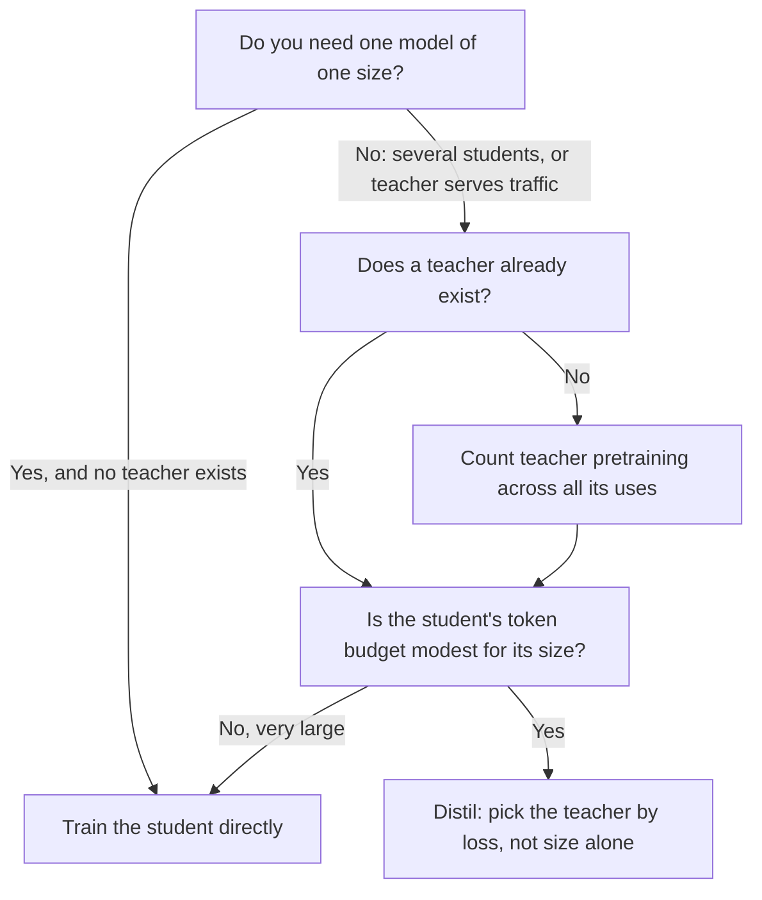

# Урок 20. Выбор размера ученика

**Связь с целью курса:** Цель курса требует, чтобы вы могли выбрать размер ученика и объём данных, учитывая в бюджете собственную стоимость учителя, а первая половина этого выбора состоит в том, чтобы знать, когда дистиллировать вообще стоит по сравнению с прямым обучением ученика.
**Первоисточник:** [Научная статья: "Distillation Scaling Laws", Busbridge et al., 2025](https://arxiv.org/abs/2502.08606), разделы 1, 4 и 5
**Предварительные требования:** [Урок 19](0019-capacity-gap-and-hidden-traits.md), [разрыв в ёмкости](../GLOSSARY.md), [учитель](../GLOSSARY.md), [ученик](../GLOSSARY.md), [логитная дистилляция](../GLOSSARY.md)

## Разминка

1. ▢ Урок 19 описал разрыв в ёмкости. Сформулируйте его одним предложением, включая то, что он делает с выбором учителя.

Проверка

Намного больший учитель может дать худшего ученика, чем дал бы меньший, так что более сильный учитель не обязательно лучший. Практическое следствие в том, что размер учителя это выбор с оптимумом, а не ручка, которую можно крутить вверх.

2. ▢ Урок 7 разобрал, как Gemma 2 и Minitron использовали распределение учителя во время предобучения. Что должен делать с учителем в каждом обучающем токене запуск [логитной дистилляции](../GLOSSARY.md) такого, чего не нужно при обычном обучении на следующий токен?

Проверка

Он должен запускать учителя на префиксе этого токена и читать его выходное распределение, либо на лету, либо из сохранённых логитов. Обычному обучению на следующий токен нужен лишь собственный прямой и обратный проход ученика. Эта дополнительная работа учителя и есть то, чему этот урок и следующий назначают цену.

3. ▢ Урок 17 отделил верность от обобщения. Если ученик близко воспроизводит предсказания своего учителя, решает ли это вопрос о том, хорош ли ученик в задаче?

Проверка

Нет. Верность это согласие с учителем на тех же входах, а учитель может ошибаться. Ученик может быть верной копией посредственного учителя или неверной, но лучшей моделью. Урок 22 возвращается к этому с измерением.

## Что нужно знать

### Вопрос, на который отвечает статья

Дистилляцию часто оправдывают существованием хорошего учителя. Busbridge и соавторы задают более узкий вопрос: при одних и тех же ресурсах достигает ли ученик, обученный на выходах учителя, меньшей потери, чем тот же ученик, обученный напрямую? Их исследование использует трансформеры-ученики и учителей от 143M до 12.6B параметров, обученных на от нескольких миллиардов до 512B токенов (раздел 1). Это контролируемое исследование дистилляции, использованной как сигнал предобучения, так что это логитная дистилляция из урока 4, применённая по датасету без повторяющихся данных.

Для всего дальнейшего важны два ограничения области. Измеряемая величина это кросс-энтропия на отложенных данных, а не точность на downstream-задачах. И статья не проверяет дистилляцию на уровне последовательностей или дистилляцию на сгенерированных инструктивных данных. Там, где этот урок применяет результат к ним, это расширение, и об этом сказано.

### Закон

Статья подгоняет [закон масштабирования дистилляции](../GLOSSARY.md) (её уравнение 8), который предсказывает кросс-энтропию ученика по трём величинам: параметрам ученика, числу токенов дистилляции и кросс-энтропии учителя. Учитель входит только через это последнее число. Вывод 2 статьи состоит в том, что размер учителя и число его обучающих токенов задают потерю ученика только через получающуюся кросс-энтропию учителя, так что меньший учитель, обученный дольше, и больший, обученный меньше, взаимозаменяемы, когда их потери совпадают (раздел 1, вывод 2, и рисунок 3b).

Подгонка хороша внутри изученного диапазона: относительная ошибка предсказания около 1% или меньше, в том числе при экстраполяции от более слабых моделей к более сильным (раздел 4.4). Вне этого диапазона это предсказание, а не измерение.

### Когда дистилляция выигрывает

Вывод статьи условен, и эти условия составляют содержание этого урока. Дистилляция не может достичь меньшей кросс-энтропии, чем контролируемое обучение, когда им обоим дано достаточно данных или вычислений. Она эффективнее контролируемого обучения, когда выполняются оба условия (раздел 1):

1. Общее число вычислений или токенов для ученика не превышает порога, зависящего от размера ученика и задаваемого законом масштабирования (раздел 5.1; раздел 5.3 показывает, что этот порог растёт с размером ученика).
2. Учитель уже существует, или обучаемый учитель имеет применения сверх единственной дистилляции (раздел 5.3).

Второе условие касается денег, которые вы уже потратили. Раздел 5.3 прямо говорит о другой стороне: когда обучение учителя учтено в бюджете, лучшая потеря ученика всегда хуже результата контролируемого обучения, так что если вам нужна одна модель одного размера и учителя нет, обучайте модель напрямую. Если вы собираетесь дистиллировать семейство моделей или учитель ещё и обслуживает трафик, дистилляция может оказаться дешевле.

Первое условие говорит, что дистилляция это фора, а не лучший финал. При скромном бюджете токенов она выгодна. При большом контролируемое обучение догоняет её и обгоняет (раздел 5.1, рисунок 6). Тот же раздел сообщает, что объём вычислений, при котором контролируемое обучение становится предпочтительнее, растёт с размером ученика, так что больший ученик сохраняет преимущество в более широком диапазоне бюджетов.

### Чего стоит учёт учителя

Статья приближает вычисления запуска дистилляции как обучение ученика плюс прямые проходы учителя (уравнение 9). Относятся ли на счёт прямые проходы учителя и его собственное предобучение, это выбор, и статья изучает четыре постановки (её таблица 2):

| Постановка | Инференс учителя учтён | Предобучение учителя учтено | Когда это описывает вас |
|---|---|---|---|
| Лучший случай, полностью амортизировано | Нет | Нет | Учитель существует и используется ещё для чего-то |
| Инференс учителя | Да | Нет | Учитель существует, и вы платите за его запуск на ваших данных |
| Предобучение учителя | Нет | Да | Вы обучаете учителя, затем сохраняете его логиты для многих учеников |
| Предобучение плюс инференс | Да | Да | Вы обучаете учителя ради дистилляции одного ученика, худший случай |

Урок 21 превращает первые два столбца в арифметику. Здесь важно, в какой вы строке. Большинство практиков, дистиллирующих из открытой модели, находятся во второй строке. Тот, кто обучает специальный учитель для единственного ученика, в четвёртой, и результат статьи для этой строки такой, что прямое обучение выигрывает.

### Разрыв в ёмкости в их масштабе

В экспериментах статьи с фиксированным отношением (рисунок 4) ученики двух размеров дистиллируются из десяти учителей возрастающего размера, каждый обучен на около 20 токенов на параметр. Кросс-энтропия ученика падает по мере роста учителя, достигает оптимума, затем растёт. Более сильный учитель в итоге снижает качество ученика, и это разрыв в ёмкости из урока 19, измеренный в контролируемых условиях.

Прочтение статьи в том, что разрыв касается способности к обучению, различия в том, что учитель и ученик могут представить и оптимизировать, а не только относительного числа параметров. В её законе разрыв проявляется как переход между двумя степенными областями по потере учителя, расположенный там, где потеря учителя и потеря, которой достиг бы контролируемый ученик, находятся в подогнанном отношении (раздел 4.3). Из этого следует один вывод: при бюджете, зафиксированном в токенах, кросс-энтропия лучшего учителя должна падать по мере роста ученика (раздел 5.2).

Это результаты одной статьи на её собственных моделях и данных. Считайте выводом форму (оптимум, затем спад) и не выносите из неё конкретное отношение размера учителя к размеру ученика.

### Решение, нарисованное

Второй ромб это место, где живёт порог. Статья не даёт для него одного числа: это кривая по размеру ученика, которую вы читаете из закона масштабирования.

## Практика

1. ▢ Коллега ссылается на статью, чтобы сказать «дистилляция всегда лучше прямого обучения ученика». Какое предложение исправляет это точнее всего?

    - a) Дистилляция выигрывает ниже зависящего от размера уровня токенов и только когда учитель существует или имеет другие применения.
    - b) Дистилляция выигрывает для учеников менее 3B параметров и только когда учитель превышает 10B параметров.
    - c) Дистилляция выигрывает всякий раз, когда учитель больше ученика, если данные отфильтрованы.
    - d) Дистилляция выигрывает на downstream-задачах и проигрывает по кросс-энтропии, когда ученик полностью обучен.

Проверка

a). Два условия статьи это зависящий от размера ученика порог по токенам или вычислениям и учитель, который уже существует или имеет применения сверх одной дистилляции. b) выдумывает отсечку по параметрам и размер учителя, которых нет нигде в условиях статьи. c) это интуиция, которую статья проверяет и уточняет: больший учитель может даже дать худшего ученика. d) переворачивает измеряемую статьёй величину: она изучала кросс-энтропию и не проверяла точность на downstream-задачах.

2. ▢ Команда будет обучать ученика на 1B. Учителя нет. Они планируют предобучить учителя на 7B, а затем дистиллировать из него одного ученика на 1B. Что говорит результат статьи и какое единственное изменение плана изменило бы ответ?

Проверка

При учёте обучения учителя в бюджете и единственном ученике статья обнаруживает, что лучшая потеря ученика всегда выше, чем при прямом контролируемом обучении при тех же вычислениях, так что обучайте модель на 1B напрямую. Изменение, которое меняет ответ, это придать учителю другие применения: дистиллировать из него семейство учеников или использовать его как производственную модель. Тогда стоимость его предобучения делится, и второе условие выполняется.

3. ▢ Предскажите: вы держите ученика на 1B параметров и токенный бюджет фиксированными и меняете учителя на втрое больший и лучший. Обязательно ли потеря ученика упадёт?

Подсказка

Рисунок 4 статьи перебирает размер учителя для фиксированного ученика. Подумайте о форме кривой, а не о том, лучше ли большее.

Проверка

Не обязательно. На рисунке 4 кросс-энтропия ученика убывает до оптимума, а затем растёт по мере роста учителя, так что учитель за пределами оптимума делает ученика хуже. Закон статьи говорит, что на ученика влияют потеря учителя и соотношение ёмкостей учителя и ученика, а не один лишь размер учителя. Пересекает ли ваша замена оптимум, зависит от двух моделей, и это скажет только запуск или подогнанный закон.

4. ▢ Что из этого можно заключить по одной статье, а что было бы её расширением? (i) Для учеников до её наибольшего размера лучшая потеря учителя даёт лучшую потерю ученика вплоть до разрыва в ёмкости. (ii) Дистилляция на уровне последовательностей на 50K сгенерированных инструкций следует тому же закону масштабирования.

Проверка

(i) это вывод, в пределах размеров и данных, на которых обучала статья (от 143M до 12.6B параметров, до 512B токенов). (ii) это расширение: статья изучает дистилляцию по логитам учителя на датасете в стиле предобучения и измеряет кросс-энтропию, так что напрямую ничего не говорит об инструктивных данных или об обучении на декодированном тексте. Вы можете использовать закон как априорное представление для (ii), но должны обозначить его как таковое.

5. ▢ Урок 18 преподал разрыв имитации. Если ученика дистиллируют при скромном бюджете и он совпадает с учителем по стилю, но не по возможностям, предсказала бы это лучшая подгонка закона масштабирования?

Проверка

Сама по себе нет. Закон масштабирования предсказывает кросс-энтропию, сводку того, насколько хорошо ученик моделирует данные, и ничего не говорит о том, какое поведение копируется первым. Разрыв имитации касается различия между стилем, который видит оценщик, и возможностью, которую проверяет целевой бенчмарк. Хорошо выглядящее число потери может сосуществовать с этим разрывом, поэтому уроки 22 и 23 измеряют по каждому умению.

## Практика в реальной работе

- [ ] Откройте статью и найдите рисунок 6 и его подпись. Запишите своими словами, что там означают синий и красный цвета и в какую сторону движется граница с ростом размера ученика.
- [ ] Возьмите дистилляцию, которую вы запускали или планируете запустить. Заполните таблицу из четырёх строк выше: в какой вы строке и что статья говорит для этой строки?
- [ ] Завтра: без заметок запишите два условия, при которых, по статье, дистилляция эффективнее контролируемого обучения, и одну вещь, которую статья не проверяла.

## Что почитать дальше

- [Размер и измерение](../reference/sizing-and-measuring.md)
- [Научная статья: "Distillation Scaling Laws", Busbridge et al., 2025](https://arxiv.org/abs/2502.08606), рисунки 4, 6 и 9
- [Предобучение](../../pretraining/): курс, который учит, из чего состоит вычислительный бюджет и как подгоняются законы масштабирования
- [Ресурсы](../RESOURCES.md)

---

Не доходит? Перечитайте первоисточник в начале: этот урок его сжимает, а при сжатии понимание как раз и теряется. Загляните в [глоссарий](../GLOSSARY.md), если какой-то термин показался скользким.

Если неясен сам урок, а не материал, это дефект: [откройте issue](https://github.com/TokenCemetery/teach/issues).
