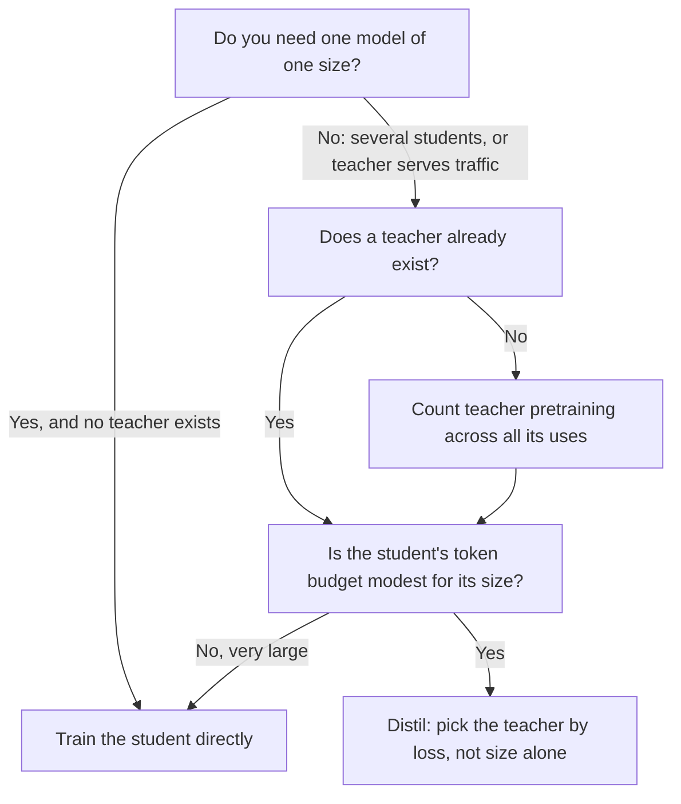

# 第 20 课：选择学生模型的规模

**使命关联:** 本使命要求你选择学生的规模和数据量，并把教师自身的成本计入预算，而这个选择的前一半，是要知道相比直接训练学生，蒸馏到底什么时候才值得做。
**主要来源:** [论文：“Distillation Scaling Laws”，Busbridge 等，2025](https://arxiv.org/abs/2502.08606)，第 1、4 和 5 节
**前置知识:** [第 19 课](0019-capacity-gap-and-hidden-traits.md)、[容量差距](../GLOSSARY.md)、[教师模型](../GLOSSARY.md)、[学生模型](../GLOSSARY.md)、[logit 蒸馏](../GLOSSARY.md)

## 热身

1. ▢ 第 19 课描述了容量差距。用一句话陈述它，并包括它对教师选择的影响。

检查

大得多的教师，可能训练出比较小的教师更差的学生，所以更强的教师并不自动就是更好的教师。实际的后果是，教师的规模是一个有最优值的选择，不是一个可以一直调高的旋钮。

2. ▢ 第 7 课讲了 Gemma 2 和 Minitron 如何在预训练期间使用教师的分布。一次 [logit 蒸馏](../GLOSSARY.md)运行，在每个训练 token 上，要对教师做哪些普通的下一个 token 训练不需要做的事？

检查

它必须让教师在该 token 的前缀上运行，并读取它的输出分布，要么实时，要么从存储的 logit 中读。普通的下一个 token 训练只需要学生自己的前向和反向传播。这额外的教师工作，就是本课和下一课要给它标价的东西。

3. ▢ 第 17 课把保真度与泛化分开了。如果学生与教师的预测匹配得很紧密，这是否就能说明学生擅长这项任务？

检查

不能。保真度是在同样输入上与教师的一致程度，而教师可能是错的。学生可以是平庸教师的忠实副本，也可以是不忠实但更好的模型。第 22 课会带着一次度量回到这一点。

## 要点

### 论文回答的问题

蒸馏常常以存在一个好的教师为理由。Busbridge 等人问的是一个更窄的问题：在相同资源下，在教师输出上训练的学生，能否达到比直接训练的同一个学生更低的损失？他们的研究使用 143M 到 12.6B 参数的 Transformer 学生和教师，在几十亿到 512B token 上训练（第 1 节）。这是一项把蒸馏用作预训练信号的受控研究，所以它是第 4 课的 logit 蒸馏，应用在一个没有重复数据的数据集上。

下面所有内容都要注意两点范围上的限制。度量的量是留出数据上的交叉熵，不是下游任务准确率。而且论文没有测试序列级蒸馏，也没有测试从生成的指令数据中蒸馏。本课把结果应用到这些情形的地方，都是一种延伸，并且会明说。

### 定律

论文拟合了一条[蒸馏缩放定律](../GLOSSARY.md)（它的公式 8），根据三样东西预测学生的交叉熵：学生的参数量、蒸馏 token 数，以及教师的交叉熵。教师只通过最后这个数进入。论文的发现 2 是，教师规模和教师训练 token 数，只通过教师最终的交叉熵来决定学生的损失，所以当损失相当时，训练更久的较小教师，与训练更少的较大教师，是可以互换的（第 1 节，发现 2，以及图 3b）。

在所研究的范围内，拟合效果很好：相对预测误差约为 1% 或更小，包括从较弱的模型外推到较强的模型时（第 4.4 节）。在那个范围之外，它是预测，不是度量。

### 蒸馏什么时候胜出

论文的结论是有条件的，而这些条件正是本课的内容。当两者都有足够的数据或算力时，蒸馏无法达到比监督学习更低的交叉熵。当下面两条同时成立时，它比监督学习更有效率（第 1 节）：

1. 用于学生的总算力或 token 数，不大于一个取决于学生规模的阈值，由缩放定律给出（第 5.1 节；第 5.3 节表明这个阈值随学生规模增大而增大）。
2. 已经存在一个教师，或者要训练的教师，在单次蒸馏之外还有其他用途（第 5.3 节）。

第二个条件关乎你已经花掉的钱。第 5.3 节直接陈述了另一面：当教师训练也计入预算时，最佳的学生损失总是比监督结果更差，所以如果你要的是一个单一规模的模型，又没有教师，就直接训练这个模型。如果你打算蒸馏一整个模型家族，或者教师还要承担线上流量，蒸馏可能更便宜。

第一个条件说的是，蒸馏是一个领先的起步，而不是更好的结局。token 预算适中时，它是有利的。预算很大时，监督学习会追上并超过它（第 5.1 节，图 6）。同一节报告说，监督学习变得更可取的那个算力，随着学生规模增大而增大，所以较大的学生在更宽的预算范围内保持优势。

### 把教师计入要付出什么

论文把一次蒸馏运行的算力近似为学生的训练，加上教师的前向传播（公式 9）。教师的前向传播和教师自己的预训练是否计费，是一个选择，论文研究了四种设置（它的表 2）：

| 设置 | 计入教师推理 | 计入教师预训练 | 它在什么时候描述你的情形 |
|---|---|---|---|
| 最好情形，完全摊销 | 否 | 否 | 教师已经存在，并且还用于别的事情 |
| 教师推理 | 是 | 否 | 教师已经存在，而你要花钱让它在你的数据上运行 |
| 教师预训练 | 否 | 是 | 你训练教师，然后为许多个学生存储它的 logit |
| 预训练加推理 | 是 | 是 | 你训练一个教师，只为蒸馏一个学生，最坏的情形 |

第 21 课把前两列变成算术。这里的要点是你处于哪一行。大多数从开源模型蒸馏的实践者处于第二行。为单个学生专门训练一个教师的人处于第四行，而论文对这一行的结果是，直接训练更胜一筹。

### 容量差距，在他们的规模上

在论文的固定比例实验里（图 4），两种规模的学生，从十个规模递增的教师蒸馏，每个教师都在每个参数约 20 个 token 上训练。学生的交叉熵随教师变大而下降，到达一个最优点，然后上升。更强的教师最终会降低学生的表现，这就是第 19 课的容量差距，在受控条件下度量出来了。

论文的解读是，这个差距关乎学习容量，即教师和学生在能表示和优化什么上的差异，而不只是相对的参数量。在它的定律里，这个差距表现为教师损失上两个幂律区域之间的转变，位置在教师的损失与监督学生会达到的损失处于一个拟合出来的比值之处（第 4.3 节）。由此得出的一个发现是：当预算以 token 固定时，最佳教师的交叉熵应当随学生变大而下降（第 5.2 节）。

这些是一篇论文在它自己的模型和数据上的结果。请把这个形状（先有最优点，然后下降）当作发现，不要从中带走某个具体的教师与学生规模比。

### 决策图

第二个菱形就是阈值所在之处。论文没有给出单独的一个数字：它是学生规模上的一条曲线，你要从缩放定律里读出来。

## 练习

1. ▢ 一位同事引用这篇论文，说“蒸馏总是胜过直接训练学生”。下面哪一句最准确地纠正了这一点？

    - a) 蒸馏在低于一个取决于规模的 token 水平时胜出，并且只在存在教师或教师另有用途时。
    - b) 蒸馏对 3B 以下的学生胜出，并且只在教师超过 10B 参数时。
    - c) 只要教师比学生大，并且数据经过过滤，蒸馏就胜出。
    - d) 蒸馏在下游任务上胜出，而在学生完全训练好之后的交叉熵上落败。

检查

a)。论文的两个条件是，一个取决于学生规模的 token 或算力阈值，以及一个已经存在、或者在一次蒸馏之外还有用途的教师。b) 虚构了一个参数截断值和一个教师规模，在论文的条件里哪里都没有。c) 是论文检验并加以限定的直觉：更大的教师甚至可能训练出更差的学生。d) 把论文度量的量弄反了：它研究的是交叉熵，并没有测试下游准确率。

2. ▢ 一个团队要训练一个 1B 的学生。没有教师。他们打算预训练一个 7B 的教师，再从它蒸馏出一个 1B 的学生。论文的结果怎么说？对这个计划做哪一处改动会改变答案？

检查

当教师训练计入预算、并且只有一个学生时，论文发现最佳的学生损失，总是高于相同算力下的直接监督训练，所以应该直接训练那个 1B 模型。能改变答案的改动，是给教师其他用途：从它蒸馏出一个模型家族的学生，或者让它作为生产模型提供服务。那样它的预训练成本就被分摊了，第二个条件也就成立了。

3. ▢ 预测：你把学生固定为 1B 参数、token 预算也固定，把教师换成大三倍、也更好的一个。学生的损失一定会下降吗？

提示

论文的图 4 针对固定的学生扫描了教师规模。想想那条曲线是什么形状，而不是想更大是否更好。

检查

不一定。在图 4 里，随着教师变大，学生的交叉熵先下降到一个最优点，然后上升，所以越过最优点的教师会让学生更差。论文的定律说，学生受到的影响，是通过教师的损失，以及教师与学生的容量关系，而不只是通过教师的规模。你的这次替换是否越过了最优点，取决于这两个模型，只有一次运行或者拟合出来的定律才能告诉你。

4. ▢ 下面哪一条，你可以单凭论文就得出结论，哪一条是对它的延伸？(i) 对最大到它所研究规模的学生，更好的教师损失会带来更好的学生损失，直到容量差距。(ii) 在 5 万条生成指令上做的序列级蒸馏，遵循同样的缩放定律。

检查

(i) 是一个发现，在论文所训练的规模和数据范围之内（143M 到 12.6B 参数，最多 512B token）。(ii) 是一种延伸：论文研究的是在类似预训练的数据集上做教师 logit 蒸馏，并度量交叉熵，所以它并没有直接说明指令数据，也没有说明在解码文本上训练。你可以把这条定律当作 (ii) 的先验，但必须标明它是先验。

5. ▢ 第 18 课讲了模仿差距。如果一个学生是用适度的预算蒸馏的，在风格上匹配教师，在能力上却不行，更好的缩放定律拟合会预测到这一点吗？

检查

单靠它不行。缩放定律预测的是交叉熵，它概括的是学生对数据建模得有多好，对哪些行为先被复制则只字未提。模仿差距关乎评分者看到的风格，与有针对性的基准所测试的能力之间的差别。一个看起来很好的损失数字，可以与这种差距并存，这就是第 22 和 23 课要按能力逐项度量的原因。

## 实战练习

- [ ] 打开论文，找到图 6 及其说明。用你自己的话写下，那里的蓝色和红色是什么意思，以及随着学生规模增大，边界向哪个方向移动。
- [ ] 取一次你已经运行或计划运行的蒸馏。填写上面的四行表：你处于哪一行？论文对那一行怎么说？
- [ ] 明天：不看笔记，写出论文所说蒸馏比监督学习更有效率的两个条件，以及论文没有测试的一件事。

## 延伸阅读

- [确定规模与度量](../reference/sizing-and-measuring.md)
- [论文：“Distillation Scaling Laws”，Busbridge 等，2025](https://arxiv.org/abs/2502.08606)，图 4、6 和 9
- [预训练](../../pretraining/)：讲授算力预算由什么构成、以及缩放定律如何拟合的系列
- [资源](../RESOURCES.md)

---

没学明白？请重读顶部的主要来源，因为本课是对它的压缩，而理解正是在压缩中流失的。如果有哪个术语觉得含糊，可以查看[术语表](../GLOSSARY.md)。

如果问题出在课程本身，而不是学习材料，那就是一个缺陷：[提交 issue](https://github.com/TokenCemetery/teach/issues)。
