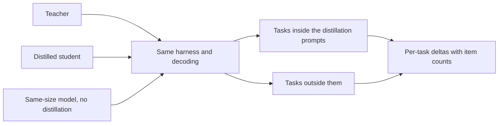

# Lección 23. Una eval honesta de destilación

**Vínculo con la misión:** La misión te pide medir qué perdió un estudiante frente a su profesor y frente a un modelo del mismo tamaño entrenado sin uno, y defender la cifra, lo que significa elegir las comparaciones antes de conocer el resultado.
**Fuente principal:** [Paper: "Distillation Scaling Laws", Busbridge et al., 2025](https://arxiv.org/abs/2502.08606), sección 5.1 y Figura 6
**Requisitos previos:** [Lección 22](0022-student-against-teacher.md), [Fidelidad](../GLOSSARY.md), [Baseline supervisado](../GLOSSARY.md), [Datos sintéticos](../GLOSSARY.md)

## Calentamiento

1. ▢ La lección 22 pidió dos columnas por capacidad. Nómbralas y di cuál mide sobre todo una valoración de preferencia.

Comprobación

El acuerdo con el profesor, y la calidad en la tarea frente a la respuesta correcta. Una valoración de preferencia se apoya en cómo se lee una respuesta, así que refleja sobre todo el estilo, y el estilo es lo que la imitación copia más rápido.

2. ▢ La lección 12 deduplicó y filtró datos generados. ¿Por qué necesita eso un conjunto generado antes de entrenar, y vale lo mismo para los prompts de evaluación?

Comprobación

Los duplicados y los malos ejemplos se aprenden tan fácilmente como los buenos, así que el conjunto necesita comprobarse antes de entrenar nada con él. El conjunto de evaluación necesita su propia versión de la comprobación: los duplicados inflan una puntuación, y un elemento que también aparece en los datos de entrenamiento mide memoria, no habilidad.

3. ▢ La lección 21 dio el costo del profesor como parte del presupuesto. Cuando comparas un estudiante con un baseline, ¿qué costo deben compartir los dos para que la comparación sea justa?

Comprobación

El presupuesto de entrenamiento o los datos de entrenamiento. Si el estudiante recibió el cómputo y los tokens de un profesor además de lo que recibió el baseline, la ventaja del estudiante puede ser los recursos extra, no la destilación. Al baseline hay que darle el mismo presupuesto o los mismos datos, y tienes que decir cuál.

## Qué debes saber

### Tres modelos, no dos

"El estudiante iguala al profesor" es una afirmación sobre dos modelos. No dice nada sobre si la destilación fue la razón, porque un modelo pequeño entrenado directamente también podría igualar al profesor. Una evaluación honesta tiene tres:

1. El profesor.
2. El estudiante destilado.
3. Un [baseline supervisado](../GLOSSARY.md): un modelo del tamaño del estudiante, entrenado sin destilación, con los mismos datos o el mismo cómputo.

El paper construye todo su análisis sobre este tercer modelo. Su Figura 6 representa la diferencia entre la entropía cruzada de un estudiante destilado y la de un modelo supervisado con los mismos recursos, con azul donde gana la destilación y rojo donde gana el aprendizaje supervisado, a lo largo de tamaños de estudiante y presupuestos de tokens (sección 5.1). Esa comparación es como encuentra que la destilación gana con presupuestos modestos y pierde con los grandes. Sin el baseline no hay tal hallazgo.

Hay que dejar por escrito dos decisiones sobre el baseline. Mismos datos significa que el modelo supervisado entrena con las mismas entradas con las que se construye el conjunto de entrenamiento del estudiante, etiquetadas por personas o por la tarea original en lugar de por el profesor. Mismo cómputo significa que recibe tantos FLOPs como toda la ejecución de destilación, y la lección 21 dice si eso incluye al profesor. Elige una, enúnciala, y no la elijas después de ver el resultado.

### Un baseline directo, como ejemplo

El informe de DeepSeek-R1 es un lugar donde aparece esta forma. Su Tabla 16 compara un modelo destilado de DeepSeek-R1 con un modelo entrenado con aprendizaje por refuerzo a gran escala, ambos a partir de Qwen2.5-32B y ambos de 32B de parámetros. El modelo destilado puntuó 72.6 en AIME 2024 pass@1 y 94.3 en MATH-500, frente a 47.0 y 91.6 del modelo de aprendizaje por refuerzo. LiveCodeBench fue 57.2 frente a 40.2 (Tabla 16, apéndice F.1).

Léelo por cómo está construida la comparación, no por su tamaño. El baseline aquí es el mismo base model entrenado con un método distinto, así que es una comparación directa, pero no es una de datos o cómputo igualados, y el paper dice que la ejecución de aprendizaje por refuerzo tomó más de 10,000 pasos. Es solo la configuración de un informe. Un lector que quisiera saber cuánto de la mejora son los datos del profesor y cuánto el método necesitaría las ejecuciones igualadas.

### Tareas held-out, no solo elementos held-out

Un estudiante puede puntuar bien en tareas que respaldaron sus datos de destilación y mal en tareas que no. Gudibande et al. encontraron exactamente eso: los modelos de imitación mejoraron en tareas de evaluación muy respaldadas en los datos de imitación, y no mejoraron, o empeoraron, en las que tenían poco respaldo (sección 1 y Figura 4). La solución es incluir tareas que no estuvieran entre los prompts de destilación, y decir cuáles son cuáles.

Así que divide la evaluación en dos. Las tareas dentro de la distribución de destilación te dicen cuán bien absorbió el estudiante lo que se le mostró. Las tareas fuera de ella te dicen si algo más allá de eso se generalizó. Infórmalas por separado, porque un promedio sobre ambas oculta la segunda.

### Contaminación cuando el profesor escribe los datos

Los [datos sintéticos](../GLOSSARY.md) añaden una vía de fuga que un conjunto de entrenamiento escrito por humanos no tiene. Si los prompts de destilación se sacaron de los elementos de una evaluación o se les parecen, las respuestas del profesor a ellos ponen el contenido de esos elementos en los datos de entrenamiento del estudiante, y la puntuación del estudiante en ese benchmark mide exposición. El profesor puede añadir la suya: un modelo que ha visto un benchmark en el preentrenamiento puede reproducir partes de él cuando se le pregunta algo cercano.

Los métodos de detección pertenecen al track de evals, así que úsalos allí. [Datos held-out y contaminación](../../evals/reference/held-out-data-and-contamination.md) da las dos vías y la prueba de instrucción guiada, y la [entrada del glosario sobre contaminación de datos](../../evals/GLOSSARY.md) fija el término. Para una destilación, añade tres comprobaciones propias:

- Registra de dónde vinieron los prompts de destilación, y excluye de ellos cualquier elemento de evaluación o casi duplicado.
- Deduplica las salidas generadas por el profesor frente al conjunto de evaluación, no solo los prompts.
- Prefiere un conjunto de evaluación construido después de recoger los prompts, o uno que hayas escrito tú.

Gudibande et al. muestran la idea a pequeña escala. Para su evaluación humana filtraron las consultas con una puntuación BLEU superior al 20 por ciento frente a cualquier ejemplo de su conjunto de entrenamiento, para reducir la fuga del conjunto de prueba (sección 4.1, nota al pie). Es un umbral en una métrica, un punto de partida y no un estándar.

### El mismo harness, la misma decodificación, deltas por tarea

Ejecuta los tres modelos a través del mismo harness, con los mismos prompts, los mismos ajustes de decodificación y la misma puntuación. Un estudiante muestreado con una temperatura de 0.7 y un baseline decodificado de forma voraz difieren en dos cosas, y no sabrás cuál produjo la brecha. La hoja [Harness de evals](../../evals/reference/eval-harness.md) cubre qué mantener fijo.

Luego informa de deltas por tarea, no de un promedio: estudiante menos profesor, y estudiante menos baseline, para cada tarea, con una nota de cuántos elementos tiene. Una tabla de deltas muestra dónde ganó el estudiante y dónde perdió. Un promedio puede ser positivo mientras las tareas de las que depende el producto son negativas.

Por último, comprueba si una brecha es ruido antes de leerla. La hoja [Go/No-Go](../../evals/reference/go-no-go.md) da el error estándar de una tasa de aciertos, aproximadamente la raíz cuadrada de p por 1 menos p entre N, y la comparación pareada que necesita menos datos. Úsala aquí tal cual, y no la reconstruyas. El track de evals enseña cómo construir el conjunto y el umbral; esta lección solo dice qué tiene que contener el conjunto para una destilación.

## Práctica

1. ▢ Un estudiante puntúa 0.68 en una tarea de 100 elementos y el baseline supervisado puntúa 0.62. El error estándar de cada tasa de aciertos es de unos 0.047 y 0.049. ¿Se distingue de ruido la brecha de 6 puntos?

Pista

Combina los dos errores estándar como la raíz cuadrada de la suma de sus cuadrados, y compara eso con la brecha.

Comprobación

No. El error estándar combinado es de unos 0.068, así que la brecha de 0.06 es menor que un error estándar. Eso no es evidencia de que el estudiante no sea mejor, solo de que 100 elementos no pueden decirlo. Usa más elementos o una comparación pareada sobre los mismos elementos, como describe la hoja de go/no-go, antes de leer la brecha.

2. ▢ Un informe dice "nuestro estudiante de 3B iguala al profesor de 70B en promedio sobre seis benchmarks". ¿Qué dos elementos añadirías para hacer defendible la afirmación?

    - a) Un segundo profesor de otra familia, y una valoración de preferencia de evaluadores humanos.
    - b) Un estudiante mayor entrenado con más datos, y un promedio ponderado por el tamaño del benchmark.
    - c) Un baseline del mismo tamaño entrenado sin destilación, y deltas por tarea con recuentos de elementos.
    - d) Una ejecución de decodificación con temperatura más baja, y una repetición de los seis benchmarks con una semilla nueva.

Comprobación

c). El baseline muestra si la destilación causó la igualdad, y los deltas por tarea muestran qué tareas oculta el promedio. b) cambia al estudiante en lugar de probar la afirmación. a) amplía la comparación sin responderla, y una valoración de preferencia es la medida débil de la lección 22. d) comprueba la estabilidad de un número, lo que no muestra si la destilación o una ejecución directa habrían igualado al profesor.

3. ▢ Destilaste con 40,000 prompts, el 30 por ciento de ellos tomados de la partición de entrenamiento de un benchmark público de razonamiento. El estudiante puntúa bien en la partición de prueba de ese benchmark. ¿Cuál es el riesgo, y qué haces?

Pista

Piensa en qué ponen las respuestas del profesor a esos prompts en los datos de entrenamiento del estudiante.

Comprobación

El estudiante ha entrenado con las respuestas del profesor a preguntas del mismo tipo y estilo que la partición de prueba, y posiblemente con casi duplicados, así que su puntuación mide exposición y no habilidad general. Informa del benchmark por separado como dentro de la distribución, añade tareas que no estuvieran en los prompts de destilación, comprueba las salidas generadas en busca de casi duplicados de elementos de prueba, y prefiere una evaluación construida después de recoger los prompts.

4. ▢ El resultado de Gudibande et al. en Natural Questions tiene al estudiante de imitación amplia en 15 y al de imitación dirigida en 27, con el profesor en 31, para 13B. ¿Qué dice sobre incluir en una evaluación tareas fuera de los prompts de destilación?

Comprobación

Una evaluación solo con las tareas que cubren los datos de destilación habría mostrado al estudiante dirigido cerca del profesor y no habría dicho nada de la pérdida del estudiante amplio. El estudiante amplio perdió en NQ, que sus datos no respaldaban bien, y cayó por debajo del base model intacto (15 frente a 20). Solo una tarea fuera de los datos muestra esto, así que incluye una e infórmala por separado.

5. ▢ Intercalado de la etapa 7: comparas un estudiante destilado de 1B con un baseline de 1B al que se dieron los mismos tokens, y gana el estudiante. De la lección 20, ¿qué tiene que cumplirse para que esa victoria sea la predicción de la ley de escalado de la destilación y no suerte?

Comprobación

El presupuesto de tokens del estudiante debe estar por debajo del umbral que depende del tamaño del estudiante, de modo que el resultado del paper favorezca la destilación, y el profesor debe existir ya o servir para otros fines. Si el presupuesto de tokens es muy grande, la ley predice que el baseline supervisado la alcanza, así que una victoria ahí necesitaría otra explicación. Comprueba el presupuesto frente al umbral, y di si el costo del profesor se cargó en la comparación con el baseline.

## Prácticas en el mundo real

- [ ] Toma una afirmación de destilación que hayas leído, de un blog o de una model card. Enumera cuáles de los tres modelos informa y cuáles de las tres comparaciones deja fuera.
- [ ] Abre el informe de DeepSeek-R1, apéndice F.1, y anota qué comparte el baseline Qwen2.5-32B-Zero con el modelo destilado y qué no.
- [ ] Mañana: sin apuntes, escribe las cinco comprobaciones de una eval honesta de destilación, y la que un simple promedio sobre benchmarks ocultaría.

## Para profundizar

- [Dimensionar y medir](../reference/sizing-and-measuring.md)
- [Go/No-Go](../../evals/reference/go-no-go.md): la fórmula del ruido y la comparación pareada, del track de evals
- [Evals](../../evals/): el track para construir el conjunto de evaluación sobre el que esta lección compara modelos
- [Paper: "DeepSeek-R1: Incentivizing Reasoning Capability in LLMs via Reinforcement Learning", DeepSeek-AI, 2025](https://arxiv.org/abs/2501.12948), apéndice F.1
- [Paper: "The False Promise of Imitating Proprietary LLMs", Gudibande et al., 2023](https://arxiv.org/abs/2305.15717)
- [Recursos](../RESOURCES.md)

---

¿No termina de quedar claro? Vuelve a leer la fuente primaria de arriba, ya que esta lección la comprime y en la compresión es donde se escapa la comprensión. Consulta el [glosario](../GLOSSARY.md) por si algún término te resultó resbaladizo.

Si lo poco claro es la propia lección y no el material, eso es un defecto: [abre un issue](https://github.com/TokenCemetery/teach/issues).
