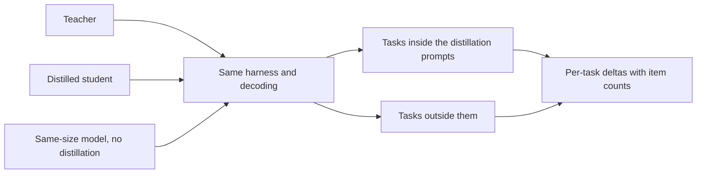

# Leçon 23. Une eval de distillation honnête

**Lien avec la mission :** La mission vous demande de mesurer ce qu'un élève a perdu par rapport à son enseignant et par rapport à un modèle de même taille entraîné sans enseignant, et de défendre le chiffre, ce qui veut dire choisir les comparaisons avant de connaître le résultat.
**Source primaire :** [Article : "Distillation Scaling Laws", Busbridge et al., 2025](https://arxiv.org/abs/2502.08606), section 5.1 et figure 6
**Prérequis :** [Leçon 22](0022-student-against-teacher.md), [Fidélité](../GLOSSARY.md), [Référence supervisée](../GLOSSARY.md), [Données synthétiques](../GLOSSARY.md)

## Échauffement

1. ▢ La leçon 22 demandait deux colonnes par capacité. Nommez-les et dites laquelle une évaluation de préférence mesure surtout.

Vérifier

L'accord avec l'enseignant, et la qualité sur la tâche par rapport à la bonne réponse. Une évaluation de préférence s'appuie sur la façon dont une réponse se lit, donc elle reflète surtout le style, et le style est ce que l'imitation copie le plus vite.

2. ▢ La leçon 12 a dédupliqué et filtré des données générées. Pourquoi un jeu généré a-t-il besoin de cela avant l'entraînement, et la même chose vaut-elle pour les prompts d'évaluation ?

Vérifier

Les doublons et les mauvais exemples s'apprennent aussi volontiers que les bons, donc le jeu doit être vérifié avant d'entraîner quoi que ce soit. Le jeu d'évaluation a besoin de sa propre version du contrôle : les doublons gonflent un score, et un élément qui apparaît aussi dans les données d'entraînement mesure la mémoire, pas la compétence.

3. ▢ La leçon 21 a donné le coût de l'enseignant comme partie du budget. Quand vous comparez un élève à une référence, quel coût les deux doivent-ils partager pour que la comparaison soit équitable ?

Vérifier

Le budget d'entraînement ou les données d'entraînement. Si l'élève a reçu le calcul et les tokens d'un enseignant en plus de ce qu'a reçu la référence, l'avance de l'élève peut venir des ressources supplémentaires, pas de la distillation. La référence doit recevoir le même budget ou les mêmes données, et vous devez dire lequel.

## À savoir

### Trois modèles, pas deux

« L'élève égale l'enseignant » est une affirmation sur deux modèles. Elle ne dit pas si la distillation en est la raison, parce qu'un petit modèle entraîné directement pourrait aussi égaler l'enseignant. Une évaluation honnête en comporte trois :

1. L'enseignant.
2. L'élève distillé.
3. Une [référence supervisée](../GLOSSARY.md) : un modèle de la taille de l'élève, entraîné sans distillation, sur les mêmes données ou avec le même calcul.

L'article bâtit toute son analyse sur ce troisième modèle. Sa figure 6 trace la différence entre l'entropie croisée d'un élève distillé et celle d'un modèle supervisé aux mêmes ressources, en bleu là où la distillation gagne et en rouge là où l'apprentissage supervisé gagne, selon les tailles d'élève et les budgets de tokens (section 5.1). Cette comparaison est la manière dont il trouve que la distillation gagne à budget modeste et perd à grand budget. Sans la référence, il n'y a pas de tel constat.

Deux décisions sur la référence doivent être écrites. Mêmes données signifie que le modèle supervisé s'entraîne sur les mêmes entrées dont est bâti le jeu d'entraînement de l'élève, labellisées par des personnes ou par la tâche d'origine plutôt que par l'enseignant. Même calcul signifie qu'il reçoit autant de FLOPs que tout le run de distillation, et la leçon 21 dit si cela inclut l'enseignant. Choisissez-en un, énoncez-le, et ne le choisissez pas après avoir vu le résultat.

### Une référence directe, à titre d'exemple

Le rapport DeepSeek-R1 est un endroit où cette forme apparaît. Son tableau 16 compare un modèle distillé à partir de DeepSeek-R1 à un modèle entraîné par apprentissage par renforcement à grande échelle, tous deux à partir de Qwen2.5-32B et tous deux à 32B de paramètres. Le modèle distillé a obtenu 72.6 sur AIME 2024 pass@1 et 94.3 sur MATH-500, contre 47.0 et 91.6 pour le modèle par apprentissage par renforcement. LiveCodeBench était à 57.2 contre 40.2 (tableau 16, annexe F.1).

Lisez-le pour la façon dont la comparaison est construite, pas pour son ampleur. La référence ici est le même base model entraîné par une autre méthode, c'est donc une comparaison directe, mais ce n'est pas une comparaison à données ou à calcul appariés, et l'article dit que le run d'apprentissage par renforcement a pris plus de 10,000 pas. La configuration propre d'un seul rapport, voilà tout ce que c'est. Un lecteur qui voudrait savoir quelle part du gain vient des données de l'enseignant et quelle part de la méthode aurait besoin des runs appariés.

### Des tâches held-out, pas seulement des éléments held-out

Un élève peut bien réussir sur des tâches que ses données de distillation soutenaient et mal sur des tâches qu'elles ne soutenaient pas. Gudibande et al. ont constaté exactement cela : les modèles d'imitation se sont améliorés sur les tâches d'évaluation fortement soutenues dans les données d'imitation, et ne se sont pas améliorés, ou ont décliné, sur celles qui l'étaient peu (section 1 et figure 4). Le correctif est d'inclure des tâches qui ne figuraient pas parmi les prompts de distillation, et de dire lesquelles sont lesquelles.

Séparez donc l'évaluation en deux. Les tâches dans la distribution de distillation vous disent à quel point l'élève a absorbé ce qu'on lui a montré. Les tâches en dehors vous disent si quoi que ce soit au-delà a généralisé. Rapportez-les séparément, parce qu'une moyenne sur les deux cache la seconde.

### La contamination quand l'enseignant écrit les données

Les [données synthétiques](../GLOSSARY.md) ajoutent une voie de fuite qu'un jeu d'entraînement écrit par des humains n'a pas. Si les prompts de distillation ont été tirés des éléments d'une évaluation ou leur ressemblent, les réponses de l'enseignant à ces prompts introduisent le contenu de ces éléments dans les données d'entraînement de l'élève, et le score de l'élève sur ce benchmark mesure l'exposition. L'enseignant peut ajouter la sienne : un modèle qui a vu un benchmark pendant le pré-entraînement peut en reproduire des parties quand on lui demande quelque chose de proche.

Les méthodes de détection relèvent du parcours evals, utilisez-les donc là-bas. La fiche [Données held-out et contamination](../../evals/reference/held-out-data-and-contamination.md) donne les deux voies et le test à instruction guidée, et l'entrée [Contamination des données](../../evals/GLOSSARY.md) du glossaire fixe le terme. Pour une distillation, ajoutez trois contrôles à vous :

- Consignez d'où viennent les prompts de distillation, et excluez-en tout élément d'évaluation ou quasi-doublon.
- Dédupliquez les sorties générées par l'enseignant par rapport au jeu d'évaluation, pas seulement les prompts.
- Préférez un jeu d'évaluation construit après la collecte des prompts, ou un que vous avez écrit.

Gudibande et al. montrent l'idée à petite échelle. Pour leur évaluation humaine, ils ont écarté les requêtes dont le score BLEU dépassait 20 pour cent par rapport à n'importe quel exemple de leur jeu d'entraînement, pour réduire la fuite du jeu de test (section 4.1, note). C'est un seuil sur une métrique, un point de départ et non une norme.

### Même harness, même décodage, deltas par tâche

Faites passer les trois modèles dans le même harness, avec les mêmes prompts, les mêmes réglages de décodage et la même notation. Un élève échantillonné à la température 0.7 et une référence décodée de façon gloutonne diffèrent par deux choses, et vous ne saurez pas laquelle a produit l'écart. La fiche [Harness d'eval](../../evals/reference/eval-harness.md) couvre ce qu'il faut garder fixe.

Rapportez ensuite des deltas par tâche, pas une moyenne : élève moins enseignant, et élève moins référence, pour chaque tâche, avec une note du nombre d'éléments qu'elle contient. Un tableau de deltas montre où l'élève a gagné et où il a perdu. Une moyenne peut être positive alors que les tâches dont dépend le produit sont négatives.

Enfin, vérifiez si un écart est du bruit avant de le lire. La fiche [Go/No-Go](../../evals/reference/go-no-go.md) donne l'erreur standard d'un taux de réussite, environ la racine carrée de p fois 1 moins p sur N, et la comparaison appariée qui demande moins de données. Utilisez-la ici telle quelle, et ne la reconstruisez pas. Le parcours evals enseigne comment construire le jeu et le seuil ; cette leçon dit seulement ce que le jeu doit contenir pour une distillation.

## Pratique

1. ▢ Un élève obtient 0.68 sur une tâche de 100 éléments et la référence supervisée obtient 0.62. L'erreur standard de chaque taux de réussite est d'environ 0.047 et 0.049. L'écart de 6 points est-il distinguable du bruit ?

Indice

Combinez les deux erreurs standard comme la racine carrée de la somme de leurs carrés, puis comparez avec l'écart.

Vérifier

Non. L'erreur standard combinée est d'environ 0.068, donc l'écart de 0.06 est plus petit qu'une erreur standard. Ce n'est pas la preuve que l'élève n'est pas meilleur, seulement que 100 éléments ne permettent pas de trancher. Utilisez plus d'éléments ou une comparaison appariée sur les mêmes éléments, comme la décrit la fiche Go/No-Go, avant de lire l'écart.

2. ▢ Un rapport dit « notre élève de 3B égale l'enseignant de 70B en moyenne sur six benchmarks ». Quels deux éléments ajouteriez-vous pour rendre l'affirmation défendable ?

    - a) Un second enseignant d'une autre famille, et une évaluation de préférence par des évaluateurs humains.
    - b) Un élève plus grand entraîné sur plus de données, et une moyenne pondérée par la taille des benchmarks.
    - c) Une référence de même taille entraînée sans distillation, et des deltas par tâche avec les nombres d'éléments.
    - d) Un run de décodage à plus basse température, et une réexécution des six benchmarks avec une nouvelle graine.

Vérifier

c). La référence montre si la distillation a causé l'égalité, et les deltas par tâche montrent quelles tâches la moyenne cache. b) change l'élève au lieu de tester l'affirmation. a) élargit la comparaison sans y répondre, et une évaluation de préférence est la mesure faible de la leçon 22. d) vérifie la stabilité d'un nombre, ce qui ne montre pas si la distillation ou un run direct aurait égalé l'enseignant.

3. ▢ Vous avez distillé sur 40,000 prompts, dont 30 pour cent pris dans le découpage d'entraînement d'un benchmark public de raisonnement. L'élève obtient de bons scores sur le découpage de test de ce benchmark. Quel est le risque, et que faites-vous ?

Indice

Pensez à ce que les réponses de l'enseignant à ces prompts introduisent dans les données d'entraînement de l'élève.

Vérifier

L'élève s'est entraîné sur les réponses de l'enseignant à des questions du même genre et du même style que le découpage de test, et peut-être sur des quasi-doublons, donc son score mesure l'exposition et non la compétence générale. Rapportez le benchmark séparément comme dans la distribution, ajoutez des tâches qui ne figuraient pas dans les prompts de distillation, cherchez dans les sorties générées des quasi-doublons d'éléments de test, et préférez une évaluation construite après la collecte des prompts.

4. ▢ Le résultat de Gudibande et al. sur Natural Questions place l'élève à imitation large à 15 et l'élève à imitation ciblée à 27, avec l'enseignant à 31, pour 13B. Que dit-il sur l'inclusion, dans une évaluation, de tâches extérieures aux prompts de distillation ?

Vérifier

Une évaluation sur les seules tâches que couvrent les données de distillation aurait montré l'élève ciblé près de l'enseignant et n'aurait rien dit de la perte de l'élève large. L'élève large a perdu sur NQ, que ses données soutenaient mal, et est tombé sous le base model intact (15 contre 20). Seule une tâche extérieure aux données le montre, donc incluez-en une et rapportez-la séparément.

5. ▢ Entrelacement avec l'étape 7 : vous comparez un élève distillé de 1B à une référence de 1B recevant les mêmes tokens, et l'élève gagne. D'après la leçon 20, que doit-il tenir pour que cette victoire soit la prédiction de la loi d'échelle de la distillation et non de la chance ?

Vérifier

Le budget de tokens de l'élève doit être sous le seuil dépendant de la taille de l'élève, de sorte que le résultat de l'article favorise la distillation, et l'enseignant doit déjà exister ou servir à d'autres usages. Si le budget de tokens est très grand, la loi prédit que la référence supervisée rattrape, donc une victoire là demanderait une autre explication. Vérifiez le budget par rapport au seuil, et dites si le coût de l'enseignant a été facturé dans la comparaison avec la référence.

## Exercices en situation réelle

- [ ] Prenez une affirmation de distillation que vous avez lue, dans un blog ou une fiche de modèle. Listez lesquels des trois modèles elle rapporte et lesquelles des trois comparaisons elle omet.
- [ ] Ouvrez le rapport DeepSeek-R1, annexe F.1, et notez ce que la référence Qwen2.5-32B-Zero partage avec le modèle distillé et ce qu'elle ne partage pas.
- [ ] Demain : sans notes, écrivez les cinq contrôles d'une eval de distillation honnête, et celui qu'une simple moyenne sur les benchmarks cacherait.

## Pour aller plus loin

- [Dimensionner et mesurer](../reference/sizing-and-measuring.md)
- [Go/No-Go](../../evals/reference/go-no-go.md) : la formule du bruit et la comparaison appariée, issues du parcours evals
- [Evals](../../evals/) : le parcours pour construire le jeu d'évaluation sur lequel cette leçon compare les modèles
- [Article : "DeepSeek-R1: Incentivizing Reasoning Capability in LLMs via Reinforcement Learning", DeepSeek-AI, 2025](https://arxiv.org/abs/2501.12948), annexe F.1
- [Article : "The False Promise of Imitating Proprietary LLMs", Gudibande et al., 2023](https://arxiv.org/abs/2305.15717)
- [Ressources](../RESOURCES.md)

---

Ça ne passe pas ? Relisez la source primaire en haut de page, car cette leçon la condense et c'est dans la condensation que la compréhension s'échappe. Consultez le [glossaire](../GLOSSARY.md) pour tout terme qui vous a paru glissant.

Si c'est la leçon elle-même qui n'est pas claire plutôt que la matière, c'est un défaut : [ouvrez une issue](https://github.com/TokenCemetery/teach/issues).
