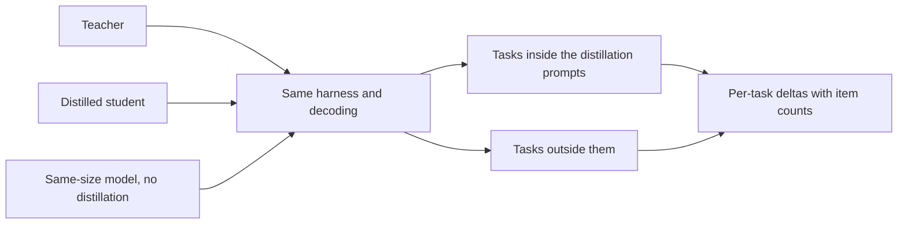

# पाठ 23. ईमानदार Distillation Eval

**मिशन से संबंध:** मिशन आपसे माँगता है कि आप माप सकें कि student ने अपने teacher के मुक़ाबले और बिना teacher के train हुए उसी आकार के model के मुक़ाबले क्या खोया, और उस संख्या का बचाव करें, जिसका मतलब है नतीजा जानने से पहले तुलनाएँ चुनना।
**मुख्य स्रोत:** [पेपर: "Distillation Scaling Laws", Busbridge et al., 2025](https://arxiv.org/abs/2502.08606), section 5.1 और Figure 6
**पूर्व-आवश्यकताएँ:** [पाठ 22](0022-student-against-teacher.md), [Fidelity](../GLOSSARY.md), [Supervised baseline](../GLOSSARY.md), [Synthetic data](../GLOSSARY.md)

## वार्म-अप

1. ▢ पाठ 22 ने हर क्षमता के लिए दो columns माँगे। उनके नाम बताएँ और बताएँ कि preference rating मुख्य रूप से किसे मापती है।

जाँचें

Teacher से agreement, और सही उत्तर के विरुद्ध task की गुणवत्ता। Preference rating इस पर टिकती है कि उत्तर कैसे पढ़ा जाता है, इसलिए वह मुख्यतः style दर्शाती है, और style वही है जिसे imitation सबसे तेज़ नक़ल करता है।

2. ▢ पाठ 12 ने generated data को deduplicate और filter किया। Generated सेट को training से पहले इसकी ज़रूरत क्यों है, और क्या यही evaluation prompts के लिए भी सच है?

जाँचें

Duplicates और ख़राब examples उतनी ही आसानी से सीखे जाते हैं जितने अच्छे, इसलिए सेट को किसी भी चीज़ पर train करने से पहले जाँचना ज़रूरी है। Evaluation set को जाँच का अपना संस्करण चाहिए: duplicates score को फुला देते हैं, और जो item training data में भी है वह कौशल नहीं, याददाश्त मापता है।

3. ▢ पाठ 21 ने teacher की लागत को बजट का हिस्सा बताया। जब आप student की तुलना baseline से करें, तो तुलना के निष्पक्ष होने के लिए दोनों को कौन-सी लागत साझा करनी चाहिए?

जाँचें

Training बजट या training data। अगर student को baseline को मिले के ऊपर teacher का compute और tokens भी मिले, तो student की बढ़त अतिरिक्त संसाधन हो सकती है, distillation नहीं। Baseline को वही बजट या वही data देना होगा, और आपको बताना होगा कि कौन-सा।

## यह जानें

### दो models नहीं, तीन

"Student teacher के बराबर है" दो models के बारे में दावा है। यह कुछ नहीं कहता कि distillation कारण था या नहीं, क्योंकि सीधे train हुआ छोटा model भी teacher के बराबर हो सकता है। ईमानदार evaluation में तीन होते हैं:

1. Teacher।
2. Distilled student।
3. एक [supervised baseline](../GLOSSARY.md): student के आकार का model, बिना distillation के, उसी data या उसी compute पर train हुआ।

पेपर अपना पूरा विश्लेषण इसी तीसरे model पर बनाता है। उसकी Figure 6 distilled student की cross-entropy और समान संसाधनों वाले supervised model की cross-entropy का अंतर plot करती है, नीला जहाँ distillation जीतता है और लाल जहाँ supervised learning, student आकारों और token बजटों के आर-पार (section 5.1)। उसी तुलना से वह पाता है कि distillation मामूली बजट पर जीतता है और बड़े पर हारता है। Baseline के बिना ऐसी कोई खोज नहीं होती।

Baseline के बारे में दो फ़ैसले लिख लेने होंगे। समान data का मतलब है कि supervised model उन्हीं inputs पर train होता है जिनसे student का training set बना है, जिन्हें teacher के बजाय लोगों या मूल task ने label किया हो। समान compute का मतलब है कि उसे पूरे distillation run जितने FLOPs मिलते हैं, और पाठ 21 बताता है कि उसमें teacher शामिल है या नहीं। एक चुनें, उसे बताएँ, और नतीजा देखने के बाद न चुनें।

### सीधा baseline, एक उदाहरण के रूप में

DeepSeek-R1 report वह एक जगह है जहाँ यह आकार दिखता है। उसकी Table 16 DeepSeek-R1 से distil किए model की तुलना बड़े पैमाने के reinforcement learning से train हुए model से करती है, दोनों Qwen2.5-32B से और दोनों 32B parameters पर। Distilled model ने AIME 2024 pass@1 पर 72.6 और MATH-500 पर 94.3 score किया, जबकि reinforcement-learning model ने 47.0 और 91.6। LiveCodeBench 57.2 बनाम 40.2 था (Table 16, appendix F.1)।

इसे यह देखने के लिए पढ़ें कि तुलना कैसे बनी है, उसके आकार के लिए नहीं। यहाँ baseline वही base model है जो अलग विधि से train हुआ, इसलिए यह सीधी तुलना है, पर यह matched-data या matched-compute वाली नहीं है, और पेपर कहता है कि reinforcement-learning run में 10,000 से ज़्यादा steps लगे। यह बस एक report की अपनी setup है। जो पाठक जानना चाहे कि फ़ायदे का कितना हिस्सा teacher के data का है और कितना विधि का, उसे matched runs चाहिए होंगे।

### Held-out tasks, सिर्फ़ held-out items नहीं

Student उन tasks पर अच्छा score कर सकता है जिन्हें उसके distillation data ने सहारा दिया और उन पर बुरा जिन्हें नहीं। Gudibande et al. ने ठीक यही पाया: imitation models उन evaluation tasks पर सुधरे जिन्हें imitation data में काफ़ी सहारा था, और उन पर नहीं सुधरे, या गिर गए, जिन्हें थोड़ा सहारा था (section 1 और Figure 4)। उपाय यह है कि ऐसे tasks शामिल करें जो distillation prompts में नहीं थे, और बताएँ कि कौन-से कौन-से हैं।

इसलिए evaluation को दो में बाँटें। Distillation distribution के भीतर के tasks बताते हैं कि student ने जो उसे दिखाया गया उसे कितनी अच्छी तरह सोखा। उसके बाहर के tasks बताते हैं कि उससे आगे कुछ generalize हुआ या नहीं। उन्हें अलग-अलग बताएँ, क्योंकि दोनों पर औसत दूसरे को छिपा देता है।

### Contamination जब teacher data लिखता है

[Synthetic data](../GLOSSARY.md) एक ऐसा leakage रास्ता जोड़ता है जो मानव-लिखित training set में नहीं होता। अगर distillation prompts किसी evaluation के items से लिए गए थे या उनसे मिलते-जुलते हैं, तो उनके teacher के उत्तर उन items की सामग्री को student के training data में डाल देते हैं, और उस benchmark पर student का score exposure मापता है। Teacher अपना भी जोड़ सकता है: जिस model ने pretraining में कोई benchmark देखा हो वह कुछ क़रीबी पूछे जाने पर उसके हिस्से दोहरा सकता है।

पहचानने के तरीक़े evals track के हैं, इसलिए उन्हें वहाँ इस्तेमाल करें। [Held-Out Data और Contamination शीट](../../evals/reference/held-out-data-and-contamination.md) दो रास्ते और guided-instruction test देती है, और [data contamination की शब्दावली प्रविष्टि](../../evals/GLOSSARY.md) उस शब्द को बाँधती है। Distillation के लिए अपनी तीन जाँचें जोड़ें:

- दर्ज करें कि distillation prompts कहाँ से आए, और उनसे किसी भी evaluation item या near-duplicate को बाहर रखें।
- Teacher के generated outputs को evaluation set के विरुद्ध deduplicate करें, सिर्फ़ prompts को नहीं।
- ऐसा evaluation set पसंद करें जो prompts इकट्ठा होने के बाद बना हो, या जिसे आपने लिखा हो।

Gudibande et al. यह विचार छोटे पैमाने पर दिखाते हैं। अपने human evaluation के लिए उन्होंने test-set leakage घटाने के लिए उन queries को छाँट दिया जिनका उनके training set के किसी भी example के विरुद्ध BLEU score 20 प्रतिशत से ऊपर था (section 4.1, footnote)। यह एक metric पर एक threshold है, शुरुआती बिंदु, मानक नहीं।

### वही harness, वही decoding, प्रति-task अंतर

तीनों models को एक ही harness से चलाएँ, उन्हीं prompts, उन्हीं decoding settings और उसी scoring के साथ। 0.7 temperature पर sample किया student और greedy decode किया baseline दो चीज़ों में अलग हैं, और आप नहीं जानेंगे कि फ़ासला किससे आया। [Eval Harness शीट](../../evals/reference/eval-harness.md) बताती है कि क्या तय रखना है।

फिर प्रति-task अंतर बताएँ, एक औसत नहीं: student घटा teacher, और student घटा baseline, हर task के लिए, इस नोट के साथ कि उसमें कितने items हैं। अंतरों की तालिका दिखाती है कि student ने कहाँ पाया और कहाँ खोया। औसत सकारात्मक हो सकता है जबकि जिन tasks पर product निर्भर है वे नकारात्मक हों।

अंत में, फ़ासला पढ़ने से पहले जाँचें कि वह noise है या नहीं। [Go/No-Go शीट](../../evals/reference/go-no-go.md) pass rate की standard error देती है, लगभग p गुना 1 घटा p भाग N का वर्गमूल, और वह paired comparison जिसे कम data चाहिए। इसे यहाँ जैसा है वैसा इस्तेमाल करें, और दोबारा न बनाएँ। Evals track सिखाता है कि सेट और threshold कैसे बनाएँ; यह पाठ सिर्फ़ यह बताता है कि distillation के लिए सेट में क्या होना चाहिए।

## अभ्यास

1. ▢ एक student 100-item task पर 0.68 score करता है और supervised baseline 0.62। हर pass rate की standard error लगभग 0.047 और 0.049 है। क्या 6-अंक का फ़ासला noise से अलग पहचाना जा सकता है?

संकेत

दोनों standard errors को उनके वर्गों के योग के वर्गमूल के रूप में मिलाएँ, फिर उसकी फ़ासले से तुलना करें।

जाँचें

नहीं। मिली हुई standard error लगभग 0.068 है, इसलिए 0.06 का फ़ासला एक standard error से छोटा है। यह इसका सबूत नहीं कि student बेहतर नहीं है, बस यह कि 100 items नहीं बता सकते। फ़ासला पढ़ने से पहले ज़्यादा items या उन्हीं items पर paired comparison इस्तेमाल करें, जैसा go/no-go शीट बताती है।

2. ▢ एक report कहती है "हमारा 3B student छह benchmarks के औसत पर 70B teacher के बराबर है"। दावे को बचाव-योग्य बनाने के लिए आप कौन-से दो items जोड़ेंगे?

    - a) दूसरे परिवार का दूसरा teacher, और मानव raters की preference rating।
    - b) ज़्यादा data पर train हुआ बड़ा student, और benchmark आकार से भारित औसत।
    - c) बिना distillation के train हुआ उसी आकार का baseline, और item counts के साथ प्रति-task अंतर।
    - d) कम-temperature decoding वाला run, और नए seed के साथ सभी छह benchmarks का दोबारा चलना।

जाँचें

c). Baseline दिखाता है कि मेल distillation से आया या नहीं, और प्रति-task अंतर दिखाते हैं कि औसत किन tasks को छिपाता है। b) दावे को परखने के बजाय student को बदलता है। a) तुलना को चौड़ा करता है पर उसका जवाब नहीं देता, और preference rating पाठ 22 का कमज़ोर माप है। d) एक संख्या की स्थिरता जाँचता है, जो नहीं दिखाता कि distillation या सीधा run teacher से मेल खाता।

3. ▢ आपने 40,000 prompts पर distil किया, जिनमें 30 प्रतिशत किसी public reasoning benchmark के training split से लिए गए। Student उस benchmark के test split पर अच्छा score करता है। जोखिम क्या है, और आप क्या करते हैं?

संकेत

सोचें कि उन prompts के teacher के उत्तर student के training data में क्या डालते हैं।

जाँचें

Student ने test split जैसे ही प्रकार और style के सवालों पर teacher के उत्तरों पर train किया है, और शायद near-duplicates पर भी, इसलिए उसका score exposure मापता है, सामान्य कौशल नहीं। Benchmark को अलग से in-distribution के रूप में बताएँ, ऐसे tasks जोड़ें जो distillation prompts में नहीं थे, generated outputs में test items के near-duplicates जाँचें, और ऐसा evaluation पसंद करें जो prompts इकट्ठा होने के बाद बना हो।

4. ▢ Natural Questions पर Gudibande et al. के नतीजे में 13B के लिए broad-imitation student 15 पर है और targeted-imitation student 27 पर, teacher 31 पर। यह evaluation में distillation prompts से बाहर के tasks शामिल करने के बारे में क्या कहता है?

जाँचें

सिर्फ़ उन tasks पर evaluation जिन्हें distillation data कवर करता है, targeted student को teacher के क़रीब दिखाता और broad student के नुक़सान के बारे में कुछ न कहता। Broad student NQ पर हारा, जिसे उसका data अच्छी तरह सहारा नहीं देता था, और अछूते base model से भी नीचे गिर गया (15 बनाम 20)। यह सिर्फ़ data से बाहर का task दिखाता है, इसलिए एक शामिल करें और उसे अलग बताएँ।

5. ▢ चरण 7 का interleave: आप distilled 1B student की तुलना उन्हीं tokens वाले 1B baseline से करते हैं, और student जीतता है। पाठ 20 से, उस जीत के distillation scaling law की भविष्यवाणी होने के लिए, न कि क़िस्मत, क्या सच होना चाहिए?

जाँचें

Student का token बजट student-आकार-निर्भर threshold से नीचे होना चाहिए, ताकि पेपर का नतीजा distillation के पक्ष में हो, और teacher पहले से मौजूद होना चाहिए या दूसरे काम करता हो। अगर token बजट बहुत बड़ा है, तो नियम supervised baseline के पकड़ लेने की भविष्यवाणी करता है, इसलिए वहाँ जीत को दूसरी व्याख्या चाहिए। बजट को threshold से मिलाएँ, और बताएँ कि teacher की लागत baseline तुलना पर लगाई गई थी या नहीं।

## असली दुनिया का अभ्यास

- [ ] कोई distillation दावा लें जो आपने पढ़ा हो, किसी blog या model card से। सूचीबद्ध करें कि वह तीनों models में से कौन-से बताता है और तीनों तुलनाओं में से कौन-सी छोड़ देता है।
- [ ] DeepSeek-R1 report खोलें, appendix F.1, और लिखें कि Qwen2.5-32B-Zero baseline distilled model के साथ क्या साझा करता है और क्या नहीं।
- [ ] कल: बिना नोट्स के ईमानदार distillation eval की पाँच जाँचें लिखें, और वह एक जिसे benchmarks पर सादा औसत छिपा देता।

## आगे बढ़ने के लिए

- [आकार तय करना और मापना शीट](../reference/sizing-and-measuring.md)
- [Go/No-Go शीट](../../evals/reference/go-no-go.md): noise का सूत्र और paired comparison, evals track से
- [Evals ट्रैक](../../evals/): वह track जो वह evaluation set बनाना सिखाता है जिस पर यह पाठ models की तुलना करता है
- [पेपर: "DeepSeek-R1: Incentivizing Reasoning Capability in LLMs via Reinforcement Learning", DeepSeek-AI, 2025](https://arxiv.org/abs/2501.12948), appendix F.1
- [पेपर: "The False Promise of Imitating Proprietary LLMs", Gudibande et al., 2023](https://arxiv.org/abs/2305.15717)
- [संसाधन](../RESOURCES.md)

---

बात नहीं बन रही? ऊपर दिए मुख्य स्रोत को दोबारा पढ़ें, क्योंकि यह पाठ उसे संक्षिप्त करता है और समझ संक्षेप में ही रिसती है। जो शब्द फिसलन भरा लगे, उसके लिए [शब्दावली](../GLOSSARY.md) देखें।

अगर दिक़्क़त सामग्री की नहीं बल्कि पाठ की ही है, तो वह एक खोट है: [issue खोलें](https://github.com/TokenCemetery/teach/issues)।
