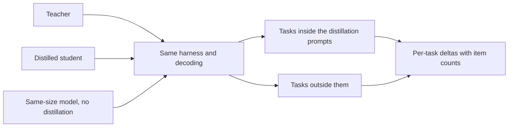

# Lesson 23. An Honest Distillation Eval

**Mission link:** The mission asks you to measure what a student lost against its teacher and against a model of the same size trained without one, and to defend the number, which means choosing the comparisons before the result is known.
**Primary source:** [Paper: "Distillation Scaling Laws", Busbridge et al., 2025](https://arxiv.org/abs/2502.08606), section 5.1 and Figure 6
**Prerequisites:** [Lesson 22](0022-student-against-teacher.md), [Fidelity](../GLOSSARY.md), [Supervised baseline](../GLOSSARY.md), [Synthetic data](../GLOSSARY.md)

## Warm-up

1. ▢ Lesson 22 asked for two columns per capability. Name them and say which one a preference rating mostly measures.

Check

Agreement with the teacher, and task quality against the correct answer. A preference rating leans on how an answer reads, so it mostly reflects style, and style is what imitation copies fastest.

2. ▢ Lesson 12 deduplicated and filtered generated data. Why does a generated set need that before training, and does the same hold for the evaluation prompts?

Check

Duplicates and bad examples are learned as readily as good ones, so the set needs checking before it trains anything. The evaluation set needs its own version of the check: duplicates inflate a score, and an item that also appears in the training data measures memory, not skill.

3. ▢ Lesson 21 gave the teacher's cost as part of the budget. When you compare a student with a baseline, which cost must the two share for the comparison to be fair?

Check

The training budget or the training data. If the student got a teacher's compute and tokens on top of what the baseline got, the student's lead may be the extra resources, not distillation. The baseline has to be given the same budget or the same data, and you have to say which.

## Know this

### Three models, not two

"The student matches the teacher" is a claim about two models. It says nothing about whether distillation was the reason, because a small model trained directly might match the teacher too. An honest evaluation has three:

1. The teacher.
2. The distilled student.
3. A [supervised baseline](../GLOSSARY.md): a model of the student's size, trained without distillation, on the same data or the same compute.

The paper builds its whole analysis on this third model. Its Figure 6 plots the difference between a distilled student's cross-entropy and that of a supervised model with the same resources, with blue where distillation wins and red where supervised learning wins, across student sizes and token budgets (section 5.1). That comparison is how it finds that distillation wins at modest budgets and loses at large ones. Without the baseline there is no such finding.

Two decisions about the baseline have to be written down. Same data means the supervised model trains on the same inputs the student's training set is built from, labelled by people or by the original task instead of by the teacher. Same compute means it gets as many FLOPs as the whole distillation run, and lesson 21 says whether that includes the teacher. Pick one, state it, and do not pick it after seeing the result.

### A direct baseline, as an example

The DeepSeek-R1 report is one place this shape appears. Its Table 16 compares a model distilled from DeepSeek-R1 with a model trained by large-scale reinforcement learning, both from Qwen2.5-32B and both at 32B parameters. The distilled model scored 72.6 on AIME 2024 pass@1 and 94.3 on MATH-500, against 47.0 and 91.6 for the reinforcement-learning model. LiveCodeBench was 57.2 against 40.2 (Table 16, appendix F.1).

Read it for how the comparison is built, not for its size. The baseline here is the same base model trained by a different method, so it is a direct comparison, but it is not a matched-data or matched-compute one, and the paper says the reinforcement-learning run took over 10,000 steps. One report's own setup is all it is. A reader who wanted to know how much of the gain is the teacher's data and how much is the method would need the matched runs.

### Held-out tasks, not only held-out items

A student can score well on tasks its distillation data supported and badly on tasks it did not. Gudibande et al. found exactly that: imitation models improved on evaluation tasks heavily supported in the imitation data, and did not improve, or declined, on those with little support (section 1 and Figure 4). The fix is to include tasks that were not among the distillation prompts, and to say which are which.

So split the evaluation in two. Tasks inside the distillation distribution tell you how well the student absorbed what it was shown. Tasks outside it tell you whether anything beyond that generalised. Report them separately, because an average over both hides the second.

### Contamination when the teacher writes the data

[Synthetic data](../GLOSSARY.md) adds a leakage route that a human-written training set does not have. If the distillation prompts were drawn from or resemble the items of an evaluation, the teacher's answers to them put those items' content into the student's training data, and the student's score on that benchmark measures exposure. The teacher can add its own: a model that has seen a benchmark in pretraining may reproduce parts of it when asked something close.

The detection methods belong to the evals track, so use them there. The [held-out data and contamination sheet](../../evals/reference/held-out-data-and-contamination.md) gives the two pathways and the guided-instruction test, and the [glossary entry for data contamination](../../evals/GLOSSARY.md) pins the term. For a distillation, add three checks of your own:

- Record where the distillation prompts came from, and exclude any evaluation item or near-duplicate from them.
- Deduplicate the teacher's generated outputs against the evaluation set, not only the prompts.
- Prefer an evaluation set built after the prompts were collected, or one you wrote.

Gudibande et al. show the idea at small scale. For their human evaluation they filtered out queries with a BLEU score above 20 percent against any example in their training set, to reduce test-set leakage (section 4.1, footnote). That is one threshold on one metric, a starting point and not a standard.

### Same harness, same decoding, per-task deltas

Run all three models through the same harness, with the same prompts, the same decoding settings and the same scoring. A student sampled at a temperature of 0.7 and a baseline decoded greedily differ in two things, and you will not know which produced the gap. The [eval harness sheet](../../evals/reference/eval-harness.md) covers what to hold fixed.

Then report per-task deltas, not one average: student minus teacher, and student minus baseline, for each task, with a note of how many items it has. A table of deltas shows where the student gained and where it lost. An average can be positive while the tasks the product depends on are negative.

Finally, check whether a gap is noise before you read it. The [go/no-go sheet](../../evals/reference/go-no-go.md) gives the standard error of a pass rate, about the square root of p times 1 minus p over N, and the paired comparison that needs less data. Use it here as it is, and do not rebuild it. The evals track teaches how to build the set and the threshold; this lesson only says what the set has to contain for a distillation.

## Practice

1. ▢ A student scores 0.68 on a 100-item task and the supervised baseline scores 0.62. The standard error of each pass rate is about 0.047 and 0.049. Is the 6-point gap distinguishable from noise?

Hint

Combine the two standard errors as the square root of the sum of their squares, then compare that with the gap.

Check

No. The combined standard error is about 0.068, so the 0.06 gap is smaller than one standard error. That is not evidence that the student is no better, only that 100 items cannot tell. Use more items or a paired comparison on the same items, as the go/no-go sheet describes, before reading the gap.

2. ▢ A report says "our 3B student matches the 70B teacher on average over six benchmarks". Which two items would you add to make the claim defensible?

    - a) A second teacher of another family, and a preference rating from human raters.
    - b) A larger student trained on more data, and an average weighted by benchmark size.
    - c) A same-size baseline trained without distillation, and per-task deltas with item counts.
    - d) A lower-temperature decoding run, and a rerun of all six benchmarks with a fresh seed.

Check

c). The baseline shows whether distillation caused the match, and the per-task deltas show which tasks the average hides. b) changes the student instead of testing the claim. a) widens the comparison without answering it, and a preference rating is the weak measure of lesson 22. d) checks stability of one number, which does not show whether distillation or a direct run would have matched the teacher.

3. ▢ You distilled on 40,000 prompts, 30 percent of them taken from the training split of a public reasoning benchmark. The student scores well on that benchmark's test split. What is the risk, and what do you do?

Hint

Think about what the teacher's answers to those prompts put into the student's training data.

Check

The student has trained on the teacher's answers to questions of the same kind and style as the test split, and possibly on near-duplicates, so its score measures exposure and not general skill. Report the benchmark separately as in-distribution, add tasks that were not in the distillation prompts, check generated outputs for near-duplicates of test items, and prefer an evaluation built after the prompts were collected.

4. ▢ The Gudibande et al. result on Natural Questions has the broad-imitation student at 15 and the targeted-imitation student at 27, with the teacher at 31, for 13B. What does it say about including tasks outside the distillation prompts in an evaluation?

Check

An evaluation on only the tasks the distillation data covers would have shown the targeted student near the teacher and said nothing of the broad student's loss. The broad student lost on NQ, which its data did not support well, and fell below the untouched base model (15 against 20). Only a task outside the data shows this, so include one and report it separately.

5. ▢ Stage 7 interleave: you compare a distilled 1B student with a 1B baseline given the same tokens, and the student wins. From lesson 20, what has to hold for that win to be the distillation scaling law's prediction and not luck?

Check

The student's token budget must be below the student-size-dependent threshold, so the paper's result favours distillation, and the teacher must already exist or serve other purposes. If the token budget is very large, the law predicts the supervised baseline catching up, so a win there would need another explanation. Check the budget against the threshold, and say whether the teacher's cost was charged to the baseline comparison.

## Real-world reps

- [ ] Take a distillation claim you have read, from a blog or a model card. List which of the three models it reports and which of the three comparisons it leaves out.
- [ ] Open the DeepSeek-R1 report, appendix F.1, and write down what the Qwen2.5-32B-Zero baseline shares with the distilled model and what it does not.
- [ ] Tomorrow: without notes, write the five checks of an honest distillation eval, and the one that a plain average over benchmarks would hide.

## Going further

- [Sizing and Measuring](../reference/sizing-and-measuring.md)
- [Go/No-Go](../../evals/reference/go-no-go.md): the noise formula and the paired comparison, from the evals track
- [Evals](../../evals/): the track for building the evaluation set this lesson compares models on
- [Paper: "DeepSeek-R1: Incentivizing Reasoning Capability in LLMs via Reinforcement Learning", DeepSeek-AI, 2025](https://arxiv.org/abs/2501.12948), appendix F.1
- [Paper: "The False Promise of Imitating Proprietary LLMs", Gudibande et al., 2023](https://arxiv.org/abs/2305.15717)
- [Resources](../RESOURCES.md)

---

Not landing? Reread the primary source at the top, since this lesson compresses it and compression is where understanding leaks. Check the [glossary](../GLOSSARY.md) for any term that felt slippery.

If the lesson itself is unclear rather than the material, that is a defect: [open an issue](https://github.com/TokenCemetery/teach/issues).
