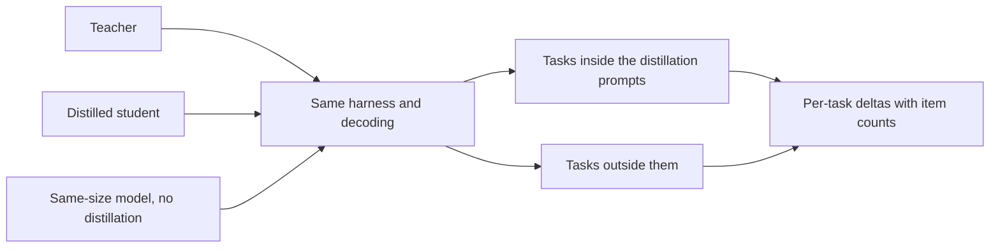

# Lição 23. Um eval honesto de destilação

**Ligação com a missão:** A missão pede que você meça o que um aluno perdeu em relação ao seu professor e em relação a um modelo do mesmo tamanho treinado sem um, e que defenda o número, o que significa escolher as comparações antes de o resultado ser conhecido.
**Fonte principal:** [Artigo científico: "Distillation Scaling Laws", Busbridge et al., 2025](https://arxiv.org/abs/2502.08606), seção 5.1 e Figura 6
**Pré-requisitos:** [Lição 22](0022-student-against-teacher.md), [Fidelidade](../GLOSSARY.md), [Baseline supervisionado](../GLOSSARY.md), [Dados sintéticos](../GLOSSARY.md)

## Aquecimento

1. ▢ A lição 22 pediu duas colunas por capacidade. Nomeie-as e diga qual delas uma avaliação de preferência mede principalmente.

Verificação

A concordância com o professor e a qualidade na tarefa contra a resposta correta. Uma avaliação de preferência se apoia em como uma resposta se lê, então reflete principalmente o estilo, e o estilo é o que a imitação copia mais rápido.

2. ▢ A lição 12 deduplicou e filtrou dados gerados. Por que um conjunto gerado precisa disso antes do treinamento, e o mesmo vale para os prompts de avaliação?

Verificação

Duplicatas e exemplos ruins são aprendidos tão prontamente quanto os bons, então o conjunto precisa ser verificado antes de treinar qualquer coisa. O conjunto de avaliação precisa da sua própria versão da verificação: as duplicatas inflam uma pontuação, e um item que também aparece nos dados de treinamento mede memória, não habilidade.

3. ▢ A lição 21 deu o custo do professor como parte do orçamento. Quando você compara um aluno com um baseline, qual custo os dois precisam compartilhar para a comparação ser justa?

Verificação

O orçamento de treinamento ou os dados de treinamento. Se o aluno recebeu o compute e os tokens de um professor além do que o baseline recebeu, a vantagem do aluno pode ser dos recursos extras, não da destilação. O baseline precisa receber o mesmo orçamento ou os mesmos dados, e você precisa dizer qual.

## Saiba isto

### Três modelos, não dois

"O aluno se iguala ao professor" é uma alegação sobre dois modelos. Ela não diz nada sobre se a destilação foi a razão, porque um modelo pequeno treinado diretamente também poderia igualar o professor. Um eval honesto tem três:

1. O professor.
2. O aluno destilado.
3. Um [baseline supervisionado](../GLOSSARY.md): um modelo do tamanho do aluno, treinado sem destilação, com os mesmos dados ou o mesmo compute.

O artigo constrói toda a sua análise sobre esse terceiro modelo. A sua Figura 6 traça a diferença entre a cross-entropy de um aluno destilado e a de um modelo supervisionado com os mesmos recursos, com azul onde a destilação vence e vermelho onde o aprendizado supervisionado vence, entre tamanhos de aluno e orçamentos de tokens (seção 5.1). Essa comparação é como ele descobre que a destilação vence em orçamentos modestos e perde nos grandes. Sem o baseline, não há tal achado.

Duas decisões sobre o baseline precisam ser escritas. Mesmos dados significa que o modelo supervisionado treina nas mesmas entradas de que o conjunto de treinamento do aluno é construído, rotuladas por pessoas ou pela tarefa original em vez de pelo professor. Mesmo compute significa que ele recebe tantos FLOPs quanto toda a execução de destilação, e a lição 21 diz se isso inclui o professor. Escolha um, declare-o e não o escolha depois de ver o resultado.

### Um baseline direto, como exemplo

O relatório do DeepSeek-R1 é um lugar onde esse formato aparece. A sua Tabela 16 compara um modelo destilado do DeepSeek-R1 com um modelo treinado por reinforcement learning em larga escala, ambos a partir do Qwen2.5-32B e ambos com 32B de parâmetros. O modelo destilado pontuou 72,6 no AIME 2024 pass@1 e 94,3 no MATH-500, contra 47,0 e 91,6 do modelo de reinforcement learning. No LiveCodeBench foi 57,2 contra 40,2 (Tabela 16, apêndice F.1).

Leia isso pela forma como a comparação é construída, não pelo tamanho. O baseline aqui é o mesmo base model treinado por um método diferente, então é uma comparação direta, mas não é uma com dados ou compute casados, e o artigo diz que a execução de reinforcement learning levou mais de 10.000 passos. A configuração de um relatório é só o que ela é. Um leitor que quisesse saber quanto do ganho vem dos dados do professor e quanto do método precisaria das execuções casadas.

### Tarefas held-out, não apenas itens held-out

Um aluno pode pontuar bem em tarefas que os seus dados de destilação sustentaram e mal em tarefas que não sustentaram. Gudibande et al. constataram exatamente isso: os modelos de imitação melhoraram em tarefas de avaliação fortemente sustentadas nos dados de imitação, e não melhoraram, ou pioraram, naquelas com pouco suporte (seção 1 e Figura 4). A correção é incluir tarefas que não estavam entre os prompts de destilação e dizer quais são quais.

Então divida a avaliação em duas. As tarefas dentro da distribuição de destilação dizem o quão bem o aluno absorveu o que lhe foi mostrado. As tarefas fora dela dizem se algo além disso generalizou. Relate-as separadamente, porque uma média sobre as duas esconde a segunda.

### Contaminação quando o professor escreve os dados

Os [dados sintéticos](../GLOSSARY.md) acrescentam uma rota de vazamento que um conjunto de treinamento escrito por humanos não tem. Se os prompts de destilação foram tirados de itens de um eval, ou se parecem com eles, as respostas do professor a eles põem o conteúdo desses itens nos dados de treinamento do aluno, e a pontuação do aluno nesse benchmark mede exposição. O professor pode acrescentar a sua própria: um modelo que viu um benchmark no pré-treinamento pode reproduzir partes dele quando perguntado algo próximo.

Os métodos de detecção pertencem à trilha de evals, então use-os lá. A folha [Dados Held-Out e Contaminação](../../evals/reference/held-out-data-and-contamination.md) dá os dois caminhos e o teste de instrução guiada, e a [entrada do glossário sobre contaminação de dados](../../evals/GLOSSARY.md) fixa o termo. Para uma destilação, acrescente três verificações suas:

- Registre de onde vieram os prompts de destilação e exclua deles qualquer item de avaliação ou quase duplicata.
- Deduplique as saídas geradas pelo professor contra o conjunto de avaliação, não apenas os prompts.
- Prefira um conjunto de avaliação construído depois de os prompts serem coletados, ou um que você mesmo escreveu.

Gudibande et al. mostram a ideia em escala pequena. Para a avaliação humana deles, eles filtraram consultas com uma pontuação BLEU acima de 20 por cento contra qualquer exemplo do seu conjunto de treinamento, para reduzir o vazamento do conjunto de teste (seção 4.1, nota de rodapé). Esse é um limiar em uma métrica, um ponto de partida e não um padrão.

### Mesmo harness, mesma decodificação, deltas por tarefa

Rode os três modelos pelo mesmo harness, com os mesmos prompts, as mesmas configurações de decodificação e a mesma pontuação. Um aluno amostrado com temperatura 0,7 e um baseline decodificado de forma greedy diferem em duas coisas, e você não saberá qual produziu a diferença. A folha [Harness de Eval](../../evals/reference/eval-harness.md) cobre o que manter fixo.

Depois relate deltas por tarefa, não uma média: aluno menos professor e aluno menos baseline, para cada tarefa, com uma nota de quantos itens ela tem. Uma tabela de deltas mostra onde o aluno ganhou e onde perdeu. Uma média pode ser positiva enquanto as tarefas de que o produto depende são negativas.

Por fim, verifique se uma diferença é ruído antes de lê-la. A folha [Go/No-Go](../../evals/reference/go-no-go.md) dá o erro padrão de uma taxa de acerto, cerca da raiz quadrada de p vezes 1 menos p sobre N, e a comparação pareada que precisa de menos dados. Use-a aqui como ela é e não a reconstrua. A trilha de evals ensina como construir o conjunto e o limiar; esta lição só diz o que o conjunto precisa conter para uma destilação.

## Prática

1. ▢ Um aluno pontua 0,68 em uma tarefa de 100 itens e o baseline supervisionado pontua 0,62. O erro padrão de cada taxa de acerto é cerca de 0,047 e 0,049. A diferença de 6 pontos é distinguível de ruído?

Dica

Combine os dois erros padrão como a raiz quadrada da soma dos seus quadrados e depois compare com a diferença.

Verificação

Não. O erro padrão combinado é cerca de 0,067, então a diferença de 0,06 é menor do que um erro padrão. Isso não é evidência de que o aluno não é melhor, apenas de que 100 itens não conseguem dizer. Use mais itens ou uma comparação pareada nos mesmos itens, como a folha de go/no-go descreve, antes de ler a diferença.

2. ▢ Um relatório diz "o nosso aluno de 3B se iguala ao professor de 70B na média de seis benchmarks". Quais dois itens você acrescentaria para tornar a alegação defensável?

    - a) Um segundo professor de outra família e uma avaliação de preferência de avaliadores humanos.
    - b) Um aluno maior treinado com mais dados e uma média ponderada pelo tamanho do benchmark.
    - c) Um baseline do mesmo tamanho treinado sem destilação e deltas por tarefa com contagens de itens.
    - d) Uma execução com decodificação de temperatura menor e uma nova execução dos seis benchmarks com uma seed nova.

Verificação

c). O baseline mostra se a destilação causou a igualdade, e os deltas por tarefa mostram quais tarefas a média esconde. b) muda o aluno em vez de testar a alegação. a) amplia a comparação sem respondê-la, e uma avaliação de preferência é a medida fraca da lição 22. d) verifica a estabilidade de um número, o que não mostra se a destilação ou uma execução direta teria igualado o professor.

3. ▢ Você destilou em 40.000 prompts, 30 por cento deles tirados da divisão de treinamento de um benchmark público de raciocínio. O aluno pontua bem na divisão de teste desse benchmark. Qual é o risco, e o que você faz?

Dica

Pense no que as respostas do professor a esses prompts põem nos dados de treinamento do aluno.

Verificação

O aluno treinou nas respostas do professor a perguntas do mesmo tipo e estilo da divisão de teste, e possivelmente em quase duplicatas, então a sua pontuação mede exposição e não habilidade geral. Relate o benchmark separadamente como dentro da distribuição, acrescente tarefas que não estavam nos prompts de destilação, verifique as saídas geradas em busca de quase duplicatas de itens de teste e prefira uma avaliação construída depois de os prompts serem coletados.

4. ▢ O resultado de Gudibande et al. no Natural Questions tem o aluno de imitação ampla em 15 e o aluno de imitação direcionada em 27, com o professor em 31, para o 13B. O que ele diz sobre incluir em uma avaliação tarefas fora dos prompts de destilação?

Verificação

Uma avaliação apenas nas tarefas que os dados de destilação cobrem teria mostrado o aluno direcionado perto do professor e não teria dito nada sobre a perda do aluno amplo. O aluno amplo perdeu no NQ, que os seus dados não sustentavam bem, e caiu abaixo do base model intocado (15 contra 20). Só uma tarefa fora dos dados mostra isso, então inclua uma e relate-a separadamente.

5. ▢ Revisão intercalada da etapa 7: você compara um aluno destilado de 1B com um baseline de 1B que recebeu os mesmos tokens, e o aluno vence. Pela lição 20, o que precisa valer para que essa vitória seja a previsão da lei de escala da destilação e não sorte?

Verificação

O orçamento de tokens do aluno precisa estar abaixo do limiar dependente do tamanho do aluno, para que o resultado do artigo favoreça a destilação, e o professor precisa já existir ou atender a outros propósitos. Se o orçamento de tokens for muito grande, a lei prevê o baseline supervisionado alcançando, então uma vitória ali precisaria de outra explicação. Confira o orçamento contra o limiar e diga se o custo do professor foi cobrado na comparação com o baseline.

## Prática no mundo real

- [ ] Pegue uma alegação de destilação que você leu, de um blog ou de um model card. Liste quais dos três modelos ela relata e quais das três comparações ela deixa de fora.
- [ ] Abra o relatório do DeepSeek-R1, apêndice F.1, e anote o que o baseline Qwen2.5-32B-Zero compartilha com o modelo destilado e o que não compartilha.
- [ ] Amanhã: sem consultar anotações, escreva as cinco verificações de um eval honesto de destilação e aquela que uma média simples entre benchmarks esconderia.

## Para ir além

- [Dimensionamento e Medição](../reference/sizing-and-measuring.md)
- [Go/No-Go](../../evals/reference/go-no-go.md): a fórmula do ruído e a comparação pareada, da trilha de evals
- [Evals](../../evals/): a trilha para construir o conjunto de avaliação em que esta lição compara os modelos
- [Artigo científico: "DeepSeek-R1: Incentivizing Reasoning Capability in LLMs via Reinforcement Learning", DeepSeek-AI, 2025](https://arxiv.org/abs/2501.12948), apêndice F.1
- [Artigo científico: "The False Promise of Imitating Proprietary LLMs", Gudibande et al., 2023](https://arxiv.org/abs/2305.15717)
- [Recursos](../RESOURCES.md)

---

Não ficou claro? Releia a fonte principal no topo, já que esta lição a comprime e é na compressão que o entendimento escapa. Consulte o [glossário](../GLOSSARY.md) para qualquer termo que pareceu escorregadio.

Se o problema é a lição em si, e não o material, isso é um defeito: [abra uma issue](https://github.com/TokenCemetery/teach/issues).
