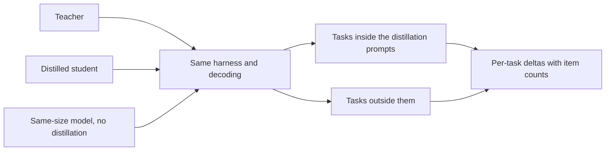

# Урок 23. Честная оценка дистилляции

**Связь с целью курса:** Цель курса требует, чтобы вы могли измерить, что ученик потерял относительно своего учителя и относительно модели того же размера, обученной без него, и защитить это число, а это значит выбирать сравнения до того, как станет известен результат.
**Первоисточник:** [Научная статья: "Distillation Scaling Laws", Busbridge et al., 2025](https://arxiv.org/abs/2502.08606), раздел 5.1 и рисунок 6
**Предварительные требования:** [Урок 22](0022-student-against-teacher.md), [верность](../GLOSSARY.md), [базовый уровень без дистилляции](../GLOSSARY.md), [синтетические данные](../GLOSSARY.md)

## Разминка

1. ▢ Урок 22 просил два столбца на каждое умение. Назовите их и скажите, какой из них в основном измеряет оценка предпочтений.

Проверка

Согласие с учителем и качество на задаче относительно правильного ответа. Оценка предпочтений опирается на то, как ответ читается, так что в основном отражает стиль, а стиль это то, что имитация копирует быстрее всего.

2. ▢ Урок 12 дедуплицировал и фильтровал сгенерированные данные. Зачем сгенерированному набору это нужно перед обучением и верно ли то же для оценочных промптов?

Проверка

Дубликаты и плохие примеры усваиваются так же охотно, как хорошие, так что набор нужно проверить, прежде чем он чему-либо научит. Оценочному набору нужна своя версия проверки: дубликаты раздувают оценку, а элемент, который есть и в обучающих данных, измеряет память, а не умение.

3. ▢ Урок 21 включил стоимость учителя в бюджет. Когда вы сравниваете ученика с базовым уровнем, какую стоимость должны разделять оба, чтобы сравнение было честным?

Проверка

Бюджет обучения или обучающие данные. Если ученику достались вычисления и токены учителя сверх того, что получил базовый уровень, лидерство ученика может объясняться лишними ресурсами, а не дистилляцией. Базовому уровню нужно дать тот же бюджет или те же данные, и вы должны сказать, какое из двух.

## Что нужно знать

### Три модели, а не две

«Ученик не уступает учителю» это утверждение о двух моделях. Оно ничего не говорит о том, была ли причиной дистилляция, потому что маленькая модель, обученная напрямую, тоже могла бы сравняться с учителем. В честной оценке их три:

1. Учитель.
2. Дистиллированный ученик.
3. [Базовый уровень без дистилляции](../GLOSSARY.md): модель размера ученика, обученная без дистилляции, на тех же данных или с теми же вычислениями.

Статья строит весь свой анализ на этой третьей модели. Её рисунок 6 строит разность между кросс-энтропией дистиллированного ученика и кросс-энтропией контролируемой модели с теми же ресурсами, синим там, где дистилляция выигрывает, и красным там, где выигрывает контролируемое обучение, по размерам ученика и токенным бюджетам (раздел 5.1). Именно это сравнение даёт вывод, что дистилляция выигрывает при скромных бюджетах и проигрывает при больших. Без базового уровня такого вывода нет.

Два решения о базовом уровне нужно записать. Одинаковые данные означают, что контролируемая модель обучается на тех же входах, из которых построен обучающий набор ученика, размеченных людьми или исходной задачей, а не учителем. Одинаковые вычисления означают, что она получает столько же FLOPs, сколько весь запуск дистилляции, а урок 21 говорит, включает ли это учителя. Выберите одно, укажите его и не выбирайте после того, как увидите результат.

### Прямой базовый уровень, как пример

Отчёт DeepSeek-R1 это одно из мест, где появляется такая форма. Его таблица 16 сравнивает модель, дистиллированную из DeepSeek-R1, с моделью, обученной масштабным обучением с подкреплением, обе из Qwen2.5-32B и обе на 32B параметров. Дистиллированная модель набрала 72.6 на AIME 2024 pass@1 и 94.3 на MATH-500, против 47.0 и 91.6 у модели с обучением с подкреплением. LiveCodeBench был 57.2 против 40.2 (таблица 16, приложение F.1).

Читайте это ради того, как построено сравнение, а не ради его величины. Базовый уровень здесь это та же базовая модель, обученная другим методом, так что это прямое сравнение, но не с согласованными данными или вычислениями, а статья говорит, что запуск с обучением с подкреплением занял более 10 000 шагов. Это всего лишь постановка одного отчёта. Читателю, который хотел бы знать, какая доля выигрыша приходится на данные учителя, а какая на метод, понадобились бы согласованные запуски.

### Отложенные задачи, а не только отложенные элементы

Ученик может хорошо оцениваться на задачах, которые поддерживали его данные для дистилляции, и плохо на тех, которые не поддерживали. Gudibande и соавторы нашли именно это: имитирующие модели улучшались на оценочных задачах, сильно представленных в данных имитации, и не улучшались или ухудшались на тех, что почти не были представлены (раздел 1 и рисунок 4). Решение состоит в том, чтобы включить задачи, не входившие в промпты дистилляции, и сказать, какие из них какие.

Так что разделите оценку на две части. Задачи внутри распределения дистилляции говорят, насколько хорошо ученик усвоил показанное. Задачи вне его говорят, обобщилось ли что-нибудь сверх этого. Сообщайте их отдельно, потому что среднее по обеим скрывает второе.

### Загрязнение, когда данные пишет учитель

[Синтетические данные](../GLOSSARY.md) добавляют путь утечки, которого нет у обучающего набора, написанного людьми. Если промпты для дистилляции взяты из элементов оценки или похожи на них, ответы учителя на них кладут содержание этих элементов в обучающие данные ученика, и оценка ученика на этом бенчмарке измеряет знакомство. Учитель может добавить своё: модель, видевшая бенчмарк при предобучении, может воспроизвести его части, когда её спрашивают о чём-то близком.

Методы обнаружения относятся к курсу по эвалам, так что используйте их там. Лист [Отложенные данные и загрязнение](../../evals/reference/held-out-data-and-contamination.md) даёт два пути и тест с направляющей инструкцией, а [запись глоссария о загрязнении данных](../../evals/GLOSSARY.md) закрепляет термин. Для дистилляции добавьте три собственные проверки:

- Записывайте, откуда взялись промпты для дистилляции, и исключайте из них любой оценочный элемент или почти-дубликат.
- Дедуплицируйте сгенерированные учителем выходы относительно оценочного набора, а не только промпты.
- Предпочитайте оценочный набор, построенный после сбора промптов, или написанный вами.

Gudibande и соавторы показывают идею в малом масштабе. Для своей человеческой оценки они отфильтровали запросы с BLEU выше 20 процентов относительно любого примера в их обучающем наборе, чтобы сократить утечку тестового набора (раздел 4.1, сноска). Это один порог по одной метрике, отправная точка, а не стандарт.

### Одна обвязка, одно декодирование, дельты по задачам

Прогоняйте все три модели через одну обвязку, с одними и теми же промптами, одними и теми же настройками декодирования и одной и той же оценкой. Ученик, сэмплируемый при температуре 0.7, и базовый уровень, декодируемый жадно, различаются двумя вещами, и вы не узнаете, что дало разрыв. Лист [Обвязка эвала](../../evals/reference/eval-harness.md) описывает, что держать фиксированным.

Затем сообщайте дельты по задачам, а не одно среднее: ученик минус учитель и ученик минус базовый уровень для каждой задачи, с пометкой, сколько в ней элементов. Таблица дельт показывает, где ученик выиграл и где проиграл. Среднее может быть положительным, пока задачи, от которых зависит продукт, отрицательны.

Наконец, проверьте, не шум ли разрыв, прежде чем его читать. Лист [Выпускать или нет](../../evals/reference/go-no-go.md) даёт стандартную ошибку доли успехов, около квадратного корня из p, умноженного на 1 минус p, делённых на N, и парное сравнение, которому нужно меньше данных. Используйте его здесь как есть и не перестраивайте. Курс по эвалам учит, как строить набор и порог; этот урок лишь говорит, что набор должен содержать для дистилляции.

## Практика

1. ▢ Ученик набирает 0.68 на задаче из 100 элементов, а контролируемый базовый уровень 0.62. Стандартная ошибка каждой доли успехов около 0.047 и 0.049. Отличим ли разрыв в 6 пунктов от шума?

Подсказка

Объедините две стандартные ошибки как квадратный корень из суммы их квадратов, затем сравните это с разрывом.

Проверка

Нет. Объединённая стандартная ошибка около 0.068, так что разрыв в 0.06 меньше одной стандартной ошибки. Это не свидетельство того, что ученик не лучше, а лишь того, что 100 элементов не позволяют сказать. Используйте больше элементов или парное сравнение на тех же элементах, как описывает лист «Выпускать или нет», прежде чем читать разрыв.

2. ▢ Отчёт говорит: «наш ученик на 3B не уступает учителю на 70B в среднем по шести бенчмаркам». Какие два пункта вы добавили бы, чтобы утверждение стало защитимым?

    - a) Второго учителя из другого семейства и оценку предпочтений от людей-оценщиков.
    - b) Более крупного ученика, обученного на большем объёме данных, и среднее, взвешенное по размеру бенчмарка.
    - c) Базовый уровень того же размера, обученный без дистилляции, и дельты по задачам с числом элементов.
    - d) Запуск с декодированием при меньшей температуре и перезапуск всех шести бенчмарков с новым seed.

Проверка

c). Базовый уровень показывает, вызвана ли совпадение дистилляцией, а дельты по задачам показывают, какие задачи скрывает среднее. b) меняет ученика вместо проверки утверждения. a) расширяет сравнение, не отвечая на вопрос, а оценка предпочтений это слабая мера из урока 22. d) проверяет устойчивость одного числа, а это не показывает, сравнялась бы с учителем дистилляция или прямой запуск.

3. ▢ Вы дистиллировали на 40 000 промптах, 30 процентов которых взяты из обучающей части публичного бенчмарка по рассуждениям. Ученик хорошо оценивается на тестовой части этого бенчмарка. В чём риск и что вы делаете?

Подсказка

Подумайте, что ответы учителя на эти промпты кладут в обучающие данные ученика.

Проверка

Ученик обучался на ответах учителя на вопросы того же вида и стиля, что и тестовая часть, и, возможно, на почти-дубликатах, так что его оценка измеряет знакомство, а не общее умение. Сообщайте этот бенчмарк отдельно как внутри распределения, добавьте задачи, которых не было в промптах дистилляции, проверьте сгенерированные выходы на почти-дубликаты тестовых элементов и предпочтите оценку, построенную после сбора промптов.

4. ▢ Результат Gudibande и соавторов на Natural Questions для 13B: ученик широкой имитации на 15, ученик целевой имитации на 27, учитель на 31. Что он говорит о включении в оценку задач вне промптов дистилляции?

Проверка

Оценка только на тех задачах, которые охватывают данные дистилляции, показала бы целевого ученика близко к учителю и ничего не сказала бы о потере широкого ученика. Широкий ученик проиграл на NQ, которую его данные поддерживали слабо, и упал ниже нетронутой базовой модели (15 против 20). Только задача вне данных показывает это, так что включите такую и сообщайте её отдельно.

5. ▢ Чередование с этапом 7: вы сравниваете дистиллированного ученика на 1B с базовым уровнем на 1B, получившим те же токены, и ученик выигрывает. Что, по уроку 20, должно выполняться, чтобы этот выигрыш был предсказанием закона масштабирования дистилляции, а не везением?

Проверка

Токенный бюджет ученика должен быть ниже зависящего от размера ученика порога, так что результат статьи говорит в пользу дистилляции, а учитель должен уже существовать или служить другим целям. Если токенный бюджет очень велик, закон предсказывает, что контролируемый базовый уровень догонит, так что выигрыш там потребовал бы другого объяснения. Сверьте бюджет с порогом и скажите, была ли стоимость учителя отнесена на счёт сравнения с базовым уровнем.

## Практика в реальной работе

- [ ] Возьмите заявление о дистилляции, которое вы читали, из блога или карточки модели. Перечислите, какие из трёх моделей оно приводит и какие из трёх сравнений опускает.
- [ ] Откройте отчёт DeepSeek-R1, приложение F.1, и запишите, что у базового уровня Qwen2.5-32B-Zero общего с дистиллированной моделью и чего общего нет.
- [ ] Завтра: без заметок запишите пять проверок честной оценки дистилляции и ту из них, которую скрыло бы простое среднее по бенчмаркам.

## Что почитать дальше

- [Размер и измерение](../reference/sizing-and-measuring.md)
- [Выпускать или нет](../../evals/reference/go-no-go.md): формула шума и парное сравнение, из курса по эвалам
- [Эвалы](../../evals/): курс о построении оценочного набора, на котором этот урок сравнивает модели
- [Научная статья: "DeepSeek-R1: Incentivizing Reasoning Capability in LLMs via Reinforcement Learning", DeepSeek-AI, 2025](https://arxiv.org/abs/2501.12948), приложение F.1
- [Научная статья: "The False Promise of Imitating Proprietary LLMs", Gudibande et al., 2023](https://arxiv.org/abs/2305.15717)
- [Ресурсы](../RESOURCES.md)

---

Не доходит? Перечитайте первоисточник в начале: этот урок его сжимает, а при сжатии понимание как раз и теряется. Загляните в [глоссарий](../GLOSSARY.md), если какой-то термин показался скользким.

Если неясен сам урок, а не материал, это дефект: [откройте issue](https://github.com/TokenCemetery/teach/issues).
