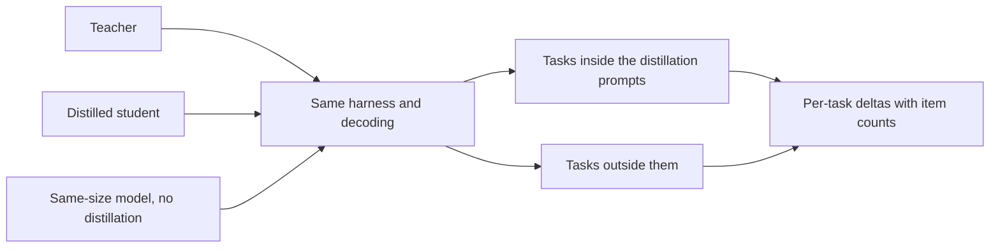

# 第 23 课：一份诚实的蒸馏评测

**使命关联:** 本使命要求你对照教师，也对照一个同样大小、不经蒸馏训练的模型，度量学生丢掉了什么，并为这个数字辩护，这意味着要在结果出来之前就选好比较对象。
**主要来源:** [论文：“Distillation Scaling Laws”，Busbridge 等，2025](https://arxiv.org/abs/2502.08606)，第 5.1 节和图 6
**前置知识:** [第 22 课](0022-student-against-teacher.md)、[保真度](../GLOSSARY.md)、[监督基线](../GLOSSARY.md)、[合成数据](../GLOSSARY.md)

## 热身

1. ▢ 第 22 课要求每种能力有两列。说出它们，并说明偏好评分主要度量的是哪一列。

检查

与教师的一致率，以及对照正确答案的任务质量。偏好评分依赖的是回答读起来如何，所以它主要反映风格，而风格是模仿复制得最快的东西。

2. ▢ 第 12 课对生成数据做了去重和过滤。为什么生成的数据集在训练之前需要这样做？评测用的提示词是否也同样需要？

检查

重复的和糟糕的样本，会像好样本一样被轻易地学进去，所以数据集在用它训练任何东西之前，都需要检查。评测集需要它自己的一版检查：重复会抬高分数，而一个同时出现在训练数据里的条目，度量的是记忆，不是技能。

3. ▢ 第 21 课把教师的成本算作预算的一部分。当你把学生与一个基线比较时，二者必须共享哪项成本，比较才是公平的？

检查

训练预算或训练数据。如果学生在基线所得的基础上，又得到了教师的算力和 token，学生的领先可能是额外的资源带来的，而不是蒸馏。必须给基线同样的预算或同样的数据，并且你必须说明是哪一种。

## 要点

### 三个模型，而不是两个

“学生与教师相当”是关于两个模型的论断。它没有说明蒸馏是不是原因，因为直接训练的小模型也可能与教师相当。诚实的评测有三个模型：

1. 教师。
2. 蒸馏出来的学生。
3. [监督基线](../GLOSSARY.md)：一个与学生大小相同、不经蒸馏、用相同的数据或相同的算力训练的模型。

论文的整个分析，都建立在这第三个模型之上。它的图 6 画出了蒸馏学生的交叉熵，与资源相同的监督模型的交叉熵之差，蒸馏胜出的地方用蓝色，监督学习胜出的地方用红色，横跨各种学生规模和 token 预算（第 5.1 节）。正是通过这个比较，它发现蒸馏在适度的预算下胜出，在很大的预算下落败。没有这个基线，就没有这样的发现。

关于基线，有两个决定必须写下来。相同数据的意思是，监督模型在构成学生训练集的同样输入上训练，由人或原始任务来标注，而不是由教师来标注。相同算力的意思是，它得到的 FLOPs，与整个蒸馏运行一样多，而第 21 课说明了这是否包括教师。选一个，说明白，不要在看到结果之后再选。

### 一个直接基线，作为例子

DeepSeek-R1 的报告，就是出现这种形态的一个地方。它的表 16 把一个从 DeepSeek-R1 蒸馏出来的模型，与一个通过大规模强化学习训练出来的模型做了比较，两者都从 Qwen2.5-32B 出发，都是 32B 参数。蒸馏模型在 AIME 2024 pass@1 上得 72.6，在 MATH-500 上得 94.3，而强化学习模型是 47.0 和 91.6。LiveCodeBench 是 57.2 对 40.2（表 16，附录 F.1）。

读它是为了看比较是怎么构建的，而不是看它的大小。这里的基线，是同一个基础模型用另一种方法训练的，所以它是一个直接的比较，但它不是匹配数据或匹配算力的比较，而论文说，强化学习的运行花了超过 10,000 步。它只是一份报告自己的设置而已。想知道增益有多少来自教师的数据、有多少来自方法的读者，需要那些匹配的运行。

### 留出的任务，而不只是留出的条目

学生可能在蒸馏数据支持的任务上得分很高，而在它没有支持的任务上很差。Gudibande 等人正是发现了这一点：模仿模型在模仿数据大量支持的评测任务上有所提高，而在支持很少的任务上没有提高，甚至下降（第 1 节和图 4）。修正办法是加入不在蒸馏提示词之内的任务，并说明哪些是哪些。

所以把评测分成两部分。在蒸馏分布之内的任务，告诉你学生吸收了它所见过的东西有多好。在它之外的任务，告诉你除此之外是否还有任何东西泛化了。要分别报告，因为对两者取平均，会掩盖第二部分。

### 当教师来写数据时的污染

[合成数据](../GLOSSARY.md)增加了一条人类编写的训练集所没有的泄漏途径。如果蒸馏提示词取自或类似于某个评测的条目，教师对它们的回答，就把这些条目的内容放进了学生的训练数据，学生在那个基准上的得分，度量的就是暴露程度。教师还可能带来它自己的污染：在预训练中见过某个基准的模型，被问到相近的东西时，可能会复现其中的部分。

检测方法属于评测系列，所以请到那里去用。[留出数据与数据污染](../../evals/reference/held-out-data-and-contamination.md)参考表给出了两条途径和引导式指令测试，而[数据污染的术语表条目](../../evals/GLOSSARY.md)固定了这个术语。对于蒸馏，请再增加你自己的三项检查：

- 记录蒸馏提示词来自哪里，并把任何评测条目或近似重复的条目从中排除。
- 对照评测集，对教师生成的输出做去重，而不只是对提示词做。
- 优先使用在收集提示词之后才构建的评测集，或者你自己写的评测集。

Gudibande 等人在小规模上展示了这个想法。对于他们的人工评测，他们过滤掉了与训练集中任何样本的 BLEU 得分超过 20% 的查询，以减少测试集泄漏（第 4.1 节，脚注）。那是一个指标上的一个阈值，是起点，不是标准。

### 相同的运行框架、相同的解码、逐任务的差值

让三个模型都通过同一个运行框架，使用同样的提示词、同样的解码设置和同样的打分。以 0.7 的温度采样的学生，与用贪心解码的基线，有两处不同，而你无从知道是哪一处造成了差距。[评测运行框架](../../evals/reference/eval-harness.md)参考表讲了要保持哪些不变。

然后报告逐任务的差值，而不是单一的平均：每个任务上学生减教师、学生减基线，并注明它有多少个条目。差值表能显示学生在哪里有所得、在哪里有所失。平均可以是正的，而产品所依赖的那些任务却是负的。

最后，在解读差距之前，先检查它是不是噪声。[上线与否](../../evals/reference/go-no-go.md)参考表给出了通过率的标准误差，约为 p 乘以 1 减 p 再除以 N 的平方根，以及所需数据更少的成对比较。这里原样使用它，不要重新造一遍。评测系列讲授如何构建评测集和阈值；本课只是说明，对蒸馏来说，评测集必须包含什么。

## 练习

1. ▢ 一个学生在一项 100 个条目的任务上得分 0.68，监督基线得分 0.62。每个通过率的标准误差分别约为 0.047 和 0.049。这个 6 分的差距与噪声分得开吗？

提示

把两个标准误差合并，取平方和的平方根，再拿它与差距比较。

检查

分不开。合并后的标准误差约为 0.068，所以 0.06 的差距小于一个标准误差。这并不是说学生没有更好的证据，只是说 100 个条目分辨不出来。在解读这个差距之前，要用更多条目，或者按上线与否参考表所述，在相同条目上做成对比较。

2. ▢ 一份报告说“我们的 3B 学生，在六个基准上的平均成绩与 70B 教师相当”。你会补上哪两项，才能让这个论断站得住脚？

    - a) 另一个家族的第二个教师，以及来自人类评分者的偏好评分。
    - b) 在更多数据上训练的更大学生，以及按基准规模加权的平均。
    - c) 一个同样大小、不经蒸馏训练的基线，以及带条目数的逐任务差值。
    - d) 一次更低温度的解码运行，以及用新的随机种子重跑全部六个基准。

检查

c)。基线说明相符是不是蒸馏造成的，逐任务的差值说明平均掩盖了哪些任务。b) 改变的是学生，而不是检验这个论断。a) 扩大了比较，却没有回答它，而偏好评分是第 22 课所说的薄弱度量。d) 检查的是一个数字的稳定性，并不能说明蒸馏还是直接运行才能与教师相当。

3. ▢ 你在 40,000 个提示词上做了蒸馏，其中 30% 取自某个公开推理基准的训练划分。学生在该基准的测试划分上得分很高。风险是什么？你怎么做？

提示

想想教师对这些提示词的回答，给学生的训练数据里放进了什么。

检查

学生已经在教师对与测试划分同类、同风格的问题的回答上训练过，还可能在近似重复的条目上训练过，所以它的得分度量的是暴露程度，而不是一般技能。把这个基准单独报告为同分布的，加入不在蒸馏提示词之内的任务，检查生成的输出里是否有测试条目的近似重复，并优先使用在收集提示词之后构建的评测集。

4. ▢ Gudibande 等人在 Natural Questions 上的结果，对 13B 来说，广泛模仿的学生是 15，有针对性模仿的学生是 27，教师是 31。这对在评测里加入不在蒸馏提示词之内的任务说明了什么？

检查

只在蒸馏数据所覆盖的任务上做评测，会显示有针对性的学生接近教师，而对广泛学生的损失只字不提。广泛的学生在它的数据支持得不好的 NQ 上有所损失，甚至低于未经改动的基础模型（15 对 20）。只有数据之外的任务才能显示这一点，所以要加入一项，并单独报告。

5. ▢ 第 7 阶段穿插题：你把一个蒸馏出来的 1B 学生，与一个得到同样 token 的 1B 基线做比较，学生赢了。根据第 20 课，要让这次获胜是蒸馏缩放定律的预测，而不是运气，必须满足什么？

检查

学生的 token 预算必须低于取决于学生规模的阈值，这样论文的结果才偏向蒸馏，而且教师必须已经存在，或者另有用途。如果 token 预算非常大，定律预测监督基线会追上来，所以在那里获胜就需要另外的解释。用阈值检查预算，并说明教师的成本是否计入了基线比较。

## 实战练习

- [ ] 取一条你读到的蒸馏声明，来自博客或模型卡。列出它报告了三个模型中的哪几个，以及它漏掉了三种比较中的哪几种。
- [ ] 打开 DeepSeek-R1 报告的附录 F.1，写下 Qwen2.5-32B-Zero 基线与蒸馏模型共有什么、不共有什么。
- [ ] 明天：不看笔记，写出一份诚实的蒸馏评测的五项检查，以及在各基准上简单取平均会掩盖的那一项。

## 延伸阅读

- [确定规模与度量](../reference/sizing-and-measuring.md)
- [上线与否](../../evals/reference/go-no-go.md)：评测系列里的噪声公式和成对比较
- [评测](../../evals/)：讲授如何构建本课用来比较模型的评测集的系列
- [论文：“DeepSeek-R1: Incentivizing Reasoning Capability in LLMs via Reinforcement Learning”，DeepSeek-AI，2025](https://arxiv.org/abs/2501.12948)，附录 F.1
- [论文：“The False Promise of Imitating Proprietary LLMs”，Gudibande 等，2023](https://arxiv.org/abs/2305.15717)
- [资源](../RESOURCES.md)

---

没学明白？请重读顶部的主要来源，因为本课是对它的压缩，而理解正是在压缩中流失的。如果有哪个术语觉得含糊，可以查看[术语表](../GLOSSARY.md)。

如果问题出在课程本身，而不是学习材料，那就是一个缺陷：[提交 issue](https://github.com/TokenCemetery/teach/issues)。
