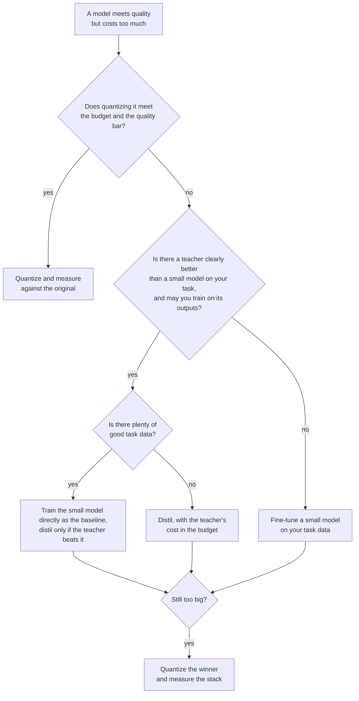

# Lección 24. Destilar, cuantizar o hacer fine-tuning

**Vínculo con la misión:** La misión termina con elegir entre destilar, cuantizar y entrenar directamente un modelo pequeño para una tarea y un presupuesto dados. La destilación es una de tres formas de conseguir un modelo más barato, y las otras dos suelen ser el mejor primer movimiento, así que esta lección es la decisión y la evidencia detrás de cada rama.
**Fuente principal:** [Paper: "Distillation Scaling Laws", Busbridge et al., 2025](https://arxiv.org/abs/2502.08606), resumen y sección 1
**Requisitos previos:** [Lección 20](0020-choosing-student-size.md), [Lección 21](0021-data-volume-and-teacher-cost.md), [Destilación](../GLOSSARY.md), [Estudiante](../GLOSSARY.md), [Profesor](../GLOSSARY.md)

## Calentamiento

1. ▢ La lección 2 dijo que los soft targets llevan más señal que un hard label. Nombra cuál es la señal extra, en una frase.

<details markdown="1"><summary>Comprobación</summary>

Los [soft targets](../GLOSSARY.md) dan una probabilidad a cada respuesta incorrecta además de a la correcta, así que muestran cuáles respuestas incorrectas son casi correctas y cuáles están muy lejos. Un [hard label](../GLOSSARY.md) pone todo en una respuesta y no dice nada del resto.

</details>

2. ▢ La lección 9 comparó la destilación a nivel de token y a nivel de secuencia. ¿Qué tiene que exponer el profesor para cada una?

<details markdown="1"><summary>Comprobación</summary>

La [destilación a nivel de token](../GLOSSARY.md) necesita las distribuciones por token del profesor, es decir, acceso a sus logits y un vocabulario compartido. La [destilación a nivel de secuencia](../GLOSSARY.md) necesita solo texto que decodificó el profesor, que proporciona una API alojada.

</details>

3. ▢ La lección 21 dijo que había que contar la inferencia del profesor en el presupuesto. ¿Por qué cambia eso una comparación con entrenar directamente al estudiante?

<details markdown="1"><summary>Comprobación</summary>

Los forward passes del profesor sobre los datos de destilación son cómputo que la ejecución directa nunca gasta. Una comparación que cuenta solo los pasos de entrenamiento del estudiante favorece a la destilación, y la brecha puede ser grande cuando el profesor es mucho mayor que el estudiante.

</details>

## Qué debes saber

### Tres palancas, tres costos

Tienes un modelo que hace la tarea pero cuesta demasiado ejecutar. Tres palancas reducen el costo, y cada una renuncia a algo.

| Palanca | Qué cambia | Qué necesita | Qué arriesga |
|---|---|---|---|
| Cuantizar | Menos bits por peso, mismos parámetros | Como mucho un conjunto de calibración, sin profesor | Deriva de exactitud y respuestas que cambian, ver el track de [Cuantización](../../quantization/) |
| Destilar | Menos parámetros, entrenado para imitar a un profesor | Un profesor que puedas usar, datos, cómputo de entrenamiento | Un estudiante que copia el estilo más rápido que la capacidad (lección 18) |
| Hacer fine-tuning de un modelo pequeño | Menos parámetros, entrenado solo con datos de la tarea | Buenos datos de la tarea, cómputo de entrenamiento | Un modelo pequeño que nunca ve lo que sabe uno mayor |

Cuantizar es lo más barato de probar. La cuantización posterior al entrenamiento no necesita una corrida de entrenamiento, así que es la primera pregunta cuando el modelo casi cabe. El track de cuantización guarda su propia [Lista de revisión de cuantización](../../quantization/reference/quantization-review-checklist.md) para esa rama, incluida la regla de quedarse en bf16 cuando ya cabe en el presupuesto.

Las otras dos parten ambas de una arquitectura más pequeña. Difieren en de qué aprende el modelo pequeño: de las salidas del profesor, o de tus datos de la tarea.

### Cuándo la destilación supera a entrenar directamente al estudiante

Busbridge et al. ajustan una ley de escalado para la entropía cruzada de un estudiante destilado, usando modelos de lenguaje entrenados con el subconjunto en inglés de C4 (sección 4.1). Dos resultados de su resumen y de la sección 1 se trasladan a esta decisión.

Primero, la destilación ayuda solo dentro de un presupuesto. Informan de que la destilación no puede producir una entropía cruzada menor que el aprendizaje supervisado cuando a ambos se les da suficientes datos o cómputo, y de que la destilación es más eficiente solo mientras el cómputo o los tokens del estudiante se mantengan por debajo de un umbral que depende del tamaño del estudiante (sección 1).

Segundo, el profesor tiene que ser gratuito o compartido. En su resumen: con un profesor existente, o muchos estudiantes que destilar, la destilación supera al aprendizaje supervisado hasta un nivel de cómputo que escala con el tamaño del estudiante. Si solo se quiere un estudiante y además hay que entrenar un profesor, el aprendizaje supervisado suele ser preferible.

Lee el alcance. Es un resultado de preentrenamiento sobre un dataset, medido en entropía cruzada. Aplicarlo al fine-tuning para una tarea de producto es una inferencia, no algo que el paper probara. La dirección de la inferencia es la parte útil: muchos buenos datos de la tarea y ningún profesor gratuito apuntan a entrenar directamente el modelo pequeño.

### Evidencia de que destilar gana, con lo que no muestra

DeepSeek-AI comparó dos formas de conseguir un modelo de razonamiento fuerte de 32B a partir del mismo base, Qwen2.5-32B ([paper](https://arxiv.org/abs/2501.12948), apéndice F.1, Tabla 16). Una fue RL a gran escala sobre el base durante más de 10K pasos, Qwen2.5-32B-Zero. La otra fue supervised fine-tuning con 800,000 muestras generadas por DeepSeek-R1.

| Modelo | AIME 2024 pass@1 | AIME 2024 cons@64 | MATH-500 | GPQA Diamond | LiveCodeBench |
|---|---|---|---|---|---|
| Qwen2.5-32B-Zero (RL) | 47.0 | 60.0 | 91.6 | 55.0 | 40.2 |
| DeepSeek-R1-Distill-Qwen-32B | 72.6 | 83.3 | 94.3 | 62.1 | 57.2 |

El modelo destilado lidera en todas las columnas, por 25.6 puntos en AIME 2024 pass@1 y 2.7 puntos en MATH-500. Los autores concluyen que el RL del modelo pequeño necesita mucho más cómputo y puede no igualar a la destilación. Lo que la tabla no muestra es un tercer brazo: un estudiante con fine-tuning sobre soluciones escritas por humanos. El paper sí dice por separado que los modelos destilados de salidas de alta calidad de un profesor superan de forma consistente a los entrenados directamente con datos generados por humanos, y cita a Busbridge et al. para ello (apéndice F).

La poda se empareja con la destilación para recortar el costo de conseguir un modelo pequeño. Muralidharan et al. (Minitron, [paper](https://arxiv.org/abs/2407.14679)) informan de que derivar los modelos de 8B y 4B de un modelo de 15B entrenado tomó hasta 40 veces menos tokens de entrenamiento por modelo que entrenar desde cero, lo que ahorró 1.8 veces el cómputo de toda la familia de 15B, 8B y 4B. Para un modelo de 4B con el mismo cómputo (Tabla 11), podar el de 15B y destilar alcanzó 51.04 en HellaSwag y 37.81 en MMLU tras 100B de tokens, frente a 46.22 y 24.36 de la inicialización aleatoria tras 150B de tokens. Es una familia, un profesor, y un modelo de 15B preentrenado que ya poseían.

### Se combinan

Las palancas se apilan. Un estudiante destilado se puede cuantizar después, y los modelos podados de Minitron están destilados, así que la poda y la destilación ya se combinan. Los errores también se apilan: un estudiante que perdió dos puntos por la destilación y dos más por pesos de 4 bits hay que medirlo como la pila, no como dos números separados. Mide el artefacto final frente al modelo original (lección 23).



## Práctica

1. ▢ Un modelo de 70B cumple el listón de calidad y tiene que servirse desde una sola GPU de 80 GB. No hay datos de entrenamiento ni presupuesto de entrenamiento. ¿Qué pruebas primero?

    - a) Cuantizar los pesos y medir la calidad
    - b) Destilar en un modelo estudiante más pequeño
    - c) Hacer fine-tuning de un modelo pequeño directamente
    - d) Preentrenar un modelo nuevo desde cero

<details markdown="1"><summary>Comprobación</summary>

**a)** La cuantización posterior al entrenamiento no necesita profesor, ni datos de la tarea, ni una corrida de entrenamiento. Solo los pesos son unos 35 GB con 4 bits (70 mil millones por medio byte) frente a 140 GB en bf16, antes de las escalas y la KV cache, así que la palanca puede caber de forma plausible. (b) y (c) necesitan datos y cómputo de entrenamiento que no tienes. (d) necesita muchísimo más de ambos.

</details>

2. ▢ Los FLOPs por paso de Minitron para los modelos de 15B, 8B y 4B son 4.4e17, 2.5e17 y 1.2e17. Entrenar los tres desde cero cuesta la suma. Entrenar solo el de 15B y derivar los otros dos con 40 veces menos tokens cuesta el de 15B más cada uno de los otros dividido entre 40. Predice el ahorro y luego ejecútalo.

    ```python
    full = 4.4e17 + 2.5e17 + 1.2e17
    derived = 4.4e17 + 2.5e17 / 40 + 1.2e17 / 40
    print(f"{full / derived:.2f}")
    ```

<details markdown="1"><summary>Pista</summary>

El modelo de 15B se entrena completo en ambos casos, así que queda la mayor parte del costo.

</details>

<details markdown="1"><summary>Comprobación</summary>

Imprime `1.80`, las 1.8 veces del paper. El ahorro parece pequeño junto a las 40 veces porque el modelo de 15B domina el costo de la familia, y se paga completo. El paper supone los mismos tokens, pasos y tamaño de batch para cada modelo, así que el 1.8 es para esa suposición.

</details>

3. ▢ Según la Tabla 16 de arriba, un colega dice "la destilación supera al RL para modelos pequeños". ¿Qué respalda la tabla, y qué deja abierto?

<details markdown="1"><summary>Comprobación</summary>

Respalda una comparación: en Qwen2.5-32B, el SFT con 800,000 muestras de R1 superó a más de 10K pasos de RL con datos de matemáticas, código y STEM, en todas las columnas. Deja abiertos otros tamaños de modelo, una ejecución de RL más larga o construida de otra forma, y un baseline de SFT con datos humanos. Tampoco dice nada sobre el costo por punto, que los autores solo describen con palabras.

</details>

4. ▢ Un equipo quiere un modelo de 1B para un producto. El único profesor candidato habría que entrenarlo primero, y el equipo tiene un corpus grande de datos de la tarea. Según Busbridge et al., ¿hacia dónde se inclina la evidencia, y qué limita la afirmación?

<details markdown="1"><summary>Comprobación</summary>

Hacia el entrenamiento supervisado del modelo pequeño: su resumen dice que con un estudiante y un profesor que además requiere entrenamiento, el aprendizaje supervisado suele ser preferible. El límite es el alcance: es una ley de escalado de preentrenamiento ajustada con modelos de lenguaje sobre C4, así que aplicarla al fine-tuning de una tarea de producto es una inferencia que deberías probar con una ejecución pequeña de ambos.

</details>

5. ▢ Tu único profesor fuerte es una API alojada que devuelve texto y no logits, y planeas entrenar un modelo abierto de 3B con sus salidas. ¿Qué lecciones deciden si ese plan es posible y qué pérdida puede usar?

<details markdown="1"><summary>Comprobación</summary>

La lección 13 decide si puedes: los términos del proveedor pueden prohibir usar las salidas para construir un modelo competidor, y la licencia de un modelo abierto puede añadir condiciones. Las lecciones 6 y 9 deciden cómo: sin logits y un vocabulario compartido, la [destilación de logits](../GLOSSARY.md) queda descartada y el estudiante entrena con entropía cruzada ordinaria sobre texto decodificado, que es a nivel de secuencia.

</details>

## Prácticas en el mundo real

- [ ] Elige un modelo que ejecute tu equipo y que cueste demasiado, y anota cuál de las tres palancas probarías primero y el número que te haría pasar a la siguiente.
- [ ] Abre la Tabla 16 del paper de DeepSeek-R1 y anota qué brazo de comparación falta para tu propia decisión, y luego di cuánto costaría ejecutarlo.
- [ ] Mañana: sin apuntes, dibuja el diagrama de decisión de esta lección y compáralo con el de arriba.

## Para profundizar

- [Lista de revisión de destilación](../reference/distillation-review-checklist.md)
- [Lista de revisión de cuantización](../../quantization/reference/quantization-review-checklist.md)
- [Paper: "Distillation Scaling Laws", Busbridge et al., 2025](https://arxiv.org/abs/2502.08606)
- [Paper: "DeepSeek-R1: Incentivizing Reasoning Capability in LLMs via Reinforcement Learning", DeepSeek-AI, 2025](https://arxiv.org/abs/2501.12948)
- [Paper: "Compact Language Models via Pruning and Knowledge Distillation", Muralidharan et al., 2024](https://arxiv.org/abs/2407.14679)
- [Fine-tuning con adapters](../../finetuning/)
- [Recursos](../RESOURCES.md)

---

¿No termina de quedar claro? Vuelve a leer la fuente primaria de arriba, ya que esta lección la comprime y en la compresión es donde se escapa la comprensión. Consulta el [glosario](../GLOSSARY.md) por si algún término te resultó resbaladizo.

Si lo poco claro es la propia lección y no el material, eso es un defecto: [abre un issue](https://github.com/TokenCemetery/teach/issues).
