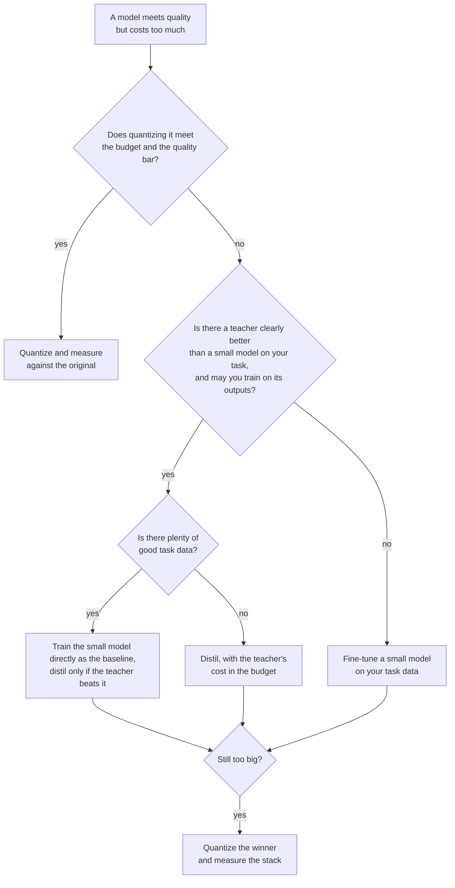

# Leçon 24. Distiller, quantifier ou faire du fine-tuning

**Lien avec la mission :** La mission s'achève sur le choix entre distiller, quantifier et entraîner directement un petit modèle pour une tâche et un budget donnés. La distillation est l'une des trois manières d'obtenir un modèle moins cher, et les deux autres sont souvent le meilleur premier geste, cette leçon est donc la décision et les preuves derrière chaque branche.
**Source primaire :** [Article : "Distillation Scaling Laws", Busbridge et al., 2025](https://arxiv.org/abs/2502.08606), résumé et section 1
**Prérequis :** [Leçon 20](0020-choosing-student-size.md), [Leçon 21](0021-data-volume-and-teacher-cost.md), [Distillation](../GLOSSARY.md), [Élève](../GLOSSARY.md), [Enseignant](../GLOSSARY.md)

## Échauffement

1. ▢ La leçon 2 a dit que les soft targets portent plus de signal qu'un hard label. Nommez ce qu'est le signal supplémentaire, en une phrase.

<details markdown="1"><summary>Vérifier</summary>

Les [soft targets](../GLOSSARY.md) donnent une probabilité à chaque mauvaise réponse autant qu'à la bonne, si bien qu'elles montrent quelles mauvaises réponses sont presque justes et lesquelles sont très loin. Un [hard label](../GLOSSARY.md) met tout sur une seule réponse et ne dit rien du reste.

</details>

2. ▢ La leçon 9 a comparé la distillation au niveau du token et au niveau de la séquence. Que doit exposer l'enseignant pour chacune ?

<details markdown="1"><summary>Vérifier</summary>

La [distillation au niveau du token](../GLOSSARY.md) a besoin des distributions par token de l'enseignant, donc de l'accès à ses logits et d'un vocabulaire partagé. La [distillation au niveau de la séquence](../GLOSSARY.md) n'a besoin que du texte que l'enseignant a décodé, ce que fournit une API hébergée.

</details>

3. ▢ La leçon 21 a dit de compter l'inférence de l'enseignant dans le budget. Pourquoi cela change-t-il une comparaison avec l'entraînement direct de l'élève ?

<details markdown="1"><summary>Vérifier</summary>

Les passes avant de l'enseignant sur les données de distillation sont du calcul que le run direct ne dépense jamais. Une comparaison qui ne compte que les pas d'entraînement de l'élève flatte la distillation, et l'écart peut être grand quand l'enseignant est bien plus gros que l'élève.

</details>

## À savoir

### Trois leviers, trois coûts

Vous avez un modèle qui fait la tâche mais coûte trop cher à exécuter. Trois leviers réduisent le coût, et chacun abandonne quelque chose.

| Levier | Ce qui change | Ce qu'il exige | Ce qu'il risque |
|---|---|---|---|
| Quantifier | Moins de bits par poids, mêmes paramètres | Au plus un jeu de calibration, pas d'enseignant | Dérive de précision et réponses inversées, voir le [parcours de quantification](../../quantization/) |
| Distiller | Moins de paramètres, entraînés à imiter un enseignant | Un enseignant que vous avez le droit d'utiliser, des données, du calcul d'entraînement | Un élève qui copie le style plus vite que la capacité (leçon 18) |
| Fine-tuning d'un petit modèle | Moins de paramètres, entraînés sur les seules données de la tâche | De bonnes données de tâche, du calcul d'entraînement | Un petit modèle qui ne voit jamais ce que sait un plus grand |

La quantification est la moins chère à essayer. La quantification post-entraînement n'exige aucun run d'entraînement, c'est donc la première question quand le modèle tient presque. Le parcours de quantification garde sa propre [liste de contrôle de relecture d'une quantification](../../quantization/reference/quantization-review-checklist.md) pour cette branche, y compris la règle de rester en bf16 quand cela tient déjà dans le budget.

Les deux autres partent toutes deux d'une architecture plus petite. Elles diffèrent par ce dont apprend le petit modèle : les sorties de l'enseignant, ou vos données de tâche.

### Quand la distillation bat l'entraînement direct de l'élève

Busbridge et al. ajustent une loi d'échelle pour l'entropie croisée d'un élève distillé, avec des modèles de langage entraînés sur le sous-ensemble anglais de C4 (section 4.1). Deux résultats de leur résumé et de la section 1 se transposent à cette décision.

D'abord, la distillation n'aide qu'à l'intérieur d'un budget. Ils rapportent que la distillation ne peut pas produire une entropie croisée plus basse que l'apprentissage supervisé quand les deux disposent d'assez de données ou de calcul, et que la distillation n'est plus efficace que tant que le calcul ou les tokens de l'élève restent sous un seuil qui dépend de la taille de l'élève (section 1).

Ensuite, l'enseignant doit être gratuit ou partagé. Dans leur résumé : avec un enseignant existant, ou de nombreux élèves à distiller, la distillation surpasse l'apprentissage supervisé jusqu'à un niveau de calcul qui croît avec la taille de l'élève. Si un seul élève est voulu et qu'un enseignant doit aussi être entraîné, l'apprentissage supervisé est généralement préférable.

Lisez la portée. C'est un résultat de pré-entraînement sur un jeu de données, mesuré en entropie croisée. L'appliquer au fine-tuning pour une tâche de produit est une inférence, pas quelque chose que l'article a testé. La direction de l'inférence est la partie utile : beaucoup de bonnes données de tâche et pas d'enseignant gratuit orientent vers l'entraînement direct du petit modèle.

### Des preuves que distiller gagne, et ce qu'elles ne montrent pas

DeepSeek-AI a comparé deux façons d'obtenir un solide modèle de raisonnement de 32B à partir du même base model, Qwen2.5-32B ([article](https://arxiv.org/abs/2501.12948), annexe F.1, tableau 16). L'une était du RL à grande échelle sur le base model pendant plus de 10K pas, Qwen2.5-32B-Zero. L'autre était du fine-tuning supervisé sur 800,000 échantillons générés par DeepSeek-R1.

| Modèle | AIME 2024 pass@1 | AIME 2024 cons@64 | MATH-500 | GPQA Diamond | LiveCodeBench |
|---|---|---|---|---|---|
| Qwen2.5-32B-Zero (RL) | 47.0 | 60.0 | 91.6 | 55.0 | 40.2 |
| DeepSeek-R1-Distill-Qwen-32B | 72.6 | 83.3 | 94.3 | 62.1 | 57.2 |

Le modèle distillé mène sur chaque colonne, de 25.6 points sur AIME 2024 pass@1 et de 2.7 points sur MATH-500. Les auteurs concluent que le RL du petit modèle exige bien plus de calcul et pourrait ne pas égaler la distillation. Ce que le tableau ne montre pas, c'est un troisième bras : un élève affiné sur des solutions écrites par des humains. L'article dit bien séparément que les modèles distillés à partir de sorties d'enseignant de haute qualité surpassent systématiquement ceux entraînés directement sur des données générées par des humains, et cite Busbridge et al. pour cela (annexe F).

L'élagage s'associe à la distillation pour réduire le coût d'obtention d'un petit modèle. Muralidharan et al. (Minitron, [article](https://arxiv.org/abs/2407.14679)) rapportent que dériver les modèles 8B et 4B d'un modèle de 15B entraîné a pris jusqu'à 40 fois moins de tokens d'entraînement par modèle qu'un entraînement de zéro, ce qui a économisé 1.8 fois le calcul pour toute la famille 15B, 8B et 4B. Pour un modèle de 4B à calcul égal (tableau 11), élaguer le 15B et distiller a atteint 51.04 sur HellaSwag et 37.81 sur MMLU après 100B tokens, contre 46.22 et 24.36 pour l'initialisation aléatoire après 150B tokens. C'est une famille, un enseignant, et un modèle de 15B pré-entraîné qu'ils possédaient déjà.

### Ils se combinent

Les leviers s'empilent. Un élève distillé peut être quantifié ensuite, et les modèles élagués de Minitron sont distillés, donc l'élagage et la distillation se combinent déjà. Les erreurs s'empilent aussi : un élève qui a perdu deux points à la distillation et deux de plus à des poids en 4 bits doit être mesuré comme l'empilement, pas comme deux nombres séparés. Mesurez l'artefact final par rapport au modèle d'origine (leçon 23).



## Pratique

1. ▢ Un modèle de 70B atteint la barre de qualité et doit être servi depuis un seul GPU de 80 Go. Il n'y a ni données d'entraînement ni budget d'entraînement. Que tentez-vous en premier ?

    - a) Quantifier les poids et mesurer la qualité
    - b) Distiller dans un modèle élève plus petit
    - c) Faire directement le fine-tuning d'un petit modèle
    - d) Pré-entraîner un nouveau modèle de zéro

<details markdown="1"><summary>Vérifier</summary>

**a)** La quantification post-entraînement n'exige ni enseignant, ni données de tâche, ni run d'entraînement. Les poids seuls font environ 35 Go en 4 bits (70 milliards fois un demi-octet) contre 140 Go en bf16, avant les échelles et le KV cache, donc le levier peut plausiblement convenir. (b) et (c) exigent des données et du calcul d'entraînement que vous n'avez pas. (d) en exige bien plus des deux.

</details>

2. ▢ Les FLOPs par pas de Minitron pour les modèles 15B, 8B et 4B sont 4.4e17, 2.5e17 et 1.2e17. Entraîner les trois de zéro coûte la somme. N'entraîner que le 15B et dériver les deux autres avec 40 fois moins de tokens coûte le 15B plus chacun des autres divisé par 40. Prédisez l'économie, puis exécutez.

    ```python
    full = 4.4e17 + 2.5e17 + 1.2e17
    derived = 4.4e17 + 2.5e17 / 40 + 1.2e17 / 40
    print(f"{full / derived:.2f}")
    ```

<details markdown="1"><summary>Indice</summary>

Le modèle de 15B est entraîné en entier dans les deux cas, donc l'essentiel du coût demeure.

</details>

<details markdown="1"><summary>Vérifier</summary>

Il affiche `1.80`, les 1.8 fois de l'article. L'économie paraît faible à côté des 40 fois parce que le modèle de 15B domine le coût de la famille, et qu'il est payé en entier. L'article suppose les mêmes tokens, pas et taille de batch pour chaque modèle, donc les 1.8 valent pour cette hypothèse.

</details>

3. ▢ D'après le tableau 16 ci-dessus, un collègue dit « la distillation bat le RL pour les petits modèles ». Que soutient le tableau, et que laisse-t-il ouvert ?

<details markdown="1"><summary>Vérifier</summary>

Il soutient une comparaison : sur Qwen2.5-32B, le SFT sur 800,000 échantillons de R1 a battu plus de 10K pas de RL sur des données de maths, de code et de STEM, sur chaque colonne. Il laisse ouvertes d'autres tailles de modèle, un run de RL plus long ou construit autrement, et une référence de SFT sur des données humaines. Il ne dit rien non plus du coût par point, que les auteurs ne décrivent qu'en mots.

</details>

4. ▢ Une équipe veut un seul modèle de 1B pour un seul produit. Le seul enseignant candidat devrait d'abord être entraîné, et l'équipe dispose d'un grand corpus de données de tâche. D'après Busbridge et al., dans quel sens penchent les preuves, et qu'est-ce qui limite l'affirmation ?

<details markdown="1"><summary>Vérifier</summary>

Vers l'entraînement supervisé du petit modèle : leur résumé dit qu'avec un seul élève et un enseignant qui exige aussi d'être entraîné, l'apprentissage supervisé est généralement préférable. La limite est la portée : c'est une loi d'échelle de pré-entraînement ajustée sur des modèles de langage sur C4, donc l'appliquer au fine-tuning sur une tâche de produit est une inférence que vous devriez tester avec un petit run des deux.

</details>

5. ▢ Votre seul enseignant solide est une API hébergée qui renvoie du texte et pas de logits, et vous prévoyez d'entraîner un modèle ouvert de 3B sur ses sorties. Quelles leçons décident si ce plan est possible et quelle loss il peut utiliser ?

<details markdown="1"><summary>Vérifier</summary>

La leçon 13 décide si vous en avez le droit : les conditions du fournisseur peuvent interdire d'utiliser les sorties pour construire un modèle concurrent, et la licence d'un modèle ouvert peut ajouter des conditions. Les leçons 6 et 9 décident comment : sans logits ni vocabulaire partagé, la [distillation de logits](../GLOSSARY.md) est exclue et l'élève s'entraîne avec une entropie croisée ordinaire sur du texte décodé, ce qui est le niveau de la séquence.

</details>

## Exercices en situation réelle

- [ ] Choisissez un modèle que votre équipe exécute et qui coûte trop cher et notez lequel des trois leviers vous essaieriez en premier et le nombre qui vous ferait passer au suivant.
- [ ] Ouvrez le tableau 16 de l'article DeepSeek-R1 et notez quel bras de comparaison manque pour votre propre décision, puis dites ce que coûterait son exécution.
- [ ] Demain : sans notes, dessinez le diagramme de décision de cette leçon et comparez-le à celui ci-dessus.

## Pour aller plus loin

- [Liste de contrôle de relecture d'une distillation](../reference/distillation-review-checklist.md)
- [Liste de contrôle de relecture d'une quantification](../../quantization/reference/quantization-review-checklist.md)
- [Article : "Distillation Scaling Laws", Busbridge et al., 2025](https://arxiv.org/abs/2502.08606)
- [Article : "DeepSeek-R1: Incentivizing Reasoning Capability in LLMs via Reinforcement Learning", DeepSeek-AI, 2025](https://arxiv.org/abs/2501.12948)
- [Article : "Compact Language Models via Pruning and Knowledge Distillation", Muralidharan et al., 2024](https://arxiv.org/abs/2407.14679)
- [Fine-tuning](../../finetuning/)
- [Ressources](../RESOURCES.md)

---

Ça ne passe pas ? Relisez la source primaire en haut de page, car cette leçon la condense et c'est dans la condensation que la compréhension s'échappe. Consultez le [glossaire](../GLOSSARY.md) pour tout terme qui vous a paru glissant.

Si c'est la leçon elle-même qui n'est pas claire plutôt que la matière, c'est un défaut : [ouvrez une issue](https://github.com/TokenCemetery/teach/issues).
