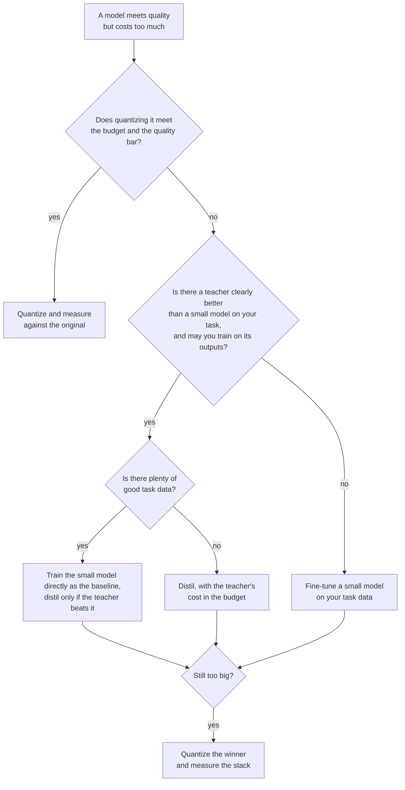

# पाठ 24. Distill करें, Quantize करें या Fine-Tune करें

**मिशन से संबंध:** मिशन इस पर ख़त्म होता है कि किसी दिए task और बजट के लिए distilling, quantizing और छोटे model को सीधे train करने में से चुनें। Distillation सस्ता model पाने के तीन तरीक़ों में से एक है, और बाक़ी दो अक्सर बेहतर पहली चाल होते हैं, इसलिए यह पाठ निर्णय और हर शाखा के पीछे का सबूत है।
**मुख्य स्रोत:** [पेपर: "Distillation Scaling Laws", Busbridge et al., 2025](https://arxiv.org/abs/2502.08606), abstract और section 1
**पूर्व-आवश्यकताएँ:** [पाठ 20](0020-choosing-student-size.md), [पाठ 21](0021-data-volume-and-teacher-cost.md), [Distillation](../GLOSSARY.md), [Student](../GLOSSARY.md), [Teacher](../GLOSSARY.md)

## वार्म-अप

1. ▢ पाठ 2 ने कहा कि soft targets में hard label से ज़्यादा signal होता है। अतिरिक्त signal क्या है, एक वाक्य में बताएँ।

<details markdown="1"><summary>जाँचें</summary>

[Soft targets](../GLOSSARY.md) हर ग़लत उत्तर को भी probability देते हैं, सही के साथ, इसलिए वे दिखाते हैं कि कौन-से ग़लत उत्तर लगभग सही हैं और कौन-से बहुत दूर। [Hard label](../GLOSSARY.md) सब कुछ एक उत्तर पर रख देता है और बाक़ी के बारे में कुछ नहीं कहता।

</details>

2. ▢ पाठ 9 ने token-level और sequence-level distillation की तुलना की। हर एक के लिए teacher को क्या उपलब्ध कराना होगा?

<details markdown="1"><summary>जाँचें</summary>

[Token-level distillation](../GLOSSARY.md) को teacher के प्रति-token distributions चाहिए, यानी उसके logits तक पहुँच और साझा vocabulary। [Sequence-level distillation](../GLOSSARY.md) को सिर्फ़ वह text चाहिए जो teacher ने decode किया, जो hosted API देती है।

</details>

3. ▢ पाठ 21 ने कहा कि बजट में teacher के inference को गिनें। इससे student को सीधे train करने से तुलना क्यों बदल जाती है?

<details markdown="1"><summary>जाँचें</summary>

Distillation data पर teacher के forward passes वह compute हैं जो सीधा run कभी ख़र्च नहीं करता। जो तुलना सिर्फ़ student के training steps गिनती है वह distillation को बढ़ाकर दिखाती है, और जब teacher student से बहुत बड़ा हो तो फ़ासला बड़ा हो सकता है।

</details>

## यह जानें

### तीन लीवर, तीन लागतें

आपके पास ऐसा model है जो task करता है पर चलाने में बहुत महँगा है। तीन लीवर लागत घटाते हैं, और हर एक कुछ छोड़ता है।

| लीवर | क्या बदलता है | क्या चाहिए | किसका जोखिम |
|---|---|---|---|
| Quantize | प्रति weight कम bits, वही parameters | ज़्यादा से ज़्यादा एक calibration set, कोई teacher नहीं | Accuracy का खिसकना और पलटे हुए उत्तर, [Quantization ट्रैक](../../quantization/) देखें |
| Distill | कम parameters, teacher की नक़ल के लिए train किए | ऐसा teacher जिसे आप इस्तेमाल कर सकें, data, training compute | ऐसा student जो क्षमता से तेज़ style नक़ल करता है (पाठ 18) |
| छोटा fine-tune करें | कम parameters, सिर्फ़ task data पर train किए | अच्छा task data, training compute | ऐसा छोटा model जो कभी नहीं देखता कि बड़ा क्या जानता है |

Quantization आज़माने में सबसे सस्ता है। Post-training quantization को training run नहीं चाहिए, इसलिए जब model लगभग फ़िट हो तब वही पहला सवाल है। Quantization track उस शाखा के लिए अपनी [Quantization Review Checklist शीट](../../quantization/reference/quantization-review-checklist.md) रखता है, जिसमें यह नियम भी है कि जब bf16 पहले से बजट में फ़िट हो तो उसी में रहें।

बाक़ी दोनों छोटी architecture से शुरू होते हैं। वे इसमें अलग हैं कि छोटा model किससे सीखता है: teacher के outputs से, या आपके task data से।

### Distillation, student को सीधे train करने से कब बेहतर है

Busbridge et al. distilled student की cross-entropy के लिए scaling law fit करते हैं, C4 के अंग्रेज़ी उपसमुच्चय पर train हुए language models का इस्तेमाल करके (section 4.1)। उनके abstract और section 1 के दो नतीजे इस निर्णय पर लागू होते हैं।

पहला, distillation सिर्फ़ एक बजट के भीतर मदद करता है। वे बताते हैं कि जब दोनों को पर्याप्त data या compute दिया जाए तो distillation, supervised learning से कम cross-entropy नहीं दे सकता, और distillation तभी तक ज़्यादा कुशल है जब तक student का compute या tokens उस threshold से नीचे रहें जो student के आकार पर निर्भर है (section 1)।

दूसरा, teacher मुफ़्त या साझा होना चाहिए। उनके abstract में: मौजूदा teacher के साथ, या distil करने के लिए कई students के साथ, distillation एक ऐसे compute स्तर तक supervised learning से बेहतर करता है जो student के आकार के साथ बढ़ता है। अगर सिर्फ़ एक student चाहिए और teacher को भी train करना पड़े, तो supervised learning आम तौर पर बेहतर है।

दायरा पढ़ें। यह एक dataset पर pretraining का नतीजा है, cross-entropy में मापा हुआ। इसे product task के लिए fine-tuning पर लागू करना अनुमान है, ऐसी चीज़ नहीं जिसे पेपर ने परखा। अनुमान की दिशा ही उपयोगी हिस्सा है: बहुत सारा अच्छा task data और कोई मुफ़्त teacher नहीं, छोटे model को सीधे train करने की ओर इशारा करता है।

### सबूत कि distilling जीतता है, और वह क्या नहीं दिखाता

DeepSeek-AI ने उसी base, Qwen2.5-32B, से मज़बूत 32B reasoning model पाने के दो तरीक़ों की तुलना की ([पेपर](https://arxiv.org/abs/2501.12948), appendix F.1, Table 16)। एक था base पर 10K से ज़्यादा steps के लिए बड़े पैमाने का RL, Qwen2.5-32B-Zero। दूसरा था DeepSeek-R1 द्वारा generate किए 800,000 samples पर supervised fine-tuning।

| Model | AIME 2024 pass@1 | AIME 2024 cons@64 | MATH-500 | GPQA Diamond | LiveCodeBench |
|---|---|---|---|---|---|
| Qwen2.5-32B-Zero (RL) | 47.0 | 60.0 | 91.6 | 55.0 | 40.2 |
| DeepSeek-R1-Distill-Qwen-32B | 72.6 | 83.3 | 94.3 | 62.1 | 57.2 |

Distilled model हर column पर आगे है, AIME 2024 pass@1 पर 25.6 अंक से और MATH-500 पर 2.7 अंक से। लेखक निष्कर्ष निकालते हैं कि छोटे model के RL को कहीं ज़्यादा compute चाहिए और वह distillation की बराबरी न कर पाए। तालिका जो नहीं दिखाती वह तीसरी arm है: मानव-लिखित हलों पर fine-tune किया student। पेपर अलग से कहता है कि उच्च-गुणवत्ता वाले teacher outputs से distil हुए models सीधे मानव-generated data पर train हुए models से लगातार बेहतर करते हैं, और इसके लिए Busbridge et al. का हवाला देता है (appendix F)।

Pruning, छोटा model पाने की लागत घटाने के लिए distillation के साथ जोड़ी बनाती है। Muralidharan et al. (Minitron, [पेपर](https://arxiv.org/abs/2407.14679)) बताते हैं कि train किए हुए 15B model से 8B और 4B models निकालने में हर model के लिए शून्य से training की तुलना में 40 गुना तक कम training tokens लगे, जिससे पूरे 15B, 8B और 4B परिवार के लिए 1.8 गुना compute बचा। बराबर compute पर 4B model के लिए (Table 11), 15B को prune करके distil करने से 100B tokens के बाद HellaSwag पर 51.04 और MMLU पर 37.81 मिला, जबकि random initialization से 150B tokens के बाद 46.22 और 24.36 मिला। यह एक परिवार है, एक teacher, और एक pretrained 15B model जो उनके पास पहले से था।

### वे जुड़ते हैं

लीवर आपस में जुड़ते हैं। Distilled student को बाद में quantize किया जा सकता है, और Minitron के pruned models distilled हैं, इसलिए pruning और distillation पहले से जुड़ते हैं। ग़लतियाँ भी जुड़ती हैं: जिस student ने distillation में दो अंक खोए और 4-bit weights में दो और, उसे दो अलग संख्याओं की तरह नहीं, पूरे जोड़ की तरह मापना होगा। अंतिम artifact को मूल model के विरुद्ध मापें (पाठ 23)।



## अभ्यास

1. ▢ 70B model गुणवत्ता की सीमा पूरी करता है और उसे एक 80 GB GPU से serve करना है। कोई training data नहीं है और कोई training बजट नहीं। आप पहले क्या आज़माते हैं?

    - a) Weights को quantize करें और गुणवत्ता मापें
    - b) छोटे student model में distil करें
    - c) छोटे model को सीधे fine-tune करें
    - d) शून्य से नया model pretrain करें

<details markdown="1"><summary>जाँचें</summary>

**a)** Post-training quantization को teacher, task data या training run नहीं चाहिए। अकेले weights 4 bits पर लगभग 35 GB हैं (70 अरब गुणा आधा byte), bf16 में 140 GB के मुक़ाबले, scales और KV cache से पहले, इसलिए लीवर संभवतः फ़िट हो सकता है। (b) और (c) को वह data और training compute चाहिए जो आपके पास नहीं है। (d) को दोनों बहुत ज़्यादा चाहिए।

</details>

2. ▢ 15B, 8B और 4B models के लिए Minitron के प्रति-step FLOPs 4.4e17, 2.5e17 और 1.2e17 हैं। तीनों को शून्य से train करने की लागत उनका योग है। सिर्फ़ 15B को train करने और बाक़ी दो को 40 गुना कम tokens से निकालने की लागत 15B जमा हर दूसरे का 40 से भाग है। बचत का अनुमान लगाएँ, फिर चलाएँ।

    ```python
    full = 4.4e17 + 2.5e17 + 1.2e17
    derived = 4.4e17 + 2.5e17 / 40 + 1.2e17 / 40
    print(f"{full / derived:.2f}")
    ```

<details markdown="1"><summary>संकेत</summary>

15B model दोनों तरह से पूरा train होता है, इसलिए ज़्यादातर लागत बनी रहती है।

</details>

<details markdown="1"><summary>जाँचें</summary>

यह `1.80` print करता है, पेपर का 1.8 गुना। बचत 40 गुना के बग़ल में छोटी लगती है क्योंकि 15B model परिवार की लागत पर हावी है, और वह पूरी चुकाई जाती है। पेपर हर model के लिए बराबर tokens, steps और batch size मानता है, इसलिए 1.8 उसी मान्यता के लिए है।

</details>

3. ▢ ऊपर की Table 16 से, एक सहकर्मी कहता है "छोटे models के लिए distillation, RL को हराता है"। तालिका क्या समर्थन करती है, और क्या खुला छोड़ती है?

<details markdown="1"><summary>जाँचें</summary>

वह एक तुलना का समर्थन करती है: Qwen2.5-32B पर, 800,000 R1 samples पर SFT ने math, code और STEM data पर 10K-से-ज़्यादा steps के RL को हर column पर हराया। वह दूसरे model आकार, ज़्यादा लंबा या अलग तरह से बना RL run, और मानव data पर SFT का baseline खुला छोड़ती है। वह प्रति अंक लागत के बारे में भी कुछ नहीं कहती, जिसे लेखक सिर्फ़ शब्दों में बताते हैं।

</details>

4. ▢ एक टीम एक product के लिए एक 1B model चाहती है। एकमात्र उम्मीदवार teacher को पहले train करना होगा, और टीम के पास task data का बड़ा corpus है। Busbridge et al. के अनुसार सबूत किस ओर झुकता है, और दावे को क्या सीमित करता है?

<details markdown="1"><summary>जाँचें</summary>

छोटे model की supervised training की ओर: उनका abstract कहता है कि एक student और ऐसे teacher के साथ जिसे भी train करना पड़े, supervised learning आम तौर पर बेहतर है। सीमा दायरा है: यह C4 language models पर fit किया pretraining scaling law है, इसलिए इसे product task पर fine-tuning पर लागू करना अनुमान है जिसे आपको दोनों के छोटे run से परखना चाहिए।

</details>

5. ▢ आपका एकमात्र मज़बूत teacher hosted API है जो text लौटाती है और logits नहीं, और आप उसके outputs पर 3B open model को train करने की योजना बनाते हैं। कौन-से पाठ तय करते हैं कि योजना संभव है या नहीं और वह कौन-सा loss इस्तेमाल कर सकती है?

<details markdown="1"><summary>जाँचें</summary>

पाठ 13 तय करता है कि आप कर सकते हैं या नहीं: provider के terms प्रतिस्पर्धी model बनाने के लिए outputs इस्तेमाल करने की मनाही कर सकते हैं, और open model का license शर्तें जोड़ सकता है। पाठ 6 और 9 तय करते हैं कि कैसे: logits और साझा vocabulary के बिना [logit distillation](../GLOSSARY.md) बाहर है और student decode किए text पर साधारण cross-entropy से train होता है, जो sequence-level है।

</details>

## असली दुनिया का अभ्यास

- [ ] अपनी टीम का कोई ऐसा model चुनें जो बहुत महँगा चलता है और लिखें कि तीन लीवरों में से कौन-सा आप पहले आज़माएँगे और वह संख्या जो आपको अगले पर जाने को मजबूर करेगी।
- [ ] DeepSeek-R1 पेपर की Table 16 खोलें और लिखें कि आपके अपने निर्णय के लिए कौन-सी तुलना arm ग़ायब है, फिर बताएँ कि उसे चलाने में क्या लगेगा।
- [ ] कल: बिना नोट्स के इस पाठ का निर्णय आरेख बनाएँ और उसे ऊपर वाले से मिलाएँ।

## आगे बढ़ने के लिए

- [Distillation Review Checklist शीट](../reference/distillation-review-checklist.md)
- [Quantization Review Checklist शीट](../../quantization/reference/quantization-review-checklist.md)
- [पेपर: "Distillation Scaling Laws", Busbridge et al., 2025](https://arxiv.org/abs/2502.08606)
- [पेपर: "DeepSeek-R1: Incentivizing Reasoning Capability in LLMs via Reinforcement Learning", DeepSeek-AI, 2025](https://arxiv.org/abs/2501.12948)
- [पेपर: "Compact Language Models via Pruning and Knowledge Distillation", Muralidharan et al., 2024](https://arxiv.org/abs/2407.14679)
- [Fine-tuning ट्रैक](../../finetuning/)
- [संसाधन](../RESOURCES.md)

---

बात नहीं बन रही? ऊपर दिए मुख्य स्रोत को दोबारा पढ़ें, क्योंकि यह पाठ उसे संक्षिप्त करता है और समझ संक्षेप में ही रिसती है। जो शब्द फिसलन भरा लगे, उसके लिए [शब्दावली](../GLOSSARY.md) देखें।

अगर दिक़्क़त सामग्री की नहीं बल्कि पाठ की ही है, तो वह एक खोट है: [issue खोलें](https://github.com/TokenCemetery/teach/issues)।
