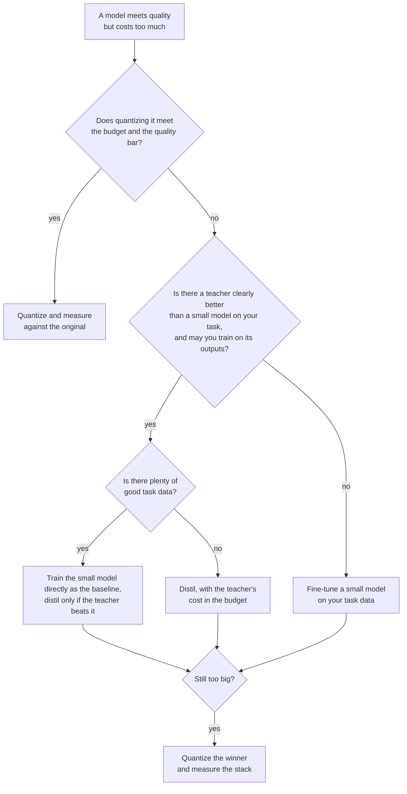

# Lesson 24. Distill, Quantize or Fine-Tune

**Mission link:** The mission ends with choosing between distilling, quantizing and training a small model directly for a given task and budget. Distillation is one of three ways to get a cheaper model, and the other two are often the better first move, so this lesson is the decision and the evidence behind each branch.
**Primary source:** [Paper: "Distillation Scaling Laws", Busbridge et al., 2025](https://arxiv.org/abs/2502.08606), abstract and section 1
**Prerequisites:** [Lesson 20](0020-choosing-student-size.md), [Lesson 21](0021-data-volume-and-teacher-cost.md), [Distillation](../GLOSSARY.md), [Student](../GLOSSARY.md), [Teacher](../GLOSSARY.md)

## Warm-up

1. ▢ Lesson 2 said soft targets carry more signal than a hard label. Name what the extra signal is, in one sentence.

<details markdown="1"><summary>Check</summary>

The [soft targets](../GLOSSARY.md) give a probability to every wrong answer as well as the right one, so they show which wrong answers are nearly right and which are far off. A [hard label](../GLOSSARY.md) puts everything on one answer and says nothing about the rest.

</details>

2. ▢ Lesson 9 compared token-level and sequence-level distillation. What does the teacher have to expose for each?

<details markdown="1"><summary>Check</summary>

[Token-level distillation](../GLOSSARY.md) needs the teacher's per-token distributions, so access to its logits and a shared vocabulary. [Sequence-level distillation](../GLOSSARY.md) needs only text the teacher decoded, which a hosted API provides.

</details>

3. ▢ Lesson 21 said to count the teacher's inference in the budget. Why does that change a comparison with training the student directly?

<details markdown="1"><summary>Check</summary>

The teacher's forward passes over the distillation data are compute the direct run never spends. A comparison that counts only the student's training steps flatters distillation, and the gap can be large when the teacher is much bigger than the student.

</details>

## Know this

### Three levers, three costs

You have a model that does the task but costs too much to run. Three levers shrink the cost, and each gives something up.

| Lever | What changes | Needs | What it risks |
|---|---|---|---|
| Quantize | Fewer bits per weight, same parameters | A calibration set at most, no teacher | Accuracy drift and flipped answers, see the [quantization track](../../quantization/) |
| Distill | Fewer parameters, trained to imitate a teacher | A teacher you may use, data, training compute | A student that copies style faster than capability (lesson 18) |
| Fine-tune small | Fewer parameters, trained on task data alone | Good task data, training compute | A small model that never sees what a larger one knows |

Quantization is the cheapest to try. Post-training quantization needs no training run, so it is the first question when the model nearly fits. The quantization track keeps its own [review checklist](../../quantization/reference/quantization-review-checklist.md) for that branch, including the rule to stay in bf16 when it already fits the budget.

The other two both start from a smaller architecture. They differ in what the small model learns from: the teacher's outputs, or your task data.

### When distillation beats training the student directly

Busbridge et al. fit a scaling law for the cross-entropy of a distilled student, using language models trained on the English subset of C4 (section 4.1). Two results from their abstract and section 1 carry over to this decision.

First, distillation helps only inside a budget. They report that distillation cannot produce lower cross-entropy than supervised learning when both are given enough data or compute, and that distillation is more efficient only while the student's compute or tokens stay below a threshold that depends on student size (section 1).

Second, the teacher has to be free or shared. In their abstract: with an existing teacher, or many students to distil, distillation outperforms supervised learning up to a compute level that scales with student size. If only one student is wanted and a teacher also has to be trained, supervised learning is generally preferable.

Read the scope. This is a pretraining result on one dataset, measured in cross-entropy. Applying it to fine-tuning for a product task is an inference, not something the paper tested. The direction of the inference is the useful part: plenty of good task data and no free teacher points to training the small model directly.

### Evidence that distilling wins, with what it does not show

DeepSeek-AI compared two ways to get a strong 32B reasoning model from the same base, Qwen2.5-32B ([paper](https://arxiv.org/abs/2501.12948), appendix F.1, Table 16). One was large-scale RL on the base for over 10K steps, Qwen2.5-32B-Zero. The other was supervised fine-tuning on 800,000 samples generated by DeepSeek-R1.

| Model | AIME 2024 pass@1 | AIME 2024 cons@64 | MATH-500 | GPQA Diamond | LiveCodeBench |
|---|---|---|---|---|---|
| Qwen2.5-32B-Zero (RL) | 47.0 | 60.0 | 91.6 | 55.0 | 40.2 |
| DeepSeek-R1-Distill-Qwen-32B | 72.6 | 83.3 | 94.3 | 62.1 | 57.2 |

The distilled model leads on every column, by 25.6 points on AIME 2024 pass@1 and 2.7 points on MATH-500. The authors conclude that the small model's RL needs far more compute and may not match distillation. What the table does not show is a third arm: a student fine-tuned on human-written solutions. The paper does say separately that models distilled from high-quality teacher outputs consistently outperform those trained directly on human-generated data, and cites Busbridge et al. for it (appendix F).

Pruning pairs with distillation to cut the cost of getting a small model. Muralidharan et al. (Minitron, [paper](https://arxiv.org/abs/2407.14679)) report that deriving the 8B and 4B models from a trained 15B model took up to 40 times fewer training tokens per model than training from scratch, which saved 1.8 times the compute for the whole 15B, 8B and 4B family. For a 4B model at equal compute (Table 11), pruning the 15B and distilling reached 51.04 on HellaSwag and 37.81 on MMLU after 100B tokens, against 46.22 and 24.36 for random initialization after 150B tokens. That is one family, one teacher, and a pretrained 15B model they already owned.

### They combine

The levers stack. A distilled student can be quantized afterwards, and Minitron's pruned models are distilled, so pruning and distillation already combine. The errors also stack: a student that lost two points to distillation and two more to 4-bit weights has to be measured as the stack, not as two separate numbers. Measure the final artifact against the original model (lesson 23).



## Practice

1. ▢ A 70B model meets the quality bar and has to serve from one 80 GB GPU. There is no training data and no training budget. What do you try first?

    - a) Quantize the weights and measure quality
    - b) Distill into a smaller student model
    - c) Fine-tune a small model directly
    - d) Pretrain a new model from scratch

<details markdown="1"><summary>Check</summary>

**a)** Post-training quantization needs no teacher, no task data and no training run. The weights alone are about 35 GB at 4 bits (70 billion times half a byte) against 140 GB in bf16, before scales and the KV cache, so the lever can plausibly fit. (b) and (c) need data and training compute you do not have. (d) needs far more of both.

</details>

2. ▢ Minitron's per-step FLOPs for the 15B, 8B and 4B models are 4.4e17, 2.5e17 and 1.2e17. Training all three from scratch costs the sum. Training only the 15B and deriving the other two with 40 times fewer tokens costs the 15B plus each of the others divided by 40. Predict the saving, then run it.

    ```python
    full = 4.4e17 + 2.5e17 + 1.2e17
    derived = 4.4e17 + 2.5e17 / 40 + 1.2e17 / 40
    print(f"{full / derived:.2f}")
    ```

<details markdown="1"><summary>Hint</summary>

The 15B model is trained in full either way, so most of the cost remains.

</details>

<details markdown="1"><summary>Check</summary>

It prints `1.80`, the paper's 1.8 times. The saving looks small beside the 40 times because the 15B model dominates the family's cost, and it is paid in full. The paper assumes equal tokens, steps and batch size for each model, so the 1.8 is for that assumption.

</details>

3. ▢ From Table 16 above, a colleague says "distillation beats RL for small models". What does the table support, and what does it leave open?

<details markdown="1"><summary>Check</summary>

It supports one comparison: on Qwen2.5-32B, SFT on 800,000 R1 samples beat 10K-plus steps of RL on math, code and STEM data, on every column. It leaves open other model sizes, a longer or differently built RL run, and a baseline of SFT on human data. It also says nothing about cost per point, which the authors only describe in words.

</details>

4. ▢ A team wants one 1B model for one product. The only candidate teacher would have to be trained first, and the team has a large corpus of task data. According to Busbridge et al., which way does the evidence lean, and what limits the claim?

<details markdown="1"><summary>Check</summary>

Toward supervised training of the small model: their abstract says that with one student and a teacher that also requires training, supervised learning is generally preferable. The limit is scope: it is a pretraining scaling law fitted on C4 language models, so applying it to fine-tuning on a product task is an inference you should test with a small run of both.

</details>

5. ▢ Your only strong teacher is a hosted API that returns text and no logits, and you plan to train a 3B open model on its outputs. Which lessons decide whether that plan is possible and which loss it can use?

<details markdown="1"><summary>Check</summary>

Lesson 13 decides whether you may: the provider's terms can forbid using outputs to build a competing model, and an open model's license can add conditions. Lessons 6 and 9 decide how: without logits and a shared vocabulary, [logit distillation](../GLOSSARY.md) is out and the student trains with ordinary cross-entropy on decoded text, which is sequence-level.

</details>

## Real-world reps

- [ ] Pick a model your team runs that costs too much and write which of the three levers you would try first and the number that would make you move to the next one.
- [ ] Open Table 16 of the DeepSeek-R1 paper and write which comparison arm is missing for your own decision, then say what it would cost to run it.
- [ ] Tomorrow: without notes, draw the decision diagram from this lesson and check it against the one above.

## Going further

- [Distillation Review Checklist](../reference/distillation-review-checklist.md)
- [Quantization Review Checklist](../../quantization/reference/quantization-review-checklist.md)
- [Paper: "Distillation Scaling Laws", Busbridge et al., 2025](https://arxiv.org/abs/2502.08606)
- [Paper: "DeepSeek-R1: Incentivizing Reasoning Capability in LLMs via Reinforcement Learning", DeepSeek-AI, 2025](https://arxiv.org/abs/2501.12948)
- [Paper: "Compact Language Models via Pruning and Knowledge Distillation", Muralidharan et al., 2024](https://arxiv.org/abs/2407.14679)
- [Finetuning](../../finetuning/)
- [Resources](../RESOURCES.md)

---

Not landing? Reread the primary source at the top, since this lesson compresses it and compression is where understanding leaks. Check the [glossary](../GLOSSARY.md) for any term that felt slippery.

If the lesson itself is unclear rather than the material, that is a defect: [open an issue](https://github.com/TokenCemetery/teach/issues).
