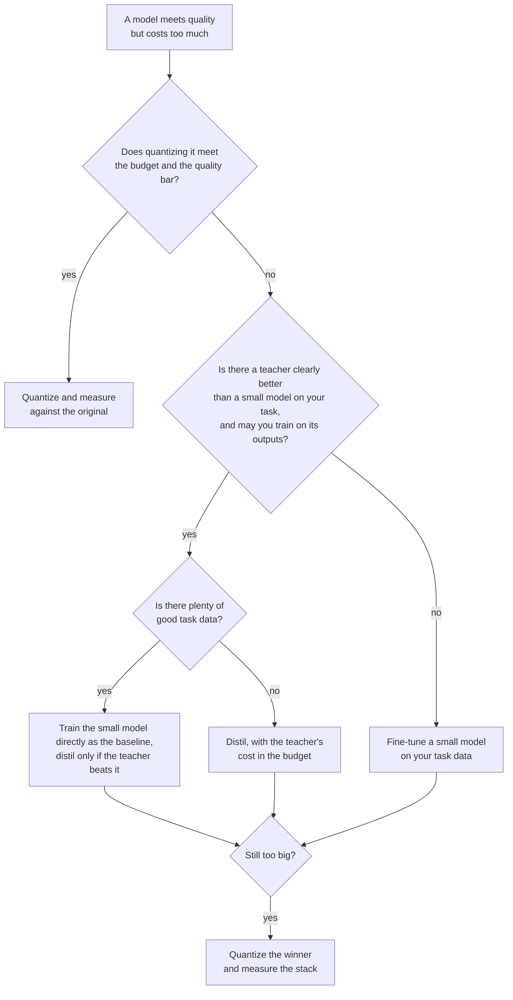

# Lição 24. Destilar, quantizar ou fazer fine-tuning

**Ligação com a missão:** A missão termina com a escolha entre destilar, quantizar e treinar diretamente um modelo pequeno para uma dada tarefa e um dado orçamento. A destilação é uma de três maneiras de obter um modelo mais barato, e as outras duas muitas vezes são o melhor primeiro movimento, então esta lição é a decisão e a evidência por trás de cada ramo.
**Fonte principal:** [Artigo científico: "Distillation Scaling Laws", Busbridge et al., 2025](https://arxiv.org/abs/2502.08606), resumo e seção 1
**Pré-requisitos:** [Lição 20](0020-choosing-student-size.md), [Lição 21](0021-data-volume-and-teacher-cost.md), [Destilação](../GLOSSARY.md), [Aluno](../GLOSSARY.md), [Professor](../GLOSSARY.md)

## Aquecimento

1. ▢ A lição 2 disse que os soft targets carregam mais sinal do que um hard label. Diga qual é o sinal extra, em uma frase.

<details markdown="1"><summary>Verificação</summary>

Os [soft targets](../GLOSSARY.md) dão uma probabilidade a toda resposta errada além da certa, então mostram quais respostas erradas são quase certas e quais estão longe. Um [hard label](../GLOSSARY.md) põe tudo em uma resposta e não diz nada sobre o resto.

</details>

2. ▢ A lição 9 comparou a destilação em nível de token e em nível de sequência. O que o professor precisa expor em cada uma?

<details markdown="1"><summary>Verificação</summary>

A [destilação em nível de token](../GLOSSARY.md) precisa das distribuições por token do professor, então de acesso aos seus logits e de um vocabulário compartilhado. A [destilação em nível de sequência](../GLOSSARY.md) precisa apenas de texto que o professor decodificou, o que uma API hospedada fornece.

</details>

3. ▢ A lição 21 disse para contar a inferência do professor no orçamento. Por que isso muda uma comparação com treinar o aluno diretamente?

<details markdown="1"><summary>Verificação</summary>

Os forward passes do professor sobre os dados de destilação são compute que a execução direta nunca gasta. Uma comparação que conta apenas os passos de treinamento do aluno favorece a destilação, e a diferença pode ser grande quando o professor é muito maior que o aluno.

</details>

## Saiba isto

### Três alavancas, três custos

Você tem um modelo que faz a tarefa mas custa caro demais para rodar. Três alavancas reduzem o custo, e cada uma abre mão de algo.

| Alavanca | O que muda | Precisa de | O que arrisca |
|---|---|---|---|
| Quantizar | Menos bits por peso, os mesmos parâmetros | No máximo um conjunto de calibração, nenhum professor | Deriva de acurácia e respostas invertidas, veja a trilha de [Quantização](../../quantization/) |
| Destilar | Menos parâmetros, treinados para imitar um professor | Um professor que você possa usar, dados, compute de treinamento | Um aluno que copia o estilo mais rápido do que a capacidade (lição 18) |
| Fine-tuning de um modelo pequeno | Menos parâmetros, treinados apenas em dados da tarefa | Bons dados da tarefa, compute de treinamento | Um modelo pequeno que nunca vê o que um maior sabe |

A quantização é a mais barata de tentar. A quantização pós-treinamento não exige uma execução de treinamento, então é a primeira pergunta quando o modelo quase cabe. A trilha de quantização mantém a sua própria [Checklist de Revisão de Quantização](../../quantization/reference/quantization-review-checklist.md) para esse ramo, incluindo a regra de ficar em bf16 quando ele já cabe no orçamento.

As outras duas começam ambas de uma arquitetura menor. Elas diferem no com o que o modelo pequeno aprende: as saídas do professor, ou os seus dados da tarefa.

### Quando a destilação supera treinar o aluno diretamente

Busbridge et al. ajustam uma lei de escala para a cross-entropy de um aluno destilado, usando modelos de linguagem treinados no subconjunto em inglês do C4 (seção 4.1). Dois resultados do resumo e da seção 1 deles se transpõem para esta decisão.

Primeiro, a destilação ajuda apenas dentro de um orçamento. Eles relatam que a destilação não consegue produzir uma cross-entropy menor do que o aprendizado supervisionado quando ambos recebem dados ou compute suficientes, e que a destilação é mais eficiente apenas enquanto o compute ou os tokens do aluno ficam abaixo de um limiar que depende do tamanho do aluno (seção 1).

Segundo, o professor precisa ser gratuito ou compartilhado. No resumo deles: com um professor existente, ou muitos alunos para destilar, a destilação supera o aprendizado supervisionado até um nível de compute que escala com o tamanho do aluno. Se apenas um aluno é desejado e um professor também precisa ser treinado, o aprendizado supervisionado geralmente é preferível.

Leia o escopo. Esse é um resultado de pré-treinamento em um dataset, medido em cross-entropy. Aplicá-lo ao fine-tuning para uma tarefa de produto é uma inferência, não algo que o artigo testou. A direção da inferência é a parte útil: muitos bons dados da tarefa e nenhum professor gratuito apontam para treinar o modelo pequeno diretamente.

### Evidência de que destilar vence, e o que ela não mostra

A DeepSeek-AI comparou duas maneiras de obter um modelo de raciocínio forte de 32B a partir da mesma base, o Qwen2.5-32B ([artigo](https://arxiv.org/abs/2501.12948), apêndice F.1, Tabela 16). Uma foi RL em larga escala na base por mais de 10K passos, o Qwen2.5-32B-Zero. A outra foi supervised fine-tuning em 800.000 amostras geradas pelo DeepSeek-R1.

| Modelo | AIME 2024 pass@1 | AIME 2024 cons@64 | MATH-500 | GPQA Diamond | LiveCodeBench |
|---|---|---|---|---|---|
| Qwen2.5-32B-Zero (RL) | 47,0 | 60,0 | 91,6 | 55,0 | 40,2 |
| DeepSeek-R1-Distill-Qwen-32B | 72,6 | 83,3 | 94,3 | 62,1 | 57,2 |

O modelo destilado lidera em todas as colunas, por 25,6 pontos no AIME 2024 pass@1 e 2,7 pontos no MATH-500. Os autores concluem que o RL do modelo pequeno precisa de muito mais compute e pode não igualar a destilação. O que a tabela não mostra é um terceiro braço: um aluno com fine-tuning em soluções escritas por humanos. O artigo diz separadamente que modelos destilados de saídas de professor de alta qualidade superam consistentemente os treinados diretamente em dados gerados por humanos, e cita Busbridge et al. para isso (apêndice F).

A poda se combina com a destilação para cortar o custo de obter um modelo pequeno. Muralidharan et al. (Minitron, [artigo](https://arxiv.org/abs/2407.14679)) relatam que derivar os modelos de 8B e 4B de um modelo treinado de 15B levou até 40 vezes menos tokens de treinamento por modelo do que treinar do zero, o que economizou 1,8 vez o compute para toda a família de 15B, 8B e 4B. Para um modelo de 4B com compute igual (Tabela 11), podar o de 15B e destilar chegou a 51,04 no HellaSwag e 37,81 no MMLU depois de 100B tokens, contra 46,22 e 24,36 para a inicialização aleatória depois de 150B tokens. Essa é uma família, um professor e um modelo de 15B pré-treinado que eles já possuíam.

### Elas se combinam

As alavancas se empilham. Um aluno destilado pode ser quantizado depois, e os modelos podados do Minitron são destilados, então a poda e a destilação já se combinam. Os erros também se empilham: um aluno que perdeu dois pontos para a destilação e mais dois para pesos de 4 bits precisa ser medido como a pilha, não como dois números separados. Meça o artefato final contra o modelo original (lição 23).



## Prática

1. ▢ Um modelo de 70B atinge a barra de qualidade e precisa ser servido de uma GPU de 80 GB. Não há dados de treinamento nem orçamento de treinamento. O que você tenta primeiro?

    - a) Quantizar os pesos e medir a qualidade
    - b) Destilar em um modelo aluno menor
    - c) Fazer fine-tuning direto de um modelo pequeno
    - d) Pré-treinar um novo modelo do zero

<details markdown="1"><summary>Verificação</summary>

**a)** A quantização pós-treinamento não precisa de professor, de dados da tarefa nem de uma execução de treinamento. Só os pesos ocupam cerca de 35 GB em 4 bits (70 bilhões vezes meio byte) contra 140 GB em bf16, antes das escalas e do KV cache, então a alavanca plausivelmente cabe. (b) e (c) precisam de dados e compute de treinamento que você não tem. (d) precisa de muito mais dos dois.

</details>

2. ▢ Os FLOPs por passo do Minitron para os modelos de 15B, 8B e 4B são 4.4e17, 2.5e17 e 1.2e17. Treinar os três do zero custa a soma. Treinar apenas o de 15B e derivar os outros dois com 40 vezes menos tokens custa o de 15B mais cada um dos outros dividido por 40. Preveja a economia e depois rode.

    ```python
    full = 4.4e17 + 2.5e17 + 1.2e17
    derived = 4.4e17 + 2.5e17 / 40 + 1.2e17 / 40
    print(f"{full / derived:.2f}")
    ```

<details markdown="1"><summary>Dica</summary>

O modelo de 15B é treinado por inteiro de qualquer jeito, então a maior parte do custo permanece.

</details>

<details markdown="1"><summary>Verificação</summary>

Imprime `1.80`, o 1,8 vez do artigo. A economia parece pequena ao lado das 40 vezes porque o modelo de 15B domina o custo da família, e ele é pago por inteiro. O artigo assume o mesmo número de tokens, passos e tamanho de batch para cada modelo, então o 1,8 é para essa suposição.

</details>

3. ▢ Pela Tabela 16 acima, um colega diz "a destilação supera o RL para modelos pequenos". O que a tabela sustenta, e o que ela deixa em aberto?

<details markdown="1"><summary>Verificação</summary>

Ela sustenta uma comparação: no Qwen2.5-32B, o SFT em 800.000 amostras do R1 superou mais de 10K passos de RL em dados de matemática, código e STEM, em todas as colunas. Ela deixa em aberto outros tamanhos de modelo, uma execução de RL mais longa ou construída de outro modo e um baseline de SFT em dados humanos. Ela também não diz nada sobre custo por ponto, que os autores só descrevem em palavras.

</details>

4. ▢ Uma equipe quer um modelo de 1B para um produto. O único professor candidato teria de ser treinado primeiro, e a equipe tem um grande corpus de dados da tarefa. Segundo Busbridge et al., para que lado a evidência pende, e o que limita a alegação?

<details markdown="1"><summary>Verificação</summary>

Para o treinamento supervisionado do modelo pequeno: o resumo deles diz que, com um aluno e um professor que também exige treinamento, o aprendizado supervisionado geralmente é preferível. O limite é o escopo: é uma lei de escala de pré-treinamento ajustada em modelos de linguagem no C4, então aplicá-la ao fine-tuning em uma tarefa de produto é uma inferência que você deve testar com uma execução pequena de ambos.

</details>

5. ▢ O seu único professor forte é uma API hospedada que devolve texto e nenhum logit, e você planeja treinar um modelo aberto de 3B nas suas saídas. Quais lições decidem se esse plano é possível e qual loss ele pode usar?

<details markdown="1"><summary>Verificação</summary>

A lição 13 decide se você pode: os termos do provedor podem proibir usar saídas para construir um modelo concorrente, e a licença de um modelo aberto pode acrescentar condições. As lições 6 e 9 decidem como: sem logits e um vocabulário compartilhado, a [destilação de logits](../GLOSSARY.md) está fora e o aluno treina com cross-entropy comum em texto decodificado, que é em nível de sequência.

</details>

## Prática no mundo real

- [ ] Escolha um modelo que a sua equipe roda e que custa caro demais e escreva qual das três alavancas você tentaria primeiro e o número que o faria passar para a próxima.
- [ ] Abra a Tabela 16 do artigo do DeepSeek-R1 e escreva qual braço de comparação falta para a sua própria decisão, e depois diga quanto custaria rodá-lo.
- [ ] Amanhã: sem consultar anotações, desenhe o diagrama de decisão desta lição e confira-o contra o de cima.

## Para ir além

- [Checklist de Revisão de Destilação](../reference/distillation-review-checklist.md)
- [Checklist de Revisão de Quantização](../../quantization/reference/quantization-review-checklist.md)
- [Artigo científico: "Distillation Scaling Laws", Busbridge et al., 2025](https://arxiv.org/abs/2502.08606)
- [Artigo científico: "DeepSeek-R1: Incentivizing Reasoning Capability in LLMs via Reinforcement Learning", DeepSeek-AI, 2025](https://arxiv.org/abs/2501.12948)
- [Artigo científico: "Compact Language Models via Pruning and Knowledge Distillation", Muralidharan et al., 2024](https://arxiv.org/abs/2407.14679)
- [Fine-Tuning com Adapters](../../finetuning/)
- [Recursos](../RESOURCES.md)

---

Não ficou claro? Releia a fonte principal no topo, já que esta lição a comprime e é na compressão que o entendimento escapa. Consulte o [glossário](../GLOSSARY.md) para qualquer termo que pareceu escorregadio.

Se o problema é a lição em si, e não o material, isso é um defeito: [abra uma issue](https://github.com/TokenCemetery/teach/issues).
