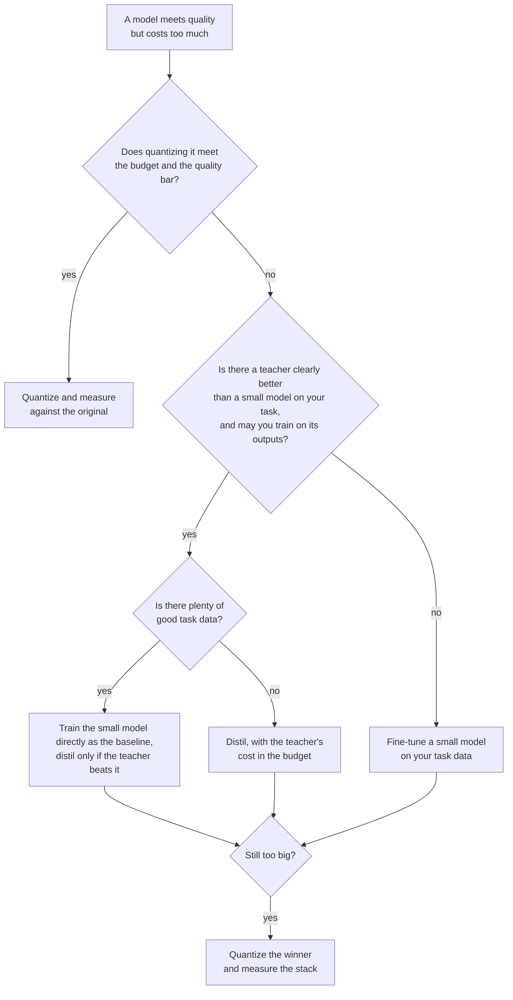

# Урок 24. Дистиллировать, квантизовать или дообучать

**Связь с целью курса:** Курс заканчивается выбором между дистилляцией, квантизацией и прямым обучением маленькой модели для заданной задачи и бюджета. Дистилляция это один из трёх способов получить более дешёвую модель, а два других часто оказываются лучшим первым ходом, поэтому этот урок это решение и свидетельства за каждую ветку.
**Первоисточник:** [Научная статья: "Distillation Scaling Laws", Busbridge et al., 2025](https://arxiv.org/abs/2502.08606), аннотация и раздел 1
**Предварительные требования:** [Урок 20](0020-choosing-student-size.md), [Урок 21](0021-data-volume-and-teacher-cost.md), [дистилляция](../GLOSSARY.md), [ученик](../GLOSSARY.md), [учитель](../GLOSSARY.md)

## Разминка

1. ▢ Урок 2 сказал, что мягкие метки несут больше сигнала, чем жёсткая метка. Назовите, что представляет собой этот дополнительный сигнал, одним предложением.

<details markdown="1"><summary>Проверка</summary>

[Мягкие метки](../GLOSSARY.md) дают вероятность каждому неверному ответу, как и правильному, так что показывают, какие неверные ответы почти верны, а какие далеки от цели. [Жёсткая метка](../GLOSSARY.md) ставит всё на один ответ и ничего не говорит об остальных.

</details>

2. ▢ Урок 9 сравнивал дистилляцию на уровне токенов и на уровне последовательностей. Что должен открывать учитель для каждой?

<details markdown="1"><summary>Проверка</summary>

[Дистилляции на уровне токенов](../GLOSSARY.md) нужны распределения учителя по токенам, то есть доступ к его логитам и общий словарь. [Дистилляции на уровне последовательностей](../GLOSSARY.md) нужен только декодированный учителем текст, который даёт размещённый API.

</details>

3. ▢ Урок 21 сказал учитывать инференс учителя в бюджете. Почему это меняет сравнение с прямым обучением ученика?

<details markdown="1"><summary>Проверка</summary>

Прямые проходы учителя по данным для дистилляции это вычисления, которых прямой запуск никогда не тратит. Сравнение, считающее только шаги обучения ученика, льстит дистилляции, и разрыв может быть большим, когда учитель намного больше ученика.

</details>

## Что нужно знать

### Три рычага, три цены

У вас есть модель, которая решает задачу, но слишком дорого стоит в запуске. Три рычага снижают стоимость, и каждый чем-то жертвует.

| Рычаг | Что меняется | Что нужно | Чем рискует |
|---|---|---|---|
| Квантизовать | Меньше бит на вес, те же параметры | Максимум калибровочный набор, учитель не нужен | Дрейф точности и перевёрнутые ответы, см. курс [Квантизация](../../quantization/) |
| Дистиллировать | Меньше параметров, обучены имитировать учителя | Учитель, которого вам можно использовать, данные, вычисления для обучения | Ученик, который копирует стиль быстрее, чем возможности (урок 18) |
| Дообучить малую модель | Меньше параметров, обучены только на данных задачи | Хорошие данные задачи, вычисления для обучения | Малая модель, которая никогда не видит того, что знает большая |

Квантизацию попробовать дешевле всего. Посттренировочной квантизации не нужен запуск обучения, так что это первый вопрос, когда модель почти помещается. У курса по квантизации есть собственный [Чек-лист ревью квантизации](../../quantization/reference/quantization-review-checklist.md) для этой ветки, включая правило оставаться в bf16, когда он уже укладывается в бюджет.

Два других оба начинают с меньшей архитектуры. Они различаются тем, на чём учится малая модель: на выходах учителя или на ваших данных задачи.

### Когда дистилляция лучше прямого обучения ученика

Busbridge и соавторы подгоняют закон масштабирования для кросс-энтропии дистиллированного ученика, используя языковые модели, обученные на английском подмножестве C4 (раздел 4.1). Два результата из их аннотации и раздела 1 переносятся на это решение.

Во-первых, дистилляция помогает только внутри бюджета. Они сообщают, что дистилляция не может дать меньшую кросс-энтропию, чем контролируемое обучение, когда обоим дано достаточно данных или вычислений, и что дистилляция эффективнее лишь пока вычисления или токены ученика остаются ниже порога, зависящего от размера ученика (раздел 1).

Во-вторых, учитель должен быть бесплатным или общим. В их аннотации: при существующем учителе или многих учениках для дистилляции дистилляция превосходит контролируемое обучение вплоть до уровня вычислений, который масштабируется с размером ученика. Если нужен только один ученик и учителя тоже нужно обучать, контролируемое обучение, как правило, предпочтительнее.

Читайте область. Это результат предобучения на одном датасете, измеренный в кросс-энтропии. Применение его к дообучению для продуктовой задачи это вывод, а не то, что проверяла статья. Полезна именно направленность вывода: много хороших данных задачи и отсутствие бесплатного учителя указывают на прямое обучение малой модели.

### Свидетельство в пользу дистилляции и чего оно не показывает

DeepSeek-AI сравнила два способа получить сильную рассуждающую модель на 32B из одной базы, Qwen2.5-32B ([статья](https://arxiv.org/abs/2501.12948), приложение F.1, таблица 16). Один это масштабное RL на базе более 10K шагов, Qwen2.5-32B-Zero. Другой это контролируемое дообучение на 800 000 сэмплов, сгенерированных DeepSeek-R1.

| Модель | AIME 2024 pass@1 | AIME 2024 cons@64 | MATH-500 | GPQA Diamond | LiveCodeBench |
|---|---|---|---|---|---|
| Qwen2.5-32B-Zero (RL) | 47.0 | 60.0 | 91.6 | 55.0 | 40.2 |
| DeepSeek-R1-Distill-Qwen-32B | 72.6 | 83.3 | 94.3 | 62.1 | 57.2 |

Дистиллированная модель лидирует по каждому столбцу, на 25.6 пункта по AIME 2024 pass@1 и на 2.7 пункта по MATH-500. Авторы заключают, что RL для малой модели требует гораздо больше вычислений и может не сравняться с дистилляцией. Таблица не показывает третью ветвь: ученика, дообученного на написанных людьми решениях. Статья отдельно говорит, что модели, дистиллированные из выходов качественных учителей, последовательно превосходят обученные напрямую на данных, созданных людьми, и ссылается на Busbridge и соавторов (приложение F).

Прунинг сочетается с дистилляцией, чтобы снизить цену получения малой модели. Muralidharan и соавторы (Minitron, [статья](https://arxiv.org/abs/2407.14679)) сообщают, что получение моделей на 8B и 4B из обученной модели на 15B потребовало до 40 раз меньше обучающих токенов на модель, чем обучение с нуля, что сэкономило в 1.8 раза вычислений для всего семейства 15B, 8B и 4B. Для модели на 4B при равных вычислениях (таблица 11) прунинг 15B и дистилляция достигли 51.04 на HellaSwag и 37.81 на MMLU после 100B токенов, против 46.22 и 24.36 для случайной инициализации после 150B токенов. Это одно семейство, один учитель и предобученная модель на 15B, которая у них уже была.

### Они сочетаются

Рычаги накладываются. Дистиллированного ученика можно квантизовать потом, а прунингованные модели Minitron дистиллируются, так что прунинг и дистилляция уже сочетаются. Ошибки тоже накладываются: ученика, потерявшего два пункта на дистилляции и ещё два на 4-битных весах, нужно измерять как стопку, а не как два отдельных числа. Измеряйте итоговый артефакт относительно исходной модели (урок 23).



## Практика

1. ▢ Модель на 70B проходит планку качества и должна обслуживаться с одного GPU на 80 ГБ. Данных для обучения и бюджета на обучение нет. Что вы пробуете первым?

    - a) Квантизовать веса и измерить качество
    - b) Дистиллировать в меньшую модель-ученика
    - c) Дообучить малую модель напрямую
    - d) Предобучить новую модель с нуля

<details markdown="1"><summary>Проверка</summary>

**a)** Посттренировочной квантизации не нужны ни учитель, ни данные задачи, ни запуск обучения. Одни веса при 4 битах занимают около 35 ГБ (70 миллиардов, умноженные на полбайта) против 140 ГБ в bf16, до масштабов и KV-кеша, так что рычаг вполне может уложиться. (b) и (c) требуют данных и вычислений на обучение, которых у вас нет. (d) требует гораздо больше того и другого.

</details>

2. ▢ FLOPs на шаг для моделей Minitron на 15B, 8B и 4B равны 4.4e17, 2.5e17 и 1.2e17. Обучение всех трёх с нуля стоит сумму. Обучение только 15B и получение двух других с в 40 раз меньшим числом токенов стоит 15B плюс каждая из остальных, делённая на 40. Предскажите экономию, затем запустите.

    ```python
    full = 4.4e17 + 2.5e17 + 1.2e17
    derived = 4.4e17 + 2.5e17 / 40 + 1.2e17 / 40
    print(f"{full / derived:.2f}")
    ```

<details markdown="1"><summary>Подсказка</summary>

Модель на 15B обучается полностью в любом случае, так что большая часть стоимости остаётся.

</details>

<details markdown="1"><summary>Проверка</summary>

Он печатает `1.80`, то есть в 1.8 раза по статье. Экономия выглядит малой рядом с 40 раз, потому что модель на 15B доминирует в стоимости семейства и оплачивается полностью. Статья предполагает равное число токенов, шагов и размер батча для каждой модели, так что 1.8 относится к этому допущению.

</details>

3. ▢ По таблице 16 выше коллега говорит «дистилляция превосходит RL для малых моделей». Что поддерживает таблица и что оставляет открытым?

<details markdown="1"><summary>Проверка</summary>

Она поддерживает одно сравнение: на Qwen2.5-32B SFT на 800 000 сэмплов R1 превзошло более 10K шагов RL на данных по математике, коду и STEM по каждому столбцу. Она оставляет открытыми другие размеры моделей, более долгий или иначе построенный запуск RL и базовый уровень SFT на данных, написанных людьми. Она также ничего не говорит о стоимости на пункт, которую авторы описывают только словами.

</details>

4. ▢ Команде нужна одна модель на 1B для одного продукта. Единственного возможного учителя пришлось бы сначала обучать, а у команды большой корпус данных задачи. По Busbridge и соавторам, в какую сторону склоняются свидетельства и что ограничивает утверждение?

<details markdown="1"><summary>Проверка</summary>

В сторону контролируемого обучения малой модели: их аннотация говорит, что при одном ученике и учителе, которого тоже нужно обучать, контролируемое обучение, как правило, предпочтительнее. Ограничение это область: это закон масштабирования для предобучения, подогнанный на языковых моделях на C4, так что применение его к дообучению на продуктовой задаче это вывод, который стоит проверить небольшим запуском обоих вариантов.

</details>

5. ▢ Ваш единственный сильный учитель это размещённый API, возвращающий текст без логитов, и вы планируете обучить открытую модель на 3B на его выходах. Какие уроки определяют, возможен ли этот план и какую функцию потерь он может использовать?

<details markdown="1"><summary>Проверка</summary>

Урок 13 определяет, можно ли вам: условия провайдера могут запрещать использовать выходы для создания конкурирующей модели, а лицензия открытой модели может добавлять условия. Уроки 6 и 9 определяют как: без логитов и общего словаря [логитная дистилляция](../GLOSSARY.md) исключена, и ученик обучается обычной кросс-энтропией на декодированном тексте, то есть на уровне последовательностей.

</details>

## Практика в реальной работе

- [ ] Выберите модель, которую запускает ваша команда и которая стоит слишком дорого, и запишите, какой из трёх рычагов вы попробовали бы первым и число, при котором вы перешли бы к следующему.
- [ ] Откройте таблицу 16 статьи DeepSeek-R1 и запишите, какая ветвь сравнения отсутствует для вашего собственного решения, затем скажите, чего стоило бы её запустить.
- [ ] Завтра: без заметок нарисуйте диаграмму решений из этого урока и сверьте её с приведённой выше.

## Что почитать дальше

- [Чек-лист ревью дистилляции](../reference/distillation-review-checklist.md)
- [Чек-лист ревью квантизации](../../quantization/reference/quantization-review-checklist.md)
- [Научная статья: "Distillation Scaling Laws", Busbridge et al., 2025](https://arxiv.org/abs/2502.08606)
- [Научная статья: "DeepSeek-R1: Incentivizing Reasoning Capability in LLMs via Reinforcement Learning", DeepSeek-AI, 2025](https://arxiv.org/abs/2501.12948)
- [Научная статья: "Compact Language Models via Pruning and Knowledge Distillation", Muralidharan et al., 2024](https://arxiv.org/abs/2407.14679)
- [Адаптерное дообучение](../../finetuning/)
- [Ресурсы](../RESOURCES.md)

---

Не доходит? Перечитайте первоисточник в начале: этот урок его сжимает, а при сжатии понимание как раз и теряется. Загляните в [глоссарий](../GLOSSARY.md), если какой-то термин показался скользким.

Если неясен сам урок, а не материал, это дефект: [откройте issue](https://github.com/TokenCemetery/teach/issues).
