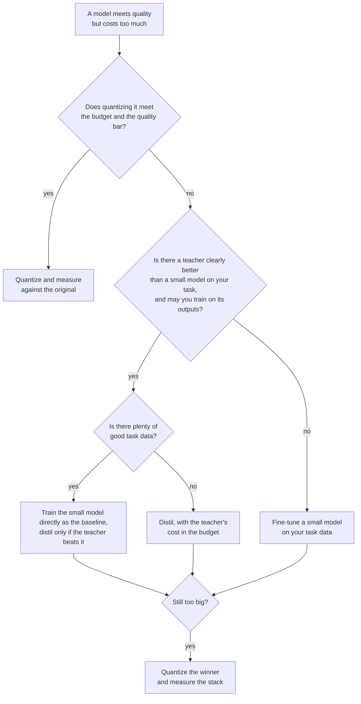

# 第 24 课：蒸馏、量化还是微调

**使命关联:** 本使命的终点，是针对给定的任务和预算，在蒸馏、量化和直接训练小模型之间做出选择。蒸馏只是获得更便宜模型的三种办法之一，而另外两种往往是更好的第一步，所以本课讲的是这个决策，以及每个分支背后的证据。
**主要来源:** [论文：“Distillation Scaling Laws”，Busbridge 等，2025](https://arxiv.org/abs/2502.08606)，摘要和第 1 节
**前置知识:** [第 20 课](0020-choosing-student-size.md)、[第 21 课](0021-data-volume-and-teacher-cost.md)、[蒸馏](../GLOSSARY.md)、[学生模型](../GLOSSARY.md)、[教师模型](../GLOSSARY.md)

## 热身

1. ▢ 第 2 课说，软目标比硬标签携带更多信号。用一句话说出，多出来的信号是什么。

<details markdown="1"><summary>检查</summary>

[软目标](../GLOSSARY.md)给每个错误答案也分配了概率，而不只是给正确答案，所以它们显示出哪些错误答案差一点就对、哪些则差得很远。[硬标签](../GLOSSARY.md)把一切都放在一个答案上，对其余的什么也没说。

</details>

2. ▢ 第 9 课比较了 token 级与序列级蒸馏。对每一种，教师必须暴露什么？

<details markdown="1"><summary>检查</summary>

[token 级蒸馏](../GLOSSARY.md)需要教师的逐 token 分布，也就是要能访问它的 logit，并共享词表。[序列级蒸馏](../GLOSSARY.md)只需要教师解码出的文本，托管的 API 就能提供。

</details>

3. ▢ 第 21 课说要把教师的推理计入预算。为什么这会改变与直接训练学生的比较？

<details markdown="1"><summary>检查</summary>

教师对蒸馏数据的前向传播，是直接运行从不花费的算力。只计算学生训练步骤的比较，会美化蒸馏，而当教师比学生大得多时，这个差距可能很大。

</details>

## 要点

### 三个杠杆，三种成本

你有一个能完成任务、但运行成本太高的模型。有三个杠杆可以缩减成本，每一个都要放弃一些东西。

| 杠杆 | 变化的是什么 | 需要什么 | 风险是什么 |
|---|---|---|---|
| 量化 | 每个权重用更少的比特，参数量不变 | 至多一份校准集，不需要教师 | 准确率漂移和答案翻转，见[量化系列](../../quantization/) |
| 蒸馏 | 更少的参数，训练它去模仿教师 | 一个你可以使用的教师、数据、训练算力 | 学生复制风格比复制能力更快（第 18 课） |
| 微调小模型 | 更少的参数，只在任务数据上训练 | 好的任务数据、训练算力 | 小模型永远看不到大模型所知道的东西 |

量化是最便宜的尝试。训练后量化不需要训练运行，所以当模型差一点就能放下时，它是首先要问的问题。量化系列为这个分支维护了它自己的[量化评审检查清单](../../quantization/reference/quantization-review-checklist.md)，其中包括这样一条规则：当 bf16 已经符合预算时，就留在 bf16。

另外两种都是从更小的架构出发。它们的区别在于，小模型是从什么那里学习：教师的输出，还是你的任务数据。

### 蒸馏什么时候胜过直接训练学生

Busbridge 等人用在 C4 英语子集上训练的语言模型（第 4.1 节），为蒸馏学生的交叉熵拟合了一条缩放定律。摘要和第 1 节里的两个结果，适用于这个决策。

第一，蒸馏只在一定预算之内有帮助。他们报告说，当两者都有足够的数据或算力时，蒸馏无法产生比监督学习更低的交叉熵，并且只有当学生的算力或 token 数低于一个取决于学生规模的阈值时，蒸馏才更有效率（第 1 节）。

第二，教师必须是免费的或者共享的。在他们的摘要里：有现成的教师，或者有许多学生要蒸馏时，在一个随学生规模而增长的算力水平以内，蒸馏胜过监督学习。如果只想要一个学生，而教师还得训练，监督学习通常更可取。

请读一读它的范围。这是在一个数据集上得到的预训练结果，以交叉熵来度量。把它应用到针对产品任务的微调上，是一种推断，不是论文测试过的东西。这个推断的方向才是有用的部分：有大量好的任务数据、又没有免费的教师，就指向直接训练小模型。

### 蒸馏获胜的证据，以及它没有说明什么

DeepSeek-AI 比较了从同一个基础模型 Qwen2.5-32B 得到强大的 32B 推理模型的两种办法（[论文](https://arxiv.org/abs/2501.12948)，附录 F.1，表 16）。一种是在基础模型上做超过 10K 步的大规模强化学习，即 Qwen2.5-32B-Zero。另一种是在 DeepSeek-R1 生成的 800,000 条样本上做监督微调。

| 模型 | AIME 2024 pass@1 | AIME 2024 cons@64 | MATH-500 | GPQA Diamond | LiveCodeBench |
|---|---|---|---|---|---|
| Qwen2.5-32B-Zero（强化学习） | 47.0 | 60.0 | 91.6 | 55.0 | 40.2 |
| DeepSeek-R1-Distill-Qwen-32B | 72.6 | 83.3 | 94.3 | 62.1 | 57.2 |

蒸馏模型在每一列上都领先，在 AIME 2024 pass@1 上领先 25.6 分，在 MATH-500 上领先 2.7 分。作者的结论是，小模型的强化学习需要多得多的算力，而且可能比不上蒸馏。这张表没有显示的是第三个分支：在人类编写的解答上微调的学生。论文确实另外说了，从高质量教师输出蒸馏的模型，始终胜过直接在人类生成数据上训练的模型，并为此引用了 Busbridge 等人（附录 F）。

剪枝与蒸馏搭配，可以降低获得小模型的成本。Muralidharan 等人（Minitron，[论文](https://arxiv.org/abs/2407.14679)）报告，从训练好的 15B 模型推导出 8B 和 4B 模型，每个模型所需的训练 token 比从零训练少多达 40 倍，这为整个 15B、8B 和 4B 家族节省了 1.8 倍的算力。对一个 4B 模型，在相同算力下（表 11），把 15B 剪枝后再蒸馏，在 100B 个 token 之后，HellaSwag 达到 51.04，MMLU 达到 37.81，而随机初始化在 150B 个 token 之后是 46.22 和 24.36。这只是一个家族，一个教师，而且是他们本来就拥有的一个预训练好的 15B 模型。

### 它们可以组合

这些杠杆是可以叠加的。蒸馏出来的学生之后还可以量化，而 Minitron 剪枝后的模型是经过蒸馏的，所以剪枝和蒸馏本来就组合在一起。误差同样会叠加：一个因蒸馏损失了两分、又因 4 位权重再损失两分的学生，必须作为叠加后的整体来度量，而不是作为两个单独的数字。要把最终的产物与原始模型对照来度量（第 23 课）。



## 练习

1. ▢ 一个 70B 的模型达到了质量要求，并且必须在一块 80 GB 的 GPU 上提供服务。没有训练数据，也没有训练预算。你首先尝试什么？

    - a) 量化权重并度量质量
    - b) 蒸馏成一个更小的学生模型
    - c) 直接微调一个小模型
    - d) 从零预训练一个新模型

<details markdown="1"><summary>检查</summary>

**a)** 训练后量化不需要教师、不需要任务数据，也不需要训练运行。权重本身在 4 位时约为 35 GB（700 亿乘以半个字节），而 bf16 时是 140 GB，这还没算缩放因子和 KV 缓存，所以这个杠杆有可能放得下。(b) 和 (c) 需要你没有的数据和训练算力。(d) 对两者的需求都大得多。

</details>

2. ▢ Minitron 的 15B、8B 和 4B 模型的每步 FLOPs 分别是 4.4e17、2.5e17 和 1.2e17。从零训练这三个模型的成本是它们之和。只训练 15B，用少 40 倍的 token 推导出另外两个，成本是 15B 加上其余每个除以 40。先预测节省的倍数，再运行它。

    ```python
    full = 4.4e17 + 2.5e17 + 1.2e17
    derived = 4.4e17 + 2.5e17 / 40 + 1.2e17 / 40
    print(f"{full / derived:.2f}")
    ```

<details markdown="1"><summary>提示</summary>

无论哪种方式，15B 模型都要完整训练，所以大部分成本仍然存在。

</details>

<details markdown="1"><summary>检查</summary>

它打印 `1.80`，即论文的 1.8 倍。与 40 倍相比，这个节省看起来很小，因为 15B 模型在这个家族的成本里占主导，而它是完整付费的。论文假定每个模型的 token、步数和批大小相同，所以 1.8 针对的是这个假设。

</details>

3. ▢ 根据上面的表 16，一位同事说“对小模型来说，蒸馏胜过强化学习”。这张表支持什么，又留下了什么悬而未决？

<details markdown="1"><summary>检查</summary>

它支持一项比较：在 Qwen2.5-32B 上，在 800,000 条 R1 样本上做监督微调，在每一列上，都胜过在数学、代码和 STEM 数据上做 10K 多步的强化学习。它没有回答其他模型规模、更长或构建方式不同的强化学习运行，以及在人类数据上做监督微调的基线。它对每分的成本也只字未提，作者只是用文字描述过。

</details>

4. ▢ 一个团队想要为一个产品做一个 1B 的模型。唯一的候选教师得先训练出来，而团队拥有大量的任务数据。根据 Busbridge 等人，证据倾向哪一边？这个论断受到什么限制？

<details markdown="1"><summary>检查</summary>

倾向于直接监督训练这个小模型：他们的摘要说，只有一个学生，且教师还需要训练时，监督学习通常更可取。限制在于范围：这是在 C4 语言模型上拟合的预训练缩放定律，所以把它应用到针对产品任务的微调上，是一种推断，应当用两者各做一次小规模运行来检验。

</details>

5. ▢ 你唯一的强教师是一个只返回文本、没有 logit 的托管 API，你打算在它的输出上训练一个 3B 的开源模型。哪几课决定这个计划是否可行，以及它能用哪种损失？

<details markdown="1"><summary>检查</summary>

第 13 课决定你是否可以这样做：服务商的条款可能禁止用输出来构建竞争性的模型，而开源模型的许可可能附加条件。第 6 课和第 9 课决定怎么做：没有 logit 和共享词表，[logit 蒸馏](../GLOSSARY.md)就不可行，学生只能在解码出的文本上用普通的交叉熵训练，这就是序列级。

</details>

## 实战练习

- [ ] 挑一个你们团队在运行的、成本太高的模型，写下你会先尝试三个杠杆中的哪一个，以及会让你转向下一个杠杆的那个数字。
- [ ] 打开 DeepSeek-R1 论文的表 16，写下对于你自己的决策，缺少哪个比较分支，然后说明运行它要花多少成本。
- [ ] 明天：不看笔记，画出本课的决策图，并与上面的那一张对照检查。

## 延伸阅读

- [蒸馏评审检查清单](../reference/distillation-review-checklist.md)
- [量化评审检查清单](../../quantization/reference/quantization-review-checklist.md)
- [论文：“Distillation Scaling Laws”，Busbridge 等，2025](https://arxiv.org/abs/2502.08606)
- [论文：“DeepSeek-R1: Incentivizing Reasoning Capability in LLMs via Reinforcement Learning”，DeepSeek-AI，2025](https://arxiv.org/abs/2501.12948)
- [论文：“Compact Language Models via Pruning and Knowledge Distillation”，Muralidharan 等，2024](https://arxiv.org/abs/2407.14679)
- [适配器微调](../../finetuning/)
- [资源](../RESOURCES.md)

---

没学明白？请重读顶部的主要来源，因为本课是对它的压缩，而理解正是在压缩中流失的。如果有哪个术语觉得含糊，可以查看[术语表](../GLOSSARY.md)。

如果问题出在课程本身，而不是学习材料，那就是一个缺陷：[提交 issue](https://github.com/TokenCemetery/teach/issues)。
