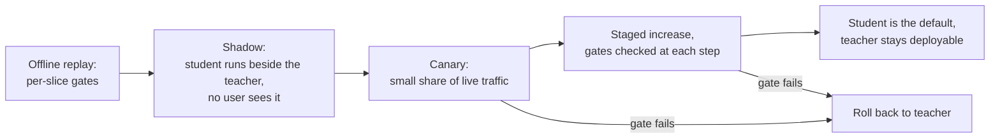

# Lección 26. Reemplazar un modelo del que otros dependen

**Vínculo con la misión:** La misión termina con que se confíe en ti para decidir sobre una destilación, y parte de la decisión es el despliegue. Un estudiante que iguala la puntuación del profesor aun así se comporta de otra manera, y quienes están aguas abajo construyeron sobre el comportamiento del profesor, no sobre su puntuación.
**Fuente principal:** [Paper: "Does Knowledge Distillation Really Work?", Stanton et al., 2021](https://arxiv.org/abs/2106.05945), resumen y secciones 4 y 5.1
**Requisitos previos:** [Lección 22](0022-student-against-teacher.md), [Lección 25](0025-reviewing-a-distillation-claim.md), [Fidelidad](../GLOSSARY.md), [Estudiante](../GLOSSARY.md), [Profesor](../GLOSSARY.md)

## Calentamiento

1. ▢ La lección 14 definió el exposure bias. ¿Por qué importa más para una salida larga que para una corta?

<details markdown="1"><summary>Comprobación</summary>

Un estudiante entrenado con prefijos que escribió el profesor se topa en inferencia con sus propios tokens anteriores, y cada error temprano lo pone en un estado con el que nunca entrenó. En una salida larga hay más oportunidades de que eso se acumule, así que un estudiante que iguala al profesor en respuestas cortas puede derivar en las largas. Ver [exposure bias](../GLOSSARY.md).

</details>

2. ▢ La lección 22 dijo que había que medir el acuerdo con el profesor por separado de la calidad en la tarea. ¿Por qué dos modelos con la misma precisión pueden discrepar en muchas entradas?

<details markdown="1"><summary>Comprobación</summary>

La precisión cuenta cuántas respuestas son correctas, no cuáles. Un modelo puede acertar donde el otro falla y al revés, y las ganancias y pérdidas se cancelan en el promedio. La [fidelidad](../GLOSSARY.md) mide directamente la discrepancia.

</details>

3. ▢ La lección 10 construyó un conjunto de instrucciones a partir de las generaciones de un profesor. ¿Qué decide de qué entradas ha visto pocas el estudiante?

<details markdown="1"><summary>Comprobación</summary>

Los prompts que se le dieron al generador. El estudiante aprende del comportamiento del profesor sobre esos prompts, así que las entradas distintas de ellos son la cola larga de la que el estudiante vio menos, por muchas generaciones que se hicieran.

</details>

## Qué debes saber

### En qué se apoyan los dependientes

Un equipo que llama a tu profesor ha construido sobre algo más que su precisión. Ha escrito un parser para su formato de salida, ha afinado un umbral sobre su confianza, ha aprendido qué peticiones rechaza y ha fijado un timeout a partir de su latencia. Nada de eso está en la puntuación del titular, y un estudiante puede diferir en todo ello.

| Comportamiento | Por qué puede diferir un estudiante | Cómo comprobarlo |
|---|---|---|
| Formato de salida | El estudiante aprendió el formato a partir de una muestra de salidas del profesor, así que pueden faltar variantes raras | Ejecuta los propios parsers de los dependientes sobre salidas reproducidas |
| Rechazos | Gudibande et al. encontraron que los modelos de imitación heredan el hábito del profesor de abstenerse (su Figura 5, en RealToxicityPrompts), pero cuán de cerca es otra pregunta | Compara las tasas de rechazo sobre un conjunto fijo de prompts, desglosadas por tema |
| Confianza | Los métodos de destilación cambian la calibración: MiniLLM informa de una mejor calibración que sus baselines ([paper](https://arxiv.org/abs/2306.08543), resumen) | Comprueba cualquier umbral que un dependiente haya afinado sobre las puntuaciones del profesor |
| Salidas largas | El exposure bias crece con la longitud (lección 14) | Reproduce las peticiones reales más largas |
| Entradas de cola larga | El conjunto de destilación cubre aquello con lo que se pidió al generador (lección 10) | Desglosa por tipo de entrada y compara |
| Longitud y latencia | Un estudiante más rápido por token aun así puede producir respuestas más largas | Mide el tiempo de extremo a extremo sobre tráfico reproducido |

Cada fila es algo que probar, no un hallazgo: las fuentes de este track muestran un mecanismo para algunas y no miden a tus dependientes. Trata cada una como una hipótesis hasta que una reproducción diga lo contrario.

### Los estudiantes discrepan de los profesores, incluso de los buenos

Stanton et al. encuentran que los estudiantes a menudo difieren notablemente de sus profesores: a menudo persiste una discrepancia sorprendentemente grande entre las distribuciones predictivas del profesor y del estudiante, incluso cuando el estudiante podría igualar exactamente al profesor (resumen). Su configuración es sobre todo clasificación de imágenes. En la sección 5.1 (Figura 3) el profesor es un ensemble de 5 componentes de redes ResNet-56 en CIFAR-100, y la mejor política de aumentación alcanzó solo un 86% de acuerdo en prueba, con el baseline a temperatura 4 alcanzando un 84.5%. También muestran un caso de texto, clasificadores LSTM en IMDB, con el mismo patrón (apéndice C.4).

Este no es un resultado sobre modelos de chat LLM, así que no cites un porcentaje como si lo fuera. Lo aprovechable es la dirección: un estudiante que iguala al profesor en precisión aun así cambiará respuestas en cierta proporción de las entradas, y puedes medir esa proporción en tu propio tráfico. Toma la aritmética, que es hipotética: de 1,000 peticiones, el profesor acierta en 820 y el estudiante acierta en 820, pero en 90 el profesor acierta y el estudiante falla, y en otras 90 al revés. La brecha de precisión es cero y 180 respuestas, el 18%, cambiaron. Las que pasaron de correctas a incorrectas son las que informará un dependiente.

### Comprobaciones por segmento y el umbral de ruido

La hoja [Go/No-Go](../../evals/reference/go-no-go.md) da la regla que se traslada: escribe el umbral de regresión antes de que corra la eval, y no lo hagas más estricto que el umbral de ruido. Para una tasa de aciertos p sobre N ejemplos, el error estándar es aproximadamente la raíz cuadrada de p por (1 menos p) entre N. Un segmento de 50 ejemplos con una tasa de aciertos de 0.8 tiene un error estándar de unos 5.7 puntos, así que un umbral de regresión de 3 puntos en ese segmento no se puede hacer cumplir con honestidad. O bien amplía el segmento, o acepta que el segmento solo puede detectar regresiones grandes y vigílalo en producción.

Compara los dos modelos sobre los mismos ejemplos y cuenta las discrepancias, como hace la comparación pareada de la hoja. Necesita menos datos que comparar dos tasas de aciertos independientes.

### El despliegue



El tráfico en shadow da entradas reales sin exponer a ningún usuario a los errores del estudiante, que es lo que los conjuntos offline no pueden darte. No da etiquetas, así que júzgalo por el acuerdo con el profesor, por los parsers de los dependientes y por una revisión de muestras. El canary expone entonces a unos pocos usuarios para encontrar lo que el shadow no pudo.

Cuatro hábitos hacen seguro el despliegue. Fija cada umbral antes de que empiece la etapa, como dice la hoja de go/no-go. Mantén al profesor desplegable hasta que el canary haya visto el tráfico que te importa, para que el rollback sea un cambio de configuración. Versiona juntos el checkpoint, la plantilla de prompt, los ajustes de decodificación y el stack de serving, porque un estudiante solo es reproducible como ese paquete. Nombra a un responsable que pueda decir stop.

Los pasos de despliegue del track de cuantización son la misma secuencia para un cambio distinto, con un baseline fijado y shadow antes del canary: consulta su [Lista de revisión de cuantización](../../quantization/reference/quantization-review-checklist.md). Lo que difiere para un estudiante es que el modelo es un conjunto distinto de pesos, así que la discrepancia con el profesor es mayor y las pruebas de los dependientes importan más.

### Avisar a quienes dependen de ti

Di qué cambió, qué no se ha medido y cómo volver atrás. Un aviso útil nombra la fecha, las versiones del modelo a ambos lados, los segmentos que se movieron y cuánto, los comportamientos que comprobaste (formato, rechazos, longitud) y cuánto tiempo seguirá disponible el profesor. Pide a los dependientes que vuelvan a ejecutar sus propias pruebas durante la ventana de shadow y que informen de una regresión a una persona con nombre. Callar los deja descubrir el cambio por sí mismos, normalmente en un incidente.

## Práctica

1. ▢ Profesor y estudiante responden ambos correctamente 820 de 1,000 peticiones. En 90 peticiones el profesor acierta y el estudiante falla, y en 90 al revés. ¿Cuántas respuestas cambiaron, y por qué la puntuación del titular es lo equivocado que entregar a un dependiente?

<details markdown="1"><summary>Comprobación</summary>

Cambiaron 180 respuestas, el 18% de las peticiones, mientras la precisión se movió cero. La puntuación promedia las 90 peticiones que pasaron de correctas a incorrectas, y un dependiente que se topa con una de ellas ve una regresión. Informa del recuento de cambios y de los segmentos en que caen. Los números aquí están inventados para mostrar la aritmética.

</details>

2. ▢ Condicionas un despliegue a un límite de regresión de 3 puntos para un segmento de 50 peticiones con una tasa de aciertos cercana a 0.8. Predice el error estándar del segmento y luego ejecútalo.

    ```python
    from math import sqrt
    p, n = 0.8, 50
    print(f"{100 * sqrt(p * (1 - p) / n):.1f} points")
    ```

<details markdown="1"><summary>Pista</summary>

La fórmula es la raíz cuadrada de p por (1 menos p) entre N.

</details>

<details markdown="1"><summary>Comprobación</summary>

Imprime `5.7 points`. Un límite de 3 puntos está por debajo, así que el umbral salta o pasa al azar. Amplía el segmento hasta que el error estándar esté muy por debajo del límite, o afloja el límite y di que ese segmento solo puede detectar regresiones grandes.

</details>

3. ▢ ¿Qué te da el tráfico en shadow que un conjunto de eval offline no te da?

    - a) Un costo de serving menor que el del profesor
    - b) Etiquetas de verdad de referencia para cada petición registrada
    - c) Una prueba de que el estudiante iguala al profesor
    - d) Entradas reales de producción sin exposición de usuarios

<details markdown="1"><summary>Comprobación</summary>

**d)** El estudiante ve las entradas que envían los usuarios reales, mientras que la respuesta del profesor es la que se devuelve. (b) es falsa porque el tráfico registrado no tiene etiquetas a menos que las añadas. (c) es falsa porque la evidencia del shadow es acuerdo sobre una muestra, que no es una prueba. (a) es una propiedad del estudiante, no del método.

</details>

4. ▢ El canary está al 5% del tráfico y la tasa de error de un segmento se duplica. ¿Qué haces con el despliegue del profesor, y qué les dices a los dependientes?

<details markdown="1"><summary>Comprobación</summary>

Deja al profesor totalmente desplegado y devuelve a él la porción del canary, que es la razón por la que se mantuvo desplegable. Diles a los dependientes que el canary se revirtió, qué segmento se movió y cuánto, y qué cambiarás antes del siguiente intento. Un rollback sin aviso los deja redescubriendo el problema.

</details>

5. ▢ El estudiante se destiló a partir de 20,000 prompts que el equipo escribió para su uso principal de chat. ¿Qué dependientes corren más riesgo, y qué ejecutas antes del canary?

<details markdown="1"><summary>Comprobación</summary>

Los dependientes cuyas entradas difieren de esos prompts: otro idioma, documentos largos, formatos inusuales, salida estructurada analizada por código. La idea de la lección 10 es que la cobertura del estudiante son los prompts del generador. Reproduce en shadow las peticiones recientes de cada dependiente a través del profesor y del estudiante, y compara por dependiente, no agrupado.

</details>

## Prácticas en el mundo real

- [ ] Elige un modelo del que dependa tu equipo y enumera tres comportamientos en los que se apoya un usuario aguas abajo que no estén en ninguna puntuación de benchmark, como un formato de salida, un patrón de rechazo o un presupuesto de latencia.
- [ ] Escribe un umbral para uno de ellos antes de cualquier cambio, con el límite, el tamaño del segmento y el error estándar a ese tamaño.
- [ ] Mañana: redacta el aviso a los dependientes para reemplazar ese modelo por uno más pequeño, usando los cinco elementos de la última sección, y envíalo a una persona para que lo revise.

## Para profundizar

- [Lista de revisión de destilación](../reference/distillation-review-checklist.md)
- [Go/No-Go](../../evals/reference/go-no-go.md)
- [Lista de revisión de cuantización](../../quantization/reference/quantization-review-checklist.md)
- [Paper: "Does Knowledge Distillation Really Work?", Stanton et al., 2021](https://arxiv.org/abs/2106.05945)
- [Paper: "The False Promise of Imitating Proprietary LLMs", Gudibande et al., 2023](https://arxiv.org/abs/2305.15717)
- [Paper: "MiniLLM: On-Policy Distillation of Large Language Models", Gu et al., 2023](https://arxiv.org/abs/2306.08543)
- [Recursos](../RESOURCES.md)

---

¿No termina de quedar claro? Vuelve a leer la fuente primaria de arriba, ya que esta lección la comprime y en la compresión es donde se escapa la comprensión. Consulta el [glosario](../GLOSSARY.md) por si algún término te resultó resbaladizo.

Si lo poco claro es la propia lección y no el material, eso es un defecto: [abre un issue](https://github.com/TokenCemetery/teach/issues).
