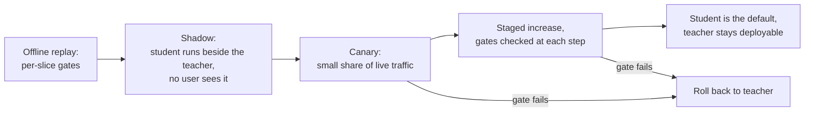

# Leçon 26. Remplacer un modèle dont d'autres dépendent

**Lien avec la mission :** La mission s'achève sur le fait qu'on vous fasse confiance pour trancher sur une distillation, et une partie de la décision est le déploiement. Un élève qui égale le score de l'enseignant se comporte quand même différemment, et les personnes en aval se sont appuyées sur le comportement de l'enseignant, pas sur son score.
**Source primaire :** [Article : "Does Knowledge Distillation Really Work?", Stanton et al., 2021](https://arxiv.org/abs/2106.05945), résumé et sections 4 et 5.1
**Prérequis :** [Leçon 22](0022-student-against-teacher.md), [Leçon 25](0025-reviewing-a-distillation-claim.md), [Fidélité](../GLOSSARY.md), [Élève](../GLOSSARY.md), [Enseignant](../GLOSSARY.md)

## Échauffement

1. ▢ La leçon 14 a défini le biais d'exposition. Pourquoi compte-t-il davantage pour une longue sortie que pour une courte ?

<details markdown="1"><summary>Vérifier</summary>

Un élève entraîné sur des préfixes écrits par l'enseignant rencontre à l'inférence ses propres tokens précédents, et chaque erreur précoce le place dans un état sur lequel il ne s'est jamais entraîné. Dans une longue sortie, il y a plus d'occasions pour que cela s'aggrave, donc un élève qui égale l'enseignant sur des réponses courtes peut dériver sur des longues. Voir [biais d'exposition](../GLOSSARY.md).

</details>

2. ▢ La leçon 22 a dit de mesurer l'accord avec l'enseignant séparément de la qualité sur la tâche. Pourquoi deux modèles de même précision peuvent-ils être en désaccord sur beaucoup d'entrées ?

<details markdown="1"><summary>Vérifier</summary>

La précision compte combien de réponses sont justes, pas lesquelles. Un modèle peut avoir raison là où l'autre a tort et inversement, et les gains et les pertes s'annulent dans la moyenne. La [fidélité](../GLOSSARY.md) mesure directement le désaccord.

</details>

3. ▢ La leçon 10 a construit un jeu d'instructions à partir des générations d'un enseignant. Qu'est-ce qui décide des entrées dont l'élève a vu peu d'exemples ?

<details markdown="1"><summary>Vérifier</summary>

Les prompts donnés au générateur. L'élève apprend du comportement de l'enseignant sur ces prompts, donc les entrées différentes d'eux forment la longue traîne dont l'élève a vu le moins, quel que soit le nombre de générations produites.

</details>

## À savoir

### Ce sur quoi les dépendants s'appuient

Une équipe qui appelle votre enseignant a construit sur davantage que sa précision. Elle a écrit un parseur pour son format de sortie, réglé un seuil sur sa confiance, appris quelles requêtes il refuse, et fixé un timeout d'après sa latence. Rien de cela ne figure dans le score en titre, et un élève peut différer sur tout cela.

| Comportement | Pourquoi un élève peut différer | Comment vérifier |
|---|---|---|
| Format de sortie | L'élève a appris le format à partir d'un échantillon de sorties de l'enseignant, si bien que des variantes rares peuvent manquer | Exécuter les propres parseurs des dépendants sur des sorties rejouées |
| Refus | Gudibande et al. ont constaté que les modèles d'imitation héritent de l'habitude de l'enseignant de s'abstenir (leur figure 5, sur RealToxicityPrompts), mais dans quelle mesure est une question distincte | Comparer les taux de refus sur un jeu de prompts fixe, par tranche de sujet |
| Confiance | Les méthodes de distillation changent la calibration : MiniLLM rapporte une meilleure calibration que ses références ([article](https://arxiv.org/abs/2306.08543), résumé) | Vérifier tout seuil qu'un dépendant a réglé sur les scores de l'enseignant |
| Longues sorties | Le biais d'exposition croît avec la longueur (leçon 14) | Rejouer les plus longues requêtes réelles |
| Entrées de longue traîne | Le jeu de distillation couvre ce avec quoi le générateur a été sollicité (leçon 10) | Découper par type d'entrée et comparer |
| Longueur et latence | Un élève plus rapide par token peut quand même produire des réponses plus longues | Mesurer le temps de bout en bout sur du trafic rejoué |

Chaque ligne est une chose à tester, pas un constat : les sources de ce parcours montrent un mécanisme pour certaines d'entre elles et ne mesurent pas vos dépendants. Traitez chacune comme une hypothèse jusqu'à ce qu'un rejeu dise le contraire.

### Les élèves sont en désaccord avec les enseignants, même bons

Stanton et al. constatent que les élèves diffèrent souvent nettement de leurs enseignants : il subsiste souvent un écart étonnamment grand entre les distributions prédictives de l'enseignant et de l'élève, même quand l'élève pourrait égaler exactement l'enseignant (résumé). Leur cadre est surtout la classification d'images. À la section 5.1 (figure 3), l'enseignant est un ensemble de 5 réseaux ResNet-56 sur CIFAR-100, et la meilleure politique d'augmentation n'a atteint que 86 % d'accord au test, la référence à la température 4 atteignant 84.5 %. Ils montrent aussi un cas textuel, des classifieurs LSTM sur IMDB, avec le même schéma (annexe C.4).

Ce n'est pas un résultat sur les modèles de chat LLM, ne citez donc pas un pourcentage comme s'il en était un. La partie utilisable est la direction : un élève qui égale l'enseignant en précision changera quand même des réponses sur une part des entrées, et vous pouvez mesurer cette part sur votre propre trafic. Prenez l'arithmétique, qui est hypothétique : sur 1,000 requêtes, l'enseignant a juste sur 820 et l'élève a juste sur 820, mais sur 90 l'enseignant a juste et l'élève faux, et sur 90 autres l'inverse. L'écart de précision est nul et 180 réponses, 18 %, ont changé. Celles qui sont passées de juste à fausse sont celles qu'un dépendant signalera.

### Contrôles par tranche et plancher de bruit

La fiche [Go/No-Go](../../evals/reference/go-no-go.md) donne la règle qui se transpose : écrire le seuil de régression avant l'exécution de l'eval, et ne pas le resserrer au-delà du plancher de bruit. Pour un taux de réussite p sur N exemples, l'erreur standard est d'environ la racine carrée de p fois (1 moins p) sur N. Une tranche de 50 exemples à un taux de réussite de 0.8 a une erreur standard d'environ 5.7 points, donc un seuil de régression de 3 points sur cette tranche ne peut pas être appliqué honnêtement. Soit on agrandit la tranche, soit on accepte que la tranche ne puisse attraper que de grosses régressions et on la surveille en production.

Comparez les deux modèles sur les mêmes exemples et comptez les désaccords, comme le fait la comparaison appariée de la fiche. Elle a besoin de moins de données que la comparaison de deux taux de réussite indépendants.

### Le déploiement



Le trafic en shadow donne des entrées réelles sans exposer aucun utilisateur aux erreurs de l'élève, ce que les jeux hors ligne ne peuvent pas donner. Il ne donne pas de labels, jugez-le donc par l'accord avec l'enseignant, par les parseurs des dépendants et par une revue par échantillonnage. Le canary expose ensuite quelques utilisateurs pour trouver ce que le shadow n'a pas pu trouver.

Quatre habitudes rendent le déploiement sûr. Fixer chaque barrière avant le début de l'étape, comme le dit la fiche Go/No-Go. Garder l'enseignant déployable jusqu'à ce que le canary ait vu le trafic qui vous importe, pour que le retour en arrière soit un changement de configuration. Versionner ensemble le checkpoint, le gabarit de prompt, les réglages de décodage et la pile de service, parce qu'un élève n'est reproductible que sous forme de ce lot. Nommer un responsable qui peut dire stop.

Les étapes de déploiement du parcours de quantification sont la même séquence pour un autre changement, avec une référence épinglée et du shadow avant le canary : voir sa [liste de contrôle de relecture de la quantification](../../quantization/reference/quantization-review-checklist.md). Ce qui diffère pour un élève, c'est que le modèle est un autre jeu de poids, si bien que le désaccord avec l'enseignant est plus grand et que les tests des dépendants comptent davantage.

### Prévenir ceux qui dépendent de vous

Dites ce qui a changé, ce qui n'a pas été mesuré, et comment revenir en arrière. Un avis utilisable nomme la date, les versions de modèle des deux côtés, les tranches qui ont bougé et de combien, les comportements que vous avez vérifiés (format, refus, longueur), et combien de temps l'enseignant reste disponible. Demandez aux dépendants de rejouer leurs propres tests pendant la fenêtre de shadow et de signaler une régression à une personne nommée. Ne rien dire les laisse découvrir le changement eux-mêmes, généralement lors d'un incident.

## Pratique

1. ▢ L'enseignant et l'élève répondent tous deux correctement à 820 requêtes sur 1,000. Sur 90 requêtes, l'enseignant a juste et l'élève faux, et sur 90 l'inverse. Combien de réponses ont changé, et pourquoi le score en titre est-il la mauvaise chose à remettre à un dépendant ?

<details markdown="1"><summary>Vérifier</summary>

180 réponses ont changé, 18 % des requêtes, alors que la précision a bougé de zéro. Le score fait disparaître en moyenne les 90 requêtes passées de juste à fausse, et un dépendant qui tombe sur l'une d'elles voit une régression. Rapportez le nombre de bascules et les tranches où elles tombent. Les nombres ici sont inventés pour montrer l'arithmétique.

</details>

2. ▢ Vous conditionnez un déploiement à une limite de régression de 3 points pour une tranche de 50 requêtes à un taux de réussite proche de 0.8. Prédisez l'erreur standard de la tranche, puis exécutez.

    ```python
    from math import sqrt
    p, n = 0.8, 50
    print(f"{100 * sqrt(p * (1 - p) / n):.1f} points")
    ```

<details markdown="1"><summary>Indice</summary>

La formule est la racine carrée de p fois (1 moins p) sur N.

</details>

<details markdown="1"><summary>Vérifier</summary>

Il affiche `5.7 points`. Une limite de 3 points est en dessous, donc la barrière se déclenche ou passe au hasard. Agrandissez la tranche jusqu'à ce que l'erreur standard soit bien sous la limite, ou desserrez la limite et dites que cette tranche ne peut attraper que de grosses régressions.

</details>

3. ▢ Que vous donne le trafic en shadow qu'un jeu d'eval hors ligne ne vous donne pas ?

    - a) Un coût de service plus bas que l'enseignant
    - b) Des labels de vérité terrain pour chaque requête journalisée
    - c) Une preuve que l'élève égale l'enseignant
    - d) Des entrées de production réelles sans exposition d'utilisateur

<details markdown="1"><summary>Vérifier</summary>

**d)** L'élève voit les entrées que les vrais utilisateurs envoient, alors que la réponse de l'enseignant est celle qui est renvoyée. (b) est faux parce que le trafic journalisé n'a pas de labels sauf si vous en ajoutez. (c) est faux parce que la preuve par shadow est un accord sur un échantillon, ce qui n'est pas une preuve. (a) est une propriété de l'élève, pas de la méthode.

</details>

4. ▢ Le canary est à 5 % du trafic et le taux d'erreur d'une tranche double. Que faites-vous du déploiement de l'enseignant, et que dites-vous aux dépendants ?

<details markdown="1"><summary>Vérifier</summary>

Laissez l'enseignant entièrement déployé et rebasculez vers lui la part du canary, ce qui est la raison pour laquelle il est resté déployable. Dites aux dépendants que le canary a été annulé, quelle tranche a bougé et de combien, et ce que vous changerez avant la prochaine tentative. Un retour en arrière sans avis les laisse redécouvrir le problème.

</details>

5. ▢ L'élève a été distillé à partir de 20,000 prompts que l'équipe a écrits pour son usage principal en chat. Quels dépendants sont les plus à risque, et que lancez-vous avant le canary ?

<details markdown="1"><summary>Vérifier</summary>

Les dépendants dont les entrées diffèrent de ces prompts : une autre langue, de longs documents, des formats inhabituels, une sortie structurée analysée par du code. Le point de la leçon 10 est que la couverture de l'élève est celle des prompts du générateur. Rejouez en shadow les requêtes récentes propres à chaque dépendant à travers l'enseignant et l'élève, et comparez par dépendant, pas en agrégé.

</details>

## Exercices en situation réelle

- [ ] Choisissez un modèle dont votre équipe dépend et listez trois comportements sur lesquels un utilisateur en aval s'appuie qui ne figurent dans aucun score de benchmark, comme un format de sortie, un schéma de refus ou un budget de latence.
- [ ] Écrivez une barrière pour l'un d'eux avant tout changement, avec le seuil, la taille de la tranche et l'erreur standard à cette taille.
- [ ] Demain : rédigez l'avis aux dépendants pour le remplacement de ce modèle par un plus petit, en utilisant les cinq éléments de la dernière section, et envoyez-le à une personne pour relecture.

## Pour aller plus loin

- [Liste de contrôle de relecture d'une distillation](../reference/distillation-review-checklist.md)
- [Evals : Go/No-Go](../../evals/reference/go-no-go.md)
- [Liste de contrôle de relecture de la quantification](../../quantization/reference/quantization-review-checklist.md)
- [Article : "Does Knowledge Distillation Really Work?", Stanton et al., 2021](https://arxiv.org/abs/2106.05945)
- [Article : "The False Promise of Imitating Proprietary LLMs", Gudibande et al., 2023](https://arxiv.org/abs/2305.15717)
- [Article : "MiniLLM: On-Policy Distillation of Large Language Models", Gu et al., 2023](https://arxiv.org/abs/2306.08543)
- [Ressources](../RESOURCES.md)

---

Ça ne passe pas ? Relisez la source primaire en haut de page, car cette leçon la condense et c'est dans la condensation que la compréhension s'échappe. Consultez le [glossaire](../GLOSSARY.md) pour tout terme qui vous a paru glissant.

Si c'est la leçon elle-même qui n'est pas claire plutôt que la matière, c'est un défaut : [ouvrez une issue](https://github.com/TokenCemetery/teach/issues).
