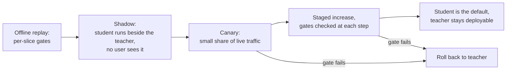

# पाठ 26. ऐसे Model को बदलना जिस पर दूसरे निर्भर हैं

**मिशन से संबंध:** मिशन इस पर ख़त्म होता है कि distillation पर फ़ैसला लेने के लिए आप पर भरोसा किया जाए, और फ़ैसले का एक हिस्सा rollout है। जो student teacher के score से मेल खाता है वह फिर भी अलग बर्ताव करता है, और आगे के लोगों ने teacher के score पर नहीं, उसके व्यवहार पर निर्माण किया है।
**मुख्य स्रोत:** [पेपर: "Does Knowledge Distillation Really Work?", Stanton et al., 2021](https://arxiv.org/abs/2106.05945), abstract और sections 4 और 5.1
**पूर्व-आवश्यकताएँ:** [पाठ 22](0022-student-against-teacher.md), [पाठ 25](0025-reviewing-a-distillation-claim.md), [Fidelity](../GLOSSARY.md), [Student](../GLOSSARY.md), [Teacher](../GLOSSARY.md)

## वार्म-अप

1. ▢ पाठ 14 ने exposure bias परिभाषित किया। लंबे output के लिए वह छोटे से ज़्यादा क्यों मायने रखता है?

<details markdown="1"><summary>जाँचें</summary>

Teacher के लिखे prefixes पर train हुआ student inference में अपने पहले tokens से मिलता है, और हर शुरुआती ग़लती उसे ऐसी स्थिति में डाल देती है जिस पर उसने कभी train नहीं किया। लंबे output में इसके जमा होने के ज़्यादा मौक़े हैं, इसलिए जो student छोटे उत्तरों पर teacher से मेल खाता है वह लंबे उत्तरों पर भटक सकता है। [Exposure bias](../GLOSSARY.md) देखें।

</details>

2. ▢ पाठ 22 ने कहा कि teacher से agreement को task की गुणवत्ता से अलग मापें। समान accuracy वाले दो models कई inputs पर असहमत क्यों हो सकते हैं?

<details markdown="1"><summary>जाँचें</summary>

Accuracy गिनती है कि कितने उत्तर सही हैं, यह नहीं कि कौन-से। एक model वहाँ सही हो सकता है जहाँ दूसरा ग़लत हो और उलटा भी, और फ़ायदे और नुक़सान औसत में कट जाते हैं। [Fidelity](../GLOSSARY.md) असहमति को सीधे मापती है।

</details>

3. ▢ पाठ 10 ने teacher की generations से instruction set बनाया। कौन तय करता है कि student ने किन inputs को कम देखा है?

<details markdown="1"><summary>जाँचें</summary>

वे prompts जो generator को दिए गए थे। Student उन prompts पर teacher के व्यवहार से सीखता है, इसलिए उनसे अलग inputs वह long tail हैं जिन्हें student ने सबसे कम देखा, चाहे कितनी भी generations बनी हों।

</details>

## यह जानें

### निर्भर लोग किस पर भरोसा करते हैं

जो टीम आपके teacher को call करती है उसने उसकी accuracy से ज़्यादा पर निर्माण किया है। उसने उसके output format के लिए parser लिखा है, उसकी confidence पर threshold tune किया है, सीखा है कि वह किन अनुरोधों को मना करता है, और उसकी latency से timeout तय किया है। उसमें से कुछ भी मुख्य score में नहीं है, और student उस सब पर अलग हो सकता है।

| व्यवहार | Student अलग क्यों हो सकता है | कैसे जाँचें |
|---|---|---|
| Output format | Student ने format teacher के outputs के नमूने से सीखा, इसलिए दुर्लभ रूप ग़ायब हो सकते हैं | निर्भर लोगों के अपने parsers को replay किए outputs पर चलाएँ |
| Refusals | Gudibande et al. ने पाया कि imitation models teacher की परहेज़ की आदत विरासत में पाते हैं (उनकी Figure 5, RealToxicityPrompts पर), पर कितनी क़रीब से, यह अलग सवाल है | तय prompt set पर refusal दरों की तुलना करें, विषय के हिसाब से बाँटकर |
| Confidence | Distillation के तरीक़े calibration बदलते हैं: MiniLLM अपने baselines से बेहतर calibration बताता है ([पेपर](https://arxiv.org/abs/2306.08543), abstract) | कोई भी threshold जाँचें जो किसी निर्भर ने teacher के scores पर tune किया |
| लंबे outputs | Exposure bias लंबाई के साथ बढ़ता है (पाठ 14) | सबसे लंबे असली अनुरोध replay करें |
| Long-tail inputs | Distillation set वही कवर करता है जिससे generator को prompt किया गया (पाठ 10) | Input के प्रकार से बाँटकर तुलना करें |
| लंबाई और latency | प्रति token तेज़ student फिर भी लंबे उत्तर बना सकता है | Replay किए traffic पर end-to-end समय मापें |

हर पंक्ति परखने की चीज़ है, खोज नहीं: इस track के स्रोत उनमें से कुछ के लिए तंत्र दिखाते हैं और आपके निर्भर लोगों को नहीं मापते। हर एक को परिकल्पना मानें जब तक कोई replay कुछ और न कहे।

### Students teachers से असहमत होते हैं, अच्छे teachers से भी

Stanton et al. पाते हैं कि students अक्सर अपने teachers से काफ़ी अलग होते हैं: teacher और student के predictive distributions के बीच अक्सर हैरान करने वाला बड़ा अंतर बना रहता है, तब भी जब student teacher से ठीक-ठीक मेल बिठा सकता था (abstract)। उनकी सेटिंग ज़्यादातर image classification है। Section 5.1 (Figure 3) में teacher, CIFAR-100 पर ResNet-56 networks का 5-घटक ensemble है, और सबसे अच्छी augmentation नीति सिर्फ़ 86% test agreement तक पहुँची, जबकि temperature 4 वाला baseline 84.5% तक। वे text का मामला भी दिखाते हैं, IMDB पर LSTM classifiers, उसी पैटर्न के साथ (appendix C.4)।

यह LLM chat models के बारे में नतीजा नहीं है, इसलिए कोई प्रतिशत ऐसे उद्धृत न करें मानो वह हो। काम का हिस्सा दिशा है: जो student accuracy में teacher के बराबर है वह फिर भी inputs के कुछ हिस्से पर उत्तर बदलेगा, और आप उस हिस्से को अपने traffic पर माप सकते हैं। गणित लें, जो काल्पनिक है: 1,000 अनुरोधों में से, teacher 820 पर सही है और student 820 पर सही है, पर 90 पर teacher सही और student ग़लत है, और दूसरे 90 पर उलटा। Accuracy का फ़ासला शून्य है और 180 उत्तर, 18%, बदल गए। जो सही से ग़लत हुए वे वही हैं जिनकी कोई निर्भर शिकायत करेगा।

### प्रति-slice जाँचें और noise की सीमा

[Go/No-Go शीट](../../evals/reference/go-no-go.md) वह नियम देती है जो आगे लागू होता है: regression threshold eval चलने से पहले लिखें, और उसे noise की सीमा से ज़्यादा कसा न रखें। N examples पर pass rate p के लिए, standard error लगभग p गुना (1 घटा p) भाग N का वर्गमूल है। 0.8 pass rate वाले 50 examples के slice की standard error लगभग 5.7 अंक है, इसलिए उस slice पर 3-अंक की regression threshold ईमानदारी से लागू नहीं हो सकती। या तो slice बढ़ाएँ, या मान लें कि slice सिर्फ़ बड़े regressions पकड़ सकता है और उसे production में देखते रहें।

दोनों models की तुलना उन्हीं examples पर करें और असहमतियाँ गिनें, जैसा शीट की paired comparison करती है। उसे दो स्वतंत्र pass rates की तुलना से कम data चाहिए।

### Rollout



Shadow traffic असली inputs देता है, student की ग़लतियों के सामने किसी उपयोगकर्ता को लाए बिना, जो offline sets आपको नहीं दे सकते। वह labels नहीं देता, इसलिए उसे teacher से agreement, निर्भर लोगों के parsers और नमूने की समीक्षा से आँकें। फिर canary कुछ उपयोगकर्ताओं को उजागर करता है ताकि वह पता चले जो shadow नहीं बता सका।

चार आदतें rollout को सुरक्षित बनाती हैं। हर gate चरण शुरू होने से पहले तय करें, जैसा go/no-go शीट कहती है। Teacher को तब तक deployable रखें जब तक canary ने वह traffic न देख लिया हो जिसकी आपको परवाह है, ताकि rollback एक configuration बदलाव हो। Checkpoint, prompt template, decoding settings और serving stack को साथ में version करें, क्योंकि student सिर्फ़ उसी bundle के रूप में दोहराया जा सकता है। ऐसे मालिक का नाम तय करें जो रुकने को कह सके।

Quantization track के rollout चरण किसी दूसरे बदलाव के लिए वही क्रम हैं, baseline pin किए हुए और canary से पहले shadow के साथ: उसकी [review checklist शीट](../../quantization/reference/quantization-review-checklist.md) देखें। Student के लिए जो अलग है वह यह कि model weights का अलग सेट है, इसलिए teacher से असहमति बड़ी है और निर्भर लोगों के tests ज़्यादा मायने रखते हैं।

### उन लोगों को बताना जो आप पर निर्भर हैं

बताएँ कि क्या बदला, क्या मापा नहीं गया है, और वापस कैसे जाएँ। काम की सूचना तारीख़, दोनों तरफ़ के model versions, जो slices हिले और कितना, जिन व्यवहारों को आपने जाँचा (format, refusals, लंबाई), और teacher कितने समय तक उपलब्ध रहेगा, इनके नाम बताती है। निर्भर लोगों से कहें कि shadow की अवधि में अपने tests दोबारा चलाएँ और regression किसी नामित व्यक्ति को बताएँ। कुछ न कहना उन्हें बदलाव ख़ुद ढूँढने के लिए छोड़ देता है, आम तौर पर किसी incident में।

## अभ्यास

1. ▢ Teacher और student, दोनों 1,000 में से 820 अनुरोध सही उत्तर देते हैं। 90 अनुरोधों पर teacher सही और student ग़लत है, और 90 पर उलटा। कितने उत्तर बदले, और मुख्य score किसी निर्भर को देना ग़लत चीज़ क्यों है?

<details markdown="1"><summary>जाँचें</summary>

180 उत्तर बदले, 18% अनुरोध, जबकि accuracy शून्य से हिली। Score उन 90 अनुरोधों को औसत में मिटा देता है जो सही से ग़लत हुए, और जो निर्भर उनमें से किसी से टकराए वह regression देखता है। बदले हुए उत्तरों की गिनती और वे किन slices में हैं, यह बताएँ। यहाँ की संख्याएँ गणित दिखाने के लिए गढ़ी गई हैं।

</details>

2. ▢ आप 0.8 के पास pass rate वाले 50 अनुरोधों के slice पर 3-अंक की regression सीमा से rollout gate करते हैं। Slice की standard error का अनुमान लगाएँ, फिर चलाएँ।

    ```python
    from math import sqrt
    p, n = 0.8, 50
    print(f"{100 * sqrt(p * (1 - p) / n):.1f} points")
    ```

<details markdown="1"><summary>संकेत</summary>

सूत्र p गुना (1 घटा p) भाग N का वर्गमूल है।

</details>

<details markdown="1"><summary>जाँचें</summary>

यह `5.7 points` print करता है। 3-अंक की सीमा उससे नीचे है, इसलिए gate संयोग से ट्रिगर होता है या पास होता है। Slice तब तक बढ़ाएँ जब तक standard error सीमा से काफ़ी नीचे न हो, या सीमा ढीली करें और कहें कि यह slice सिर्फ़ बड़े regressions पकड़ सकता है।

</details>

3. ▢ Shadow traffic आपको क्या देता है जो offline eval set नहीं देता?

    - a) Teacher से कम serving लागत
    - b) हर logged अनुरोध के ground-truth labels
    - c) इसका प्रमाण कि student teacher से मेल खाता है
    - d) बिना किसी उपयोगकर्ता के उजागर हुए असली production inputs

<details markdown="1"><summary>जाँचें</summary>

**d)** Student वे inputs देखता है जो असली उपयोगकर्ता भेजते हैं, जबकि teacher का उत्तर वही है जो लौटाया जाता है। (b) ग़लत है क्योंकि logged traffic में labels तब तक नहीं होते जब तक आप न जोड़ें। (c) ग़लत है क्योंकि shadow का सबूत एक नमूने पर agreement है, जो प्रमाण नहीं। (a) student का गुण है, विधि का नहीं।

</details>

4. ▢ Canary traffic के 5% पर है और एक slice की error दर दोगुनी हो जाती है। आप teacher की deployment के साथ क्या करते हैं, और निर्भर लोगों को क्या बताते हैं?

<details markdown="1"><summary>जाँचें</summary>

Teacher को पूरी तरह deployed रखें और canary का हिस्सा उसके पास वापस भेजें, इसीलिए वह deployable रहा था। निर्भर लोगों को बताएँ कि canary वापस लिया गया, कौन-सा slice हिला और कितना, और अगली कोशिश से पहले आप क्या बदलेंगे। सूचना के बिना rollback उन्हें समस्या दोबारा खोजने के लिए छोड़ देता है।

</details>

5. ▢ Student को उन 20,000 prompts से distil किया गया जो टीम ने अपने मुख्य chat उपयोग के लिए लिखे थे। कौन-से निर्भर सबसे ज़्यादा जोखिम में हैं, और canary से पहले आप क्या चलाते हैं?

<details markdown="1"><summary>जाँचें</summary>

वे निर्भर जिनके inputs उन prompts से अलग हैं: दूसरी भाषा, लंबे documents, असामान्य formats, code द्वारा parse किया जाने वाला structured output। पाठ 10 का मुद्दा है कि student की कवरेज generator के prompts हैं। हर निर्भर के अपने हाल के अनुरोध shadow में teacher और student दोनों से चलाएँ, और प्रति निर्भर तुलना करें, मिलाकर नहीं।

</details>

## असली दुनिया का अभ्यास

- [ ] कोई model चुनें जिस पर आपकी टीम निर्भर है और तीन व्यवहार सूचीबद्ध करें जिन पर कोई आगे का उपयोगकर्ता निर्भर है और जो किसी benchmark score में नहीं हैं, जैसे output format, refusal का पैटर्न या latency बजट।
- [ ] उनमें से किसी एक के लिए कोई भी बदलाव से पहले gate लिखें, threshold, slice आकार और उस आकार पर standard error के साथ।
- [ ] कल: उस model को छोटे model से बदलने के लिए निर्भर लोगों की सूचना का मसौदा लिखें, आख़िरी section की पाँच बातों का इस्तेमाल करके, और उसे समीक्षा के लिए किसी एक को भेजें।

## आगे बढ़ने के लिए

- [Distillation Review Checklist शीट](../reference/distillation-review-checklist.md)
- [Go/No-Go शीट](../../evals/reference/go-no-go.md)
- [Quantization Review Checklist शीट](../../quantization/reference/quantization-review-checklist.md)
- [पेपर: "Does Knowledge Distillation Really Work?", Stanton et al., 2021](https://arxiv.org/abs/2106.05945)
- [पेपर: "The False Promise of Imitating Proprietary LLMs", Gudibande et al., 2023](https://arxiv.org/abs/2305.15717)
- [पेपर: "MiniLLM: On-Policy Distillation of Large Language Models", Gu et al., 2023](https://arxiv.org/abs/2306.08543)
- [संसाधन](../RESOURCES.md)

---

बात नहीं बन रही? ऊपर दिए मुख्य स्रोत को दोबारा पढ़ें, क्योंकि यह पाठ उसे संक्षिप्त करता है और समझ संक्षेप में ही रिसती है। जो शब्द फिसलन भरा लगे, उसके लिए [शब्दावली](../GLOSSARY.md) देखें।

अगर दिक़्क़त सामग्री की नहीं बल्कि पाठ की ही है, तो वह एक खोट है: [issue खोलें](https://github.com/TokenCemetery/teach/issues)।
