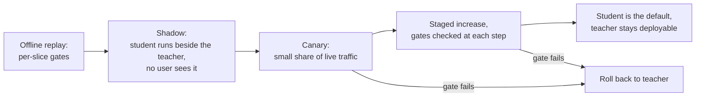

# Lesson 26. Replacing a Model Others Depend On

**Mission link:** The mission ends with trusting you to make the call on a distillation, and part of the call is the rollout. A student that matches the teacher's score still behaves differently, and the people downstream built on the teacher's behaviour, not on its score.
**Primary source:** [Paper: "Does Knowledge Distillation Really Work?", Stanton et al., 2021](https://arxiv.org/abs/2106.05945), abstract and sections 4 and 5.1
**Prerequisites:** [Lesson 22](0022-student-against-teacher.md), [Lesson 25](0025-reviewing-a-distillation-claim.md), [Fidelity](../GLOSSARY.md), [Student](../GLOSSARY.md), [Teacher](../GLOSSARY.md)

## Warm-up

1. ▢ Lesson 14 defined exposure bias. Why does it matter more for a long output than for a short one?

<details markdown="1"><summary>Check</summary>

A student trained on prefixes the teacher wrote meets its own earlier tokens at inference, and each early mistake puts it in a state it never trained on. In a long output there are more chances for that to compound, so a student that matches the teacher on short answers can drift on long ones. See [exposure bias](../GLOSSARY.md).

</details>

2. ▢ Lesson 22 said to measure agreement with the teacher separately from task quality. Why can two models with the same accuracy disagree on many inputs?

<details markdown="1"><summary>Check</summary>

Accuracy counts how many answers are right, not which ones. One model can be right where the other is wrong and the reverse, and the gains and losses cancel in the average. [Fidelity](../GLOSSARY.md) measures the disagreement directly.

</details>

3. ▢ Lesson 10 built an instruction set from a teacher's generations. What decides which inputs the student has seen few of?

<details markdown="1"><summary>Check</summary>

The prompts the generator was given. The student learns from the teacher's behaviour on those prompts, so inputs unlike them are the long tail the student saw least of, however many generations were made.

</details>

## Know this

### What dependents rely on

A team that calls your teacher has built against more than its accuracy. It has written a parser for its output format, tuned a threshold on its confidence, learned which requests it refuses, and set a timeout from its latency. None of that is in the headline score, and a student can differ on all of it.

| Behaviour | Why a student may differ | How to check |
|---|---|---|
| Output format | The student learned the format from a sample of teacher outputs, so rare variants may be missing | Run the dependents' own parsers over replayed outputs |
| Refusals | Gudibande et al. found imitation models inherit the teacher's habit of abstaining (their Figure 5, on RealToxicityPrompts), but how closely is a separate question | Compare refusal rates on a fixed prompt set, slice by topic |
| Confidence | Distillation methods change calibration: MiniLLM reports better calibration than its baselines ([paper](https://arxiv.org/abs/2306.08543), abstract) | Check any threshold a dependent tuned on the teacher's scores |
| Long outputs | Exposure bias grows with length (lesson 14) | Replay the longest real requests |
| Long-tail inputs | The distillation set covers what the generator was prompted with (lesson 10) | Slice by input type and compare |
| Length and latency | A student that is faster per token can still produce longer answers | Measure end-to-end time on replayed traffic |

Every row is a thing to test, not a finding: this track's sources show a mechanism for some of them and do not measure your dependents. Treat each as a hypothesis until a replay says otherwise.

### Students disagree with teachers, even good ones

Stanton et al. find that students often differ markedly from their teachers: there often remains a surprisingly large discrepancy between the predictive distributions of teacher and student, even when the student could match the teacher exactly (abstract). Their setting is mostly image classification. In section 5.1 (Figure 3) the teacher is a 5-component ensemble of ResNet-56 networks on CIFAR-100, and the best augmentation policy reached only 86% test agreement, with the baseline at temperature 4 reaching 84.5%. They also show a text case, LSTM classifiers on IMDB, with the same pattern (appendix C.4).

This is not a result about LLM chat models, so do not quote a percentage as if it were. The usable part is the direction: a student that equals the teacher in accuracy will still change answers on some share of inputs, and you can measure that share on your own traffic. Take the arithmetic, which is hypothetical: of 1,000 requests, the teacher is right on 820 and the student is right on 820, but on 90 the teacher is right and the student wrong, and on another 90 the reverse. The accuracy gap is zero and 180 answers, 18%, changed. The ones that went from right to wrong are the ones a dependent will report.

### Per-slice checks and the noise floor

The [go/no-go sheet](../../evals/reference/go-no-go.md) gives the rule that carries over: write the regression threshold before the eval runs, and keep it no tighter than the noise floor. For a pass rate p over N examples, the standard error is about the square root of p times (1 minus p) over N. A slice of 50 examples at a pass rate of 0.8 has a standard error of about 5.7 points, so a 3-point regression threshold on that slice cannot be enforced honestly. Either grow the slice, or accept that the slice can only catch large regressions and watch it in production.

Compare the two models on the same examples and count the disagreements, as the sheet's paired comparison does. It needs less data than comparing two independent pass rates.

### The rollout



Shadow traffic gives real inputs with no user exposure to the student's mistakes, which is what offline sets cannot give you. It does not give labels, so judge it by agreement with the teacher, by dependents' parsers and by sampled review. The canary then exposes a few users to find what the shadow could not.

Four habits make the rollout safe. Set each gate before the stage starts, as the go/no-go sheet says. Keep the teacher deployable until the canary has seen the traffic you care about, so rollback is a configuration change. Version the checkpoint, the prompt template, the decoding settings and the serving stack together, because a student is only reproducible as that bundle. Name an owner who can say stop.

The quantization track's rollout steps are the same sequence for a different change, with a baseline pinned and shadow before canary: see its [review checklist](../../quantization/reference/quantization-review-checklist.md). What differs for a student is that the model is a different set of weights, so the disagreement with the teacher is larger and the dependents' tests matter more.

### Telling the people who depend on you

Say what changed, what has not been measured, and how to go back. A usable notice names the date, the model versions on both sides, the slices that moved and by how much, the behaviours you checked (format, refusals, length), and how long the teacher stays available. Ask dependents to rerun their own tests in the shadow window and to report a regression to a named person. Saying nothing leaves them to find the change themselves, usually in an incident.

## Practice

1. ▢ Teacher and student both answer 820 of 1,000 requests correctly. On 90 requests the teacher is right and the student wrong, and on 90 the reverse. How many answers changed, and why is the headline score the wrong thing to hand to a dependent?

<details markdown="1"><summary>Check</summary>

180 answers changed, 18% of requests, while accuracy moved by zero. The score averages away the 90 requests that went from right to wrong, and a dependent who hits one of those sees a regression. Report the flipped count and the slices they fall in. The numbers here are made up to show the arithmetic.

</details>

2. ▢ You gate a rollout on a 3-point regression limit for a slice of 50 requests at a pass rate near 0.8. Predict the slice's standard error, then run it.

    ```python
    from math import sqrt
    p, n = 0.8, 50
    print(f"{100 * sqrt(p * (1 - p) / n):.1f} points")
    ```

<details markdown="1"><summary>Hint</summary>

The formula is the square root of p times (1 minus p) over N.

</details>

<details markdown="1"><summary>Check</summary>

It prints `5.7 points`. A 3-point limit is below it, so the gate fires or passes at random. Grow the slice until the standard error is well under the limit, or loosen the limit and say that this slice can only catch large regressions.

</details>

3. ▢ What does shadow traffic give you that an offline eval set does not?

    - a) A lower serving cost than the teacher
    - b) Ground-truth labels for every logged request
    - c) A proof the student matches the teacher
    - d) Real production inputs with no user exposure

<details markdown="1"><summary>Check</summary>

**d)** The student sees the inputs real users send, while the teacher's answer is the one returned. (b) is wrong because logged traffic has no labels unless you add them. (c) is wrong because shadow evidence is agreement on a sample, which is not proof. (a) is a property of the student, not of the method.

</details>

4. ▢ The canary is at 5% of traffic and one slice's error rate doubles. What do you do to the teacher's deployment, and what do you tell dependents?

<details markdown="1"><summary>Check</summary>

Leave the teacher fully deployed and route the canary share back to it, which is why it stayed deployable. Tell dependents the canary was reverted, which slice moved and by how much, and what you will change before the next attempt. A rollback without a notice leaves them to rediscover the problem.

</details>

5. ▢ The student was distilled from 20,000 prompts the team wrote for its main chat use. Which dependents are most at risk, and what do you run before the canary?

<details markdown="1"><summary>Check</summary>

Dependents whose inputs differ from those prompts: another language, long documents, unusual formats, structured output parsed by code. Lesson 10's point is that the student's coverage is the generator's prompts. Replay each dependent's own recent requests through teacher and student in shadow, and compare per dependent, not pooled.

</details>

## Real-world reps

- [ ] Pick a model your team depends on and list three behaviours a downstream user relies on that are not in any benchmark score, such as an output format, a refusal pattern or a latency budget.
- [ ] Write a gate for one of them before any change, with the threshold, the slice size and the standard error at that size.
- [ ] Tomorrow: draft the dependents' notice for replacing that model with a smaller one, using the five items in the last section, and send it to one person for review.

## Going further

- [Distillation Review Checklist](../reference/distillation-review-checklist.md)
- [Evals: Go/No-Go](../../evals/reference/go-no-go.md)
- [Quantization Review Checklist](../../quantization/reference/quantization-review-checklist.md)
- [Paper: "Does Knowledge Distillation Really Work?", Stanton et al., 2021](https://arxiv.org/abs/2106.05945)
- [Paper: "The False Promise of Imitating Proprietary LLMs", Gudibande et al., 2023](https://arxiv.org/abs/2305.15717)
- [Paper: "MiniLLM: On-Policy Distillation of Large Language Models", Gu et al., 2023](https://arxiv.org/abs/2306.08543)
- [Resources](../RESOURCES.md)

---

Not landing? Reread the primary source at the top, since this lesson compresses it and compression is where understanding leaks. Check the [glossary](../GLOSSARY.md) for any term that felt slippery.

If the lesson itself is unclear rather than the material, that is a defect: [open an issue](https://github.com/TokenCemetery/teach/issues).
