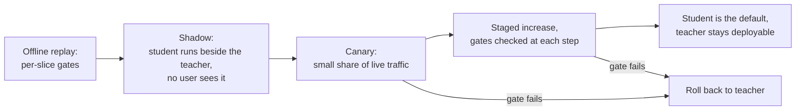

# Lição 26. Substituindo um modelo de que outros dependem

**Ligação com a missão:** A missão termina com confiarem em você para tomar a decisão sobre uma destilação, e parte da decisão é o rollout. Um aluno que iguala a pontuação do professor ainda se comporta de forma diferente, e as pessoas a jusante construíram sobre o comportamento do professor, não sobre a sua pontuação.
**Fonte principal:** [Artigo científico: "Does Knowledge Distillation Really Work?", Stanton et al., 2021](https://arxiv.org/abs/2106.05945), resumo e seções 4 e 5.1
**Pré-requisitos:** [Lição 22](0022-student-against-teacher.md), [Lição 25](0025-reviewing-a-distillation-claim.md), [Fidelidade](../GLOSSARY.md), [Aluno](../GLOSSARY.md), [Professor](../GLOSSARY.md)

## Aquecimento

1. ▢ A lição 14 definiu o exposure bias. Por que ele importa mais para uma saída longa do que para uma curta?

<details markdown="1"><summary>Verificação</summary>

Um aluno treinado em prefixos que o professor escreveu encontra os seus próprios tokens anteriores na inferência, e cada erro inicial o coloca em um estado em que ele nunca treinou. Em uma saída longa há mais chances de isso se compor, então um aluno que iguala o professor em respostas curtas pode se desviar nas longas. Veja [exposure bias](../GLOSSARY.md).

</details>

2. ▢ A lição 22 disse para medir a concordância com o professor separadamente da qualidade na tarefa. Por que dois modelos com a mesma acurácia podem discordar em muitas entradas?

<details markdown="1"><summary>Verificação</summary>

A acurácia conta quantas respostas estão certas, não quais. Um modelo pode estar certo onde o outro está errado e o inverso, e os ganhos e as perdas se cancelam na média. A [fidelidade](../GLOSSARY.md) mede a discordância diretamente.

</details>

3. ▢ A lição 10 construiu um conjunto de instruções a partir das gerações de um professor. O que decide de quais entradas o aluno viu poucas?

<details markdown="1"><summary>Verificação</summary>

Os prompts que o gerador recebeu. O aluno aprende com o comportamento do professor nesses prompts, então as entradas diferentes deles são a cauda longa que o aluno menos viu, por mais gerações que tenham sido feitas.

</details>

## Saiba isto

### Em que os dependentes se apoiam

Uma equipe que chama o seu professor construiu algo contra mais do que a sua acurácia. Ela escreveu um parser para o formato de saída dele, ajustou um limiar na sua confiança, aprendeu quais pedidos ele recusa e definiu um timeout a partir da sua latência. Nada disso está na pontuação de destaque, e um aluno pode diferir em tudo isso.

| Comportamento | Por que um aluno pode diferir | Como verificar |
|---|---|---|
| Formato de saída | O aluno aprendeu o formato a partir de uma amostra de saídas do professor, então variantes raras podem estar faltando | Rode os próprios parsers dos dependentes sobre saídas reproduzidas |
| Recusas | Gudibande et al. constataram que os modelos de imitação herdam o hábito do professor de se abster (a Figura 5 deles, no RealToxicityPrompts), mas o quão de perto é uma questão separada | Compare as taxas de recusa em um conjunto fixo de prompts, fatiando por tópico |
| Confiança | Os métodos de destilação mudam a calibração: o MiniLLM relata melhor calibração do que os seus baselines ([artigo](https://arxiv.org/abs/2306.08543), resumo) | Confira qualquer limiar que um dependente ajustou nas pontuações do professor |
| Saídas longas | O exposure bias cresce com o comprimento (lição 14) | Reproduza os pedidos reais mais longos |
| Entradas de cauda longa | O conjunto de destilação cobre o que o gerador recebeu como prompt (lição 10) | Fatie por tipo de entrada e compare |
| Comprimento e latência | Um aluno mais rápido por token ainda pode produzir respostas mais longas | Meça o tempo de ponta a ponta em tráfego reproduzido |

Cada linha é algo a testar, não um achado: as fontes desta trilha mostram um mecanismo para algumas delas e não medem os seus dependentes. Trate cada uma como hipótese até que uma reprodução diga o contrário.

### Alunos discordam dos professores, mesmo os bons

Stanton et al. constatam que os alunos muitas vezes diferem marcadamente dos seus professores: muitas vezes permanece uma discrepância surpreendentemente grande entre as distribuições preditivas do professor e do aluno, mesmo quando o aluno poderia igualar o professor exatamente (resumo). O cenário deles é em sua maioria de classificação de imagens. Na seção 5.1 (Figura 3), o professor é um ensemble de 5 componentes de redes ResNet-56 no CIFAR-100, e a melhor política de aumento de dados chegou a apenas 86% de concordância no teste, com o baseline a temperatura 4 chegando a 84,5%. Eles também mostram um caso de texto, classificadores LSTM no IMDB, com o mesmo padrão (apêndice C.4).

Esse não é um resultado sobre modelos de chat LLM, então não cite uma porcentagem como se fosse. A parte utilizável é a direção: um aluno que se iguala ao professor em acurácia ainda vai mudar respostas em uma parcela das entradas, e você pode medir essa parcela no seu próprio tráfego. Tome a aritmética, que é hipotética: de 1.000 pedidos, o professor acerta 820 e o aluno acerta 820, mas em 90 o professor acerta e o aluno erra, e em outros 90 o inverso. A diferença de acurácia é zero e 180 respostas, 18%, mudaram. As que passaram de certas para erradas são as que um dependente vai reportar.

### Verificações por fatia e o piso de ruído

A folha [Go/No-Go](../../evals/reference/go-no-go.md) dá a regra que se transfere: escreva o limiar de regressão antes de o eval rodar e não o aperte além do piso de ruído. Para uma taxa de acerto p sobre N exemplos, o erro padrão é cerca da raiz quadrada de p vezes (1 menos p) sobre N. Uma fatia de 50 exemplos com taxa de acerto de 0,8 tem um erro padrão de cerca de 5,7 pontos, então um limiar de regressão de 3 pontos nessa fatia não pode ser aplicado com honestidade. Ou aumente a fatia, ou aceite que a fatia só consegue pegar regressões grandes e acompanhe-a em produção.

Compare os dois modelos nos mesmos exemplos e conte as discordâncias, como faz a comparação pareada da folha. Ela precisa de menos dados do que comparar duas taxas de acerto independentes.

### O rollout



O tráfego em shadow dá entradas reais sem exposição de nenhum usuário aos erros do aluno, que é o que os conjuntos offline não conseguem dar. Ele não dá rótulos, então julgue-o pela concordância com o professor, pelos parsers dos dependentes e por revisão amostrada. O canary então expõe alguns usuários para encontrar o que o shadow não conseguiu.

Quatro hábitos tornam o rollout seguro. Defina cada gate antes de a etapa começar, como diz a folha de go/no-go. Mantenha o professor implantável até o canary ter visto o tráfego que importa para você, para que o rollback seja uma mudança de configuração. Versione o checkpoint, o template de prompt, as configurações de decodificação e a stack de serving juntos, porque um aluno só é reproduzível como esse pacote. Nomeie um responsável que possa dizer pare.

Os passos de rollout da trilha de quantização são a mesma sequência para uma mudança diferente, com um baseline fixado e shadow antes do canary: veja a sua [Checklist de Revisão de Quantização](../../quantization/reference/quantization-review-checklist.md). O que difere para um aluno é que o modelo é um conjunto diferente de pesos, então a discordância com o professor é maior e os testes dos dependentes importam mais.

### Avisando as pessoas que dependem de você

Diga o que mudou, o que não foi medido e como voltar atrás. Um aviso utilizável nomeia a data, as versões do modelo dos dois lados, as fatias que se moveram e por quanto, os comportamentos que você verificou (formato, recusas, comprimento) e por quanto tempo o professor continua disponível. Peça aos dependentes que rodem de novo os seus próprios testes na janela de shadow e que reportem uma regressão a uma pessoa nomeada. Não dizer nada os deixa para descobrir a mudança por conta própria, em geral em um incidente.

## Prática

1. ▢ Professor e aluno acertam ambos 820 de 1.000 pedidos. Em 90 pedidos o professor acerta e o aluno erra, e em 90 o inverso. Quantas respostas mudaram, e por que a pontuação de destaque é a coisa errada a entregar a um dependente?

<details markdown="1"><summary>Verificação</summary>

180 respostas mudaram, 18% dos pedidos, enquanto a acurácia se moveu zero. A pontuação tira a média dos 90 pedidos que passaram de certos para errados, e um dependente que cai em um deles vê uma regressão. Relate a contagem de trocas e as fatias em que elas caem. Os números aqui são inventados para mostrar a aritmética.

</details>

2. ▢ Você condiciona um rollout a um limite de regressão de 3 pontos para uma fatia de 50 pedidos com taxa de acerto perto de 0,8. Preveja o erro padrão da fatia e depois rode.

    ```python
    from math import sqrt
    p, n = 0.8, 50
    print(f"{100 * sqrt(p * (1 - p) / n):.1f} points")
    ```

<details markdown="1"><summary>Dica</summary>

A fórmula é a raiz quadrada de p vezes (1 menos p) sobre N.

</details>

<details markdown="1"><summary>Verificação</summary>

Imprime `5.7 points`. Um limite de 3 pontos está abaixo disso, então o gate dispara ou passa ao acaso. Aumente a fatia até o erro padrão ficar bem abaixo do limite, ou afrouxe o limite e diga que essa fatia só consegue pegar regressões grandes.

</details>

3. ▢ O que o tráfego em shadow dá a você que um conjunto de eval offline não dá?

    - a) Um custo de serving menor do que o do professor
    - b) Rótulos de verdade de referência para cada pedido registrado
    - c) Uma prova de que o aluno se iguala ao professor
    - d) Entradas reais de produção sem exposição de usuários

<details markdown="1"><summary>Verificação</summary>

**d)** O aluno vê as entradas que usuários reais enviam, enquanto a resposta do professor é a que é devolvida. (b) está errada porque o tráfego registrado não tem rótulos a menos que você os acrescente. (c) está errada porque a evidência do shadow é concordância em uma amostra, o que não é prova. (a) é uma propriedade do aluno, não do método.

</details>

4. ▢ O canary está em 5% do tráfego e a taxa de erro de uma fatia dobra. O que você faz com a implantação do professor, e o que diz aos dependentes?

<details markdown="1"><summary>Verificação</summary>

Deixe o professor totalmente implantado e roteie a parcela do canary de volta para ele, que é o motivo de ele ter ficado implantável. Diga aos dependentes que o canary foi revertido, qual fatia se moveu e por quanto, e o que você vai mudar antes da próxima tentativa. Um rollback sem aviso os deixa para redescobrir o problema.

</details>

5. ▢ O aluno foi destilado de 20.000 prompts que a equipe escreveu para o seu uso principal de chat. Quais dependentes correm mais risco, e o que você roda antes do canary?

<details markdown="1"><summary>Verificação</summary>

Dependentes cujas entradas diferem desses prompts: outro idioma, documentos longos, formatos incomuns, saída estruturada lida por código. O ponto da lição 10 é que a cobertura do aluno são os prompts do gerador. Reproduza os pedidos recentes de cada dependente pelo professor e pelo aluno em shadow e compare por dependente, não agrupado.

</details>

## Prática no mundo real

- [ ] Escolha um modelo de que a sua equipe depende e liste três comportamentos em que um usuário a jusante se apoia que não estão em nenhuma pontuação de benchmark, como um formato de saída, um padrão de recusa ou um orçamento de latência.
- [ ] Escreva um gate para um deles antes de qualquer mudança, com o limiar, o tamanho da fatia e o erro padrão nesse tamanho.
- [ ] Amanhã: redija o aviso aos dependentes para substituir esse modelo por um menor, usando os cinco itens da última seção, e envie-o a uma pessoa para revisão.

## Para ir além

- [Checklist de Revisão de Destilação](../reference/distillation-review-checklist.md)
- [Go/No-Go](../../evals/reference/go-no-go.md)
- [Checklist de Revisão de Quantização](../../quantization/reference/quantization-review-checklist.md)
- [Artigo científico: "Does Knowledge Distillation Really Work?", Stanton et al., 2021](https://arxiv.org/abs/2106.05945)
- [Artigo científico: "The False Promise of Imitating Proprietary LLMs", Gudibande et al., 2023](https://arxiv.org/abs/2305.15717)
- [Artigo científico: "MiniLLM: On-Policy Distillation of Large Language Models", Gu et al., 2023](https://arxiv.org/abs/2306.08543)
- [Recursos](../RESOURCES.md)

---

Não ficou claro? Releia a fonte principal no topo, já que esta lição a comprime e é na compressão que o entendimento escapa. Consulte o [glossário](../GLOSSARY.md) para qualquer termo que pareceu escorregadio.

Se o problema é a lição em si, e não o material, isso é um defeito: [abra uma issue](https://github.com/TokenCemetery/teach/issues).
