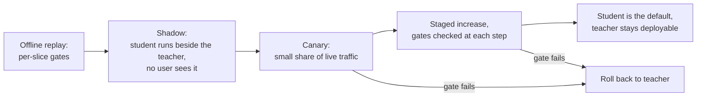

# Урок 26. Замена модели, от которой зависят другие

**Связь с целью курса:** Курс заканчивается тем, что вам доверяют принимать решение о дистилляции, а часть решения это выкатка. Ученик, совпадающий с оценкой учителя, всё равно ведёт себя иначе, а те, кто находится ниже по цепочке, строили на поведении учителя, а не на его оценке.
**Первоисточник:** [Научная статья: "Does Knowledge Distillation Really Work?", Stanton et al., 2021](https://arxiv.org/abs/2106.05945), аннотация и разделы 4 и 5.1
**Предварительные требования:** [Урок 22](0022-student-against-teacher.md), [Урок 25](0025-reviewing-a-distillation-claim.md), [верность](../GLOSSARY.md), [ученик](../GLOSSARY.md), [учитель](../GLOSSARY.md)

## Разминка

1. ▢ Урок 14 определил смещение экспозиции. Почему оно важнее для длинного выхода, чем для короткого?

<details markdown="1"><summary>Проверка</summary>

Ученик, обученный на префиксах, которые написал учитель, при инференсе сталкивается с собственными более ранними токенами, и каждая ранняя ошибка уводит его в состояние, на котором он никогда не обучался. В длинном выходе больше шансов, что это накопится, так что ученик, совпадающий с учителем на коротких ответах, может дрейфовать на длинных. См. [смещение экспозиции](../GLOSSARY.md).

</details>

2. ▢ Урок 22 сказал измерять согласие с учителем отдельно от качества на задаче. Почему две модели с одной и той же точностью могут расходиться на многих входах?

<details markdown="1"><summary>Проверка</summary>

Точность считает, сколько ответов верны, а не какие именно. Одна модель может быть права там, где другая ошибается, и наоборот, и выигрыши с потерями взаимно уничтожаются в среднем. [Верность](../GLOSSARY.md) измеряет расхождение напрямую.

</details>

3. ▢ Урок 10 построил инструктивный набор из генераций учителя. Что определяет, каких входов ученик видел мало?

<details markdown="1"><summary>Проверка</summary>

Промпты, которые получил генератор. Ученик учится на поведении учителя на этих промптах, так что входы, непохожие на них, это длинный хвост, которого ученик видел меньше всего, сколько бы генераций ни было сделано.

</details>

## Что нужно знать

### На что полагаются зависящие

Команда, которая вызывает вашего учителя, строила своё не только на его точности. Она написала парсер для формата его вывода, настроила порог по его уверенности, выяснила, какие запросы он отклоняет, и задала таймаут по его задержке. Ничего из этого нет в заголовочной оценке, а ученик может отличаться по всему этому.

| Поведение | Почему ученик может отличаться | Как проверить |
|---|---|---|
| Формат вывода | Ученик выучил формат по выборке выходов учителя, так что редких вариантов может не быть | Прогнать собственные парсеры зависящих по воспроизведённым выходам |
| Отказы | Gudibande и соавторы обнаружили, что имитирующие модели наследуют привычку учителя воздерживаться (их рисунок 5, на RealToxicityPrompts), но насколько точно, это отдельный вопрос | Сравнить доли отказов на фиксированном наборе промптов, разрезав по темам |
| Уверенность | Методы дистилляции меняют калибровку: MiniLLM сообщает о лучшей калибровке, чем у её базовых методов ([статья](https://arxiv.org/abs/2306.08543), аннотация) | Проверить любой порог, который зависящий настроил по оценкам учителя |
| Длинные выходы | Смещение экспозиции растёт с длиной (урок 14) | Воспроизвести самые длинные настоящие запросы |
| Входы длинного хвоста | Набор для дистилляции охватывает то, что подали генератору (урок 10) | Разрезать по типу входа и сравнить |
| Длина и задержка | Ученик, более быстрый на токен, всё равно может выдавать более длинные ответы | Измерить сквозное время на воспроизведённом трафике |

Каждая строка это то, что нужно проверить, а не вывод: источники этого курса показывают механизм для некоторых из них и не измеряют ваших зависящих. Считайте каждую гипотезой, пока воспроизведение не скажет иное.

### Ученики расходятся с учителями, даже хорошими

Stanton и соавторы обнаруживают, что ученики часто заметно отличаются от своих учителей: между предсказательными распределениями учителя и ученика часто остаётся удивительно большое расхождение, даже когда ученик мог бы точно совпасть с учителем (аннотация). Их постановка в основном это классификация изображений. В разделе 5.1 (рисунок 3) учитель это ансамбль из 5 сетей ResNet-56 на CIFAR-100, а лучшая политика аугментации достигла лишь 86% согласия на тесте, при базовом уровне с температурой 4, достигшем 84.5%. Они также показывают текстовый случай, классификаторы LSTM на IMDB, с той же картиной (приложение C.4).

Это не результат о чат-моделях LLM, так что не цитируйте процент так, как если бы он был таким. Применима направленность: ученик, равный учителю по точности, всё равно изменит ответы на некоторой доле входов, и эту долю можно измерить на вашем собственном трафике. Возьмите арифметику, гипотетическую: из 1 000 запросов учитель прав на 820 и ученик прав на 820, но на 90 учитель прав, а ученик нет, и ещё на 90 наоборот. Разрыв точности равен нулю, а 180 ответов, 18%, изменились. Те, что перешли от верных к неверным, это те, о которых сообщит зависящий.

### Проверки по срезам и уровень шума

Лист [Выпускать или нет](../../evals/reference/go-no-go.md) даёт правило, которое переносится: записывайте порог регрессии до запуска эвала и не делайте его жёстче уровня шума. Для доли успехов p по N примерам стандартная ошибка примерно равна квадратному корню из p, умноженного на (1 минус p), делённого на N. Срез из 50 примеров при доле успехов 0.8 имеет стандартную ошибку около 5.7 пункта, так что порог регрессии в 3 пункта на этом срезе нельзя честно обеспечить. Либо увеличьте срез, либо примите, что срез может поймать только большие регрессии, и следите за ним в эксплуатации.

Сравнивайте две модели на одних и тех же примерах и считайте расхождения, как это делает парное сравнение из листа. Ему нужно меньше данных, чем сравнению двух независимых долей успехов.

### Выкатка



Теневой трафик даёт настоящие входы без воздействия ошибок ученика на пользователей, чего офлайн-наборы дать не могут. Меток он не даёт, так что судите по нему через согласие с учителем, парсеры зависящих и выборочный просмотр. Затем канарейка подвергает воздействию нескольких пользователей, чтобы найти то, чего не смог найти тень.

Четыре привычки делают выкатку безопасной. Задавайте каждый порог до начала этапа, как говорит лист «Выпускать или нет». Держите учителя готовым к развёртыванию, пока канарейка не увидит нужный вам трафик, так что откат это изменение конфигурации. Версионируйте контрольную точку, шаблон промпта, настройки декодирования и стек обслуживания вместе, потому что ученик воспроизводим только как этот комплект. Назначьте владельца, который может сказать стоп.

Шаги выкатки в курсе по квантизации это та же последовательность для другого изменения, с зафиксированным базовым уровнем и тенью перед канарейкой: см. его [Чек-лист ревью квантизации](../../quantization/reference/quantization-review-checklist.md). Для ученика отличается то, что модель это другой набор весов, так что расхождение с учителем больше, а тесты зависящих важнее.

### Как сообщить тем, кто от вас зависит

Скажите, что изменилось, что не измерено и как вернуться. Пригодное уведомление называет дату, версии моделей с обеих сторон, срезы, которые сдвинулись, и насколько, поведения, которые вы проверили (формат, отказы, длина), и как долго учитель остаётся доступным. Попросите зависящих перезапустить собственные тесты в окне тени и сообщить о регрессии названному человеку. Молчание оставляет их находить изменение самостоятельно, обычно в инциденте.

## Практика

1. ▢ Учитель и ученик оба отвечают правильно на 820 из 1 000 запросов. На 90 запросах учитель прав, а ученик нет, и на 90 наоборот. Сколько ответов изменилось и почему заголовочная оценка это неверное, что передавать зависящему?

<details markdown="1"><summary>Проверка</summary>

Изменилось 180 ответов, 18% запросов, тогда как точность сдвинулась на ноль. Оценка усредняет 90 запросов, перешедших от верных к неверным, а зависящий, попавший на один из них, видит регрессию. Сообщайте число перевернувшихся и срезы, в которые они попадают. Числа здесь выдуманы, чтобы показать арифметику.

</details>

2. ▢ Вы ограничиваете выкатку порогом регрессии в 3 пункта для среза из 50 запросов при доле успехов около 0.8. Предскажите стандартную ошибку среза, затем запустите.

    ```python
    from math import sqrt
    p, n = 0.8, 50
    print(f"{100 * sqrt(p * (1 - p) / n):.1f} points")
    ```

<details markdown="1"><summary>Подсказка</summary>

Формула это квадратный корень из p, умноженного на (1 минус p), делённого на N.

</details>

<details markdown="1"><summary>Проверка</summary>

Он печатает `5.7 points`. Порог в 3 пункта ниже этого, так что порог срабатывает или проходит случайно. Увеличивайте срез, пока стандартная ошибка не станет заметно ниже порога, или ослабьте порог и скажите, что этот срез может поймать только большие регрессии.

</details>

3. ▢ Что даёт теневой трафик такого, чего не даёт офлайн-набор для оценки?

    - a) Меньшую стоимость обслуживания, чем у учителя
    - b) Эталонные метки для каждого записанного запроса
    - c) Доказательство того, что ученик совпадает с учителем
    - d) Настоящие производственные входы без воздействия на пользователей

<details markdown="1"><summary>Проверка</summary>

**d)** Ученик видит входы, которые отправляют настоящие пользователи, а возвращается ответ учителя. (b) неверно, потому что у записанного трафика нет меток, если вы их не добавите. (c) неверно, потому что теневое свидетельство это согласие на выборке, а это не доказательство. (a) это свойство ученика, а не метода.

</details>

4. ▢ Канарейка на 5% трафика, и у одного среза доля ошибок удвоилась. Что вы делаете с развёртыванием учителя и что говорите зависящим?

<details markdown="1"><summary>Проверка</summary>

Оставляете учителя полностью развёрнутым и возвращаете долю канарейки к нему, ради чего он и оставался готовым к развёртыванию. Сообщаете зависящим, что канарейка откачена, какой срез сдвинулся и насколько, и что вы измените перед следующей попыткой. Откат без уведомления оставляет их заново обнаруживать проблему.

</details>

5. ▢ Ученика дистиллировали из 20 000 промптов, которые команда написала для своего основного чата. Какие зависящие подвергаются наибольшему риску и что вы запускаете перед канарейкой?

<details markdown="1"><summary>Проверка</summary>

Зависящие, чьи входы отличаются от этих промптов: другой язык, длинные документы, необычные форматы, структурированный вывод, разбираемый кодом. Мысль урока 10 в том, что охват ученика это промпты генератора. Воспроизведите собственные недавние запросы каждого зависящего через учителя и ученика в тени и сравнивайте по каждому зависящему, а не общей кучей.

</details>

## Практика в реальной работе

- [ ] Выберите модель, от которой зависит ваша команда, и перечислите три поведения, на которые полагается пользователь ниже по цепочке и которых нет ни в одной оценке бенчмарка, например формат вывода, шаблон отказов или бюджет задержки.
- [ ] Запишите порог для одного из них до любого изменения, с пороговым значением, размером среза и стандартной ошибкой при этом размере.
- [ ] Завтра: составьте уведомление зависящим о замене этой модели на меньшую, используя пять пунктов из последнего раздела, и отправьте одному человеку на ревью.

## Что почитать дальше

- [Чек-лист ревью дистилляции](../reference/distillation-review-checklist.md)
- [Выпускать или нет](../../evals/reference/go-no-go.md)
- [Чек-лист ревью квантизации](../../quantization/reference/quantization-review-checklist.md)
- [Научная статья: "Does Knowledge Distillation Really Work?", Stanton et al., 2021](https://arxiv.org/abs/2106.05945)
- [Научная статья: "The False Promise of Imitating Proprietary LLMs", Gudibande et al., 2023](https://arxiv.org/abs/2305.15717)
- [Научная статья: "MiniLLM: On-Policy Distillation of Large Language Models", Gu et al., 2023](https://arxiv.org/abs/2306.08543)
- [Ресурсы](../RESOURCES.md)

---

Не доходит? Перечитайте первоисточник в начале: этот урок его сжимает, а при сжатии понимание как раз и теряется. Загляните в [глоссарий](../GLOSSARY.md), если какой-то термин показался скользким.

Если неясен сам урок, а не материал, это дефект: [откройте issue](https://github.com/TokenCemetery/teach/issues).
