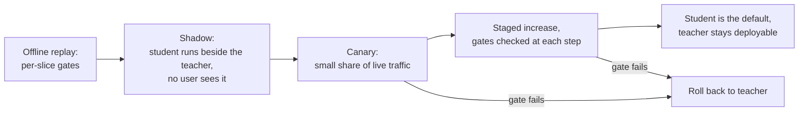

# 第 26 课：替换别人依赖的模型

**使命关联:** 本使命的终点，是信任你对一次蒸馏做出判断，而判断的一部分就是上线。与教师得分相当的学生，行为仍然不同，而下游的人是建立在教师的行为之上的，不是建立在它的得分之上。
**主要来源:** [论文：“Does Knowledge Distillation Really Work?”，Stanton 等，2021](https://arxiv.org/abs/2106.05945)，摘要以及第 4 节和第 5.1 节
**前置知识:** [第 22 课](0022-student-against-teacher.md)、[第 25 课](0025-reviewing-a-distillation-claim.md)、[保真度](../GLOSSARY.md)、[学生模型](../GLOSSARY.md)、[教师模型](../GLOSSARY.md)

## 热身

1. ▢ 第 14 课定义了暴露偏差。为什么它对长输出比对短输出更要紧？

<details markdown="1"><summary>检查</summary>

在教师写的前缀上训练的学生，在推理时会遇到自己先前的 token，而每一个早期的错误，都会把它带进从未训练过的状态。在长输出里，这种错误累积的机会更多，所以在短答案上与教师相符的学生，可能在长答案上跑偏。见[暴露偏差](../GLOSSARY.md)。

</details>

2. ▢ 第 22 课说，要把与教师的一致率和任务质量分开度量。为什么两个准确率相同的模型，仍然可能在许多输入上不一致？

<details markdown="1"><summary>检查</summary>

准确率数的是答对了多少，而不是答对了哪些。一个模型可以在另一个出错的地方答对，反之亦然，得失在平均值里相互抵消。[保真度](../GLOSSARY.md)直接度量这种不一致。

</details>

3. ▢ 第 10 课用教师的生成结果构建了一份指令数据集。是什么决定了学生对哪些输入见得很少？

<details markdown="1"><summary>检查</summary>

给生成器的提示词。学生是从教师在那些提示词上的行为中学习的，所以与它们不同的输入，就是学生见得最少的长尾，不论生成了多少次。

</details>

## 要点

### 依赖方所依赖的东西

调用你的教师的团队，所依赖的不只是它的准确率。他们为它的输出格式写了解析器，在它的置信度上调好了阈值，知道了它会拒绝哪些请求，并按它的延迟设定了超时。这些都不在标题分数里，而学生可以在所有这些方面都有所不同。

| 行为 | 学生为什么可能不同 | 如何检查 |
|---|---|---|
| 输出格式 | 学生是从教师输出的一个样本里学到格式的，所以罕见的变体可能缺失 | 对重放的输出运行依赖方自己的解析器 |
| 拒答 | Gudibande 等人发现，模仿模型继承了教师回避的习惯（他们的图 5，在 RealToxicityPrompts 上），但继承得有多紧，是另一个问题 | 在固定的提示词集上比较拒答率，并按主题切分 |
| 置信度 | 蒸馏方法会改变校准：MiniLLM 报告它的校准好于其基线（[论文](https://arxiv.org/abs/2306.08543)，摘要） | 检查依赖方在教师得分上调好的任何阈值 |
| 长输出 | 暴露偏差随长度增长（第 14 课） | 重放最长的真实请求 |
| 长尾输入 | 蒸馏集覆盖的是生成器所获得的提示词（第 10 课） | 按输入类型切分并比较 |
| 长度与延迟 | 每个 token 更快的学生，仍然可能产出更长的回答 | 在重放的流量上度量端到端时间 |

每一行都是要测试的东西，不是发现：本系列的来源展示了其中某些行的机制，并没有度量你的依赖方。在重放另有说法之前，把每一行当作假设。

### 学生与教师不一致，即使是好的学生

Stanton 等人发现，学生常常与它们的教师明显不同：教师与学生的预测分布之间，常常仍然存在惊人的巨大差异，即使学生本来可以完全匹配教师（摘要）。他们的设置大多是图像分类。在第 5.1 节（图 3）里，教师是 CIFAR-100 上由 ResNet-56 网络组成的 5 成员集成，最佳的增强策略只达到了 86% 的测试一致率，温度为 4 的基线达到 84.5%。他们还展示了一个文本案例，IMDB 上的 LSTM 分类器，模式相同（附录 C.4）。

这不是关于 LLM 聊天模型的结果，所以不要把某个百分比当作它来引用。可用的部分是方向：准确率与教师相同的学生，仍然会在一部分输入上改变答案，而你可以在自己的流量上度量这个比例。来看看算术，它是假设的：在 1,000 个请求里，教师答对 820 个，学生也答对 820 个，但有 90 个是教师对、学生错，另外 90 个则相反。准确率差距为零，而有 180 个答案，即 18%，变了。从对变成错的那些，就是依赖方会报告的那些。

### 逐切片检查与噪声下限

[上线与否](../../evals/reference/go-no-go.md)参考表给出了可以沿用的规则：在评测运行之前写下退步的阈值，并且不要比噪声下限更严。对 N 个样本上的通过率 p，标准误差约为 p 乘以 (1 减 p) 再除以 N 的平方根。一个 50 个样本、通过率为 0.8 的切片，标准误差约为 5.7 分，所以在这个切片上，3 分的退步阈值无法被诚实地执行。要么扩大切片，要么承认这个切片只能抓住大的退步，并在生产环境中盯着它。

在相同的样本上比较这两个模型，并数出不一致的个数，就像参考表里的成对比较那样。它需要的数据，比比较两个独立通过率要少。

### 上线



影子流量给你真实的输入，而用户不会接触到学生的错误，这是离线数据集给不了你的。它不提供标签，所以要靠与教师的一致率、依赖方的解析器和抽样审查来判断它。然后金丝雀让少数用户接触到它，以发现影子没能发现的东西。

有四个习惯能让上线变得安全。在每个阶段开始之前，就设定好每道关卡，就像上线与否参考表所说的。在金丝雀看到你关心的流量之前，让教师一直保持可部署，这样回滚就只是一次配置变更。把检查点、提示词模板、解码设置和服务栈作为一个整体来做版本管理，因为学生只有作为这个整体才是可复现的。指定一位能喊停的负责人。

量化系列的上线步骤，是针对另一种变更的同一套顺序，固定了基线，先影子后金丝雀：见它的[量化评审检查清单](../../quantization/reference/quantization-review-checklist.md)。对学生来说不同的是，这个模型是另一组权重，所以与教师的不一致更大，依赖方的测试也更要紧。

### 告知依赖你的人

说明改了什么、什么还没有度量、以及怎样退回去。一份可用的通知，会写明日期、两边的模型版本、有变动的切片及变动多少、你检查过的行为（格式、拒答、长度），以及教师还会保留可用多久。请依赖方在影子窗口期里重新运行他们自己的测试，并把退步报告给一位指定的人。什么都不说，就是让他们自己去发现这一变化，通常是在一次事故里。

## 练习

1. ▢ 教师和学生都在 1,000 个请求里答对了 820 个。在 90 个请求上，教师对、学生错，在 90 个上则相反。有多少个答案变了？为什么标题分数不该交给依赖方？

<details markdown="1"><summary>检查</summary>

180 个答案变了，占请求的 18%，而准确率的变化为零。分数把从对变成错的那 90 个请求平均掉了，而撞上其中一个的依赖方，会看到一次退步。要报告翻转的个数，以及它们落在哪些切片里。这里的数字是为了展示算术而编的。

</details>

2. ▢ 你为一次上线设定的关卡，是对一个 50 个请求、通过率接近 0.8 的切片设 3 分的退步上限。先预测这个切片的标准误差，再运行它。

    ```python
    from math import sqrt
    p, n = 0.8, 50
    print(f"{100 * sqrt(p * (1 - p) / n):.1f} points")
    ```

<details markdown="1"><summary>提示</summary>

公式是 p 乘以 (1 减 p) 再除以 N 的平方根。

</details>

<details markdown="1"><summary>检查</summary>

它打印 `5.7 points`。3 分的上限低于它，所以这个关卡是随机地触发或通过。要么扩大切片，直到标准误差远低于上限，要么放宽上限，并说明这个切片只能抓住大的退步。

</details>

3. ▢ 影子流量能给你什么是离线评测集给不了的？

    - a) 比教师更低的服务成本
    - b) 每个已记录请求的真实标签
    - c) 学生与教师相符的证明
    - d) 没有用户接触的真实生产输入

<details markdown="1"><summary>检查</summary>

**d)** 学生看到的是真实用户发来的输入，而返回的是教师的答案。(b) 是错的，因为记录下来的流量，除非你补上，否则没有标签。(c) 是错的，因为影子的证据是一个样本上的一致率，不是证明。(a) 是学生的属性，不是这种方法的属性。

</details>

4. ▢ 金丝雀处在 5% 的流量上，某个切片的错误率翻了一倍。你对教师的部署做什么？你告诉依赖方什么？

<details markdown="1"><summary>检查</summary>

让教师保持完整部署，并把金丝雀那部分流量路由回它，这就是它一直保持可部署的原因。告诉依赖方金丝雀已被撤回、哪个切片变动了、变动了多少，以及在下一次尝试之前你会改什么。没有通知的回滚，会让他们自己重新发现这个问题。

</details>

5. ▢ 学生是从团队为主要聊天用途写的 20,000 个提示词蒸馏出来的。哪些依赖方的风险最大？在金丝雀之前你要运行什么？

<details markdown="1"><summary>检查</summary>

输入与这些提示词不同的依赖方：另一种语言、长文档、不常见的格式、由代码解析的结构化输出。第 10 课的要点是，学生的覆盖范围就是生成器的提示词。把每个依赖方自己最近的请求，在影子中分别通过教师和学生重放，按依赖方逐个比较，而不是合并在一起。

</details>

## 实战练习

- [ ] 挑一个你们团队所依赖的模型，列出下游用户所依赖、却不在任何基准分数里的三种行为，比如输出格式、拒答模式或延迟预算。
- [ ] 在做任何改动之前，为其中一种行为写一道关卡，带上阈值、切片大小和那个大小下的标准误差。
- [ ] 明天：用最后一节里的五项内容，起草用一个更小的模型替换那个模型的依赖方通知，并发给一个人审阅。

## 延伸阅读

- [蒸馏评审检查清单](../reference/distillation-review-checklist.md)
- [评测：上线与否](../../evals/reference/go-no-go.md)
- [量化评审检查清单](../../quantization/reference/quantization-review-checklist.md)
- [论文：“Does Knowledge Distillation Really Work?”，Stanton 等，2021](https://arxiv.org/abs/2106.05945)
- [论文：“The False Promise of Imitating Proprietary LLMs”，Gudibande 等，2023](https://arxiv.org/abs/2305.15717)
- [论文：“MiniLLM: On-Policy Distillation of Large Language Models”，Gu 等，2023](https://arxiv.org/abs/2306.08543)
- [资源](../RESOURCES.md)

---

没学明白？请重读顶部的主要来源，因为本课是对它的压缩，而理解正是在压缩中流失的。如果有哪个术语觉得含糊，可以查看[术语表](../GLOSSARY.md)。

如果问题出在课程本身，而不是学习材料，那就是一个缺陷：[提交 issue](https://github.com/TokenCemetery/teach/issues)。
