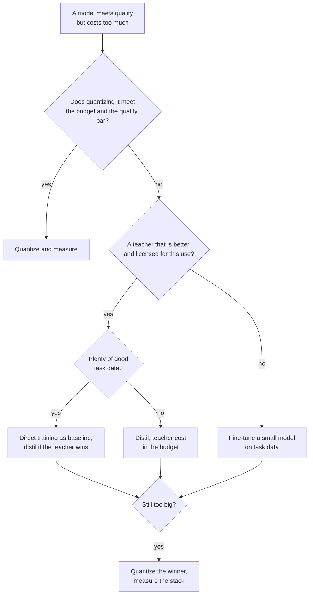

# Lista de revisión de destilación: elegir, revisar y desplegar

La etapa 9 comprimida para consulta. La [lección 24](../lessons/0024-distill-quantize-or-fine-tune.md) cubre la elección entre las tres palancas, la [lección 25](../lessons/0025-reviewing-a-distillation-claim.md) cubre la revisión de una afirmación, la [lección 26](../lessons/0026-replacing-a-model-others-depend-on.md) cubre el despliegue, y la [lección 27](../lessons/0027-when-the-usual-answer-is-wrong.md) cubre cuándo la respuesta habitual es incorrecta y cómo resolver una disputa desde la fuente.

## Elegir entre las palancas

Pregunta en este orden. Cada pregunta elimina opciones antes de la siguiente.

| # | Pregunta | Si sí | Si no |
|---|---|---|---|
| 1 | ¿El modelo cabe en el presupuesto tal como está? | Déjalo como está | Continúa |
| 2 | ¿Cuantizarlo cumple el presupuesto y el listón de calidad? | Cuantiza, luego mide frente al original ([Lista de revisión de cuantización](../../quantization/reference/quantization-review-checklist.md)) | Continúa |
| 3 | ¿Hay un profesor claramente mejor que un modelo pequeño en tu tarea, y puedes entrenar con sus salidas? | Continúa | Haz fine-tuning de un modelo pequeño con tus datos de la tarea ([Fine-tuning con adapters](../../finetuning/)) |
| 4 | ¿Hay muchos buenos datos de la tarea? | Entrena directamente el modelo pequeño como baseline, destila solo si el profesor lo supera | Destila, con el costo del profesor contado |
| 5 | ¿Sigue siendo demasiado grande? | Cuantiza al ganador y mide la pila | Hecho |

## Qué dice la evidencia, y sus límites

| Hallazgo | Fuente | Límite |
|---|---|---|
| La destilación no puede superar al entrenamiento supervisado con suficiente cómputo o tokens del estudiante, y gana dentro de un presupuesto que crece con el tamaño del estudiante | Busbridge et al., resumen y sección 1 | Modelos de lenguaje en C4, entropía cruzada |
| Con un estudiante y un profesor que hay que entrenar, el aprendizaje supervisado suele ser preferible | Busbridge et al., resumen | Igual |
| El SFT con 800,000 muestras de R1 superó a más de 10K pasos de RL en Qwen2.5-32B: AIME 2024 pass@1 72.6 frente a 47.0 | Paper de DeepSeek-R1, apéndice F.1, Tabla 16 | Un base model, sin brazo de SFT con datos humanos |
| Podar 15B y luego destilar: 40 veces menos tokens por modelo derivado, ahorro de 1.8 veces para la familia | Minitron, resumen y apéndice | Una familia, un 15B ya entrenado |
| 4B podado y destilado: MMLU 37.81 frente a 24.36 de la inicialización aleatoria | Minitron Tabla 11 | 100B frente a 150B de tokens con el mismo cómputo, una familia |
| Los estudiantes a menudo discrepan de los profesores incluso pudiendo igualarlos | Stanton et al., resumen | Sobre todo clasificación de imágenes |
| Modelos de imitación valorados cerca de ChatGPT por evaluadores, poca brecha cerrada en tareas sin respaldo | Gudibande et al., secciones 4.2 a 4.4 | Imitar a ChatGPT, modelos de hasta 13B |

## Preguntas para la afirmación de otra persona

| Parte de la afirmación | Pregunta |
|---|---|
| "Conserva X%" | ¿Una razón de qué, sobre qué suite, frente a qué profesor? Recalcúlala a partir de la tabla (DistilBERT: 77.0 entre 79.5 es 96.9%, con CoLA al 91.1% y RTE al 86.4%) |
| Tareas | ¿El promedio oculta las tareas débiles? |
| Población | ¿Held-out, o de la distribución de destilación? |
| Baseline | ¿El profesor, un modelo del mismo tamaño entrenado sin él, el base model? |
| Contaminación | ¿Qué mantuvo las entradas de prueba fuera de los prompts de destilación? |
| Evaluador | ¿Humanos, un modelo juez o una métrica, y podían comprobar hechos? |
| Decodificación | ¿Voraz o muestreada, la misma para ambos modelos? |
| Ruido | ¿Cuántas semillas, y cuán grande es la brecha frente a la dispersión? |
| Costo | ¿Se cuentan la inferencia del profesor, la generación de datos y el filtrado? |

Di también qué está bien y debe quedarse. Una revisión que solo enumera fallos está a medias. Enuncia cada parte oculta como un costo y nombra la medición que lo resolvería, con su precio.

## Desplegar un estudiante

| Paso | Qué hacer |
|---|---|
| Fijar el baseline | Nombra el checkpoint del profesor, el harness y el conjunto de prompts, y sigue sirviéndolo |
| Eval offline | Precisión, acuerdo con el profesor y respuestas que cambian, por segmento |
| Fijar los umbrales | Límites escritos antes de la ejecución, no más estrictos que el error estándar ([Go/No-Go](../../evals/reference/go-no-go.md)) |
| Comprobar en qué se apoyan los dependientes | Formato de salida con sus propios parsers, tasa de rechazo, umbrales de confianza, salidas largas, entradas de cola larga, latencia |
| Shadow | El estudiante corre junto al profesor, ningún usuario lo ve, juzgar por acuerdo y revisión de muestras |
| Canary, luego por etapas | Una pequeña parte del tráfico en vivo, umbrales comprobados en cada paso |
| Versión | Checkpoint, plantilla de prompt, ajustes de decodificación y stack de serving juntos |
| Rollback | El profesor sigue siendo desplegable hasta que el canary haya visto el tráfico que te importa |
| Avisar a los dependientes | Fecha, versiones a ambos lados, segmentos que se movieron, comportamientos comprobados, cuánto tiempo seguirá el profesor |

## Cuando la respuesta habitual es incorrecta

| Respuesta habitual | Es incorrecta cuando | Fuente |
|---|---|---|
| Destila el modelo grande | Ningún profesor supera al estudiante en tu tarea | Paper de R1 apéndice F.1, Gudibande et al. |
| Usa el mejor profesor | Los términos o la licencia lo prohíben | Terms of Use de OpenAI, licencia de Llama 3.1: lee el texto vigente |
| Un profesor mayor es mejor | Brecha de capacidad: error del estudiante de ImageNet 30.24 desde cero, 30.57, 30.79 y 30.95 con profesores de error 30.24, 26.70 y 23.85 | Cho y Hariharan Tabla 1 |
| El estudiante puede absorberlo | La tarea necesita conocimiento que no puede contener | Gudibande et al. |
| Haz fine-tuning con salidas del profesor | El entrenamiento on-policy rinde mejor | Agarwal et al. secciones 4.1 y 4.3 |
| La KL directa es estándar | La métrica es la calidad del seguimiento de instrucciones, no la pérdida sobre texto | Busbridge et al. Tabla 7, Minitron Tabla 16, MiniLLM, Agarwal et al. sección 4.4 |
| Destila, no cuantices | Cuantizar cumple el presupuesto | [Lista de revisión de cuantización](../../quantization/reference/quantization-review-checklist.md) |

## Resolver una disputa desde la fuente

1. Encuentra el paper, no la publicación que lo cita.
2. Comprueba los modelos, los tamaños y el año.
3. Comprueba qué se midió frente a lo que se afirmó.
4. Lee el montaje detrás de la tabla: baselines, ensayos, cómo se eligió el número informado.
5. Compara la brecha con el ruido entre ejecuciones.
6. Ejecútalo en tu propia tarea.
