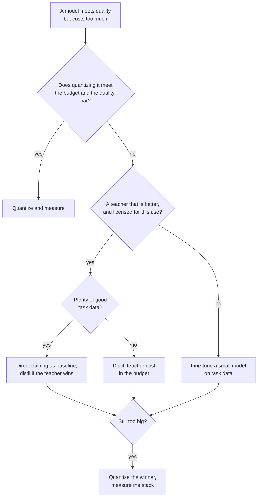

# Liste de contrôle de relecture d'une distillation : choisir, relire et déployer

L'étape 9 condensée pour la consultation. La [leçon 24](../lessons/0024-distill-quantize-or-fine-tune.md) couvre le choix entre les trois leviers, la [leçon 25](../lessons/0025-reviewing-a-distillation-claim.md) la relecture d'une affirmation, la [leçon 26](../lessons/0026-replacing-a-model-others-depend-on.md) le déploiement, et la [leçon 27](../lessons/0027-when-the-usual-answer-is-wrong.md) les cas où la réponse habituelle est fausse et la manière de trancher un différend à partir de la source.

## Choisir entre les leviers

Posez les questions dans cet ordre. Chaque question écarte des options avant la suivante.

| # | Question | Si oui | Si non |
|---|---|---|---|
| 1 | Le modèle tient-il dans le budget tel quel ? | Le laisser tel quel | Continuer |
| 2 | Le quantifier tient-il dans le budget et atteint-il la barre de qualité ? | Quantifier, puis mesurer par rapport à l'original ([liste de contrôle de relecture de la quantification](../../quantization/reference/quantization-review-checklist.md)) | Continuer |
| 3 | Existe-t-il un enseignant nettement meilleur qu'un petit modèle sur votre tâche, et avez-vous le droit d'entraîner sur ses sorties ? | Continuer | Faire le fine-tuning d'un petit modèle sur vos données de tâche ([parcours de fine-tuning](../../finetuning/)) |
| 4 | Y a-t-il beaucoup de bonnes données de tâche ? | Entraîner directement le petit modèle comme référence, ne distiller que si l'enseignant le bat | Distiller, avec le coût de l'enseignant compté |
| 5 | Encore trop gros ? | Quantifier le gagnant et mesurer l'empilement | Terminé |

## Ce que disent les preuves, et leurs limites

| Constat | Source | Limite |
|---|---|---|
| La distillation ne peut pas battre l'entraînement supervisé avec assez de calcul ou de tokens pour l'élève, et gagne dans un budget qui croît avec la taille de l'élève | Busbridge et al., résumé et section 1 | Modèles de langage sur C4, entropie croisée |
| Avec un seul élève et un enseignant à entraîner, l'apprentissage supervisé est généralement préférable | Busbridge et al., résumé | Idem |
| Le SFT sur 800,000 échantillons de R1 a battu plus de 10K pas de RL sur Qwen2.5-32B : AIME 2024 pass@1 72.6 contre 47.0 | Article DeepSeek-R1, annexe F.1, tableau 16 | Un base model, pas de bras SFT sur données humaines |
| Élaguer le 15B puis distiller : 40 fois moins de tokens par modèle dérivé, 1.8 fois d'économie pour la famille | Minitron, résumé et annexe | Une famille, un 15B déjà entraîné |
| 4B élagué et distillé : MMLU 37.81 contre 24.36 pour l'initialisation aléatoire | Minitron, tableau 11 | 100B contre 150B tokens à calcul égal, une famille |
| Les élèves sont souvent en désaccord avec leurs enseignants même quand ils peuvent les égaler | Stanton et al., résumé | Surtout de la classification d'images |
| Modèles d'imitation jugés proches de ChatGPT par des évaluateurs, peu d'écart comblé sur les tâches non soutenues | Gudibande et al., sections 4.2 à 4.4 | Imitation de ChatGPT, modèles jusqu'à 13B |

## Questions pour l'affirmation de quelqu'un d'autre

| Partie de l'affirmation | Demander |
|---|---|
| « Conserve X % » | Un rapport de quoi, sur quelle suite, face à quel enseignant ? Recalculez-le à partir du tableau (DistilBERT : 77.0 sur 79.5 fait 96.9 %, avec CoLA à 91.1 % et RTE à 86.4 %) |
| Tâches | La moyenne cache-t-elle les tâches faibles ? |
| Population | Held-out, ou issue de la distribution de distillation ? |
| Référence | L'enseignant, un modèle de même taille entraîné sans lui, le base model ? |
| Contamination | Qu'est-ce qui a tenu les entrées de test hors des prompts de distillation ? |
| Évaluateur | Des humains, un modèle juge ou une métrique, et pouvaient-ils vérifier les faits ? |
| Décodage | Glouton ou échantillonné, le même pour les deux modèles ? |
| Bruit | Combien de graines, et quelle est la taille de l'écart par rapport à la dispersion ? |
| Coût | Inférence de l'enseignant, génération des données et filtrage comptés ? |

Dites aussi ce qui est bien et doit rester. Une relecture qui ne liste que des fautes est à moitié faite. Énoncez chaque partie cachée comme un coût et nommez la mesure qui trancherait, avec son prix.

## Déployer un élève

| Étape | Que faire |
|---|---|
| Épingler la référence | Nommer le checkpoint de l'enseignant, le harness et le jeu de prompts, et continuer à le servir |
| Eval hors ligne | Précision, accord avec l'enseignant et réponses basculées, par tranche |
| Fixer les barrières | Seuils écrits avant le run, pas plus serrés que l'erreur standard (fiche [Go/No-Go](../../evals/reference/go-no-go.md)) |
| Vérifier ce sur quoi les dépendants s'appuient | Format de sortie avec leurs propres parseurs, taux de refus, seuils de confiance, longues sorties, entrées de longue traîne, latence |
| Shadow | L'élève tourne à côté de l'enseignant, aucun utilisateur ne le voit, juger par l'accord et une revue par échantillonnage |
| Canary, puis par étapes | Une petite part du trafic réel, barrières vérifiées à chaque étape |
| Versionner | Checkpoint, gabarit de prompt, réglages de décodage et pile de service ensemble |
| Retour en arrière | L'enseignant reste déployable jusqu'à ce que le canary ait vu le trafic qui vous importe |
| Prévenir les dépendants | Date, versions des deux côtés, tranches qui ont bougé, comportements vérifiés, combien de temps l'enseignant reste |

## Quand la réponse habituelle est fausse

| Réponse habituelle | Fausse quand | Source |
|---|---|---|
| Distillez le grand modèle | Aucun enseignant ne bat l'élève sur votre tâche | Article R1, annexe F.1, Gudibande et al. |
| Utilisez le meilleur enseignant | Les conditions ou la licence l'interdisent | Terms of Use d'OpenAI, licence Llama 3.1 : lisez le texte actuel |
| Un enseignant plus grand est meilleur | Écart de capacité : erreur de l'élève ImageNet 30.24 de zéro, 30.57, 30.79 et 30.95 sous des enseignants d'erreur 30.24, 26.70 et 23.85 | Cho et Hariharan, tableau 1 |
| L'élève peut l'absorber | La tâche exige une connaissance qu'il ne peut pas contenir | Gudibande et al. |
| Fine-tuning sur les sorties de l'enseignant | L'entraînement on-policy fait mieux | Agarwal et al., sections 4.1 et 4.3 |
| La KL directe est standard | La métrique est la qualité de suivi d'instructions, pas la loss sur du texte | Busbridge et al., tableau 7, Minitron, tableau 16, MiniLLM, Agarwal et al., section 4.4 |
| Distiller, pas quantifier | La quantification tient dans le budget | [Liste de contrôle de relecture de la quantification](../../quantization/reference/quantization-review-checklist.md) |

## Trancher un différend à partir de la source

1. Trouvez l'article, pas le billet qui le cite.
2. Vérifiez les modèles, les tailles et l'année.
3. Vérifiez ce qui a été mesuré par rapport à ce qui a été affirmé.
4. Lisez le montage derrière le tableau : références, essais, comment le nombre rapporté a été choisi.
5. Comparez l'écart avec le bruit d'un run à l'autre.
6. Exécutez-le sur votre propre tâche.
